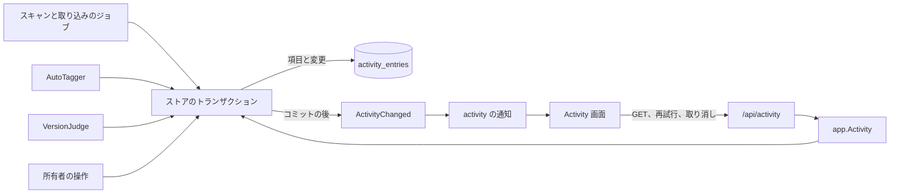
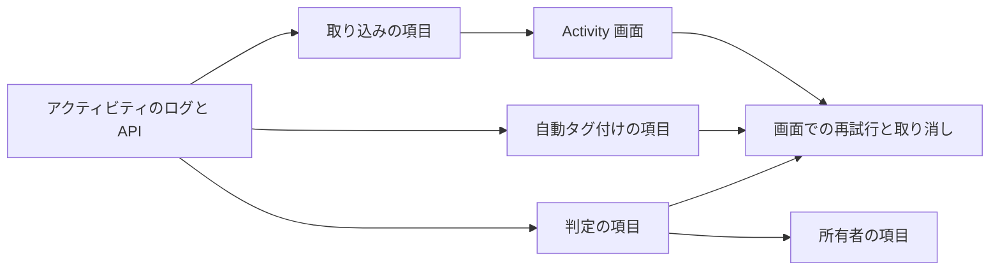

# 実装計画: Activity {#implementation-plan-activity}

**ブランチ**: `feature/055-activity` | **親 Issue**: #1225

**入力**: 親 Issue。これがこの機能の仕様である。

## 概要 {#summary}

vv が動画か組に対して動かすすべての処理 (取り込み、自動タグ付け、重複の判定、作品情報の取得、失敗したスキャン) と、動画のタグかバージョンのまとまりを変える所有者のすべての操作は、その変更と同じトランザクションでアクティビティの項目を書く。所有者だけの Activity 画面は項目を新しい順に一覧し、状態で絞り込み、`activity` の通知で更新し、当てはまるところで開く、再試行、取り消しを示す。

| 関心事 | 方針 |
| --- | --- |
| 保存 | ユーザーデータのテーブル 1 つ、`activity_entries`。消去しない。メモリ上のスキャンのアクティビティとは別に「アクティビティの項目」と呼ぶ ([R-1](research.md#r-1-a-persistent-activity-log-named-apart-from-the-scan-activity)) |
| 書き込み | 変更のストアのトランザクションの中で、1 つのヘルパーを通して書く ([R-2](research.md#r-2-an-entry-is-written-in-the-transaction-of-the-change-it-records)) |
| 粒度 | 実行と対象ごとに 1 つの項目。取り込みは 5 つの段階で 1 つの項目。スキャンは失敗したときだけで、次の成功したスキャンが閉じる ([R-3](research.md#r-3-one-entry-per-run-and-subject-an-import-is-one-entry-for-all-its-stages)) |
| 状態 | `running` / `attention` / `done` と、理由か結果。新しい実行が古い問題を閉じる。起動時に、取得済みの項目を `interrupted` にする。重複の組は再試行を通して 1 つの項目を保つ ([R-4](research.md#r-4-three-statuses-with-a-reason-and-a-newer-run-closes-an-older-problem)) |
| 決定者 | 確率が決めたときは `ai`、固定の規則と自動のきっかけには `rule`、依頼には `owner` ([R-5](research.md#r-5-the-decider-is-who-made-the-recorded-decision-else-who-started-the-run)) |
| 所有者の操作 | タグとバージョンのまとまりの変更と、メディアフォルダの削除。グループ、プレイリスト、タグの定義、サムネイルの編集は含まない ([R-6](research.md#r-6-the-owner-operations-recorded)) |
| 取り消し | 状態がまだ成り立つときは元に戻し、除外は常に記録する ([R-7](research.md#r-7-undo-restores-the-state-and-always-records-the-exclusion)) |
| ライブ更新 | `activity` の通知で取得し直す ([R-8](research.md#r-8-the-screen-refreshes-on-an-activity-notification)) |
| ページング | id によるキーセット、`status` の絞り込み、ページの中の件数 ([R-9](research.md#r-9-keyset-paging-by-id-newest-first-filtered-by-status)) |
| 対象 | 書いた時点のラベルを保つ内容の鍵 ([R-10](research.md#r-10-the-subject-is-a-content-key-with-a-label-kept-at-write-time)) |
| 作品情報の取得 | 失敗した取得は終わった項目であり、再試行する問題ではない ([R-11](research.md#r-11-a-failed-work-information-fetch-is-a-finished-entry-not-a-problem)) |

## 仕組み {#how-it-works}

図は、項目がどこで書かれ、画面がそれをどう読むかを示す。



1. **実行は、キューに入るときに項目を開く。** 動画の取り込みのジョブ、自動タグ付け、判定できる候補をキューに入れると、理由が `waiting` の `running` の項目を書き、キューの行がその id を保つ。取得は理由を `processing` にする。
2. **終わると同じ項目を更新する。** 実行を終えるか失敗させるストアのメソッドが、項目を `done` か `attention` にし、決定者と、分類器の決定については確率を記す。
3. **所有者の操作は `done` の項目を書く**。書くのは操作のトランザクションの中である。
4. **再試行は `app.Activity` を通り**、それが種類ごとに既存のユースケース (再プローブ、手動のスキャン、自動タグ付けのキュー、判定の再試行) へ振り分け、関係するワーカーを起こす。
5. **取り消しは 1 つの `ActivityStore` のトランザクションであり**、対象の状態を読み直し、`Unbundle`、`Dismiss`、タグの却下のパッケージ内の手順を再利用し、除外を記録し、所有者の `undo` の項目を書く。`app.Activity` はその後にワーカーを起こすだけである ([R-7](research.md#r-7-undo-restores-the-state-and-always-records-the-exclusion))。

| 受け入れ条件 (親 Issue) | 満たす場所 |
| --- | --- |
| 1. 取り込み、自動タグ付け、自動のまとめの行と、決定者と確率 | `import`、`auto_tag`、`version_judgement` の項目 |
| 2. 所有者のまとめ、まとまりから外す操作、タグを外す操作の行 | 所有者の操作の項目 ([R-6](research.md#r-6-the-owner-operations-recorded)) |
| 3. 接続がなく、その後同じ行に結果が出る | `version_judgement` は組ごとに 1 つの項目を保つ |
| 4. 再試行は実行中を経て新しい結果になる | `POST /api/activity/{id}/retry` は新しい項目を開く。重複の組の項目は代わりに `running` に戻る ([R-4](research.md#r-4-three-statuses-with-a-reason-and-a-newer-run-closes-an-older-problem)) |
| 5. まとめ、タグ、「別」の取り消し | [R-7](research.md#r-7-undo-restores-the-state-and-always-records-the-exclusion) |
| 6. タブが件数と一致する | 1 回の読み取りからの `status` の絞り込みと `counts` (`running`、`attention`、`done`) |
| 7. 再読み込みなしで新しい行が出る | `activity` の通知 |
| 8. ゲスト | 所有者だけのルートと操作 |

## 技術的な文脈 {#technical-context}

**正本の定義**:

| 項目 | 出典 |
| --- | --- |
| 境界、ストアの役割、コミットの後のイベント、ユーザーデータ | [ARCHITECTURE.md](../../ARCHITECTURE.md)、[.golangci.yml](../../.golangci.yml) (depguard) |
| 取り込みのジョブと取り込みの問題 | [020 データモデル](../020-seek-thumbnail-stage/data-model.md)、[024 の調査](../024-import-progress/research.md) |
| 自動タグ付けのキュー、提案したタグ、却下 | [auto-tagging.md](../../docs/design-docs/auto-tagging.md) |
| 重複の判定、まとまりから外した組 | [duplicate-judging.md](../../docs/design-docs/duplicate-judging.md)、[054 データモデル](../054-auto-dup/data-model.md) |
| 起動時の回復 | [process-lifecycle.md](../../docs/design-docs/process-lifecycle.md) |
| 所有者だけのアクセス | [016 auth-api.md](../016-single-account-auth/contracts/auth-api.md) |
| 画面の API と生成コード | [api/openapi.yaml](../../api/openapi.yaml)、`task generate` |
| 画面と Web のテスト | [design-system.md](../../docs/design-docs/design-system.md)、[web-testing.md](../../docs/design-docs/web-testing.md)、[i18n.md](../../docs/design-docs/i18n.md) |
| 検査 | [Taskfile.yml](../../Taskfile.yml) (`task check`、`task check-docs`) |

**この機能に固有の文脈**: ほかの feature ブランチもマイグレーションを加えるので、マイグレーションは、その単位を書く時点の `main` の次の番号を取る。画面のレイアウト、行の構成、シェルの入口は `design` 段階のもの (`ui-design.md`) である。

## 憲章の確認 {#constitution-check}

ARCHITECTURE.md、core-beliefs.md、AGENTS.md に照らして確認した。この設計が拠る規則は次のとおりである:

| 規則 | 設計がそれを満たす方法 |
| --- | --- |
| ドメインが決め、ストアが強制する | 状態の遷移、取り込みの集約、置き換え、再試行と取り消しの可否は `internal/domain` にある。ストアは取り消しのトランザクションの中で対象の状態を読み直す |
| 役割はほかの役割のメソッドを呼ばない | 項目は、各役割のトランザクションの中でパッケージ内のヘルパーが書く。`ActivityStore` は一覧、再試行、取り消しだけをする |
| コミットの後のイベント | `ActivityChanged` は、項目を書いたトランザクションの後に発行する |
| ユーザーデータは作り直しを越えて残る | 項目と保留は内容の鍵をキーとし、`videos` への外部キーを持たない |
| すべての読み取りは閲覧者を知っている | `GET /api/activity` は所有者だけである。`subject.videoIds` は、所有者を閲覧者とする読み取りから来る |
| 複雑度 25 と、コードを写さないこと | 再試行と取り消しは、種類ごとに既存のユースケースへ振り分ける。まとめの取り消しは `VersionStore.Unbundle` の手順である |

判定: 違反はない。

## プロジェクトの構成 {#project-structure}

### 文書 (この機能) {#documentation-this-feature}

```text
specs/055-activity/
├── plan.md
├── research.md            # R-1..R-11
├── data-model.md          # Three tables, three activity_id columns, the rules
└── contracts/
    └── screen-api.md      # /api/activity, retry, undo, the activity notification
```

`quickstart.md` はない: どの受け入れ条件にも、偽の分類器を使うストア、ハンドラー、Web、e2e のテストで到達するので、独自の手作業の実行はない。`design` 段階が `ui-design.md` を加える。

### ソースコード {#source-code}

**影響する境界**:

| パッケージ | 変更 |
| --- | --- |
| `internal/domain` | 項目の型、種類、状態、取り込みの集約、置き換え、再試行と取り消しの可否、`ActivityChanged`。`AutoTagSelection` の確率 |
| `internal/store` | マイグレーション、項目のヘルパー、`ActivityStore` (一覧、件数、再試行、取り消し)、[data-model.md、種類](data-model.md#kinds) のすべての書き込み箇所での項目、起動時の回復、`judgeablePairs` と引き継ぎでの保留 |
| `internal/app` | `Activity` のユースケース (再試行の振り分け、ワーカーを起こす処理)。`AutoTagger`、`Scans`、作品情報の取得が決定者と確率を渡す。取り込みのキューのポートが決定者を受け取る |
| `internal/httpapi`、`api/openapi.yaml` | 3 つの操作と `activity` の通知 |
| `cmd/mdm` | `events.go` での `Activity` と通知の配線 |
| `web/src/activity` (新規)、`web/src/app`、`web/src/shell`、`web/src/auth` | 画面、そのルート、シェルの入口、`ownerOnlyPath` |

**新しいパス**: `internal/store/activity.go`、`internal/app/activity_log.go` (`activity.go` はスキャンのアクティビティである)、`web/src/activity/`、`docs/design-docs/activity.md`。

**構成の判断**: `ActivityStore` は独自の役割である。書き込みはそのメソッドではなく、記録するすべての役割が自分のトランザクションの中で呼ぶヘルパーなので、記録が役割をまたぐことはない。

## 実装作業 {#implementation-work}

図は、どの単位が先に入る必要があるかを示す。画面の単位は `design` 段階の `ui-design.md` も待つ。



### アクティビティの項目を保存し、画面の API で一覧する {#store-activity-entries-and-list-them-in-the-screen-api}

**範囲**: マイグレーション ([data-model.md](data-model.md))。ドメインの型、状態、置き換えと可否の規則。項目のヘルパーと `ActivityChanged`。`ActivityStore` の一覧と件数。起動時の `interrupted` への回復。`GET /api/activity`、どの種類にも `409` を応答する空の再試行と取り消しのルート、`activity` の通知 ([contracts/screen-api.md](contracts/screen-api.md))。振り分けの表を持つ `app.Activity`。索引からリンクする `docs/design-docs/activity.md`、サブシステムの地図の行、ARCHITECTURE.md と running-vv.md のユーザーデータの一覧 (新しい 3 つのテーブルすべて)、process-lifecycle.md の回復の手順。

**依存**: なし。

**受け入れ**: `task check` と `task check-docs` が通り、`task generate` で差分が出ない。ストアのテストが次を示す: 項目は新しい順に返る。`status`、`feature`、`decider`、`since`、`q` はそれぞれ一覧を絞り込む。`counts` は `status` を無視し、`features` は `feature` を無視し、どちらもほかの絞り込みに従う。`undo` の項目は、取り消された項目の機能の下に一覧される。カーソルは、項目が加わる間も重複なく続く。新しい項目は、同じ種類と対象の古い `attention` の項目を置き換える。`running` の項目は回復の後に `attention`/`interrupted` になる。ハンドラーのテストが次を示す: ゲストは 3 つの操作すべてから `401 unauthenticated` を受け取り、項目が書かれた後に所有者の流れが `activity` を受け取る。

### 取り込みと失敗したスキャンを記録し、再試行する {#record-imports-and-failed-scans-and-retry-them}

**範囲**: 未完了のジョブがない動画の取り込みのジョブをキューに入れるときに開く `import` の項目、ジョブの `activity_id`、各ジョブの終了での集約、取り込みのキューのポートを通した、スキャンの起点による決定者。失敗したスキャンの `scan` の項目と、次の成功したスキャンがそれを閉じること。両方の再試行 ([R-3](research.md#r-3-one-entry-per-run-and-subject-an-import-is-one-entry-for-all-its-stages)、[R-5](research.md#r-5-the-decider-is-who-made-the-recorded-decision-else-who-started-the-run))。

**依存**: アクティビティの項目を保存し、画面の API で一覧する。

**受け入れ**: `task check` が通る。ストアのテストが次を示す: 新しいファイルは 1 つの `import` の項目を与え、その項目は指紋のジョブが終わるまで `running` で、その後 `done` になる。諦めた段階は項目を `attention`/`failed` にし、その段階を `stage` に、そのメッセージを `detail` に入れる。同じファイルの再スキャンは 2 つ目の項目を開く。再起動で中断された項目は、キューに戻ったそのジョブが動くときに置き換えられる。ハンドラーのテストが、失敗した取り込みの再試行は `202` を応答し、新しい `running` の項目が続くことを示す。失敗したスキャンの再試行は手動のスキャンを始め、それが `done` で終わると `scan` の項目は `superseded` になる。再起動で中断されたスキャンは項目を書かない。

### 自動タグ付けの実行を記録し、それが加えたタグを取り消す {#record-auto-tagging-runs-and-undo-the-tags-they-added}

**範囲**: `AutoTagSelection` の確率。キューに入るときに開く `auto_tag` の項目、`activity_entry_tags` にあるそのタグ、失敗したときの `attention`/`failed`。再試行。`auto_tag_rejections` を通したタグごとの取り消し。auto-tagging.md の項目と取り消し ([R-7](research.md#r-7-undo-restores-the-state-and-always-records-the-exclusion))。

**依存**: アクティビティの項目を保存し、画面の API で一覧する。

**受け入れ**: `task check` が通る。偽の分類器を使うアプリとストアのテストが次を示す: 0.91 でタグを 1 つ加え、0.6 で 1 つを提案する実行は、両方をその確率と決定者 `ai` とともに一覧する。加えたタグの取り消しは、まとまりのすべてのメンバーからそれを外し、却下を記録し、所有者の `undo` の項目を書き、その後の "Tag all again" はそれを加えない。所有者がタグを外した後の取り消しは `already_reverted` を応答し、どのタグも変えない。所有者がタグを外して手でもう一度付けた後の取り消しも同じであり、所有者の付与を残す。失敗した実行の再試行は動画をキューに入れ、機能がオフの間は `409 auto_tagging_off` を応答する。

### 重複の判定を記録し、自動のまとめと自動で退けた組を取り消す {#record-duplicate-judgements-and-undo-automatic-bundles-and-dismissals}

**範囲**: 判定できる候補ごとの (判定がオンにされたときは待っている候補についても) `version_judgement` の項目、候補の判定に従うその状態、結果の決定者と確率、`decided_by_owner` か `gone` として閉じること、候補の作り直しでの付け直し。確率と、加わった側の鍵を保つ `ApplyJudgement`。`video_version_judging_holds` と、取得と引き継ぎでのその使い方。失敗した組の再試行。`same` と `different` の取り消し。duplicate-judging.md の保留と項目、054 data-model.md の取得の規則 ([R-4](research.md#r-4-three-statuses-with-a-reason-and-a-newer-run-closes-an-older-problem)、[R-7](research.md#r-7-undo-restores-the-state-and-always-records-the-exclusion))。

**依存**: アクティビティの項目を保存し、画面の API で一覧する。

**受け入れ**: `task check` が通る。ストアとアプリのテストが次を示す: 接続が保存されていないときにモデルが要る組は `attention`/`no_connection` であり、接続が保存されて偽の分類器が 0.9 と答えた後、同じ項目は決定者 `ai`、確率 0.9 の `done`/`same` になる。フレームの規則によるまとめは決定者が `rule` である。自動のまとめの取り消しは、加わった動画をまとまりから外し、その組は二度と取得されない。自動で退けた組の取り消しは、組を `GET /api/version-candidates` に戻し、ワーカーはそれを決して取得しない。所有者がまとまりから外した後の取り消しは `already_reverted` を応答する。`undecided` の組を手でまとめると、その項目は `decided_by_owner` として閉じる。1 つの鍵の候補を作り直しても、組の項目は保たれる。所有者のまとまり {B1, B2} (代表 B1) とまとまり {A, C} の自動のまとめの取り消しは、{B1, B2} を代表 B1 のまま、{A, C} を元のまま残し、`video_version_unbundles` は 2 つの側にまたがる組についてだけ記録する。

### 所有者のタグとバージョンの操作を記録する {#record-the-owners-tag-and-version-operations}

**範囲**: [R-6](research.md#r-6-the-owner-operations-recorded) の操作についての所有者の項目を、そのストアの書き込み箇所で書く。ドラッグでの整理、外部 API のタグの変更、整理の取り消し、メディアフォルダの削除を含む。`work_info_fetch` と `work_info_apply` の項目 ([R-11](research.md#r-11-a-failed-work-information-fetch-is-a-finished-entry-not-a-problem))。

**依存**: 重複の判定を記録し、自動のまとめと自動で退けた組を取り消す (所有者のバージョンの操作は、その書き込み箇所を共有する)。

**受け入れ**: `task check` が通る。ストアのテストが次を示す: まとめる、バージョンから外す、代表にする、タグを付ける、タグを外す、提案したタグを残す、却下する、作品情報を適用する、はそれぞれ動画ごとに決定者 `owner` の `done` の項目を 1 つ書き、"Different videos" は組の項目を 1 つ書く。3 本の動画に付けたタグは 3 つの項目を書く。ドラッグでの整理で 3 本の動画をまとめると 3 つの項目を書き、その取り消しはそれらについて `organize_undo` の項目を書く。`/api/v1` を通して付けたタグは所有者の項目を書く。メディアフォルダの削除は、動画の数を持つ `media_folder_remove` の項目を 1 つ書く。失敗した取得は、プラグインのメッセージとともに `done`/`failed` を書く。プレイリストの並べ替えは何も書かない。

### 所有者だけの Activity 画面にアクティビティのログを示す {#show-the-activity-log-on-an-owner-only-activity-screen}

**範囲**: [ui-design.md、デザインシステムの変更](ui-design.md#changes-to-the-design-system) にあるデザインシステムへの追加 (絞り込みのドロップダウンボタン、`CardList`、レールの件数、名前付きのサイズ) と、そのショーケースの項目。ルート、件数を持つシェルの入口、`ownerOnlyPath`。`ui-design.md` に従った、検索と URL に保つ 4 つの絞り込みを持つツールバー、開く操作と取り込みの進み具合を持つカード、フッターの帯。`activity` での取得し直し。`en.ts` の画面の文言。

**依存**: 取り込みと失敗したスキャンを記録し、再試行する。

**受け入れ**: `task check` が通る。Web のテストが次を示す: 各絞り込みはカードを絞り込み、URL に保たれる。Status のメニューの件数は応答と一致する。フッターの件数は絞り込みを無視する。`activity` の通知で取得し直す。対象に動画がない項目は開く操作を示さない。e2e のテストは、ファイルを取り込み、その `import` の行が再読み込みなしで `done` に達するのを見る。ゲストには入口がなく、`/activity` からログインに送られる。画面は、`ui-design.md` の幅での見た目のレビューに通る。

### Activity 画面から再試行し、取り消す {#retry-and-undo-from-the-activity-screen}

**範囲**: 再試行と取り消しを示す行でのその操作と、`already_reverted` とエラーのメッセージ。`ui-design.md` に従う。

**依存**: 所有者だけの Activity 画面にアクティビティのログを示す。自動タグ付けの実行を記録し、それが加えたタグを取り消す。重複の判定を記録し、自動のまとめと自動で退けた組を取り消す。

**受け入れ**: `task check` が通る。Web のテストが次を示す: 再試行と取り消しは、`retryRun` と `undoable` が true のカードにだけ現れる。`auto_tag` のカードはそのメニューから 1 つのタグを取り消す。すでに戻された決定の取り消しは、そのメッセージを示す。e2e のテストは自動のまとめを取り消し、動画ページはもうそのバージョンを一覧しない。カードは、`ui-design.md` の幅での見た目のレビューに通る。
