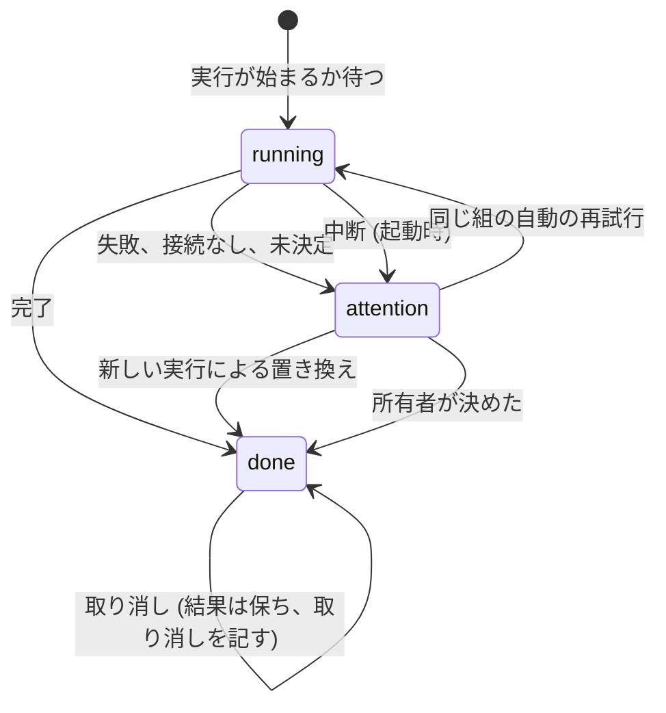

# 調査: Activity {#research-activity}

引き継ぐ決定: スタックと境界は [ARCHITECTURE.md](../../ARCHITECTURE.md) にある。取り込みのキューは [020 データモデル](../020-seek-thumbnail-stage/data-model.md) と [024 の調査](../024-import-progress/research.md) にある。自動タグ付けは [auto-tagging.md](../../docs/design-docs/auto-tagging.md) にある。重複の判定は [duplicate-judging.md](../../docs/design-docs/duplicate-judging.md) と [054 の調査](../054-auto-dup/research.md) にある。画面の通知のパターンは [054 R-10](../054-auto-dup/research.md#r-10-the-duplicates-page-refreshes-on-a-candidates-notification) にある。このファイルは、この機能が加える決定だけを記録する。

## R-1: 永続するアクティビティのログを、スキャンのアクティビティとは別の名前で持つ {#r-1-a-persistent-activity-log-named-apart-from-the-scan-activity}

**決定**: アクティビティは 1 つの SQLite のテーブル `activity_entries` で、独自のストアの役割を持つ。Go と API での名前は「アクティビティの項目」(activity entry) である。`domain.ScanActivity` がすでに、取り込みの進捗のメモリ上の「今動いているもの」の行を指す名前だからである (024 R-8)。

| 案 | 再起動を越えて残る | すべての実行を保つ | 決定者を知っている | 判定 |
| --- | --- | --- | --- | --- |
| **変更ごとに書く 1 つのログのテーブル** | はい | はい | はい | 採用 |
| アクティビティを `jobs`、`auto_tag_queue`、`video_version_candidates`、`scan_issues` から読む | はい | いいえ: 行は次の実行で上書きされ、候補は作り直される | いいえ: 自動のまとめと退ける処理は所有者の行を書く (054) | 不採用: 要件 3 と 10 を満たせない |
| `internal/app` のメモリ上の `activities` を拡張する | いいえ | いいえ | 一部 | 不採用: 要件 10 と再起動のエッジケース |

**理由**: 今、画面が読むことになるどの出典も、親 Issue が求めるものの何かを忘れる。テーブルはユーザーデータであり、作り直さず、消去もしない (要件 10)。

## R-2: 項目は、それが記録する変更のトランザクションの中で書く {#r-2-an-entry-is-written-in-the-transaction-of-the-change-it-records}

**決定**: 記録する処理を動かすか終える、または記録する決定を適用するストアの各メソッドは、同じトランザクションの中で 1 つのパッケージ内のヘルパーを通してその項目を書くか更新し、コミットの後に `ActivityChanged` を発行する。

| 案 | 項目と変更が一致する | 決定者と確率を運ぶ | 判定 |
| --- | --- | --- | --- |
| **ストアのトランザクションの中で書く** | 常に | 呼び出し側が渡す | 採用 |
| イベントバスの購読者がドメインのイベントから項目を書く | いいえ: コミットの後のクラッシュで項目が失われ、購読者は後で動く | いいえ: イベントは id だけを運ぶ | 不採用 |
| `internal/app` がストアの呼び出しの後に項目を書く | いいえ: 2 つのトランザクション | はい | 不採用: 取り消しには、変更があるときは常に、その対象を指す項目があることが要る |

**理由**: ARCHITECTURE.md はすでに、役割をまたぐ作業を 1 つのトランザクションの中のパッケージ内のヘルパーに通している。このヘルパーもその 1 つなので、どの役割もほかの役割のメソッドを呼ばない。

## R-3: 実行と対象ごとに 1 つの項目。取り込みは、そのすべての段階で 1 つの項目 {#r-3-one-entry-per-run-and-subject-an-import-is-one-entry-for-all-its-stages}

**決定**: 1 つの対象に対する処理の実行は、状態が移る 1 つの項目である。動画の取り込みは、その 5 つの取り込みの段階 (probe、サムネイル、シーク用プレビュー、ホバー用プレビュー、指紋) を覆う 1 つの項目である。スキャンは、`interrupted` 以外の理由で `failed` で終わったときだけ項目を書き、`done` で終わる次のスキャンがそれを `superseded` として閉じる。

| 案 | 新しい 1,000 個のファイルでの項目 | 1 つのファイルを開いて再試行できる | 判定 |
| --- | --- | --- | --- |
| **動画ごとに 1 つの取り込みの項目、段階はその中** | 1,000 | はい | 採用 |
| ジョブごとに 1 つの項目 | 5,000 | はい | 不採用: 所有者は「このファイルを取り込む」と考え、失敗した段階はすでに理由に名前が出る |
| スキャンごとに 1 つの項目 | 1 | いいえ | 不採用: 要件 6 は動画を開き、要件 7 は 1 つを再試行する |
| 失敗したかどうかにかかわらず、すべてのスキャンにスキャンの項目 | 空の監視スキャンが数千 | — | 不採用: 成功したスキャンとは、それが生んだ取り込みの項目である |

**理由**: 取り込みの項目は、その動画のジョブのどれかが未完了の間は開いており、それはジョブのテーブルがすでに知っている。各ジョブは自分が属する項目の id を持つので、後でもう一度キューに入ったジョブ (再スキャン、再プローブ、再試行) は、終わった項目を生き返らせるのではなく新しい項目を開く (エッジケース「実行はそれぞれ独自の行」)。スキャンの対象はスキャンそのものである。スキャンはすべてのメディアフォルダを覆う (`POST /api/scans` はフォルダを取らない) からである。その再試行は手動のスキャンを始める。起動時に `interrupted` として閉じたスキャンは項目を書かない。起動がすでにそれを再開するからである。

## R-4: 理由を持つ 3 つの状態。新しい実行が古い問題を閉じる {#r-4-three-statuses-with-a-reason-and-a-newer-run-closes-an-older-problem}

**決定**: 項目は `running`、`attention`、`done` のどれかである。`attention` と `running` は理由を持ち、`done` は結果を持つ。同じ対象に対する同じ種類の新しい項目が始まると、`attention` の項目は結果 `superseded` の `done` になる。

| 案 | attention の件数が意味するもの | 判定 |
| --- | --- | --- |
| **新しい実行が古い問題を閉じる** | まだ開いている問題 | 採用 |
| 所有者が片付けるまで、問題は `attention` のまま残る | これまでに見たすべての問題 | 不採用: まとめて片付ける操作は範囲外なので、件数は増える一方になる |
| どの種類でも、再試行が失敗した項目を生き返らせる | まだ開いている問題 | 不採用: 受け入れ条件 4 は新しい結果を新しい行として記録し、失敗の履歴が失われる |

**理由**: 起動時、ワーカーが始まる前に、理由が `processing` の `running` の項目を `attention`/`interrupted` にする (process-lifecycle.md)。まだ `waiting` の項目は始まっていなかったので、そのまま残る。その後、キューに戻ったジョブが新しい項目を開き、それが中断された項目を置き換えるので、エッジケースが成り立つ。スキャンの開いている `attention` の項目は、`done` で終わる次のスキャンが閉じる。成功したスキャンは独自の項目を書かないからである。

**重複の組での例外**: 中断の後と画面からの再試行で、自分の待ち時間 (054 R-5) に従って `running` に戻るのは、組の項目そのものである。受け入れ条件 3 は同じ行が結果に変わることを求め、組は数時間の待ち時間をかけて判定される。試行ごとに新しい行を作ると、同じ組が何度も一覧される。そのため、受け入れ条件 4 の新しい行は `version_judgement` を除くすべての種類で成り立つ。

## R-5: 決定者は記録した決定をした者、そうでなければ実行を始めた者 {#r-5-the-decider-is-who-made-the-recorded-decision-else-who-started-the-run}

**決定**: `decider` は、分類器の確率が決めたときは `ai`、固定の規則が決めたか自動のきっかけが実行を始めたときは `rule`、所有者の依頼が始めたときは `owner` である。AI の項目は確率を保存する。

| 項目 | 決定者 |
| --- | --- |
| 監視スキャン、失敗したスキャン、起動時の再開からの取り込み | `rule` |
| 手動のスキャン、再プローブ、再試行からの取り込み | `owner` |
| 取り込みが始めた自動タグ付けの実行 | 終わるまで `rule`、その後 `ai` |
| Settings か動画ページから始めた自動タグ付けの実行 | 終わるまで `owner`、その後 `ai` |
| 待っている、`no_connection` の、または `failed` の重複の組 | `rule` |
| すべてのフレームが一致したのでまとめた、または規則で未決定とした重複の組 | `rule` |
| モデルの答えでまとめた、退けた、または未決定のまま残した重複の組 | `ai`、確率とともに |
| 作品情報の取得、所有者のすべての操作、すべての取り消し | `owner` |

**理由**: 加えたタグの確率は今は選択の後に捨てられるので、`domain.AutoTagSelection` がそれをストアに運ぶ。`domain.VersionJudgeResult` はすでにモデルの確率を運んでおり、`ApplyJudgement` は今後 `same` と `different` でもそれを保つ。スキャナーは今は起点なしでジョブをキューに入れるので、取り込みのキューのポートが決定者を受け取る。不採用: モデルのものでないすべての実行の決定者を `rule` にする案。手動のスキャンは所有者の依頼であり、行は規則がそれを始めたと示すことになるからである。

## R-6: 記録する所有者の操作 {#r-6-the-owner-operations-recorded}

**決定**: 記録する所有者の操作は、動画のタグかバージョンのまとまりを変えるものと、メディアフォルダの削除である。親 Issue の `まとまり` はバージョンのまとまりと読む。

| 記録する | 記録しない |
| --- | --- |
| まとめる (Duplicates、動画ページ、ドラッグでの整理)、バージョンから外す、代表にする、"Different videos" | グループをタグにする操作以外のグループの編集、プレイリスト、お気に入り、視聴履歴 |
| 動画へのタグの付け外し (動画ページ、ライブラリの選択、グループをタグにする操作、外部 API)、提案したタグを残す、却下する | タグの定義: 作成、名前の変更、統合、削除、同義語、種類 |
| プラグインからの作品情報の適用 | 表示名、サムネイルの位置、アップロードと ComfyUI によるサムネイルの編集 |
| メディアフォルダの削除。その動画をライブラリから取り除く | — |
| 自動の決定の取り消しと、ドラッグでの整理の取り消し | — |

**理由**: これらは自動の処理もする変更なので、所有者による行が、自動の決定がもう成り立たない理由を説明する。不採用: 変更をするすべてのエンドポイント。親 Issue が求めていない並べ替えとお気に入りがログの大半を占めることになるからである。親 Issue の `削除` はメディアフォルダの削除である: 動画ごとの削除はなく、ファイルがなくなったのを見つけたスキャンは決定ではない。タグの定義の変更は多くの動画に一度に触れ、動画ではなくタグについてのものである。サムネイルの編集は、アップロードでも ComfyUI によるものでも、独自のダイアログでの所有者自身の編集であり、自動の処理も決めることを何も決めない。取り込みのサムネイルの段階は `import` の項目にある。

## R-7: 取り消しは状態を戻し、除外を常に記録する {#r-7-undo-restores-the-state-and-always-records-the-exclusion}

**決定**: 自動の決定を取り消すと、今の状態がまだその決定と一致するときだけ状態を変え、自動の処理が同じ決定をもう一度しないようにする除外は常に記録する。

| 取り消す決定 | まだ成り立つときの状態の変更 | 記録する除外 |
| --- | --- | --- |
| まとめた組 | 加わった側を分けて戻す。1 つの動画はまとまりから外れ、まとまりだった側は以前の代表を持つ 1 つのまとまりとして外れる | `video_version_unbundles`。2 つの側にまたがる組についてだけ記録する (054 R-8) |
| "Different videos" | 退けた組を削除し、両方の鍵の候補を作り直すので、組は Duplicates に戻る | 新しい `video_version_judging_holds` の組 |
| 加えたタグか提案したタグ | それが書いた付与を、その付与がまだあるときだけ削除する | `auto_tag_rejections` ([auto-tagging.md](../../docs/design-docs/auto-tagging.md#tags-it-adds)) |

自動のまとめは 2 つの側をつなぎ、どちらもすでにまとまりであることがある。加わった側とは、その代表がまとまりの代表にならなかった側である。項目はその側のメンバーの鍵と以前の代表を保つので、取り消しは所有者が作ったまとまりを単独の動画に崩さず、その側を元のとおりに戻す。まとまりとして外れる側は、`Unbundle` が残るメンバーにコピーを与えるのと同じく、合わさったまとまりのユーザーデータのコピーを得る。もうライブラリにないメンバーや、もう合わさったまとまりにないメンバーは飛ばす。

自動のタグは、まとまりのユーザーキーに付与の時刻とともに書かれる。項目は両方を保ち、取り消しはそのキーの `video_tags` の行を、作り直しで対象の動画の鍵が変わった後はその動画の今の鍵の行を、時刻がまだ一致し、提案したタグがまだ提案のままであるときだけ削除する。所有者が外してもう一度付けたタグや、残したタグは、新しい時刻か状態を持つので、所有者自身の付与は決して削除されない。

取り消しは 1 つの `ActivityStore` のトランザクションであり、対象の状態を読み直し、`Unbundle`、`Dismiss`、却下のパッケージ内の手順を再利用し、所有者の `undo` の項目を書く ([R-2](#r-2-an-entry-is-written-in-the-transaction-of-the-change-it-records))。

状態がもう一致しないとき (所有者がすでにまとまりから外した、すでにタグを外した) は、ほかに何も変わらず、エッジケースが求めるとおり、応答はすでに戻されていたと伝える。不採用: 取り消した退けた組に `video_version_unbundles` を再利用する案。このテーブルは「まとまりから外した」を意味し、取り消した組はまとめられたことがないからである。不採用: 取得のクエリが取り消した決定をログから読む案。ログが判定の規則の入力になってしまうからである。

## R-8: 画面は `activity` の通知で更新する {#r-8-the-screen-refreshes-on-an-activity-notification}

**決定**: `ActivityChanged` は、`/api/events` 上のペイロードのない `activity` の通知になり、所有者にだけ送られ、`candidates` と同じようにまとめられる。画面は件数と読み込んだ項目を取得し直す。

不採用: 通知のペイロードに項目を入れる案。ほかのすべての通知は状態を読み直すものであり、ペイロードには独自の順序とページングの規則が要るからである。不採用: ポーリング。ページはすでに共有のイベントの接続を持っているからである。

## R-9: id によるキーセットのページング、新しい順、状態で絞り込む {#r-9-keyset-paging-by-id-newest-first-filtered-by-status}

**決定**: `GET /api/activity` は、不透明なカーソルと省略できる `status` で、項目の id の降順にページングする。応答は `running`、`attention`、`done` の件数を運ぶので、受け入れ条件 6 のどのタブにも一致させる件数がある。

不採用: オフセットによるページング。所有者がスクロールする間に新しい項目が届き、すべてのページがずれるからである。テーブルは、動画ごとにおよそ 1 つの取り込みの項目と、判定した実行ごとに 1 つの項目の割合で増える。10,000 本の動画で数万行になり、`(status, id)` のインデックスが保持期間の規則なしでそれに応える。

## R-10: 対象は、書いた時点のラベルを保つ内容の鍵である {#r-10-the-subject-is-a-content-key-with-a-label-kept-at-write-time}

**決定**: 項目は対象を内容の鍵で指し (組は 2 つの鍵、スキャンはその id、削除したメディアフォルダはそのパス)、対象のラベルを書いたとおりに保つ。画面は、読むときに鍵を今の動画に解決する。

不採用: `videos.id`。再スキャンがそれを作り直すからである (ARCHITECTURE.md、"User data survives a rebuild")。鍵が所有者の見てよい動画に解決されないときは、エッジケースが求めるとおり、項目は残り、開く操作を持たない。

## R-11: 失敗した作品情報の取得は終わった項目であり、問題ではない {#r-11-a-failed-work-information-fetch-is-a-finished-entry-not-a-problem}

**決定**: 作品情報の取得は、結果 `failed` とプラグインのメッセージを持つ `done` の項目を書く。動画を変えるのは適用だけである。

不採用: 再試行付きの `attention` の項目。取得は所有者の対話的な依頼で、すでに画面上で答えられており、もう一度動かすには所有者が検索結果を選ぶ必要があるからである。項目は動画の作品情報を開き、所有者はそこでもう一度取得する。
