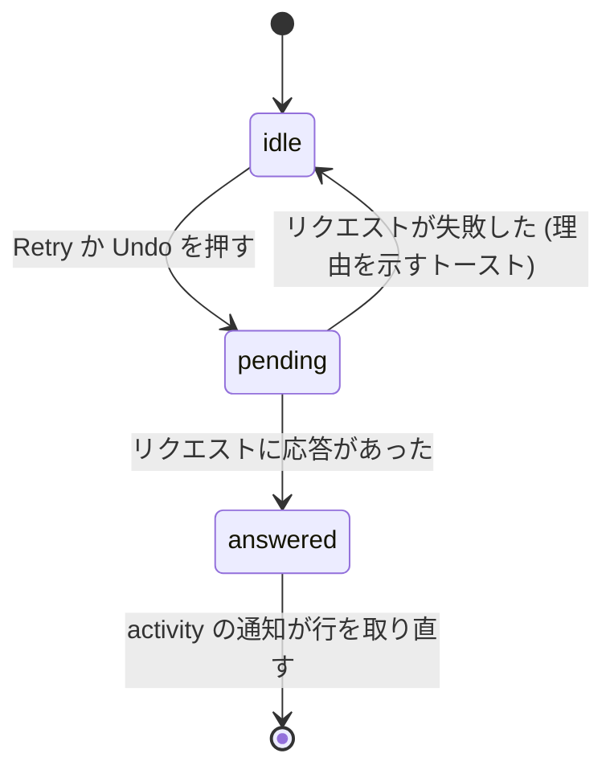

# UI 設計: Activity {#ui-design-activity}

出典: [design-system.md](../../docs/design-docs/design-system.md) とその規則 ([patterns.md](../../web/registry/rules/patterns.md)、[components.md](../../web/registry/rules/components.md))。History の画面 (`web/src/history/HistoryPage.tsx`、[043 UI 設計](../043-watch-history/ui-design.md)) で、この画面はページ、日のグループ、ページ送りでそれに従う。タグの管理の件数付きのタブ (`web/src/tags/TagsTabs.tsx`)。データと操作は [plan.md](plan.md) と [contracts/screen-api.md](contracts/screen-api.md) である。

## この形にした理由 {#why-this-shape}

Activity は、History と同じく、新しい順に並ぶ `GroupedList` の日のグループを持つ `ListPage` である。どちらも所有者が時間をさかのぼって読むログであり、History が日の見出し、`lg` 未満で積み重なる行のグリッド、スクロールによるページ送りをすでに決めている。各行はサムネイルのない文字の行である。サムネイルは同じ動画についてのすべての項目で繰り返され、組には 2 つ必要になり、スキャンや削除されたフォルダにはない。所有者が目で探すのは、状態、対象、時刻である。

| 採用しなかった案 | 理由 |
| --- | --- |
| 状態、対象、決定者、時刻の列を持つ `DataTable` | 360px では列が対象に数文字しか残さない。親 Issue は、狭い幅で状態、対象、時刻が読めたままであることを求めている |
| 状態の絞り込みに `Tabs` | 4 つの選択肢はパネルを切り替えるのではなく、1 つの一覧を絞る。絞り込みは History が使う `ToggleGroup` で、タグの管理のタブが持つ件数を添える。親 Issue の `タブ` はこの絞り込みである |
| History の `JumpList` の横の列 | 項目のある日の一覧が必要だが、API はそれを返さない。また、所有者がこのログを絞るのは状態の絞り込みによる |
| ヘッダーの主な操作 | 親 Issue は一括の操作を範囲外にしている |

## 文言 {#words}

`web/src/i18n/en.ts` が持つことになる画面の文言で、注記がない限り `t.activity` の下にある。`{name}` などはカタログの関数の引数である。

| 場所 | 文言 | 補足 |
| --- | --- | --- |
| サイドバーの項目 (`t.shell.nav.activity`) | `Activity` | |
| サイドバーの件数、読み上げ | `1 needs attention`、`{count} need attention` | `selectPlural`。見える文字は数である |
| ページと文書のタイトル | `Activity` | |
| 絞り込みのグループのラベル | `Show` | |
| 絞り込みの選択肢 | `All`、`Running`、`Needs attention`、`Done` | `All` 以外は、それぞれの後に件数が続く |
| 状態のバッジ | `Running`、`Needs attention`、`Done` | 絞り込みと同じ語 |
| 決定者 | `Rule`、`AI`、`AI {percent}`、`You` | `AI 91%` は項目が `probability` を持つときだけ。`You` は所有者である |
| 種類: `import` | `Import` | |
| 種類: `scan` | `Scan` | |
| 種類: `auto_tag` | `Auto-tagging` | |
| 種類: `version_judgement` | `Duplicate check` | |
| 種類: `work_info_fetch` | `Work info fetch` | |
| 種類: 所有者の操作 | `Bundled as versions`、`Removed from versions`、`Made representative`、`Marked as different videos`、`Added tag {name}`、`Removed tag {name}`、`Kept suggested tag {name}`、`Rejected suggested tag {name}`、`Applied work info`、`Removed media folder`、`Undid a drag-and-drop change` | 種類ごとに 1 つの句で、データモデルの順 |
| `media_folder_remove` の件数 | `1 video left the library`、`{count} videos left the library` | 種類の句の後に、`detail` から |
| 種類: `undo` | `Undid: {kind} · {outcome}`、`Undid: tag {name}` | `undoes` から: 取り消された項目の種類と結果の句、またはタグごとの取り消しのタグ |
| 理由 `waiting` | `Waiting` | |
| 理由 `processing` | `In progress` | |
| 理由 `failed` | `Failed` | |
| 理由 `failed`、`import` | `Failed at {stage}` | `{stage}` は `stage` から: `analysis`、`thumbnail`、`seek thumbnails`、`preview`、`duplicate check`。`t.shell.scan.activity` の語は動詞であり、`at` の後に読めない |
| 理由 `failed`、`version_judgement` | `Failed · tries again at {time}` | `{time}` は `retryAt` から: 今日なら現地の時刻 (`14:05`)、そうでなければ短い日付と時刻 (`Oct 17, 14:05`) |
| 理由 `interrupted` | `Stopped when vv shut down` | |
| 理由 `no_connection` | `Needs the AI connection to decide` | |
| 理由 `undecided` | `Couldn't tell whether these are the same video` | |
| 結果 `completed` | `Finished` | 所有者の操作は種類の句だけを示す |
| 結果 `completed`、`auto_tag` | `Added 1 tag`、`Added {count} tags`、`Added no tags` | |
| 結果 `same` | `Same video · bundled` | |
| 結果 `different` | `Different videos` | |
| 結果 `failed` | `Failed` | `work_info_fetch` だけ |
| 結果 `superseded` | `Replaced by a newer run` | |
| 結果 `decided_by_owner` | `You decided on Duplicates` | |
| 結果 `gone` | `A video left the library` | |
| 結果 `already_reverted` | `Already changed back by you` | |
| 取り消し済みの印 | `Undone` | 取り消された項目と、取り消されたタグに |
| スキャンの対象 | `Manual scan`、`Watch scan` | |
| ライブラリにない対象 | `Not in the library` | History と同じ |
| 再試行のボタン | `Retry` | 読み上げは `Retry {kind} for {subject}` |
| 取り消しのボタン | `Undo` | 読み上げは `Undo {kind} for {subject}` |
| 1 つのタグの取り消し | `Undo2` のアイコンだけ | ツールチップと読み上げは `Undo tag {name}` |
| Duplicates を開く | `Open in Duplicates` | |
| 作品情報を開く | `Work info` | 動画がライブラリにある `work_info_fetch` の行 |
| Settings を開く | `Settings` | `no_connection` の行 |
| 取り消しの後のトースト | `Undone. vv won't decide this again on its own` | |
| すでに戻されていた取り消しの後のトースト | `Already changed back. vv won't decide this again on its own` | |
| 再試行か取り消しが失敗したときのトースト | `Couldn't retry: {reason}`、`Couldn't undo: {reason}` | `{reason}` はエラーのカタログから |
| エラー `activity_not_retryable` (エラーのカタログ) | `This can no longer be retried` | |
| エラー `activity_not_undoable` (エラーのカタログ) | `This can no longer be undone` | |
| 空、すべて | `No activity yet` / `Imports, auto-tagging, duplicate checks and your changes to tags and versions show up here.` | タイトル / 説明 |
| 空、実行中 | `Nothing is running` | |
| 空、要対応 | `Nothing needs your attention` | |
| 空、完了 | `Nothing has finished yet` | |
| 絞り込みで空のときの説明と操作 | `Entries with another status are under All.` / `Show all` | |
| 読み込みの失敗 | `Couldn't load the activity` | History と同じく `Retry` とともに |

## サイドバーの項目 {#sidebar-entry}

`Activity` はメインのナビゲーションの最後の項目で、`Duplicates` の後にあり、所有者だけのもので、lucide の `Activity` アイコンを持つ。1 つ以上の項目が対応を必要とする間、項目は[デザインシステムの変更](#changes-to-the-design-system)の件数を持つ。実行中の項目は印を加えない。取り込みのたびに現れては消えるからである。件数は、どの画面でも `activity` の通知で更新される。

## Activity のページ {#activity-page}

`toolbarRow="header"` の `ListPage` である。タイトルだけを持つ `PageHeader` と、絞り込みを持つ `Toolbar`。選んだ絞り込みはページの URL の `status` クエリパラメータ (`All` ならなし) で、History の視聴の絞り込みと同じく履歴に積まれるので、戻ると前の絞り込みに戻る。

絞り込みは 1 つの `ToggleGroup` (`outline`、`sm`) で、常に 1 つの選択肢が押されている。`All` 以外の各選択肢は、タグの管理のタブと同じく、`text-muted-foreground` と `tabular-nums` の件数で終わる。件数は最初のページが届くまでない。選択肢が幅に収まらないとき、グループは `TagsTabs` と同じく自身の帯の中で横にスクロールし、押されている選択肢がスクロールして見える位置に来る。ページは横にスクロールしない。

本体は、`createdAt` の現地の日ごとに 1 つのグループを持つ `GroupedList` で、History と同じく `Today`、`Yesterday` または日付を見出しにする。その後、所有者がスクロールするにつれて次のページが読み込まれる間は `LoadMoreRow` が続く。行は API の順 (新しい項目が先) を保つので、項目は後で終わっても、始まった日に留まる。

### 項目の行 {#entry-row}

[デザインシステムの変更](#changes-to-the-design-system)の新しい行のグリッド上の `GroupedListItem` である。状態、文字、時刻が 1 行にあり、時刻は末尾で上にそろう。操作は、`lg` 未満では文字の下に、`lg` 以上では文字と時刻の間にある。

| 部分 | 内容 | 形 |
| --- | --- | --- |
| 状態 | アイコン付きの状態の語: `Spinner` 付きの `Running`、`TriangleAlert` 付きの `Needs attention`、`Check` 付きの `Done` | `Badge`: `soft`、`warning`、`success`。最初の列で、縮まない |
| 対象 | 各要素のラベル。`videoId` を持つ要素は動画の画面へのリンクである。組の 2 つの要素は `·` でつなぐ | 1 行目、`text-sm font-medium`、1 行で、省略記号で切る。History はタイトルを 2 行で切るが、ここでは 1 行目に状態と時刻もあり、それらは下に動いてはならない |
| 時刻 | `createdAt` の現地の時刻 (`14:05`) | 最後の列、`text-xs text-muted-foreground tabular-nums`、縮まない |
| 起きたこと | 種類の句、`·`、理由か結果の句、`·`、決定者、そして取り消されていれば `Undone` | 2 行目、`text-xs text-muted-foreground`、折り返す |
| ライブラリにない | `video` か `pair` の対象について、`videoId` のない各要素の後に: そのラベルをただの文字で、そして History が使う警告の形で `Not in the library` | 2 行目の末尾。スキャンとフォルダには出さない |
| 問題 | `attention` と、失敗した `work_info_fetch` について: `detail` (プロバイダか段階のメッセージ) | 3 行目、`text-xs`、折り返し、最大 3 行 (`line-clamp-3`) |
| タグ | `auto_tag` について: タグごとに、名前と割合を持つ 1 つの `Badge` (`secondary`、提案のタグには `TentativeMark` 付き)、続いてチップの外にそのタグの取り消しのボタン | 3 行目、タグの間で折り返し、1 つのタグの中では折り返さない。チップの `×` は取り除く規則であり、このボタンは取り消す |
| 操作 | `Retry`、`Undo`、`Open in Duplicates`、`Work info`、`Settings` | `ghost` `sm` のボタンで、状態のバッジより軽く見える。項目が提供するものだけ |

取り消された項目は、その行、状態、句を保ち、2 行目に `Undone` と示す。取り消されたタグは `text-muted-foreground` で描き、名前に取り消し線を引き、取り消しのボタンを持たない。

行にはホバーの塗りも、行全体のリンクもない。対象のリンクと操作のボタンが押す対象であり、文字を押して何かを誤って開いたり取り消したりすることはない。

### 操作 {#actions}

図は、`Retry` か `Undo` を押すと行がどうなるかを示す。

| 操作 | 示すとき | その後 |
| --- | --- | --- |
| `import`、`auto_tag` の `Retry` | `retryRun` が true | 先頭に新しい `Running` の行。この行は `Done`、`Replaced by a newer run` になる |
| `version_judgement` の `Retry` | `retryRun` が true | この行が `Running` になる。新しい行はない |
| `scan` の `Retry` | `retryRun` が true | スキャンが始まる。この行は、スキャンが失敗せずに終わるまで `Needs attention` のままで、その後 `Replaced by a newer run` と示す |
| `Undo` | `undoable` が true で、種類が `auto_tag` でない | トースト。行は `Undone` と示す。先頭に新しい `You` の行 |
| 1 つのタグの取り消し | `undone` が false の、`auto_tag` の項目のタグ | トースト。タグは取り消された形で描かれる。先頭に新しい `You` の行 |
| `Open in Duplicates` | `candidate` が true の組 | `/duplicates` を開く |
| `Work info` | 動画がライブラリにある `work_info_fetch` | 動画の作品情報の編集画面 (`/videos/{id}/edit`) を開く |
| `Settings` | 理由 `no_connection` | AI の接続を保存する `/settings` を開く |

リクエストが保留の間、そのボタンは `Spinner` を示し、その行のすべてのボタンが無効になる。`Retry` も `Undo` も確認を求めない。取り消しは自動の決定の前の状態に戻し、所有者はそれを手でもう一度できる。再試行は失敗したものを始める。失敗したリクエストは行をそのままにし、トーストを示す。

### ライブの更新 {#live-updates}

`activity` の通知で、ページは件数と読み込んだすべてのページを取り直し、行をその場で置き換える。絞り込みに合わなくなった行は一覧から出る。新しい行は先頭のグループに加わる。スクロールの位置は所有者が読んでいた行に留まる (ブラウザのスクロールのアンカー) ので、その上に加わった行がそれを押しのけない。

### 状態 {#states}

| 状態 | ページが示すもの |
| --- | --- |
| 読み込み中 | ヘッダーと絞り込みの下に、グループの配置の `LoadingState` |
| 読み込みの失敗 | `Couldn't load the activity` と `Retry` を持つ `ErrorState` |
| 項目がまったくない | `Activity` アイコン、`No activity yet` とその説明を持つ `EmptyState` |
| 絞り込みに項目がない | `ListFilter` アイコン、絞り込みの空のタイトル、`Entries with another status are under All.`、`All` を押す `Show all` を持つ `EmptyState`。ほかの選択肢の件数は残る |
| 項目がある | 日のグループ |
| さらに読み込み中 | 最後のグループの後に `Spinner` を持つ `LoadMoreRow` |
| さらに読み込むのに失敗 | メッセージと `Retry` を持つ `LoadMoreRow` |

### ゲスト {#guests}

ゲストにはサイドバーの項目がなく、`/activity` は、所有者だけのどの画面とも同じく、ゲストをサインインに送る ([016 UI 設計](../016-single-account-auth/ui-design.md))。

## デザインシステムの変更 {#changes-to-the-design-system}

**レールの件数。** `Sidebar` は項目に件数を持てるようになる。レールでは、項目のアイコンの右上の角に固定した `Badge` (`warning`)。狭い幅のドロワーでは、行の末尾の `SidebarMenuBadge`。99 を超えると `99+`、0 では何もなく、呼び出し側が読み上げの文字を項目のアクセシブルな名前に付け加える。ショーケースは件数 3 と 120 のレールの項目を描く。これは [components.md の Sidebar](../../web/registry/rules/components.md#sidebar) と `sidebar` の項目に入る。

| 採用しなかった案 | 理由 |
| --- | --- |
| レールでも `SidebarMenuBadge` | サイドバーがアイコンに畳まれると隠れ、vv のレールは常にその状態である |
| 数のない点 | 所有者はページを開かないと、1 つの問題か多くの問題かを見分けられない |

**実行中の状態のバッジ。** components.md の `Badge` の規則は、選択中か有効なチップに `soft` を、状態に `destructive`、`warning`、`success` を挙げている。まだ実行中の処理は有効であり、問題でも成功でもないので、規則に次を加える: 実行中の状態には `Spinner` 付きの `soft` を、常にその語とともに使う。

**アクティビティの行のグリッド。** `tokens.css` は、`grid-cols-history-row` の隣に名前付きのユーティリティ `grid-cols-activity-row` を加える。`lg` 未満では列は状態、文字、時刻で、操作は文字の下の 2 つ目の行にある。`lg` 以上では、状態、文字、操作、時刻である。History のユーティリティはサムネイルの列で始まるが、この行にはそれがない。

## レスポンシブな振る舞い {#responsive-behaviour}

| 幅 | 配置 |
| --- | --- |
| 360px | ヘッダー、次に独立した行の絞り込みの帯で、4 つの選択肢が収まらないときは横にスクロールする。行: 状態、次に 1 行に切った対象、次に時刻。対象の下に起きたこと、次に問題かタグ。その後、文字の下に独立した行の操作 |
| 768px | 360px と同じ。絞り込みは 1 行に収まる。対象はほとんどのラベルが入る広さを持つ |
| 1280px | ヘッダーと絞り込みが 1 行。行: 状態、文字の行、操作、最後に時刻で、すべて 1 行目に上をそろえる |

## レビューの基準 {#review-criteria}

1. 360px、768px、1280px で、対象が 120 文字のファイル名の行は、1 行目の先頭の状態のバッジと末尾の時刻を欠けずに保つ。切られるのは対象だけで、行の中の何も重ならず、ページを横に押し出さない。
2. 一覧を見渡すと、`Needs attention` の行は、文字を読む前に `warning` のバッジでほかから目立ち、ghost の操作のボタンはバッジより目を引かない。
3. 対象は 2 行目より先に読まれる。その下の `text-xs` の薄い行より大きく明るい。
4. `Needs attention` の行では、何も開かずに、理由が 2 行目にあり、プロバイダのメッセージがその下にある。500 文字のメッセージは 3 行で止まり、次の行はその 3 行の下から始まり、それらに重ならない。
5. `Running`、`Needs attention`、`Done` の横の件数は、その絞り込みが一覧する行の数に等しく、サイドバーの件数は `Needs attention` の件数に等しい。
6. 取り込まれた動画の `Done` の行にはボタンがない。失敗した取り込みは `Retry` だけを示す。自動のまとめは `Undo` だけを示す。取り消しの後は `Undone` と示し、`Retry` も `Undo` も示さない。
7. 360px では、操作は文字の下の独立した行にあり、絞り込みの帯は折り返したりページからはみ出したりせずにスクロールする。
8. ページを開いたまま、終わった取り込みは再読み込みなしに `Today` の先頭に行を加え、所有者が読んでいた行は動かない。
9. 動画がライブラリから出た行は、ラベルをただの文字で `Not in the library` とともに示し、リンクを持たない。
10. 1280px で、行、日のグループ、ページの端は History と同じ間隔を持ち、2 行の `Done` の行は History の行より高くない。
