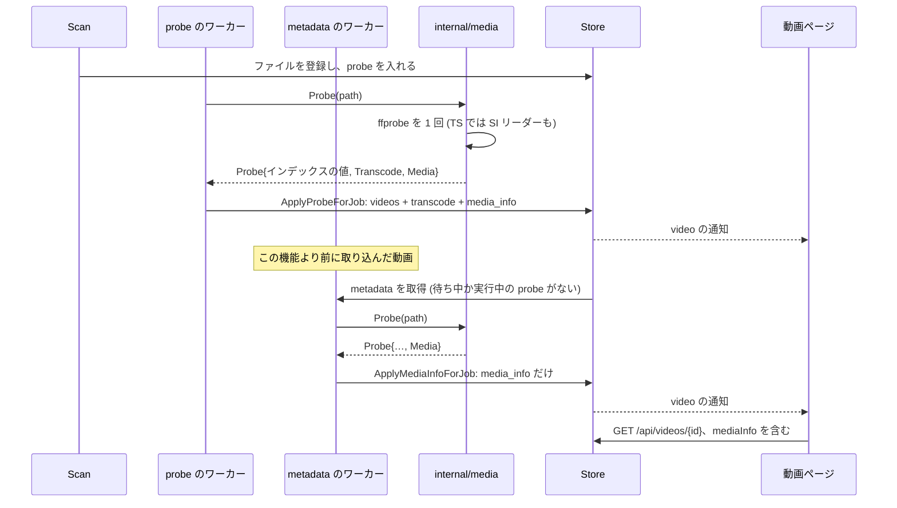
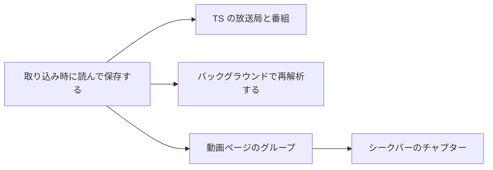

# 実装計画: 取り込みのプローブから得るメディア情報を、動画ページとシークバーに示す {#implementation-plan-media-information-from-the-import-probe-on-the-video-page-and-the-seek-bar}

**ブランチ**: `feature/056-media-info` | **親 Issue**: #1227

**入力**: 親 Issue。これがこの機能の仕様である。

## 概要 {#summary}

取り込みの 1 回の `ffprobe` の実行は、すでに読んでいて今は捨てているものを保つ: フレームレート、ビット深度、ビットレート、インターレース、HDR の種類、360 度と 3D の信号、すべての音声と字幕のトラック、埋め込まれたタグ、撮影の日時、機器と場所、カバーアート、チャプター。TS の録画では、`ffprobe` が復号できない放送局名と番組名を、小さな Go のリーダーが復号する。すべてを動画ごとに 1 つのバージョン付きの JSON の行として保存し、動画ページでは、ファイルがその項目を持つときだけ現れるグループで示し、チャプターはシークバーの印とチャプターのメニューとしてプレイヤーに届く。この機能より前に取り込んだ動画は、新しい取り込みに譲るバックグラウンドのジョブがもう一度読む。

| 関心事 | 方針 |
| --- | --- |
| 保存 | 動画ごとに 1 つのバージョン付きの JSON の行、`video_media_info` ([R-1](research.md#r-1-media-information-is-one-versioned-json-row-per-video)) |
| 情報源 | 同じ `ffprobe` の実行。`-show_chapters` を加え、TS では解析の上限を長くする ([R-2](research.md#r-2-the-same-ffprobe-run-reads-chapters-and-reads-longer-for-mpeg-ts)) |
| 分類 | HDR、投影、3D、インターレースを純粋なドメインの規則として決める ([R-3](research.md#r-3-hdr-projection-3d-and-interlacing-are-decided-by-pure-rules-in-internaldomain)) |
| TS の名前 | ARIB STD-B24 の復号器を持つ Go の SI リーダー、先頭の 32 MiB ([R-4](research.md#r-4-station-and-programme-names-of-a-ts-recording-come-from-a-go-si-reader-with-an-arib-std-b24-decoder)) |
| 再解析 | `metadata` のジョブの種類。待ち中か実行中のプローブがないときだけ取得できる ([R-5](research.md#r-5-imported-videos-are-re-analysed-by-a-metadata-job-that-yields-to-pending-probes)) |
| API | `mediaInfo` は詳細だけに入り、ゲストも含む ([R-6](research.md#r-6-mediainfo-is-part-of-the-video-detail-only-for-owners-and-guests-alike)) |
| チャプター | `chapters` のテキストトラック、video.js のシークバーの印、チャプターのボタン ([R-7](research.md#r-7-chapters-are-a-chapters-text-track-with-marks-drawn-in-the-videojs-seek-bar)) |
| 言語 | 名前は `Intl.DisplayNames` で示す ([R-8](research.md#r-8-language-codes-are-shown-through-intldisplaynames)) |

## 仕組み {#how-it-works}

シーケンス図は、新しい取り込みと、既存の動画のバックグラウンドでの再解析を示す。どちらも同じ行と同じページで終わる。



1. **プローブはより多く読み、失敗は増えない。** `media.Probe` は `-show_chapters` と、TS のファイルでは長い解析の上限を加え、インデックスの値の隣に `domain.MediaInfo` を埋める。欠けている項目や読めない項目は省く。プローブを失敗させるのは、今と同じく、長さが欠けているときだけである ([data-model.md の規則](data-model.md#rules))。
2. **TS のファイルは名前を得る。** `.ts`、`.m2ts`、`.mts` では、`internal/media` が先頭の 32 MiB を Go で読み、最初のプログラムの SDT、EIT の現在と次のイベント、TOT を見つけ、名前を ARIB の復号器で復号し、録画と最も長く重なるイベントを残す。そのため、番組より前に始まる録画が、その前の番組の名前を付けられることはない (R-4)。スキャンは `.ts` に加えて `.m2ts` と `.mts` も取り込む。
3. **ストアは 1 つの行を書く。** `ApplyProbeForJob` は、`videos` を更新するトランザクションの中で、同じ同一性の確認のもとで `video_media_info` を書く。そのため、プローブの間に置き換えられたファイルは、古いファイルの行を残さない。
4. **既存の動画が追いつく。** マイグレーションは、プローブ済みの動画ごとに `metadata` のジョブを入れる。スキャンは、行がないか、行が今のバージョンより古い動画に 1 つ入れる。`metadata` のワーカーは、待ち中か実行中の `probe` のジョブがない間だけ取得し、同じ `Probe` を実行し、行だけを書く。上限での失敗は、ページが今示すものを保つ。
5. **ページはグループを示す。** `GET /api/videos/{id}` は `mediaInfo` を運ぶ。ページは技術の行の下に Video、Audio、Subtitles、Embedded、Broadcast のグループを、それぞれ項目があるときだけ、`design` 段階が定める形で描く。タイトルと Created、Added の事実は変えない。
6. **プレイヤーはチャプターを示す。** ページは `mediaInfo.chapters` から `chapters` のテキストトラックを作る。シークバーのコンポーネントは開始ごとに印を描き、シークプレビューはポインターの下のチャプターの名前を示し、チャプターのボタンは一覧を示してシークする。

それぞれの選択の理由と代わりの案は [research.md](research.md) に、保存する値とその規則は [data-model.md](data-model.md) に、API の差分は [contracts/screen-api.md](contracts/screen-api.md) に、実際のファイルでの確認は [quickstart.md](quickstart.md) にある。

## 技術的な文脈 {#technical-context}

**正本の定義**:

| 項目 | 出典 |
| --- | --- |
| 境界、ストアの役割、コミットの後のイベント、メディアのファイルを読むのはスキャンだけであること | [ARCHITECTURE.md](../../ARCHITECTURE.md)、[.golangci.yml](../../.golangci.yml) (depguard) |
| プローブ、その値、ライブ変換の行 | [`internal/media/probe.go`](../../internal/media/probe.go)、[018 データモデル](../018-live-transcode-seek/data-model.md) |
| ジョブのキュー、段階ごとに 1 つのワーカー、取得の条件、欠けた指紋の入れ直し | [020 データモデル](../020-seek-thumbnail-stage/data-model.md)、[030 データモデル、Fingerprints](../030-video-versions/data-model.md#fingerprints)、[024 の調査](../024-import-progress/research.md) |
| 動画ページの事実と技術の行 | [033 の UI 設計](../033-video-dates/ui-design.md)、[`web/src/player/VideoFacts.tsx`](../../web/src/player/VideoFacts.tsx) |
| プレイヤー、シークプレビュー、字幕のメニュー | [021 の調査](../021-seek-thumbnail-sprite/research.md)、[028 の調査 R-10](../028-sidecar-subtitles/research.md#r-10-subtitle-button-and-menu-use-videojs-subscapsbutton) |
| 画面の API と生成コード | [api/openapi.yaml](../../api/openapi.yaml)、`task generate` |
| 画面、Web のテスト、画面の文言 | [design-system.md](../../docs/design-docs/design-system.md)、[web-testing.md](../../docs/design-docs/web-testing.md)、[i18n.md](../../docs/design-docs/i18n.md) |
| 検査 | [Taskfile.yml](../../Taskfile.yml) (`task check`、`task check-docs`) |

**この機能に固有の文脈**: ARIB の復号器の記号の表と TS の解析の上限は、それを使う単位がマージされる前に、[クイックスタート](quickstart.md) が実際の録画で確かめる。各マイグレーションは、その単位を書く時点の `main` の次の番号を取る。

## 憲章の確認 {#constitution-check}

ARCHITECTURE.md と AGENTS.md に照らして確認した。この設計が拠る規則は次のとおりである:

| 規則 | 設計がそれを満たす方法 |
| --- | --- |
| ドメインが決め、ストアが強制する | HDR、インターレース、チャプター、文字列の規則は `internal/domain` にある。ストアはジョブの同一性の確認のもとで行を書き、取得のクエリがプローブに譲る条件を持つ |
| アダプターは互いを import しない | `internal/media/arib` は `internal/media` の下の純粋なパッケージで、`internal/media` だけが import する。`internal/media` に対する depguard の規則がそれを覆う |
| メディアフォルダのファイルを読むのはスキャンだけである | SI リーダーは、すでに `ffprobe` のためにファイルを開くプローブと `metadata` のジョブの中で動く |
| すべての読み取りは視聴者を知る | `mediaInfo` は、すでに視聴者を受け取る詳細の読み取りが読む。ゲストが得るのは、詳細と同じく、公開の動画のものだけである |
| ユーザーデータは作り直しを越えて残る | `video_media_info` はインデックスである。running-vv.md のテーブルの一覧にそれを加える |
| コードを写さない | プローブのジョブと `metadata` のジョブは、`media.Probe` と行のための 1 つのストアの補助関数を共有する |
| 関数ごとに複雑度 25 | パーサーはグループ (映像、トラック、埋め込み、チャプター) ごとに分ける。ARIB の復号器の表は分岐ではなくデータである |

## プロジェクトの構成 {#project-structure}

### 文書 (この機能) {#documentation-this-feature}

```text
specs/056-media-info/
├── plan.md
├── research.md            # R-1..R-8
├── data-model.md          # video_media_info, domain.MediaInfo, the rules
├── quickstart.md          # Real HDR, phone, TS and chaptered files
└── contracts/
    └── screen-api.md      # Video.mediaInfo, the enum values, /api/events
```

`design` 段階が、動画ページのグループと、プレイヤーのチャプターの印、メニュー、プレビューのための `ui-design.md` を加える。

### ソースコード {#source-code}

**影響する境界**:

| パッケージ | 変更 |
| --- | --- |
| `internal/domain` | `MediaInfo` と `MediaInfoVersion`。HDR、インターレース、ビット深度、文字列、日付、場所、チャプター、放送番組の規則。`JobMetadata`、`NoClaimableProbe`、`IndexedVideo.MediaInfoMissing`、アクティビティと問題の種類 |
| `internal/media` | `-show_chapters`、TS の上限、新しい項目のパーサー。TS の SI リーダー。`internal/media/arib` (復号器) |
| `internal/store` | 2 つのマイグレーション。`ApplyProbeForJob` での行。`ApplyMediaInfoForJob`。詳細での読み取り。取得の条件。`metadata` のための `EnsureJob`。スキャンのインデックスのクエリ |
| `internal/scanner` | `mediaExtensions` の `.m2ts` と `.mts`。`MediaInfoMissing` のときに `metadata` を入れる |
| `internal/app` | `Ingest` の `metadata` のハンドラー |
| `cmd/mdm` | 新しい種類のワーカー (`domain.JobKinds` から) と、プローブが終わった後にそれを起こす処理 |
| `internal/httpapi`、`api/openapi.yaml` | 詳細の `mediaInfo`。2 つの列挙の値 |
| `web/src/player`、`web/src/i18n` | 動画ページのグループ。言語の名前。チャプターのトラック、シークバーの印、プレビューの名前、チャプターのボタン |

**新しいパス**: `internal/media/ts_si.go`、`internal/media/arib/`、`internal/store/media_info.go`、`docs/design-docs/media-information.md` (索引からリンクする)、`web/src/player/MediaInfoGroups.tsx`、`web/src/player/chapters.ts`。

**構成の判断**: ARIB の復号器を独自の純粋なパッケージにし、その表とテストをプロセスの扱いから離す。SI リーダーはメディアのファイルを読み、ほかのアダプターはそれをしないので、`internal/media` に置く。`metadata` の段階は (`VersionJudge` と違い) 独自のワーカーではなくジョブの種類である。動画ごとのもので、キューの同一性の確認、試行回数の上限、問題の記録が要るからである。

## 実装作業 {#implementation-work}

図は、どの単位が先に入る必要があるかを示す。2 つの画面の単位は、`design` 段階の `ui-design.md` も待つ。



### 取り込み時にメディア情報を読んで保存する {#read-and-store-media-information-at-import}

**範囲**: `domain.MediaInfo`、`MediaInfoVersion`、[data-model.md の規則](data-model.md#rules) (チャプターと TS の規則を使う側を除く)。`video_media_info` を作るマイグレーション。`-show_chapters`、TS の解析の上限、[保存する値](data-model.md#stored-value-domainmediainfo) の `Broadcast` を除くすべての項目のパーサーを持つ `media.Probe`。`ApplyProbeForJob` で書き、詳細の読み取りが読む行。索引からリンクする `docs/design-docs/media-information.md` と、running-vv.md のテーブルの項目 ([R-1](research.md#r-1-media-information-is-one-versioned-json-row-per-video) から [R-3](research.md#r-3-hdr-projection-3d-and-interlacing-are-decided-by-pure-rules-in-internaldomain))。

**依存**: なし。

**受け入れ**: `task check` と `task check-docs` が通る。`ffprobe` の JSON のフィクスチャでのパーサーのテストが次を示す: HDR10、HLG、Dolby Vision、SDR が分類される。`Spherical Mapping` と `Stereo 3D` の項目が保たれる。`tt` はインターレースで、`unknown` は省かれる。2 つの音声と 1 つの字幕のトラックが、言語、タイトル、ディスポジションとともに得られる。Apple の撮影のタグから、オフセット付きの `RecordedAt`、機器、場所が得られる。高度を持つ ISO 6709 の文字列が解析される。添付の画像から `CoverArt` が得られる。3 つのチャプターのうち、1 つは長さで切られ、長さを越える 1 つは捨てられる。これらのどれも持たないファイルは、`Video.HDR = sdr` だけを持つ `Media` になる。プローブのテストが、TS の拡張子で上限が加わり、MP4 では加わらないことを示す。ストアのテストが、`ApplyProbeForJob` の後に行があること、ジョブの場所のバージョンが変わったときは行がないこと、動画の行を消した後は行がなくなることを示す。

### TS の録画の放送局名と番組名を読む {#read-the-station-and-programme-names-of-ts-recordings}

**範囲**: SI リーダー (PAT、SDT、EIT の現在/次、TOT/TDT、32 MiB の上限、早い停止、リーダー自身の 10 秒の期限) と `internal/media/arib` (JIS X 0208 と X 0201 の文字集合、追加記号の表、制御符号)。これを `.ts`、`.m2ts`、`.mts` について `media.Probe` につなぐ。`domain.SelectBroadcastProgram`。スキャナーの `mediaExtensions` の `.m2ts` と `.mts`。保存する値の `Broadcast` ([R-4](research.md#r-4-station-and-programme-names-of-a-ts-recording-come-from-a-go-si-reader-with-an-arib-std-b24-decoder))。

**依存**: 取り込み時にメディア情報を読んで保存する。

**受け入れ**: `task check` が通る。復号器のテストが、漢字、ひらがな、カタカナ、半角カタカナの並び、追加記号 (丸数字と角括弧の字形)、ロッキングシフトとシングルシフト、対応のない符号が、期待する文字列に復号されることを示す。テストの中で作った TS (PAT、PMT、SDT、ARIB の文字列を持つ EIT のセクション、その前の詰め物のパケット) でのリーダーのテストが、両方の名前を返すこと、先頭の 32 MiB に SDT も EIT もない TS では何も返さないこと、名前と時刻が見つかった後は読むのを止めることを示す。ドメインのテストが次を示す: 番組の 5 分前に始まる録画は次のイベントを得る。番組の中で始まる録画は現在のイベントを得る。長さが未定義の現在のイベントは次のイベントで終わる。時刻がなければ `Program` はない。スキャナーのテストが、`.m2ts` と `.mts` のファイルが取り込まれることを示す。[クイックスタート](quickstart.md) の `rec.ts` の行が通り、復号した名前とプローブにかかった時間を PR に記録する。

### 取り込み済みの動画をバックグラウンドで再解析する {#re-analyse-imported-videos-in-the-background}

**範囲**: 取得の条件に `NoClaimableProbe` を持つ、`domain.JobKinds` の `JobMetadata`。`jobs` を作り直し、埋め戻しを入れるマイグレーション。`IndexedVideo.MediaInfoMissing` と、それに対するスキャンの `EnsureJob`。`ApplyMediaInfoForJob` と `Ingest` の `metadata` のハンドラー。プローブが終わった後にワーカーを起こす処理。`ScanActivityKind` の `metadata` と `ScanIssueKind` の `metadata_failed`、およびそれらの SPA での文言。失敗の規則 ([R-5](research.md#r-5-imported-videos-are-re-analysed-by-a-metadata-job-that-yields-to-pending-probes)、[contracts/screen-api.md の値が増える列挙](contracts/screen-api.md#enumerations-that-gain-a-value))。

**依存**: 取り込み時にメディア情報を読んで保存する。

**受け入れ**: `task check` が通り、`task generate` で差分が出ない。マイグレーションのテストが、登録された場所を持つプローブ済みの動画は `metadata` のジョブを 1 つ入れられ、プローブが待ちの動画は入れられないことを示す。ストアのテストが次を示す: `probe` のジョブが待ち中か実行中の間は `metadata` は取得されず、それが終わると取得される。スキャンは、行のない動画と古いバージョンの行の動画に `metadata` を入れ、今のバージョンの行には入れない。場所のバージョンが変わったときは `ApplyMediaInfoForJob` は何も書かない。上限での失敗は行を残し、`metadata_failed` を記録する。偽の生成器を使うアプリのテストが、ハンドラーは行を書き、`videos` に触れないことを示す。[クイックスタート](quickstart.md) の古いデータベース、置き換えたファイル、読めないファイルの行が通る。

### 動画ページにメディア情報を示す {#show-media-information-on-the-video-page}

**範囲**: 所有者とゲストに向けた `GET /api/videos/{id}` の `mediaInfo` と、[contracts/screen-api.md](contracts/screen-api.md#get-apivideosid-mediainfo) の `api/openapi.yaml` のスキーマ。`ui-design.md` に従う技術の行の下のグループ。それぞれ中身があるときだけ示し、HDR の種類、ディスポジション、ラベルにはカタログの文言を使い、言語の名前は `Intl.DisplayNames` で示す ([R-6](research.md#r-6-mediainfo-is-part-of-the-video-detail-only-for-owners-and-guests-alike)、[R-8](research.md#r-8-language-codes-are-shown-through-intldisplaynames))。

**依存**: 取り込み時にメディア情報を読んで保存する。

**受け入れ**: `task check` と `task check-docs` が通り、`task generate` で差分が出ない。ハンドラーのテストが次を示す: 公開の動画では所有者とゲストが同じ `mediaInfo` を得る。非公開の動画では、今と同じくゲストは `404` を得る。行のない動画には `mediaInfo` がない。一覧の項目には決してない。Web のテストが次を示す: すべてのグループを持つ動画は 5 つすべてを描き、`video` だけを持つ動画は 1 つを描く。`jpn` は Japanese と示され、`und` は何も示さない。Length、Size、Added、Edited、Created の事実は変わらない。e2e が、2 つの音声トラックと埋め込みのタグを持たせて作ったフィクスチャを取り込み、Audio と Embedded のグループを確かめる。[クイックスタート](quickstart.md) の HDR、2 つのトラック、スマートフォンのファイルの行が通る。グループは `ui-design.md` の幅で見た目のレビューを通り、新しい項目のないページは今と同じに見える。

### プレイヤーのシークバーにチャプターを示す {#show-chapters-on-the-players-seek-bar}

**範囲**: `mediaInfo.chapters` から作る `chapters` のテキストトラック、シークバーの印のコンポーネント、シークプレビューのチャプターの名前、コントロールバーのチャプターのボタン。いずれも `ui-design.md` に従う ([R-7](research.md#r-7-chapters-are-a-chapters-text-track-with-marks-drawn-in-the-videojs-seek-bar))。

**依存**: 動画ページにメディア情報を示す。

**受け入れ**: `task check` が通る。Web のテストが次を示す: 3 つのチャプターは 3 つのキューと、バーの幅の `start / duration` の位置にある 3 つの印になる。名前のないチャプターは番号で一覧に載る。チャプターの中の位置でのプレビューはその名前を示す。チャプターを選ぶとその開始にシークする。チャプターのない動画には印もチャプターのボタンもない。e2e が、チャプターを持たせて作ったフィクスチャを取り込み、印にホバーして名前を見て、チャプターを選んでその開始から再生する。[クイックスタート](quickstart.md) の `chapters.mkv` の行が通る。印、メニュー、プレビューは `ui-design.md` の幅で見た目のレビューを通り、ポインターとキーボードでのシークと再生は今までどおり動く。
