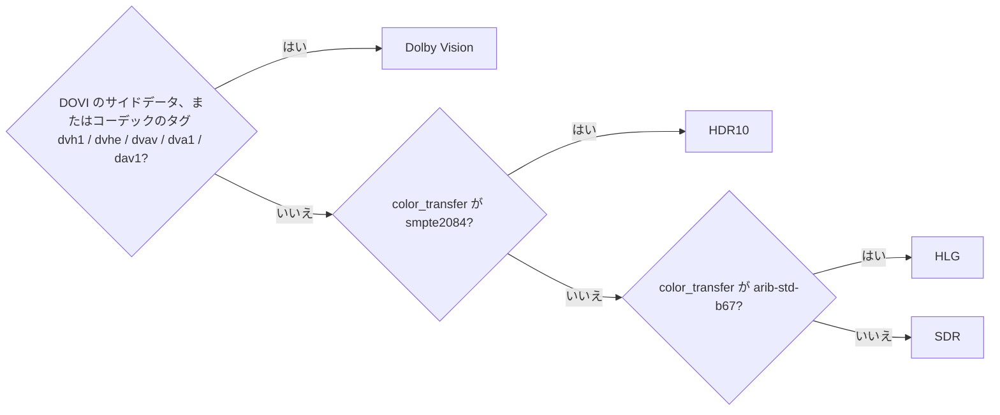
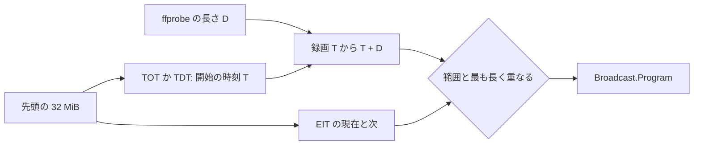
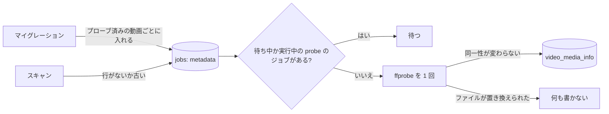

# 調査: 取り込みのプローブから得るメディア情報 {#research-media-information-from-the-import-probe}

引き継ぐ決定: 取り込みごとに 1 回の `ffprobe` の実行とそれが保つ値は [`internal/media/probe.go`](../../internal/media/probe.go) と [018 データモデル](../018-live-transcode-seek/data-model.md) に従う。ジョブのキュー、段階ごとに 1 つのワーカー、欠けた指紋の入れ直しは [020 データモデル](../020-seek-thumbnail-stage/data-model.md) と [030 データモデル、Fingerprints](../030-video-versions/data-model.md#fingerprints) に従う。ファイル全体を何も復号しない理由は [seek-sprite-generation.md](../../docs/design-docs/seek-sprite-generation.md) にある。このファイルは、この機能が加える決定だけを記録する。

## R-1: メディア情報は動画ごとに 1 つのバージョン付きの JSON の行である {#r-1-media-information-is-one-versioned-json-row-per-video}

**決定**: この機能が読むものはすべて、動画ごとに 1 つの JSON の値として、バージョンの列を持つ新しいインデックスのテーブル `video_media_info` に保存する ([data-model.md](data-model.md))。

| 案 | 動画ページでの読み取り | 一覧、並べ替え、絞り込み | 形の変更 | 判定 |
| --- | --- | --- | --- | --- |
| **動画ごとに 1 つの JSON の行、バージョン付き** | `video_id` で 1 行 | 不要 (親 Issue で範囲外) | `MediaInfoVersion` を上げる。古い行はないものとして読まれ、作り直される | 採用 |
| `videos` の列 | すでに読み込まれている | 使える | null を許す約 30 の列で、すべての一覧のクエリが読む | 不採用: 一覧は、どの一覧も示さないデータを運び、新しい項目のたびにマイグレーションになる |
| 正規化したテーブル (`video_streams`、`video_chapters`、`video_embedded_tags`) | 4 つのクエリ | 使える | 形の変更ごとに 3 つのマイグレーション | 不採用: それらを結合したり絞り込んだりするクエリはないので、正規化で得るものがない |

**根拠**: ページは値全体を一度に読み、ほかに読むものはないので、`video_transcode_probes` の形 (1 つのバージョン付きの JSON の行、プローブが作り直すインデックス) が合う。バージョンの列は、[R-5](#r-5-imported-videos-are-re-analysed-by-a-metadata-job-that-yields-to-pending-probes) のバックグラウンドでの再解析を動かすものでもある: パーサーの変更がそれを上げ、それより低い行はすべてもう一度読まれる。

## R-2: 同じ ffprobe の実行がチャプターを読み、MPEG-TS では長く読む {#r-2-the-same-ffprobe-run-reads-chapters-and-reads-longer-for-mpeg-ts}

**決定**: 取り込みの 1 回の `ffprobe` の実行に `-show_chapters` を加え、`.ts`、`.m2ts`、`.mts` のファイルでは `-analyzeduration 30M -probesize 100M` (30 秒、100 MiB) も加える。項目ごとに 2 つ目のプロセスは起動しない。

| 案 | 判定 |
| --- | --- |
| **1 回の実行、`-show_chapters`、TS では長い解析** | 採用 |
| 項目ごとかストリームごとに 2 つ目の `ffprobe` | 不採用: `Probe` のコメントが記録するとおり、費用の大半はプロセスの起動である。10,000 本の動画のライブラリは、さらに 10,000 のプロセスを起動することになる |
| すべてのコンテナで長い解析 | 不採用: MP4 や MKV はヘッダーにすべてのストリームを並べるので、長い上限はそこでは何も変えない。一方、TS は上限まで読まれる |
| 項目のためにフレームを復号する (ピーク輝度など) | 不採用: 親 Issue で範囲外であり、取り込みが復号を避ける理由は [seek-sprite-generation.md](../../docs/design-docs/seek-sprite-generation.md) が説明する |

**根拠**: `ffprobe` は既定では TS の解析を 5 秒か 5 MB で止める。放送の録画の 2 つ目の音声トラックや字幕のストリームは、録画が番組より前に始まるとき、最初のパケットをそれより遅く送ることがある。30 秒は録画機が開始の前に加える余裕を覆い、100 MiB は 24 Mbps の放送の 30 秒なので、2 つの上限には同時に達する。読み取りには上限があり、ファイルごとに 1 回だけ起こる。

## R-3: HDR、投影、3D、インターレースは `internal/domain` の純粋な規則で決める {#r-3-hdr-projection-3d-and-interlacing-are-decided-by-pure-rules-in-internaldomain}

**決定**: `internal/media` は `ffprobe` の生の値をそのまま渡し、`internal/domain` がそれを分類する。

| 項目 | 規則 |
| --- | --- |
| HDR の種類 | 図のとおり、その順に判定する。色の情報のない動画は SDR である |
| 360 度の動画 | `side_data_list` の `Spherical Mapping` の項目。その `projection` の値を保つ |
| 3D | `side_data_list` の `Stereo 3D` の項目。その `type` の値を保つ |
| インターレース | `field_order` が `tt`、`bb`、`tb`、`bt` ならインターレースであり、`progressive` ならそうではない。`unknown` かないときは省く |
| ビット深度 | あれば `bits_per_raw_sample`、なければ `pix_fmt` の深度 (`yuv420p10le` は 10) |

| 案 | 判定 |
| --- | --- |
| **伝達特性と Dolby Vision の信号** | 採用 |
| BT.2020 の原色か 10 ビットの深度を HDR とする | 不採用: 10 ビットの BT.2020 の SDR のエンコードはあり、HDR と示されてしまう |
| HDR10 のメタデータのために最初のフレームの SEI を読む | 不採用: 親 Issue で範囲外 |

**根拠**: HDR10 と HLG は伝達関数で定義され、すべての HDR のエンコードはそれをコンテナかストリームのヘッダーで示す。Dolby Vision はその構成のレコードで示される。HDR10+ は動的なメタデータを持つ HDR10 であり、HDR10 と示す。親 Issue はそれを認めている。規則は純粋な関数なので、それぞれの場合がプロセスなしの単体テストになる。

## R-4: TS の録画の放送局名と番組名は、ARIB STD-B24 の復号器を持つ Go の SI リーダーから得る {#r-4-station-and-programme-names-of-a-ts-recording-come-from-a-go-si-reader-with-an-arib-std-b24-decoder}

**決定**: TS のファイルでは、プローブのジョブはさらに、ファイルの先頭の最大 32 MiB を Go で読み、PAT、SDT (テーブル 0x42)、PAT の最初のプログラムの EIT の現在/次 (テーブル 0x4E、セクション 0 と 1)、TOT か TDT (テーブル 0x73 と 0x70) を解析し、サービス名とイベント名を `internal/media/arib` の ARIB STD-B24 の 8 単位符号の文字の復号器で復号する。サービス名、両方のイベント、時刻が見つかった時点で読むのを止める。番組は、開始の時点の現在のイベントではなく、2 つのイベントのうち録画と最も長く重なるものである:

| 録画 | 現在のイベント | 次のイベント | 番組 |
| --- | --- | --- | --- |
| 21:00 から 21:54 のドラマに対して 20:55 から 21:56 | 20:00 から 21:00 のニュース (中に 5 分) | ドラマ (中に 54 分) | ドラマ |
| 遅れて始まった 21:10 から 21:54 | ドラマ (中に 44 分) | 21:54 の次の番組 (中にない) | ドラマ |
| 先頭の 32 MiB に TOT も TDT もない | 任意 | 任意 | ない: 開始の時刻がわからないので、名前を推測しない |

選択は `internal/domain` の純粋な規則である ([data-model.md の規則](data-model.md#rules))。長さが未定義の現在のイベントは、次のイベントが始まるところで終わる。

| 案 | 放送局名 | 番組名 | 判定 |
| --- | --- | --- | --- |
| **ARIB の復号器を持つ Go の SI リーダー** | SDT から、復号する | EIT の現在か次のイベントから、復号し、重なりで選ぶ | 採用 |
| 開始の時点の EIT の現在のイベント | 採用した案と同じ | 番組より前に始まる録画では、録画した番組の前の番組 | 不採用: 録画機は録画を早めに始めるので、開始の時点の現在のイベントは前の番組であることが多い |
| `ffprobe -show_programs` | 生のバイトの `service_name`: FFmpeg が復号するのは ARIB STD-B24 ではなく DVB の文字の表なので、日本語の名前は読めない | 得られない: FFmpeg は EIT をメタデータに解析しない | 不採用: 要件 5 のどちらの半分も満たさない |
| `epg` のデータストリームの `ffprobe -show_packets` から得る EIT のセクション | 上と同じ | はるかに大きな出力に対して同じ復号器が要る | 不採用: より多い出力で同じ作業になる |
| 外部の TS のツール | ツールによる | ツールによる | 不採用: コンテナと Windows のアプリが同梱するのは `ffmpeg` と `ffprobe` だけである |

**根拠**: 放送では SDT と EIT の現在/次は少なくとも 2 秒ごとに繰り返され、24 Mbps のストリームの 2 秒は 6 MiB なので、32 MiB は、ほかのテーブルのパケットで始まる録画の分の余裕を残してそれらを見つける。TOT は数秒ごとに送られ、[クイックスタート](quickstart.md) の `rec.ts` の行が、それが上限の中にあることを確かめる。開始の時点の現在と次のイベントは、録画の最初の番組とその次の番組を覆う。録画がその前か中で始まる限り、そのどちらかが録画した番組である。リーダーは `ffprobe` の後に、`ffprobe` の 30 秒の `probeTimeout` とは別の、リーダー自身の 10 秒の期限のもとで動く。タイムアウトか読み取りのエラーは名前を省き、プローブを決して失敗させない。復号器は、JIS X 0208 の漢字とかなを `golang.org/x/text/encoding/japanese` で、JIS X 0201 のカタカナを、ARIB の追加記号 (85 区から 94 区) を表から扱う。サイズと位置の制御は無視し、対応できない文字は捨てる。復号した後に印字できる文字のない名前は省く。DVB (日本以外) の録画はこのリーダーでは復号せず、その名前は省く。

## R-5: 取り込み済みの動画は、待っているプローブに譲る `metadata` のジョブが再解析する {#r-5-imported-videos-are-re-analysed-by-a-metadata-job-that-yields-to-pending-probes}

**決定**: 新しいジョブの種類 `metadata` は、同じ `media.Probe` を実行し、`video_media_info` の行だけを書く。登録された場所を持つ動画に待ち中か実行中の `probe` のジョブがない間だけ取得できる。`seek_thumbnail` のジョブが `thumbnail` のジョブを待つ (`NoClaimableThumbnail`) のと同じである。そのため、実行中のプローブと `metadata` の実行が同時にディスクを読むことはない。マイグレーションは、プローブが終わり、登録された場所を持つすべての動画に 1 つ入れる。スキャンは、欠けた指紋を入れ直すのと同じように、行がないか、行が `MediaInfoVersion` より低い動画に 1 つ入れる。新しい取り込みは決してこれを得ない。そのプローブのジョブが自ら行を書くからである。

| 案 | 判定 |
| --- | --- |
| **待ち中か実行中のプローブがないときに取得できる `metadata` の種類** | 採用 |
| 優先度の列を持たせて既存の `probe` のジョブを入れ直す | 不採用: 上限で失敗したプローブは動画を `failed` にし、再生とシークプレビューを隠す。Edge Case は既存の情報を保つ |
| 起動時に始める埋め戻しの goroutine | 不採用: 何を試したかの記録がなく、再起動で最初からやり直し、同じディスクでプローブのワーカーと並んで動くことになる |
| `videos` の `media_info_version` の列 | 不採用: JSON の行がすでにバージョンを持つ。スキャンの行がない条件は、`FingerprintMissing` と同じようにそれを読む |

**根拠**: 種類ごとに 1 つのワーカーが一度に 1 つの `ffprobe` を実行し、それはヘッダー (と TS の最大 100 MiB) を読むので、再生は遅くならない。待ち中と実行中のプローブに譲ることで、新しい取り込み自身の段階が先になる。これが Edge Case のもう半分である。プローブのジョブが `running` を離れるとプローブのワーカーが `metadata` のワーカーを起こすので、埋め戻しはポーリングを待たずに再開する。上限での失敗は行をそのままにし、動画が最新のスキャンの集合にあるときは `metadata_failed` の問題として記録され、次のスキャンがジョブをもう一度入れる。ジョブが終わるときに送る `video` の通知で、開いている動画ページは取得し直すので、所有者は操作なしで情報が現れるのを見る。ゲストは次に開いたときに見る。

## R-6: `mediaInfo` は動画の詳細だけに入り、所有者とゲストで同じである {#r-6-mediainfo-is-part-of-the-video-detail-only-for-owners-and-guests-alike}

**決定**: `GET /api/videos/{id}` が `mediaInfo` を運ぶ ([contracts/screen-api.md](contracts/screen-api.md))。一覧の項目はどれもそれを運ばず、公開の動画を読むゲストは所有者と同じ値を得る。

| 案 | 判定 |
| --- | --- |
| **詳細の応答のフィールド** | 採用 |
| `GET /api/videos/{id}/media-info` | 不採用: ページを開くたびにリクエストが 1 つ増える。ページはすでに `video` の通知で詳細を取得し直し、再解析の結果はそれで届く |
| 一覧を含むすべての `Video` に入れる | 不採用: カードが何も示さないもののために、カードごとに JSON の行を読む。これらの項目での並べ替えと絞り込みは範囲外である |
| ゲストへの応答から場所と機器を省く | 不採用: 要件 8 はそれらをほかの項目と同じに扱い、公開の動画は全体として公開である |

**根拠**: `workInfo` がすでにこの形 (詳細だけ、所有者の PUT は別) に従うので、サーバー、クライアント、テストには写せる型がある。

## R-7: チャプターは `chapters` のテキストトラックであり、印を video.js のシークバーに描く {#r-7-chapters-are-a-chapters-text-track-with-marks-drawn-in-the-videojs-seek-bar}

**決定**: ページは `mediaInfo.chapters` から `chapters` のテキストトラックを作り、チャプターごとにキューを加える。シークバーに加えるコンポーネントが、チャプターの開始ごとに `start / duration` の位置に印を 1 つ描く。シークプレビューはポインターの下のチャプターの名前を示す。コントロールバーの video.js の `ChaptersButton` が名前を並べ、選んだものへシークする。

| 案 | 判定 |
| --- | --- |
| **テキストトラック、シークバーの印、チャプターのボタン** | 採用 |
| `videojs-markers` プラグイン | 不採用: 最後のリリースは video.js 7 向けで、保守されていない |
| プレイヤーの下の独自のチャプターの帯 | 不採用: シークする面が 2 つになり、親 Issue はシークバーを求めている |
| WebVTT のチャプターのエンドポイント | 不採用: 詳細の応答が持つデータのために、ルートとリクエストが 1 つ増える |

**根拠**: video.js 自身のチャプターのボタンとメニューで、キーボードとスクリーンリーダーの振る舞いがただで得られ、それが読むキューは印とプレビューが使うのと同じ一覧なので、ページ上の情報源は 1 つになる。チャプターの一覧の正規化は `internal/domain` の純粋な規則である ([data-model.md の規則](data-model.md#rules)): 長さの時点かそれより後に始まるチャプターは捨て、長さを越える終わりは切るので、シークバーが終わりより先に印を示すことは決してない。

## R-8: 言語のコードは `Intl.DisplayNames` で示す {#r-8-language-codes-are-shown-through-intldisplaynames}

**決定**: API はトラックの言語のコードをファイルが持つとおりに運び (`jpn`、`eng`、`ja-JP`)、ページは `new Intl.DisplayNames([locale], { type: "language" }).of(code)` を示す。これは、2 文字の対応を持つ 3 文字のコードを正規化する。呼び出しが例外を投げるか、コードを変えずに返すときは、コードをそのまま示し、`und` は示さない。

| 案 | 判定 |
| --- | --- |
| **ページでの `Intl.DisplayNames`** | 採用 |
| カタログの言語の表 | 不採用: ブラウザーがすでに持つ名前のために、2 つのカタログに数百の行が要る |
| サーバーで解決した名前 | 不採用: サーバーは視聴者のロケールを持たず、画面の文言はページのものである ([i18n.md](../../docs/design-docs/i18n.md)) |

**根拠**: SPA が対応するすべてのブラウザーは `Intl.DisplayNames` を持ち、カタログはプロダクトが定める言葉だけを持つ。
