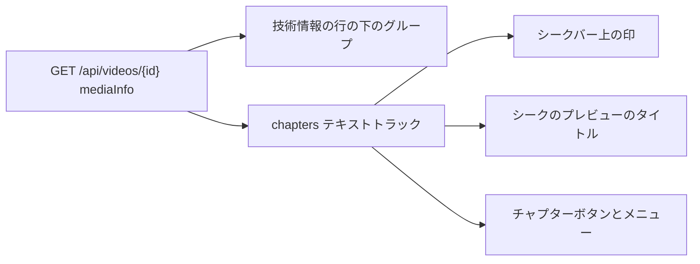
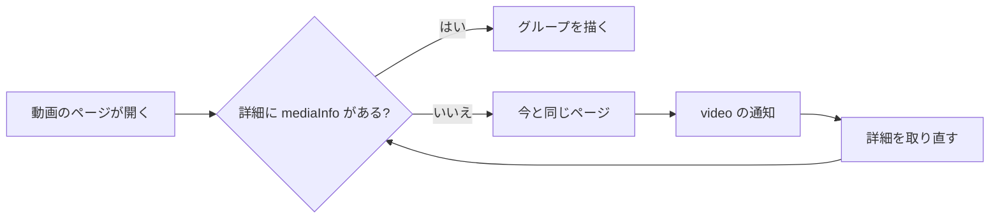
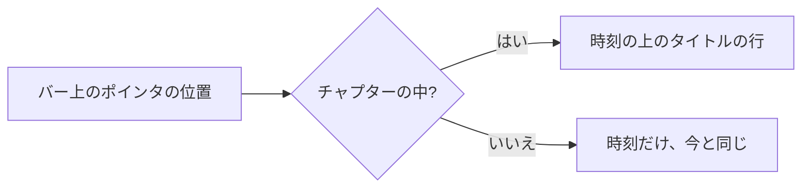

# UI 設計: 動画ページのメディア情報のグループとシークバーのチャプター {#ui-design-media-information-groups-on-the-video-page-and-chapters-on-the-seek-bar}

**機能**: [親 Issue #1227](https://github.com/syudead/vv/issues/1227) · [plan.md](plan.md) · [data-model.md、保存する値](data-model.md#stored-value-domainmediainfo) · [contracts/screen-api.md](contracts/screen-api.md) · [research.md R-6](research.md#r-6-mediainfo-is-part-of-the-video-detail-only-for-owners-and-guests-alike) · [R-7](research.md#r-7-chapters-are-a-chapters-text-track-with-marks-drawn-in-the-videojs-seek-bar) · [R-8](research.md#r-8-language-codes-are-shown-through-intldisplaynames)

すでに決まっていることの出典。ここでは繰り返さずリンクする。

| 話題 | 出典 |
| --- | --- |
| トークン、閉じたスケール、動画のページの視聴の密度 | [design-system.md、Foundations](../../docs/design-docs/design-system.md#foundations)。値は [`web/src/ui/tokens.css`](../../web/src/ui/tokens.css) の `@theme` にあり、ここでは名前で示し、決して写さない |
| `Button`、`Popover`、`Badge`: それぞれの用途 | [components.md](../../web/registry/rules/components.md) |
| 動画のページの階層 (プレイヤー > タイトル > 関連動画 > ファイルの情報 > 技術情報)、情報の行、その右側の操作のグループ | [012 UI 設計、階層と文字組み](../012-video-detail-ia/ui-design.md#hierarchy-and-typography)、[動画の事実](../012-video-detail-ia/ui-design.md#video-facts)。[library-ui.md、情報の行](../../docs/design-docs/library-ui.md#information-rows)。[`VideoFacts.tsx`](../../web/src/player/VideoFacts.tsx) |
| 作品の詳細の行: ファイルの行の間隔で折り返す `label value` の項目、三つの項目と `+{n} more` に折りたたむ長い一覧、三行に折りたたむ説明 | [047 UI 設計、動画のページ: 作品の詳細の行](../047-video-work-info/ui-design.md#video-page-work-details-row)。[`WorkInfo.tsx`](../../web/src/player/WorkInfo.tsx) |
| 技術情報の行: `text-xs uppercase tracking-wider`、控えめな色、大文字のコーデック (`formatCodec`) | [012 UI 設計、階層と文字組み](../012-video-detail-ia/ui-design.md#hierarchy-and-typography)。[`properties.ts`](../../web/src/player/properties.ts) |
| コントロールバーの並び順と、そのメニューボタンの箱、文字、メニュー。Esc がメニューだけを閉じること | [012 UI 設計、コントロールバー](../012-video-detail-ia/ui-design.md#control-bar)。[027 UI 設計、コントロールバー: 画質のメニュー](../027-playback-quality/ui-design.md#control-bar-quality-menu)。[library-ui.md、コントロールバー](../../docs/design-docs/library-ui.md#control-bar) |
| トラックがないと自ら隠れる字幕ボタンと、そのメニュー | [028 research R-10](../028-sidecar-subtitles/research.md#r-10-subtitle-button-and-menu-use-videojs-subscapsbutton)。[`subtitleMenu.ts`](../../web/src/player/subtitleMenu.ts) |
| シークのプレビュー: バーの上の画像、その時刻の丸い枠、プレイヤーの幅ごとのその幅、タッチとポインタでの振る舞い | [021 research](../021-seek-thumbnail-sprite/research.md)。[`seekPreview.ts`](../../web/src/player/seekPreview.ts)。[`web/src/index.css`](../../web/src/index.css) の `.vv-seek-preview` の規則と `tokens.css` の `seek-preview-*` の段階 |
| CSS での幅のブレークポイント。人が端末で確かめるレイアウト | [library-ui.md、幅のブレークポイント](../../docs/design-docs/library-ui.md#width-breakpoints-in-css-and-the-sidebar-exception)、[人が確かめるレイアウト](../../docs/design-docs/library-ui.md#layout-verified-by-people-not-machines) |
| 画面の文言 | [`web/src/i18n/en.ts`](../../web/src/i18n/en.ts) (`player.facts`、`player.workInfo`、`player.controls`)。この機能は `player.mediaInfo` と `player.chapters` を加える |

この機能は画面に二つのものを加え、所有者とゲストのどちらにも示す (R-6)。

1. 動画のページ (`/videos/:id`) の技術情報の行の下の**メディア情報のグループ**: Video、Audio、Subtitles、Embedded、Broadcast。どれもファイルにその項目があるときだけ描く (要件 7 と 8、受け入れ条件 1 から 4、6、7)。
2. **プレイヤーのチャプター**: シークバー上のチャプターごとの印、シークのプレビューのチャプターのタイトル、コントロールバーのチャプターボタン。そのメニューはチャプターへシークする (要件 9、受け入れ条件 5)。

図はそれぞれの部分の位置を示す。

変わらないもの: プレイヤーのほかのコントロール、タイトルとタグ、公開範囲の切り替え、ファイルの事実 (Length、Size、Added、Edited、Created)、作品の詳細の行、技術情報の行、カードと一覧の行 (メディア情報を持たず、範囲外)、そしてタイトルと Created の事実。埋め込みのタイトルと撮影日時がこれらを置き換えることはない (要件 10)。`mediaInfo` の値を持たない動画は、今と画素単位で同じである。

## この形にした理由 {#why-this-shape}

**グループは技術情報の行の下の折り返す行で、ファイルの行の `text-sm` と間隔を使い、各行の先頭に小さな大文字のグループ名を置く。** Issue は、タイトル、長さ、解像度が主のままであり、追加分がグループごとに、既存の情報表示の間隔と書体で副次的に読めることを求める。情報欄はすでにその形を持つ: ファイルの行と作品の詳細の行は `label value` の項目を `gap-x-4` で折り返し、技術情報の行は最後の最も控えめな行である。グループはその順を下へ続ける: グループは技術情報の行の後に来る (plan、仕組み) ので、一目で要る要約 (解像度、コンテナ、コーデック) は今の場所に残り、詳細がその後に続く。各グループ名は技術情報の行と同じ組み方 (`text-xs uppercase tracking-wider`、控えめな色) にするので、`VIDEO`、`AUDIO`、`SUBTITLES` は新しい事実ではなく技術的な種類の見出しとして読める。`FactList` (一行に一つの用語と値) は採用しなかった: 二つの音声トラック、字幕のストリーム、放送局、番組を持つ TS の録画は十二行の高さになり、Issue は今の情報を埋もれさせる一覧を除外している。カードや枠付きのブロックは [012](../012-video-detail-ia/ui-design.md#screen-boundary) により採用しなかった。012 は詳細の周りに枠を描かない。開閉 (既定で閉じた `Details`) は採用しなかった: 受け入れ条件 1 から 4 と 7 は HDR の種類、トラック、撮影の情報、放送局がページで見えることを期待し、情報欄には今、読むためのコントロールがない。

**グループ全体を控えめな色にする。単位や語が何であるかを示す値にはラベルを付けない。** ファイルの事実はアイコン付きでラベルのない控えめな文字である。`12:34` と `1.2 GB` はそれ自体で意味が分かるからである。作品の詳細は控えめなラベルと本文の色の値である。所有者の内容だからである。メディア情報はファイル自身の記述で、重要さでは作品の詳細より下にある。そのためどのグループも `text-muted-foreground` のままにし、Video、Audio、Subtitles の項目は `label value` の組ではなく単位付きの裸の語 (`HDR10`、`29.97 fps`、`10-bit`、`Stereo`、`Japanese`) にする。組にすると項目の数が倍になる。Embedded と Broadcast の項目は語のラベル (`Title`、`Author`、`Station`) を保つ。裸の `NHK` や `John` は何であるかを示さないからである。項目のアイコンは採用しなかった: フレームレート、ビット深度、HDR の種類には、見る人が `size-4` で読める図柄がない。

**一つのトラックは部分を ` · ` でつないだ一つの項目で、グループに二つ以上あるときは番号を付ける。** 受け入れ条件 2 は、どの音声トラックもその言語とともに示すことである。見る人はトラックを番号で数え、行が折り返すときは番号がトラックの始まりを示す。トラックごとに一行は採用しなかった。作品の詳細が一覧を折りたたむのと同じ理由である: リマックスは 64 のトラックを持ちうるし、Issue は情報欄が高くならないようにしている。代わりに、六つより多いトラックを持つグループは六つと `+{n} more` を示す。作品の詳細の折りたたみを上限を上げて使う。六つのトラックはディスクのリマックスがよく持つ数で、1280px で二行に収まるからである。

**インターレースは `Interlaced` の語として、ファイルがそう示すときだけ示す。** プログレッシブのファイルが普通である。ほぼすべての動画に `Progressive` の項目があれば雑音になり、インターレースを気にする人は例外 (縞の出る TS の録画) を探す。`Cover art` と `Closed captions` も同じ規則に従う: 真なら語を示し、偽なら何も示さない。

**チャプターはシークバーの切れ目、シークのプレビューのタイトルの行、右側のグループの左端のメニューボタンである。** 印はプレイヤーの暗い面の色 (`navbar`) でバーの高さいっぱいに描く。YouTube が見慣れたものにした形である: チャプターの境界はバーの切れ目に見え、再生済み (`primary`) と未再生 (`input`) の部分のどちらでも見える。印はポインタのイベントを受けないので、その下のバーは前とまったく同じにシークする (`UI品質`: チャプターはシークと再生の邪魔を決してしない)。見る人はすでに時刻がある場所でチャプターのタイトルを知る: シークのプレビューに時刻の上にチャプターのタイトルの行が加わるので、印の上にポインタを置くか印をまたいでスクラブすると、そこから始まるチャプターの名前が出る。チャプターボタンは video.js の `ChaptersButton` で、字幕や画質のボタンと同じコンポーネントの系統なので、それらの箱、メニュー、キーボードの扱い、並べるものがないときに隠れることを持つ (R-7)。ボタンは右寄せの空白の後、変換の表示の前、時刻の表示に最も近い位置に置く。時間を移動するものだからである。画質と速度の間に置くのは採用しなかった。027 は変換の表示を画質と組にし、028 は字幕を速度の隣に置くからである。プレイヤーの下のチャプターの帯とプラグイン `videojs-markers` は R-7 で採用しなかった。今のチャプターのタイトルを時刻の表示の横に示すのは採用しなかった: 360px ではコントロールバーに余地がなく、プレビューとメニューがすでにチャプターの名前を示す。ページ上のチャプターの一覧は採用しなかった: 要件 7 はページに対して要件 1 から 3 と 5 を挙げており、二つ目のチャプターの一覧は二つ目のシークの面になる。

## 文言 {#words}

英語はカタログが取り込む下書きである。実装の後は [`web/src/i18n/en.ts`](../../web/src/i18n/en.ts) が正となる。トラックのタイトル、埋め込みのタグ、放送局と番組の名前、機器の名前、チャプターのタイトルは利用者のデータで、訳さずに埋め込む。言語の名前はカタログの言語 (`en`) で `Intl.DisplayNames` (R-8) から得る。ブラウザが名前を付けられないコードはコードのまま示す。

### 動画のページ、グループ {#video-page-groups}

| 場所 | 文字 | 注記 |
| --- | --- | --- |
| グループ名 | Video / Audio / Subtitles / Embedded / Broadcast | 見える。`text-xs uppercase tracking-wider`。それぞれがその `ul` の名前になる |
| HDR の種類 | SDR / HDR10 / HLG / Dolby Vision | `hdr` から。HDR10+ は HDR10 として示す (R-3) |
| フレームレート | {rate} fps | 小数は二桁まで、末尾のゼロは落とす: `23.98 fps`、`30 fps`、`59.94 fps` |
| ビット深度 | {n}-bit | `8-bit`、`10-bit` |
| ビットレート | {n} Mbps / {n} kbps | 1 Mbps 以上は小数一桁の Mbps (末尾のゼロは落とす)、それ未満は丸めた kbps: `12.3 Mbps`、`850 kbps` |
| インターレース | Interlaced | `interlaced` が `true` のときだけ。`false` か無いときは何も示さない |
| 360 度動画 | 360° | `projection` があるとき。値は問わない |
| 3D | 3D ({type}) | `type` はファイルが与えるままの `stereo3d`: `3D (side by side)` |
| トラック番号 | {n} | グループに二つ以上のトラックがあるときの、トラックの項目の最初の部分。ストリームの順に `1` から |
| 音声のコーデック | AAC / AC-3 / E-AC-3 / DTS / TrueHD / FLAC / Opus / MP3 / MP2 / PCM / Vorbis | これらの `codec_name` には表を使う。ほかは `formatCodec` を通す (大文字) |
| 字幕のコーデック | SRT / ASS / SSA / PGS / DVD / WebVTT / MP4 text / ARIB / DVB / EIA-608 | `subrip`、`ass`、`ssa`、`hdmv_pgs_subtitle`、`dvd_subtitle`、`webvtt`、`mov_text`、`arib_caption`、`dvb_subtitle`、`eia_608`。ほかは `formatCodec` を通す |
| チャンネルの構成 | Mono / Stereo / {layout} / {n} ch | `mono` と `stereo` はカタログの語。ほかの構成はファイルが与えるまま (`5.1`、`7.1`)。数だけが分かるときは `{n} ch` |
| トラックの属性 | Default / Forced / Hearing impaired | それぞれトラックの項目の一部で、この順に、タイトルの後に置く |
| クローズドキャプション | Closed captions | `video.closedCaptions` が `true` のときの Subtitles グループの項目 |
| 埋め込みのラベル | Title / Author / Comment / Description / Genre / Date / Recorded / Device / Location | `label value` の項目。`Date` は保存されたままのファイルの文字。`Recorded` は三つの日付の事実と同じく、見る人の時間帯での `recordedAt` の `formatDateTime` |
| 位置の値 | {latitude}, {longitude} / {latitude}, {longitude} · {altitude} m | 小数四桁、`tabular-nums`。高度はあるときメートル単位に丸める |
| カバーアート | Cover art | `coverArt` が `true` のときの、Embedded グループの末尾の語の項目 |
| 放送のラベル | Station / Program | `label value` の項目 |
| 折りたたんだトラック | +{n} more / Show fewer | `player.workInfo.more` と `showFewer` を再利用する。`aria-label` は `Show all {count} {group}` (`Show all 8 audio tracks`) |
| 折りたたんだコメントや説明 | Show more / Show less | `player.workInfo.showMore` と `showLess` を再利用する |

### プレイヤー {#player}

| 場所 | 文字 | 注記 |
| --- | --- | --- |
| チャプターボタンの名前、ツールチップ、メニューのタイトル | Chapters | `playerDictionary()` を通す (`Chapters`)。キーはない |
| メニューの項目 | {start} {title} | 開始を `formatDuration` (`0:12`、`1:02:03`) で `tabular-nums` にし、その後にタイトル |
| タイトルのないチャプター | Chapter {n} | `n` は開始の順で 1 からのチャプターの位置。メニューとプレビューで使う |
| シークのプレビューのタイトルの行 | {title} | 利用者のデータ。一行で、プレビューの幅で省略記号で切る |

## 動画のページ: グループ {#video-page-groups-1}

グループは情報欄 ([library-ui.md、情報の行](../../docs/design-docs/library-ui.md#information-rows)) の技術情報の行の後に描くので、情報欄の `gap-3` がグループを技術情報の行から、またグループどうしを離す。グループは項目が一つ以上あるときだけ描く。`video` オブジェクトがある `mediaInfo` の値を持つ動画には、常に Video グループがある。`hdr` が常に設定されるからである (contracts)。チャプターはここには示さず、プレイヤーへ行く。

| 部分 | 形 |
| --- | --- |
| グループ | ファイルの行のクラス (`flex flex-wrap items-baseline gap-x-4 gap-y-2 text-sm sm:gap-x-5`) を持つ `ul` で、全体が `text-muted-foreground`。区切り線、枠、アイコンはない |
| グループ名 | 行の最初の子: `text-xs uppercase tracking-wider`、`lang="en"`、技術情報の行の形。`ul` の名前になる (`aria-labelledby`) |
| 語の項目 | 一つの語か値の `li` (`HDR10`、`29.97 fps`、`Interlaced`、`Cover art`)。`whitespace-nowrap`、数には `tabular-nums` |
| ラベル付きの項目 | ラベルと値を `gap-x-1.5` 離した `li` で、どちらも控えめな色。値は `wrap-anywhere` で、長いタイトルや機器の名前はそれ自身の中で改行し、ページを決してスクロールさせない |
| トラックの項目 | 部分を ` · ` で一つの文字の並びにつないだ `li`: 番号 (トラックが二つ以上)、コーデック、構成 (音声)、言語の名前、タイトル、`Default`、`Forced`、`Hearing impaired`。無い部分は飛ばす。`min-w-0 wrap-anywhere`: それ単独で行より広いときだけ中で改行する |
| Comment、Description | それぞれ Embedded の行の項目ではなく、その下のラベル付きの段落: ラベルを先に、続いて文字を `whitespace-pre-line max-w-prose` で置き、`Show more` で三行に折りたたむ。先頭のラベルと控えめな色を持つ、作品の詳細の `Description` である |

グループの順と、それぞれが示すもの:

| グループ | 項目 (順に) | 無いとき |
| --- | --- | --- |
| Video | HDR の種類、フレームレート、ビット深度、ビットレート、`Interlaced`、`360°`、`3D ({type})` | `video` が無い |
| Audio | `audioTracks` の項目ごとに一つのトラックの項目、ストリームの順に。六つより多いと折りたたむ | `audioTracks` が無い |
| Subtitles | `subtitleTracks` の項目ごとに一つのトラックの項目。`Closed captions` を最後に | `subtitleTracks` が無く、`closedCaptions` が `true` でない |
| Embedded | `Title`、`Author`、`Genre`、`Date`、`Recorded`、`Device`、`Location`、`Cover art`。その後に `Comment` と `Description` の段落 | `embedded` が無い |
| Broadcast | `Station`、`Program` | `broadcast` が無い |

例。1280px での行の読め方:

| ファイル | 行 |
| --- | --- |
| スマートフォンの動画 | `VIDEO  SDR · 29.97 fps · 8-bit · 18.2 Mbps` / `AUDIO  AAC · Stereo` / `EMBEDDED  Recorded Sep 27, 2026, 3:04 PM · Device Apple iPhone 15 · Location 35.6895, 139.6917 · 40 m` (ここでは ` · ` が行の間隔を表す) |
| quickstart の `dual.mkv` | `AUDIO  1 · AAC · 5.1 · Japanese · Default   2 · AAC · Stereo · English` / `SUBTITLES  SRT · Japanese` |
| `rec.ts` | `VIDEO  SDR · 29.97 fps · 8-bit · 14.9 Mbps · Interlaced` / `AUDIO  1 · AAC · Stereo · Japanese   2 · AAC · Stereo · Japanese` / `SUBTITLES  ARIB · Japanese` / `BROADCAST  Station NHK総合 · Program {programme name}` |

折りたたみは作品の詳細の長い一覧と同じに働く: 最初の六つのトラックの項目、続いて行の中に、控えめな色で `hover:text-primary` の `link` `sm` の `Button` として `+{n} more`。押すとその場ですべてのトラックを示し、フォーカスを七つ目へ移す。`Show fewer` で再び折りたたむ。覚えておかない。

### 状態 {#states}

グループは自分の読み込み中の状態を持たない: `mediaInfo` は動画とともに届く。図はグループが現れる時を示す。

| 状態 | 画面が示すもの |
| --- | --- |
| `mediaInfo` が無い (この機能より前に取り込んだ、または行が現在のバージョンより下。既存の動画は再解析しない、[R-5](research.md#r-5-media-information-is-read-only-by-the-import-probe-of-new-or-changed-files)) | 新しいものはない。ファイルの行、作品の詳細、技術情報の行は今と同じ。プレースホルダーも `Reading…` の行もない: 技術情報の行がすでにプローブの保留や失敗を示す |
| ページを開いている間に `video` の通知で `mediaInfo` が届く (所有者) | グループが技術情報の行の下にその場で現れる。上の行は動かず、空にもならない (受け入れ条件 6) |
| 一部のグループ | 内容のあるものだけを、決まった順に |
| ゲスト | 公開の動画では所有者と同じグループ (R-6、要件 8)。ゲストは `group` の通知だけを受け取る ([048 の契約、`/api/events`](../048-groups/contracts/screen-api.md)) ので、ゲストが開いているページは プローブのジョブが終わっても再取得しない。グループはページを次に読み込んだとき、またはイベントストリームが再接続した後に現れる。この機能はゲスト向けの通知を加えない |

## プレイヤー: チャプター {#player-chapters}

ページは `mediaInfo.chapters` から `chapters` テキストトラックを作る。チャプターごとに `startMs` から `endMs` までの一つのキューで、タイトルを持ち、タイトルがないときは `Chapter {n}` を持つ (R-7)。下の三つの部分はその一つのトラックを読む。チャプターのない動画にはトラックも印もボタンもなく、そのプレイヤーは今と同じである (受け入れ条件 5)。

### 印 {#marks}

| 観点 | 規則 |
| --- | --- |
| 位置 | `.vjs-progress-holder` 上に、バーの幅の `startMs / durationMs` の位置にチャプターごとに一つの印。最初のチャプターのものも含む (`0` ではバーの左端に重なり、そこでは目立たないので、印の数はチャプターの数に等しい) |
| 形 | 名前付きの段階 `chapter-mark` の幅 (2px)、バーの高さいっぱい、色は `navbar`。ホバーでバーが太くなるのに合わせて太くなり、再生済みと未再生の部分のどちらでも見える |
| 重なり順 | 再生の進みの塗りより上、シークのプレビューとスライダーのつまみより下 |
| ポインタ | `pointer-events: none`。バーでの押下、ドラッグ、キーボードでのシークは変わらない |
| 重複 | 開始が同じ二つのチャプターは見える印を一つ描く |
| 装飾 | チャプターごとのラベル、番号、色はない |

Q-5: 印は操作できない。その価値は、チャプターがどこで始まり、それぞれがどれだけの長さかを一目で示すことにある。印をボタンと思って押した人は、その下のバー上のその位置へシークする。それが押した意図なので、防ぐべきものはない。

### シークのプレビューのタイトル {#seek-preview-title}

図はプレビューがチャプターの名前を示す方法を示す。

| 観点 | 規則 |
| --- | --- |
| どのチャプターか | 開始がその位置以前で最も遅く、終わりがその位置より後のもの。開始が同じチャプターの間では、開始の順で後のもの。無ければタイトルの行はない。一つの共有の関数がこの規則を適用するので、プレビューとメニューの選択 (下記) は常に同じチャプターを示す |
| 形 | 時刻の丸い枠の中の、時刻の上の行: 同じ `--text-seek-preview` の大きさと `foreground` の色、中央揃え、`white-space: nowrap`。丸い枠の幅で省略記号で切り、その幅はプレビューの画像の幅で止まる |
| プレビューが使えない (スプライトが失敗した) | 今と同じく丸い枠だけで、時刻の上にタイトルの行を置く |
| スプライトの URL がない (`seekThumbnailUrl` が無い) | 今はこのときプレイヤーはシークのプレビューを付けない。チャプターのある動画はスプライトなしでプレビューを付け、最初から使えない形にする (タイトルの行と時刻を持つ丸い枠、画像なし、スプライトの要求なし)。チャプターもスプライトの URL もない動画は今と同じである。URL が後から届くと、今と同じく、プレビューをスプライト付きで付け直す |
| タッチ | 時刻と同じ: 指がバーに触れている間示す |

### チャプターボタンとメニュー {#chapters-button-and-menu}

| 観点 | 規則 |
| --- | --- |
| 位置 | 右寄せの空白の後、変換の表示の前: 空白、**Chapters**、変換の表示、画質、字幕、速度、PiP、全画面 |
| ボタン | チャプターのアイコンを持つ video.js の `ChaptersButton`。字幕ボタンが持つ `.vjs-control` の箱 (`4em`、狭いコンテナでは `3em`) に入れる。チャプターのトラックがないときは video.js が隠す。キーも `aria-keyshortcuts` もない |
| メニュー | 字幕と画質のボタンが使う video.js のメニューで、幅は `20em` (画質のメニューの `10em` ではタイトルが短く切れる)。タイトル `Chapters` を `vjs-menu-title` として持ち、開始の順にチャプターごとに一つの項目 |
| 項目 | `{start} {title}`、左揃え、一行、メニューの幅で省略記号で切る。video.js の `ChaptersTrackMenuItem` は項目を `cue.text` だけでラベル付けし、キューの文字はシークのプレビューが読むのでタイトルのままにする。そのため、ボタンは `ChaptersButton` のサブクラスで、その項目はキューの `startTime` (`formatDuration`) とその文字からラベルを組み立てる `ChaptersTrackMenuItem` のサブクラスである |
| 選択中の項目 | 今再生中のチャプターが `vjs-selected` を持ち、再生が境界を越えると移る。現在の時刻にシークのプレビューの規則 (最も遅い開始、同じ開始では後のもの) を当てて選び、video.js の `activeCues[0]` では選ばない。後者は重なるチャプターのうち前のものを示す (data-model.md は重なりを保つ)。そのため、メニューとプレビューが食い違うことはない |
| 選ぶ | チャプターの開始へシークし、再生中か一時停止かを元のまま保ち、メニューを閉じる |
| 多くのチャプター | 長い字幕の一覧と同じく、一覧はメニューの中でスクロールする。1,000 のチャプターでも遅れなく開く |
| キーと Esc | 画質のメニューと同じ: Tab、Enter か Space、矢印、Enter。Esc はメニューだけを閉じる |
| タッチ | ボタンで開閉し、項目で選ぶ |

## レスポンシブな振る舞い {#responsive-behaviour}

Tailwind の既定のブレークポイントだけを使い、CSS で切り替える。確かめる幅は 360px、768px、1280px (二列のレイアウトでは 1280×820) で、プレイヤーはそれぞれでページが与える幅にする。

| 幅 | グループ | プレイヤー |
| --- | --- | --- |
| 1280px | 左の列の技術情報の行の下。各グループは一行か二行。`dual.mkv` は二つの行になる。行には列をスクロールして届き、ファイルの行と操作のグループは情報欄の上端に残る | バーはおよそ列の幅で、印は 2px。タイトルの行を持つプレビューは `--size-seek-preview-max`。チャプターのメニューは `20em` で上向きに開く |
| 768px | 縦に積むレイアウトで 1280px と同じ。三つのトラックを持つグループは次のグループの前で二行に折り返す | プレイヤーは端から端まで。プレビューはその clamp に従う。コントロールバーは完全な `4em` の箱 |
| 360px | 各グループは `gap-x-4` で項目ごとに折り返す。行より広いトラックの項目はそれ自身の中で改行する。2,000 文字の埋め込みのタイトルや、六つに折りたたんだ 64 トラックのファイルでも横スクロールはない。グループ名は行の最初の行に留まり、収まるときは最初の項目がその横に並ぶ | 狭いコンテナ: `3em` の箱。変換の表示、字幕、チャプターがすべてあるとき、バーはすべてのボタンを枠の中に保つ。何より先に変換の表示と時刻の表示の余白を狭め、どのボタンも隠さない。プレビューのタイトルの行は狭い画像の幅で切れる。`20em` のメニューはプレイヤーの中に収まる |

## レビューの基準 {#review-criteria}

vv の一つの暗い配色で、動いている画面を見て判断する (library-ui.md、人が確かめるレイアウト)。「存在する」だけでは合格しない (Q-4)。

1. **視覚の階層 (ページ)**: 目は今もプレイヤー → タイトル → タグ → ファイルの事実 → 作品の詳細 → 技術情報の行と進み、その後で初めてグループへ行く。すべてのグループがあるページでも、タイトル、長さ、解像度はグループのないページと同じ速さで見つかる (`UI品質`: 主な情報が先頭のままである)。グループ名は技術的な種類の小さな見出しとして、技術情報の行と同じ重さで読め、どのグループの項目もファイルの事実より濃くも大きくもない。
2. **グループが区別して読める**: 見る人は値を読まずに、どの行が映像、音声、字幕、埋め込みのタグ、放送についてかを言える。`rec.ts` のページでは `Station` と `Program` を区別でき、二つ目の音声トラックを一つ目と番号で区別できる (受け入れ条件 2 と 7)。
3. **情報の密度**: スマートフォンの動画は三つの行を、TS の録画は五つの行を加え、どれも 1280px で二行より高くない。音声トラックが一つで字幕のない動画は `Subtitles` の行も、空のラベルも、`—` も示さない (`UI品質`: 項目の少ない動画に空白がない。受け入れ条件 3)。8 トラックのファイルは六つと `+2 more` を示す。2,000 文字の説明は三行と `Show more` である。ファイルの行の右端の操作のグループはどの幅でもその位置を保ち、`mediaInfo` のない動画は行のどの画素も変わらない。
4. **間隔のリズム**: 項目の間の間隔はファイルの行と等しい (`gap-x-4`、`sm` から `gap-x-5`)。情報欄の `gap-3` が技術情報の行、各グループ、段落を離す。グループ名は項目のベースラインに乗り、360px ではグループの折り返した行は行の左端、グループ名の下から、字下げなしで始まる。
5. **文字組み**: グループ名は技術情報の行の `text-xs uppercase tracking-wider` である。項目はファイルの行の `text-sm` の控えめな色である。数 (`29.97 fps`、`10-bit`、`12.3 Mbps`、`35.6895, 139.6917`、トラック番号) は `tabular-nums` である。コーデックは技術情報の行と同じく大文字である (`AAC`、`SRT`、`ARIB`)。HDR の種類は正確に `HDR10`、`HLG`、`Dolby Vision`、`SDR` と読める (受け入れ条件 1)。言語は名前で、`Japanese` と `English` であり、決して `jpn` ではない (受け入れ条件 2)。`und` のトラックは言語の部分を示さない。
6. **値**: スマートフォンの動画は日付と時刻付きの `Recorded`、メーカーと機種付きの `Device`、小数四桁の二つの座標付きの `Location` を示し、そのタイトル、Created と Added の事実、一覧のカードはこの機能の前と同じである (受け入れ条件 4、要件 10)。10-bit の HLG のファイルは `HLG · 10-bit` を示す。TS の録画は `Interlaced` とその放送局を示す (受け入れ条件 7)。
7. **自ら現れる**: 新しいファイルか変更されたファイルのプローブが終わる前に所有者が開いた動画のページは、再読み込みなしに、上の行が動いたり空になったりせずに、技術情報の行の下にグループを得る。この機能より前に取り込んだ動画は再解析しない (R-5)。
8. **操作の優先度 (プレイヤー)**: `chapters.mkv` で、シークバーの押下とドラッグ、印の押下、Space、F、M は、チャプターのない動画と同じに振る舞う。印は細い切れ目で、再生の進みの塗りとつまみより先に目を引かない (`UI品質`: チャプターはシークと再生の邪魔をしない)。チャプターボタンは右側のグループのもう一つの控えめな箱で、字幕ボタンより大きくも明るくもなく、チャプターのない動画にはない。
9. **チャプターのタイトル**: 印の上にポインタを置くと、時刻の上にそこから始まるチャプターのタイトルを持つプレビューが出る。境界をまたいで動かすと、印のところでタイトルが変わる。最初のチャプターより前や最後のチャプターより後の位置は時刻だけを示す。チャプターがあってシークのスプライトがない動画は、丸い枠の中で時刻の上に同じタイトルを示す (受け入れ条件 5)。
10. **チャプターのメニュー**: メニューはすべてのチャプターを順に `{start} {title}` として並べ、再生中のものに印を付け、重なるチャプターの中では、印の付く項目はその時刻にプレビューが示すチャプターである。一つを選ぶとその開始から再生し、再生中か一時停止かの状態を保つ。タイトルのないチャプターは `Chapter 3` と読める。メニューより広いタイトルは省略記号で終わり、メニューの幅は変わらない。長さを越えて終わるチャプターは印と項目を示し、そのキューは長さのところで終わる (quickstart、エッジケース: 長さを越えるチャプター)。
11. **スマートフォンの幅 (プレイヤー)**: 360px で、字幕トラック付きで変換を通して `chapters.mkv` を再生しているとき、コントロールバーのどのボタンも枠の中にあり、全画面ボタンは切れない。プレビューのタイトルの行は省略記号付きの一行である。メニューはプレイヤーの中に開く。
12. **ゲスト**: サインアウトした状態で、公開の `dual.mkv` は所有者と同じ `Audio` と `Subtitles` の行を示し、公開の `chapters.mkv` は同じ印、プレビューのタイトル、メニューを示す。
13. **要件を満たさない例** (`UI品質`): グループが枠付きのカード、表、一行に一つの項目の用語と値の一覧である。グループが技術情報の行やファイルの事実より上にある。グループ名が `text-sm` か本文の色である。項目にアイコンがある。Video の行がすべてのファイルで `Progressive` を示す、または `Subtitles` が `None` を示す。空の動画が `No media information` の行やスピナーを示す。グループが開閉の後ろにある。埋め込みのタイトルがページのタイトルを置き換える、または撮影日時が Created を置き換える。印に色やラベルがある、またはポインタを受ける。チャプターボタンが画質と速度の間にある、またはチャプターのない動画に出る。チャプターのタイトルがコントロールバーの時刻の表示の横に描かれる。メニューがタイトルを開始時刻なしで並べる。360px でコントロールバーのボタンが隠れるか切れる。

## デザインシステムへの変更 {#changes-to-the-design-system}

コンポーネント、パターン、規則は加えない。`tokens.css` はプレイヤーの特別な節の `seek-preview-*` の段階の隣に、名前付きの段階 `chapter-mark` (2px) を一つ得る。印の幅は間隔のスケールにない値だからである。印とメニューの幅は、画質のメニューの `10em` と同じく、`index.css` の既存の `.vv-video-player` の規則の下に置く。色のトークンは加えず、`web/src/theme/tokens.test.ts` の `pairs` にも何も加えない: グループは一覧にある `background` の上の `muted-foreground` を使い、印とプレビューの行は文字の組ではない。作品の詳細の `ListItem` は折りたたみの上限を引数として受け取り、その `Description` は先頭のラベルと控えめな色を受け取るので、コードは写さない (AGENTS.md)。アイコンは video.js 自身のチャプターのアイコンである。

## アクセシビリティ {#accessibility}

親 Issue はスクリーンリーダーやコントラストの設計を求めていないので、033 と 047 と同じく、名前だけを決める。

- 各グループの `ul` は見えるグループ名で名付ける。トラックの項目は一つの文字の並びで、`1 · AAC · Stereo · Japanese · Default` と読まれる。ラベル付きの項目のラベルは見える文字なので、隠れた名前は要らない。折りたたみのコントロールは折りたたんでいる間 `Show all {count} {group}` である。
- チャプターボタンは `Chapters`、そのメニューのタイトルは `Chapters`、各項目はその `{start} {title}` の文字で、再生中のものには video.js の `, selected` の接尾辞が付く。印はシークのプレビューと同じく `aria-hidden` である。メニューが同じチャプターを並べるからである。
