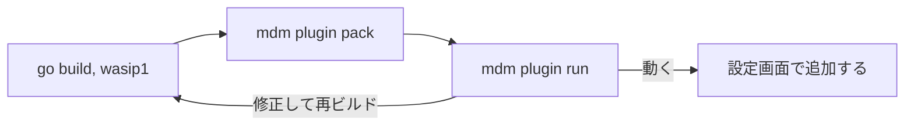

# 契約: プラグイン作者のためのホストコマンド {#contract-host-commands-for-plugin-authors}

正典: [cmd/mdm](../../../cmd/mdm) と作者向けの手順書 [docs/how-to/work-info-plugins.md](../../../docs/how-to/work-info-plugins.md)。実装がこれを更新する。2 つのコマンドはどちらも、`mdm account` ([016 account-cli.md](../../016-single-account-auth/contracts/account-cli.md)) と同じく、サーバーのバイナリ `mdm` のサブコマンドである。引数のない `mdm` は引き続きサーバーを起動し、`VVMDM.exe` はこれらを受け付けない ([R-1](../research.md#r-1-mdm-plugin-run-and-mdm-plugin-pack-reuse-the-servers-runtime-and-parser-and-open-no-database))。どちらのコマンドも `MDM_DATA_DIR` を読まず、`ffmpeg` も要らない。

図は作者のループを示す。

## `mdm plugin pack <module.wasm> <manifest.json>` {#mdm-plugin-pack-modulewasm-manifestjson}

パックしたモジュールがアップロードと同じ検査を通ったあとで、マニフェストを `vv.plugin` セクションとしてモジュールに書き込む。既存のセクションがあれば置き換える ([R-2](../research.md#r-2-pack-replaces-the-vvplugin-section-and-writes-the-file-only-after-the-packed-module-passes-inspection))。

| 引数 | 意味 |
| --- | --- |
| `<module.wasm>` | ビルドしたモジュール。一時ファイルとリネームでその場に書く |
| `<manifest.json>` | マニフェスト ([plugin-contract.md の Manifest](plugin-contract.md#manifest)) |

| 結果 | 終了コード | 標準エラー |
| --- | --- | --- |
| 書き込んだ | 0 | プラグインの名前、バージョン、操作、宣言した設定。VVMDM が一覧にするとおり |
| マニフェストが JSON オブジェクトでないか、規則に違反する | 2 | `manifest_invalid` または `contract_unsupported`、フィールドと違反した規則。ファイルは変わらない |
| パックしたモジュールが検査に失敗する | 2 | 問題 (`not_wasm`、`import_unsupported`、`export_invalid`、`table_too_large`)。ファイルは変わらない |
| ファイルを読めないか書けない | 1 | 理由。リネームが行われなかった場合、モジュールは変わらない |
| 引数が正しくない | 2 | 理由と使い方 |

## `mdm plugin run <module.wasm> <operation> <input> [--set KEY=VALUE]... [--proxy URL]` {#mdm-plugin-run-modulewasm-operation-input---set-keyvalue---proxy-url}

モジュールを VVMDM と同じように 1 回実行し、VVMDM が応答から保持するものを出力する。

| 引数 | 意味 |
| --- | --- |
| `<operation>` | プラグインの契約の操作: `search` または `fetch`。のちの契約の操作は、マニフェストが宣言していれば受け付ける |
| `<input>` | 操作の入力: `search` では語、`fetch` では作品の ID。画面 API と同じ規則で確認する (トリムしたあとで 1 から 200 文字)。URL の形の入力もそのまま ID である |
| `--set KEY=VALUE` | 設定の値。繰り返せる。`KEY` はマニフェストが宣言したものでなければならず、値も既定値もない `required` のキーがあればコマンドは止まる |
| `--proxy URL` | 実行のプロキシ。`PUT /api/settings/plugin-proxy` が受け取るもの ([R-4](../research.md#r-4-the-proxy-is-one-url-in-settings-read-on-each-run-and-passed-to-the-runtime-as-a-run-option))。フラグがなければなし |

コマンドは最初にモジュールを検査し、アップロードが拒否するものを拒否する。実行には [Limits](../../../docs/how-to/work-info-plugins.md#limits) の制限と [Addresses](../../../docs/how-to/work-info-plugins.md#addresses) のアドレス規則が適用され、要求は実効の設定値を載せる ([R-3](../research.md#r-3-a-setting-declares-default-and-options-the-stored-value-or-the-default-is-what-the-run-receives))。

| 結果 | 終了コード | 標準出力 | 標準エラー |
| --- | --- | --- | --- |
| 応答が有効 | 0 | 保持した結果をインデントつき JSON で: VVMDM の切り詰めと制限のあとの `{"candidates": […]}` または `{"workInfo": {…}}` | プラグインの標準エラーを書かれたとおりに。切り詰められていれば続けて `truncated after 64 KiB` |
| 実行が失敗した | 1 | なし | プラグインの標準エラー。続けて失敗を示す 1 行 (`plugin_failed`、`timed_out`、`blocked_address`、`network_error`、`memory_exceeded`、`output_too_large`)。2 つのネットワークの失敗ではホスト、`plugin_failed` ではプラグインのメッセージ |
| モジュールが検査に失敗する、宣言されていない設定か欠けている設定がある、入力かプロキシの URL が規則に違反する | 2 | なし | 理由と使い方 |
| ファイルを読めない | 1 | なし | 理由 |

`--set` で渡した秘密の値は、プラグインが書いたとおりに出力する。作者が自分で入力したものであり、[R-6](../research.md#r-6-the-runtime-returns-each-runs-standard-error-and-the-app-keeps-the-last-one-per-plugin-with-the-secret-values-masked) の伏せ字は所有者の画面のためにある。
