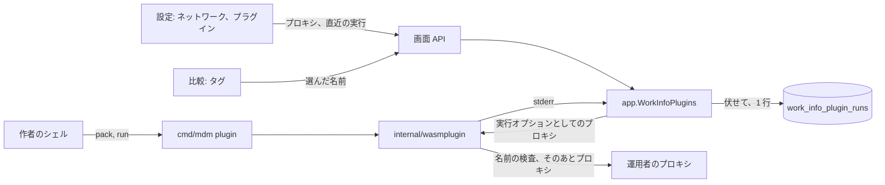
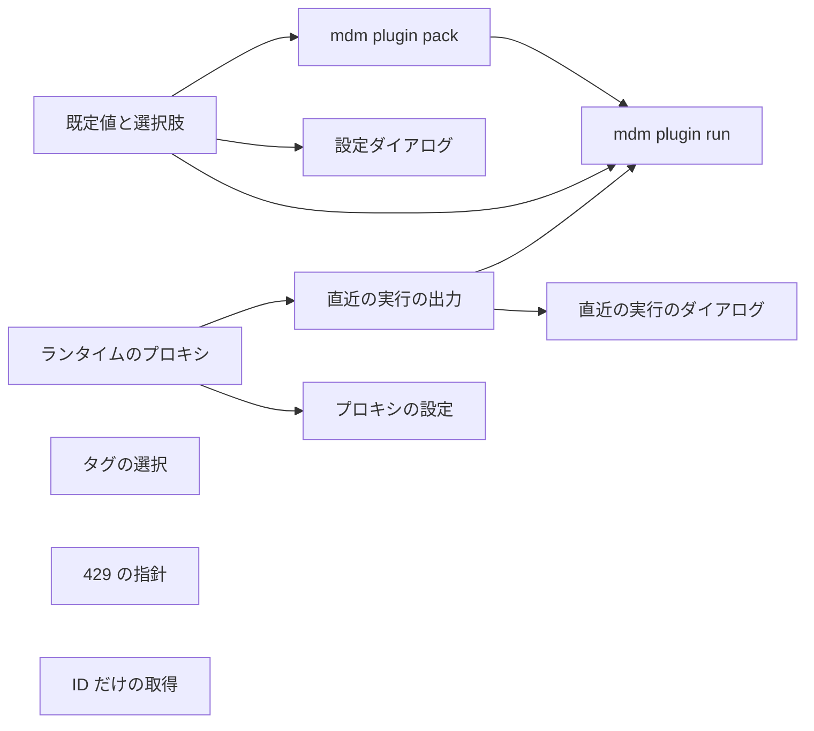

# 実装計画: 作者、運用者、利用者のための作品情報プラグインの道具 {#implementation-plan-work-info-plugin-tooling-for-authors-operators-and-users}

**ブランチ**: `feature/056-plugin-tooling` | **親 Issue**: #1232

**入力**: 親 Issue。これがこの機能の仕様である。

## 概要 {#summary}

プラグインの作者は、`mdm` バイナリにホストコマンドを 2 つ得る。`mdm plugin pack` はマニフェストを検査してモジュールに書き込み、`mdm plugin run` はサーバーと同じランタイムと制限でモジュールをローカルで実行する。マニフェストの設定に `default` と `options` が加わる。設定ダイアログはそれを表示し、所有者が何も入力しなかったとき、実行はそれを受け取る。運用者は Network セクションでプラグインの要求用のプロキシを設定する。VVMDM は、非公開アドレスに解決される宛先を引き続き拒否し、各プラグインの直近の実行の標準エラーを、秘密の値を伏せて設定画面のために保持する。比較では、所有者は取得したタグを 1 つずつ選ぶ。プラグインの契約はバージョン 1 のままである。

図は、この機能が加えるか変更する部分と、その間を流れるものを示す。



| 関心事 | 方針 |
| --- | --- |
| ローカルでの実行と pack | ランタイムとパーサーを共有する `mdm` のサブコマンド。データベースは使わない ([R-1](research.md#r-1-mdm-plugin-run-and-mdm-plugin-pack-reuse-the-servers-runtime-and-parser-and-open-no-database)、[R-2](research.md#r-2-pack-replaces-the-vvplugin-section-and-writes-the-file-only-after-the-packed-module-passes-inspection)、[contracts/plugin-cli.md](contracts/plugin-cli.md)) |
| 既定値と選択肢 | マニフェストの `default` と `options`。実効値は `internal/domain` で計算する ([R-3](research.md#r-3-a-setting-declares-default-and-options-the-stored-value-or-the-default-is-what-the-run-receives)、[contracts/plugin-contract.md](contracts/plugin-contract.md)) |
| プロキシ | 実行ごとに読む `settings` の 1 行をランタイムに渡す。宛先の名前は、各要求とリダイレクトの前に解決して検査する ([R-4](research.md#r-4-the-proxy-is-one-url-in-settings-read-on-each-run-and-passed-to-the-runtime-as-a-run-option)、[R-5](research.md#r-5-through-a-proxy-the-destination-is-checked-by-resolving-its-name-before-each-request-and-redirect)) |
| 直近の実行の出力 | ランタイムが返し、アプリが伏せ、世代に結び付けたプラグインごとの 1 行にし、実行が終わった順に書く ([R-6](research.md#r-6-the-runtime-returns-each-runs-standard-error-and-the-app-keeps-the-last-one-per-plugin-with-the-secret-values-masked)、[data-model.md](data-model.md)) |
| タグの選択 | apply で `fields` の隣に `tags` を置く。動画にあるタグは選べない ([R-7](research.md#r-7-the-apply-takes-the-selected-tag-names-and-a-tag-already-on-the-video-is-not-selectable)、[contracts/screen-api.md](contracts/screen-api.md)) |
| プロキシを設定する場所 | すべてのビルドの Network セクション。LAN スイッチはデスクトップ専用のまま ([R-8](research.md#r-8-the-network-section-shows-on-every-build-and-the-lan-switch-stays-desktop-only)) |
| `429` の指針 | 実行ごとの待ち 10 秒の範囲で、最大 5 秒後に 1 回再試行し、そのあとはエラー応答にする ([R-9](research.md#r-9-on-a-429-a-plugin-waits-for-the-smaller-of-retry-after-and-5-seconds-retries-once-and-otherwise-reports-an-error)) |
| ID だけの取得 | 取得の要求、画面 API、`mdm plugin run` は作品の ID を運び、URL を運ばない。各候補は取得に使う ID を、リンクにすぎないページの URL の隣に持つ。所有者の文字列がそのまま ID である ([R-10](research.md#r-10-a-fetch-takes-a-work-id-only-and-vvmdm-never-fetches-a-url-the-owner-typed)、[contracts/plugin-contract.md](contracts/plugin-contract.md)、[contracts/plugin-cli.md](contracts/plugin-cli.md)) |

要件 14 から 16 は、統合 PR が開いたあとで親 Issue に加わった。これらは [049 screen-api.md](../049-work-info-plugins/contracts/screen-api.md) と [049 ui-design.md](../049-work-info-plugins/ui-design.md) の取得の入力を改める。この 2 つはコードが引く生きた参照なので、この Plan の最後の単位がその場で更新する。

この Issue には `ui` ラベルがあるので、`design` ステージが 4 つの画面の単位より前に `ui-design.md` を書く。そこでは次を扱う。[049 ui-design.md の Settings dialog](../049-work-info-plugins/ui-design.md#settings-dialog) の設定ダイアログについては、既定値を入力した値と区別して見せる方法、選択肢のある設定のフィールド、古い値の注記。Network セクションのプロキシの行は、LAN スイッチの行と同じ形にする。プラグインの行とそのダイアログの直近の実行の出力は、空、切り詰め、失敗の状態と、レイアウトを保つ長い出力を含む。[049 ui-design.md の Compare](../049-work-info-plugins/ui-design.md#compare) の比較では、行のチェックボックスを全選択にしてタグを 1 つずつ選ぶこと、初期の選択、動画にあるタグの選択不可の印、25 個以上のタグを全体で見られる一覧を扱う。いずれも Issue の `UI品質` の範囲内である。

親 Issue の `対象外` にあるとおり、次は範囲外である。既定の `User-Agent` の変更。VVMDM がプラグインの代わりに `429` を再試行すること。直近の実行より前の実行の履歴。プラグインの配布や共有。

## 技術的背景 {#technical-context}

**正典となる定義**:

| 話題 | 出典 |
| --- | --- |
| 境界、コンポジションルート、ストアの役割、利用者のデータ | [ARCHITECTURE.md](../../ARCHITECTURE.md) |
| プラグインのサンドボックス、制限、ネットワーククライアント、実行と apply | [work-info-plugins.md](../../docs/design-docs/work-info-plugins.md)、[049 research](../049-work-info-plugins/research.md)、[internal/wasmplugin](../../internal/wasmplugin)、[internal/app/work_info_fetch.go](../../internal/app/work_info_fetch.go) |
| 作者向けのプラグインの契約 | [work-info-plugins.md (how-to)](../../docs/how-to/work-info-plugins.md) |
| `mdm` のホストコマンド | [016 account-cli.md](../016-single-account-auth/contracts/account-cli.md)、[cmd/mdm/account.go](../../cmd/mdm/account.go) |
| 設定の行、Network セクションとその API | [internal/store/settings.go](../../internal/store/settings.go)、[037 network-settings-api.md](../037-windows-app/contracts/network-settings-api.md)、[web/src/settings/NetworkSection.tsx](../../web/src/settings/NetworkSection.tsx) |
| プラグインの行、設定の値、フィクスチャのビルド補助 | [049 data-model.md](../049-work-info-plugins/data-model.md)、[internal/store/work_info_plugins.go](../../internal/store/work_info_plugins.go)、[internal/wasmplugin/plugintest](../../internal/wasmplugin/plugintest) |
| 画面 API、エラー、生成されたコード | [api/openapi.yaml](../../api/openapi.yaml)、[023 error-api](../023-english-i18n/contracts/error-api.md)、`task generate` |
| 設定ダイアログ、取得ダイアログ、画面の規則、Web のテスト | [web/src/settings/WorkInfoPluginSettingsDialog.tsx](../../web/src/settings/WorkInfoPluginSettingsDialog.tsx)、[web/src/player/workInfoFetch/](../../web/src/player/workInfoFetch/)、[design-system.md](../../docs/design-docs/design-system.md)、[web-testing.md](../../docs/design-docs/web-testing.md) |
| ブラウザーのテストとそのフィクスチャのプラグイン | `web/e2e/work-info-plugins.e2e.ts` (削除済み)、`internal/wasmplugin/testdata/e2eworks/` (削除済み) |
| チェック | [Taskfile.yml](../../Taskfile.yml) (`task check`、`task check-docs`) |

**この機能に固有の背景**:

- 新しい依存はない。マイグレーションは `00054_work_info_plugin_runs.sql` の 1 つである ([data-model.md の Migration](data-model.md#migration))。
- `WorkInfoPluginRuntime.Run` はこの機能で 2 回形を変える。プロキシを `domain.WorkInfoRunNetwork` として受け取り、結果の隣に保持した標準エラーを返す。これを変える 2 つの単位は、シグネチャの変更がそれぞれ 1 回で済むように順序づけてある。
- プロキシのテストは、テストがループバックで起動するプロキシに対して実行する。アドレス規則の `local` 関数は、既存のネットワークのテストと同じように注入するので、CI にインターネットは要らない。CI が扱えないものは [quickstart.md](quickstart.md) にある。
- PR #1233 (`main` に対して開いている) は契約に `lookup` 操作を加える。`mdm plugin run` は操作を引数に取ってマニフェストに照らして検証するので、その PR が入っても形を変える必要はない。コマンドの実装は、そのときまでに PR がマージされていれば `lookup` の入力規則を加える。
- `internal/domain` は `os` を import しないので、2 つのコマンドのファイルの読み書きは `cmd/mdm` に、セクションの書き換えは `internal/wasmplugin` に置く。

## 憲章の確認 {#constitution-check}

| 規則 (出典) | 判定 |
| --- | --- |
| import は `cmd` から `internal/app` とアダプターを経て `internal/domain` へ向かう。アダプターは互いにも `internal/app` も import しない (ARCHITECTURE.md、depguard) | 適合: `mdm account` が `internal/store` を呼ぶのと同じく、`cmd/mdm` はコマンドのために `internal/wasmplugin` と `internal/domain` を直接呼ぶ。ランタイムは引き続き `internal/domain` だけを import する |
| `cmd/mdm` は独自のユースケースを持たない (ARCHITECTURE.md) | 判断つきで適合: `pack` と `run` は、`mdm account` がストアに対して行うのと同じく、アダプターとドメインの規則の上のホストコマンドである。必要な要求の組み立てと実効値の規則は `internal/domain` にあり、`internal/app` と共有する |
| ストアの役割。1 つの操作に 1 つの役割 (ARCHITECTURE.md) | 適合: 実行の行と、置き換え時のその削除は `WorkInfoPluginStore` に属し、プロキシの行は `SettingsStore` に属する |
| 利用者のデータは再構築を越えて残る (ARCHITECTURE.md) | 適合: `work_info_plugin_runs` は `videos` へのリンクを持たない `work_info_plugins` にぶら下がる。プロキシは `settings` の行である |
| すべての読み取りは閲覧者を知っている (ARCHITECTURE.md) | 適合: 新しいルートはすべて所有者専用で、`accessRoutes` にない |
| プラグインが選ぶアドレスに届くのは `internal/wasmplugin` だけ (ARCHITECTURE.md、work-info-plugins.md) | 適合: プロキシの対応と名前の検査はアダプターのクライアントの中に留まる。ComfyUI と Ollama のクライアントには触れない |
| 生成されたファイルを手で編集しない (AGENTS.md) | 適合: `api/openapi.yaml` を変え、そのあと `task generate` を実行する |
| 複雑度は 25 以下。コピーせずコードを共有する (AGENTS.md) | 適合: カスタムセクションの書き込みは `plugintest` から出て、コマンドとテストが共有する。実効値の規則は、アプリ、エントリ、CLI が使う 1 つのドメイン関数である。プロキシの URL の規則は、API と CLI が使う 1 つのドメイン関数である |
| 画面の前に design-system.md を読む。最も低いレベルでテストする (AGENTS.md、web-testing.md) | 適合: マニフェストの規則、実効値、URL の規則、伏せ字には Go の単体テストを置く。プロキシのクライアントと stderr の返却にはアダプターのテスト、ルートにはハンドラーのテスト、ダイアログにはページのテストを置く。タグの選択は既存のブラウザーのテストを拡張する |
| 変更と一緒に文書を書く (AGENTS.md、core-beliefs.md) | 適合: 各単位が、変更する手順書か設計文書の節を挙げ、翻訳は同じ PR で実行する |

違反はないので、複雑度の追跡はしない。判定は Phase 1 のあとも変わらない。

## プロジェクトの構成 {#project-structure}

### 文書 (この機能) {#documentation-this-feature}

```text
specs/056-plugin-tooling/
├── plan.md
├── research.md
├── data-model.md
├── quickstart.md
└── contracts/
    ├── plugin-cli.md
    ├── plugin-contract.md
    └── screen-api.md
```

`ui-design.md` は `design` ステージが書く。`quickstart.md` があるのは、CI が実際のプロキシにもサイトにも届かず、Windows アプリを実行しないからである。

### ソースコード {#source-code}

**影響する境界**:

| 境界 | この機能で持つもの |
| --- | --- |
| `internal/domain` | マニフェストの `default` と `options` の規則。設定の実効値と古い値。プロキシの URL の規則。`WorkInfoRunNetwork`。実行ログの型。秘密の値の伏せ字。apply で選んだタグの名前 |
| `internal/wasmplugin` | 公開したセクションの書き込み。`Proxy` コールバックでの名前の検査を伴うクライアントのプロキシと、`407`/`CONNECT` の対応づけ。保持した標準エラーを返す `Run` |
| `internal/store` | マイグレーションと、`WorkInfoPluginStore` の `work_info_plugin_runs` (置き換え時に削除する)。`SettingsStore` のプロキシの行 |
| `internal/app` | 実行ごとのプロキシの読み取り。実行ログの伏せ字と保存。選択による apply のタグの絞り込み。プロキシ設定のユースケース |
| `internal/httpapi`、`api/openapi.yaml` | エントリのフィールド、直近の実行のルート、プロキシのルート、apply の `tags` |
| `cmd/mdm` | `mdm account` の隣の `mdm plugin pack` と `mdm plugin run` |
| `web/src/api`、`web/src/settings`、`web/src/player/workInfoFetch`、`web/src/i18n` | クライアント関数と型。既定値と選択肢のあるダイアログ、直近の実行のダイアログ、プロキシの行。タグの選択。カタログのテキスト |
| `web/e2e`、`internal/wasmplugin/testdata/e2eworks` | 選択を外したタグ、既定値のある設定、直近の実行の出力を含むブラウザーのテスト。標準エラーに書くフィクスチャ |
| `docs/`、`ARCHITECTURE.md` | 作者向けの手順書 (pack、run、マニフェストのフィールド、標準エラー、`429`、プロキシ)、設計文書 (ネットワークと実行の節)、running-vv.md の復旧の表、サブシステムの行 |

**新しいパス**: `cmd/mdm/plugin.go`、`internal/store/migrations/00054_work_info_plugin_runs.sql`、`web/src/settings/WorkInfoPluginRunDialog.tsx`。

**構成の決定**: コマンドは専用のパッケージではなく `cmd/mdm` に置く。`mdm account` がすでにそこにあり、コマンドは既存の 2 つのパッケージの組み合わせだからである ([R-1](research.md#r-1-mdm-plugin-run-and-mdm-plugin-pack-reuse-the-servers-runtime-and-parser-and-open-no-database))。プロキシはランタイムの状態ではなく各実行のパラメーターとする ([R-4](research.md#r-4-the-proxy-is-one-url-in-settings-read-on-each-run-and-passed-to-the-runtime-as-a-run-option))。これでランタイムが持つ所有者の設定が 1 つ減り、コマンドとサーバーが同じ `Run` を呼ぶ。

## 実装の作業 {#implementation-work}

図は、先に入れなければならない単位を示す。4 つの画面の単位は、`design` ステージの `ui-design.md` も待つ。



### 作品情報プラグインの設定に既定値と選択肢を宣言する {#declare-default-values-and-choices-for-work-info-plugin-settings}

**範囲**: `domain.WorkInfoPluginSetting` の `default` と `options`。規則は [contracts/plugin-contract.md の Manifest](contracts/plugin-contract.md#manifest) による。`Entry`、要求の `settings`、`required` の確認での実効値と `staleValue` ([R-3](research.md#r-3-a-setting-declares-default-and-options-the-stored-value-or-the-default-is-what-the-run-receives))。`api/openapi.yaml` の `WorkInfoPluginSetting` とクライアントの型 ([contracts/screen-api.md](contracts/screen-api.md#workinfopluginsetting))。作者向けの手順書の `Manifest` と `Request` の節。

**依存**: なし。

**受け入れ**: `task check` と `task check-docs` が通り、`task generate` との差分がない。ドメインのテストが次を示す。既定値が選択肢にないマニフェスト、選択肢が 1 つのもの、50 を超える 51 個のもの、201 文字の選択肢、重複する選択肢、既定値のある秘密の設定は、いずれも `manifest_invalid` として拒否される。有効な既定値と選択肢を持つものは受け入れられる。設定されていないキーには既定値、設定されているキーには保存された値、選択肢にない保存された値には既定値を載せた実行要求。既定値のある必須キーは欠落と報告されない。アプリのテストが、選択肢にない保存された値のエントリが `set: true`、その `value`、`staleValue` を持つことを示す。ハンドラーのテストが、一覧の本文に `default`、`options`、`staleValue` があることを示す。

### mdm plugin pack でプラグインのマニフェストを書いて確認する {#write-and-check-a-plugin-manifest-with-mdm-plugin-pack}

**範囲**: `vv.plugin` セクションを置き換えるか追加する `internal/wasmplugin` の公開関数。`plugintest` とブラウザーのテストのフィクスチャのビルドは、それぞれの複製の代わりにこれを使う。`cmd/mdm` の `mdm plugin pack`。検査、拒否したマニフェストの理由 (フィールドと規則。コマンドが使えるようにドメインのパーサーの結果へ加える)、[contracts/plugin-cli.md](contracts/plugin-cli.md#mdm-plugin-pack-modulewasm-manifestjson) のアトミックな書き込み ([R-2](research.md#r-2-pack-replaces-the-vvplugin-section-and-writes-the-file-only-after-the-packed-module-passes-inspection))。手順書の手順 5 と 6 を 1 つの `pack` の手順に置き換え、`addsection` に触れていた `Troubleshooting` の行を更新する。

**依存**: 作品情報プラグインの設定に既定値と選択肢を宣言する。

**受け入れ**: `task check` と `task check-docs` が通る。アダプターのテストが、セクションのないモジュールにセクションを加えることと既存のセクションを置き換えることを示し、wazero が新しいマニフェストを読む。コマンドのテストが次を示す。有効なマニフェストが書き込まれ、そのモジュールが `Inspect` と `Upload` に受け入れられる。既定値が選択肢にないマニフェストは、終了コード 2、`default` を名指しするメッセージ、ファイルのバイトが変わらない状態で拒否される。未対応の関数を import するモジュールは、`import_unsupported` でファイルが変わらないまま拒否される。`pack` を 2 回実行してもセクションは 1 つになる。引数が足りないときは、使い方と終了コード 2 で応答する。

### 非公開の宛先を拒否しつつ、運用者が選んだプロキシ経由で作品情報プラグインの要求を送る {#send-work-info-plugin-requests-through-an-operator-chosen-proxy-while-refusing-non-public-destinations}

**範囲**: `domain.WorkInfoRunNetwork` と `ParseWorkInfoPluginProxyURL`。ネットワークのオプションを受け取る `WorkInfoPluginRuntime.Run` (`app.WorkInfoPlugins` はまだ何も渡さない)。`internal/wasmplugin` では、実行ごとのトランスポートのプロキシ、各要求とリダイレクトごとに `Proxy` コールバックで解決して検査する宛先の名前、到達できない、`CONNECT` を拒否する、`407` を返すプロキシの `-3` とプロキシのホストへの対応づけ ([R-5](research.md#r-5-through-a-proxy-the-destination-is-checked-by-resolving-its-name-before-each-request-and-redirect))。`docs/design-docs/work-info-plugins.md` のネットワークの節に残るリスクを書き、手順書の `Addresses` の節を更新する。

**依存**: なし。

**受け入れ**: `task check` と `task check-docs` が通る。ドメインのテストが次を示す。ユーザー情報の有無にかかわらず `http`、`https`、`socks5` の URL が受け入れられ、パスのある URL、`ftp` スキーム、ホストのない URL、2048 文字を超える URL は拒否される。ループバックで起動したプロキシと注入したリゾルバーを使うアダプターのテストが次を示す。プラグインの要求がプロキシ経由でサイトに届く (プロキシがそれを見た)。LAN アドレスに解決される宛先の名前は `blocked_address` で拒否され、プロキシが要求を見る前にその名前が拒否される。そのような名前へのリダイレクトも同じように拒否される。リテラルの LAN アドレスは拒否される。待ち受けていないプロキシと `407` を返すプロキシは、それぞれ実行を `network_error` とプロキシのホストで失敗させる。プロキシなしの実行は挙動が変わらない。

### 作品情報プラグインごとに直近の実行の標準エラーを保持する {#keep-the-last-runs-standard-error-per-work-info-plugin}

**範囲**: 成功時にも失敗時にも、保持した標準エラーとその切り詰めのフラグを返す `Run`。マイグレーションと `WorkInfoPluginStore` の `work_info_plugin_runs`。ランタイムの `record` 呼び出しの中で、実行した世代に対してだけ書き、置き換えるアップロードで削除する ([data-model.md](data-model.md))。実行の秘密の値の伏せ字と `app.WorkInfoPlugins` での保存 ([R-6](research.md#r-6-the-runtime-returns-each-runs-standard-error-and-the-app-keeps-the-last-one-per-plugin-with-the-secret-values-masked))。エントリの `lastRunAt` と `GET /api/work-info-plugins/{id}/last-run` ([contracts/screen-api.md](contracts/screen-api.md#get-apiwork-info-pluginsidlast-run))。クライアント関数。設計文書の実行の節。running-vv.md の復旧の表。

**依存**: 非公開の宛先を拒否しつつ、運用者が選んだプロキシ経由で作品情報プラグインの要求を送る。

**受け入れ**: `task check` と `task check-docs` が通り、`task generate` との差分がない。アダプターのテストが、成功した実行、時間切れになった実行、失敗した実行で標準エラーが返ることと、100 KiB の出力がフラグつきで 64 KiB として返ることを示す。アダプターのテストが、2 回目の実行が始まれる前に `record` が呼ばれることを示す。ドメインのテストが、2 回現れる秘密の値が 2 回置き換えられること、秘密でない値が残ること、空の秘密が一致しないこと、秘密の先頭のバイト列で終わる切り詰められた出力ではそのバイト列が伏せられることを示す。ストアとアプリのテストが次を示す。2 回目の実行で行が置き換わる。置き換えるアップロードのあとに行が残らない。保存の前にプラグインが置き換えられた (同じバイト列でも) か削除された実行は何も書かない。一覧に `lastRunAt` がある。ハンドラーのテストが、保持された実行ではルートの本文、実行がなければ `{}`、未知のプラグインでは `404`、ゲストでは `401` を示す。

### mdm plugin run で作品情報プラグインをローカルで実行する {#run-a-work-info-plugin-locally-with-mdm-plugin-run}

**範囲**: [contracts/plugin-cli.md](contracts/plugin-cli.md#mdm-plugin-run-modulewasm-operation-input---set-keyvalue---proxy-url) が定める `cmd/mdm` の `mdm plugin run`。検査、操作とその入力と実効の設定値からの要求、`--proxy`、保持した結果のインデントつき JSON、プラグインの標準エラーと失敗の行、終了コード ([R-1](research.md#r-1-mdm-plugin-run-and-mdm-plugin-pack-reuse-the-servers-runtime-and-parser-and-open-no-database))。手順書の `run` の手順と `Check the result` の段落。ホストコマンドを挙げる ARCHITECTURE.md のコンポジションルートの `cmd/mdm` の文。

**依存**: 作品情報プラグインの設定に既定値と選択肢を宣言する。mdm plugin pack でプラグインのマニフェストを書いて確認する。作品情報プラグインごとに直近の実行の標準エラーを保持する。

**受け入れ**: `task check` と `task check-docs` が通る。フィクスチャのプラグインと、リゾルバーを注入したループバックのサイトを使うコマンドのテストが次を示す。`fetch` が、プラグインが標準エラーに書いた行とともに、保持した `workInfo` を出力する。制限を超えて眠るプラグインが `timed_out` で終了コード 1 になる。`127.0.0.1` への要求が `blocked_address` とホストつきで終了コード 1 になる。マニフェストのないモジュールが `manifest_missing` で終了コード 2 になる。宣言されていない `--set` のキーと、欠けている必須のキーが、それぞれそのキーつきで終了コード 2 になる。設定されていないキーの既定値を載せた要求。`--proxy` を通した実行をループバックのプロキシが見る。201 文字のクエリの `search` が終了コード 2 になる。

### ネットワーク設定で作品情報プラグインのプロキシを設定する {#set-the-work-info-plugin-proxy-in-the-network-settings}

**範囲**: `SettingsStore` の `settings` の行。URL を検証して保存し、`app.WorkInfoPlugins` が各実行の前に読む `internal/app` のユースケース ([R-4](research.md#r-4-the-proxy-is-one-url-in-settings-read-on-each-run-and-passed-to-the-runtime-as-a-run-option))。`GET` と `PUT /api/settings/plugin-proxy` ([contracts/screen-api.md](contracts/screen-api.md#get-and-put-apisettingsplugin-proxy))。`ui-design.md` が定めるとおり、すべてのビルドで表示する `NetworkSection` のプロキシの行 ([R-8](research.md#r-8-the-network-section-shows-on-every-build-and-the-lan-switch-stays-desktop-only))。カタログのテキスト。

**依存**: 非公開の宛先を拒否しつつ、運用者が選んだプロキシ経由で作品情報プラグインの要求を送る。`design` ステージ。

**受け入れ**: `task check` が通り、`task generate` との差分がない。偽のランタイムを使うアプリのテストが、保存のあとの実行が URL を受け取り、消去のあとの実行が何も受け取らないことを示す。ハンドラーのテストが次を示す。`GET` は保存前に `""`、保存後に保存した値を返す。パスつきの `PUT` は `400` を返す。両方のルートがゲストに `401` を返す。ページのテストが次を示す。ネットワークのルートが `404` を返すとき、セクションはプロキシの行だけで LAN スイッチなしで描画される。`200` を返すときは両方の行がある。保存した URL は再読み込みのあとに表示される。拒否された URL はエラーつきで表示される。画面は `ui-design.md` が挙げる幅で目視により確認する。

### プラグインの設定ダイアログに既定値と選択肢を表示する {#show-default-values-and-choices-in-the-plugin-settings-dialog}

**範囲**: `ui-design.md` が定める `WorkInfoPluginSettingsDialog`。入力した値と区別した既定値の表示、`options` のある設定での選択肢からの選択、古い値の注記、選んだ値か `null` を送る `Save`。既定値を挙げる承認プロンプトの設定の一覧。カタログのテキスト。

**依存**: 作品情報プラグインの設定に既定値と選択肢を宣言する。`design` ステージ。

**受け入れ**: `task check` が通る。ページのテストが次を示す。既定値があり保存された値がない設定は、入力した値ではなく既定値として表示される。選択肢のある設定は、選択肢だけを示して既定値を選んだ状態にする。古い値の注記があり、フィールドは既定値にある。選んだ選択肢を保存するとその値が送られ、入力した値を消すと `null` が送られる。画面は `ui-design.md` が挙げる幅で目視により確認する。

### 設定画面に直近の実行のエラー出力を表示する {#show-the-last-runs-error-output-on-the-settings-screen}

**範囲**: `ui-design.md` が定める、プラグインの行の直近の実行の操作と `WorkInfoPluginRunDialog`。実行の時刻、操作、失敗。ページのレイアウトを保つスクロールするブロックでの出力。切り詰めの注記。実行がない場合と何も書かなかった実行の場合の空の状態。カタログのテキスト。受け取った設定を標準エラーに書くフィクスチャのプラグイン `e2eworks`。取得のあとに出力を開いて伏せた秘密を確認するよう拡張した `web/e2e/work-info-plugins.e2e.ts`。

**依存**: 作品情報プラグインごとに直近の実行の標準エラーを保持する。`design` ステージ。

**受け入れ**: `task check` が通り、CI の `Browser E2E` が拡張したテストで通る。ページのテストが次を示す。出力のある実行のダイアログ。ページを広げずに描画された 64 KiB の出力。切り詰めの注記。`No run yet`。`The last run wrote nothing`。2 回目の取得が出力を置き換えること。画面は `ui-design.md` が挙げる幅で目視により確認する。

### 取得したタグを 1 つずつ選んでから適用する {#pick-fetched-tags-one-by-one-before-applying-them}

**範囲**: `internal/app` と `internal/httpapi` で、`ApplyWorkInfoFetchRequest` の `tags` を、結果に照らして検証し、apply が付ける名前を絞り込む ([contracts/screen-api.md](contracts/screen-api.md#post-apivideosidwork-info-fetchesfetchidapply)、[R-7](research.md#r-7-the-apply-takes-the-selected-tag-names-and-a-tag-already-on-the-video-is-not-selectable))。クライアント関数。`ui-design.md` が定める `web/src/player/workInfoFetch/` の比較のタグの行。取得した各タグがトグルになる。行のチェックボックスが全選択になる。動画にないタグは最初はすべて選択される。動画にあるタグは選べない。25 個以上の一覧が全体で見える。何も選ばないときは `tags` なしの `fields` を送る。カタログのテキスト。1 つのタグを外してから適用するよう拡張した `web/e2e/work-info-plugins.e2e.ts`。

**依存**: `design` ステージ。

**受け入れ**: `task check` が通って `task generate` との差分がなく、CI の `Browser E2E` が拡張したテストで通る。そのテストは、外したタグが付かず、ほかが仮のタグとして付くことを確認する。アプリとハンドラーのテストが次を示す。取得した 3 つの名前のうち 2 つでの apply はその 2 つを付ける。`skippedTags` は選んだ無効な名前だけを報告する。空の `tags`、結果にない名前、`fields` に `tags` がないのに `tags` がある場合は、いずれも `400` で応答される。`tags` のない apply は従来どおりすべての名前を付ける。ページのテストが次を示す。ステップを開いたとき動画にないタグがすべて選択されている。動画にあるタグは選べない。すべてのタグを外すと `tags` なしの `fields` が送られる。行のチェックボックスが全解除と全選択を行う。30 個のタグがすべて見える。画面は `ui-design.md` が挙げる幅で目視により確認する。

### 429 応答の扱い方をプラグインの手順書で推奨する {#recommend-how-a-plugin-handles-a-429-response-in-the-plugin-guide}

**範囲**: `docs/how-to/work-info-plugins.md` の `Rate limiting` の節に、[R-9](research.md#r-9-on-a-429-a-plugin-waits-for-the-smaller-of-retry-after-and-5-seconds-retries-once-and-otherwise-reports-an-error) の挙動と、それが実行と要求の制限にどう収まるかを書き、`Limits` の節からリンクする。

**依存**: なし。

**受け入れ**: `task check-docs` が通る。手順書の新しい節が、待ちの上限、実行ごとの 10 秒の待ち、1 回の再試行、エラー応答を述べ、`Limits` の節がそれへリンクする。

### 作品の ID だけで作品情報を取得する {#fetch-work-information-by-a-work-id-only}

**範囲**: 親 Issue の要件 14 から 16 ([R-10](research.md#r-10-a-fetch-takes-a-work-id-only-and-vvmdm-never-fetches-a-url-the-owner-typed))。`POST /api/videos/{id}/work-info-fetches` は `pluginId` と `id` を受け取り、`url` は受け取らない。プラグインへの取得の要求は `id` だけを運ぶ。検索の候補は必須の `id` を持ち、ID の規則で確認する。その隣に、必須のページ `url` を持つ。これは `http` または `https` のリンクのままである。`mdm plugin run ... fetch <id>` は ID を受け取る。`web/src/player/workInfoFetch/` の取得ダイアログは、入力した文字列をそのまま ID として送り、選んだ候補をその `id` で取得し、候補のホストと `Open page` のリンクを保ち、プラグインの操作を `Fetch by ID` と名付ける。このユニットより前に作られたプラグインは、`id` を読み、候補に `id` を返すように作り直す。この点で契約は後方互換ではない。手順書、[049 screen-api.md](../049-work-info-plugins/contracts/screen-api.md)、[049 ui-design.md](../049-work-info-plugins/ui-design.md)、[contracts/plugin-contract.md](contracts/plugin-contract.md)、[contracts/plugin-cli.md](contracts/plugin-cli.md)、e2e のフィクスチャのプラグインが、ID だけの取得と、候補の `id` とその隣の `url` を述べる。

**依存**: なし。ほかの単位のあと、統合 PR がマージされる前に入る。

**受け入れ**: `task check` が通り、`task generate` との差分がない。CI の `Browser E2E` が通り、`web/e2e/work-info-plugins.e2e.ts` は候補をその ID で選ぶ。ドメインのテストが、URL の形の ID を持つ取得の要求が `id` としてそのまま直列化されること、候補が `url` を保つこと、ID のない候補、空白だけの ID の候補、201 文字の ID の候補、`http` または `https` の URL のない候補が検索を失敗させることを示す。ハンドラーのテストが、`url` を持つ本文には `400` が返り、URL の形の `id` はレジストリに渡されることを示す。CLI のテストが ID で `fetch` を実行する。ページのテストが、貼り付けた URL が語句として検索されるか `id` として送られること、候補がその `id` で取得されるうえ、その `Open page` のリンクが `url` を指すことを示す (受け入れ条件 12 から 14)。
