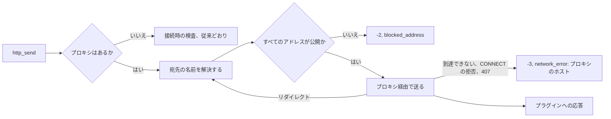

# 調査: 作者、運用者、利用者のための作品情報プラグインの道具 {#research-work-info-plugin-tooling-for-authors-operators-and-users}

引き継ぐ決定: [049 research.md](../049-work-info-plugins/research.md) (プロセス内の wazero、WASI コマンドの契約、マニフェストのセクション、実行の制限、接続時のアドレス検査、ダイジェストに結び付けた blob の行、メモリ上の取得結果、マニフェストで宣言する設定)、[052 research.md](../052-plugin-work-info-fields/research.md) (apply は選んだフィールドを 1 つのトランザクションでマージする)、[016 account-cli.md](../016-single-account-auth/contracts/account-cli.md) のホストコマンドの形 (`mdm` のサブコマンド、終了コード 0、1、2、標準エラーの理由)。このファイルは、この機能が加える決定だけを記録する。

## R-1: `mdm plugin run` と `mdm plugin pack` はサーバーのランタイムとパーサーを再利用し、データベースを開かない {#r-1-mdm-plugin-run-and-mdm-plugin-pack-reuse-the-servers-runtime-and-parser-and-open-no-database}

**決定**: 2 つのコマンドはどちらも `mdm` バイナリのサブコマンドである ([contracts/plugin-cli.md](contracts/plugin-cli.md))。`run` はサーバーが組み立てる要求を組み立て、`wasmplugin.Runtime.Inspect` でモジュールを検査し、同じ `Run` と同じ制限で実行し、VVMDM が応答から保持するものを出力する。`pack` は `domain.ParseWorkInfoPluginManifest` でマニフェストを検証し、書き込む前にパックしたバイト列を検査する。どちらも `MDM_DATA_DIR` を読まず、`ffmpeg` も要らない。

| 案 | サーバーと同じ制限 | 歩調を合わせるために保つ追加のコード | 判定 |
| --- | --- | --- | --- |
| **`mdm` のサブコマンドが `internal/wasmplugin` と `internal/domain` を呼ぶ** | はい: ランタイムもパーサーも 1 つ | なし | 採用 |
| 別の `vvplugin` バイナリ | はい。同じパッケージからビルドする場合 | 2 つ目のビルド、リリース、Windows の成果物 | 不採用: Windows アプリとコンテナはすでに `mdm` を配布しており、`mdm account` が先例を作った |
| 動作中のサーバーの `POST /api/work-info-plugins/dry-run` ルート | はい | 所有者のサーバーで未承認のコードを実行するルート | 不採用: 049 R-3 は所有者が承認していないモジュールを決して実行しない。作者のループはビルド、pack、run であり、サーバーは要らない |

**理由**: コマンドとサーバーが `Run` を共有すれば、要件 2 は構造上満たされる。制限の 2 つ目の実装はずれていく。要求の形 (`contract`、`settings`) は VVMDM が組み立てるものなので、`run` は作者が手で書く JSON ファイルの代わりに、操作とその入力と `--set KEY=VALUE` フラグを受け取る。`run` は最初に検査し、アップロードが拒否するのと同じ問題を拒否するので、作者はモジュールを VVMDM に加える前に `manifest_missing` や `import_unsupported` を見られる。デスクトップの `VVMDM.exe` は独自の引数 (`--port`) を保ち、コマンドはサーバーのバイナリにだけある。

## R-2: `pack` は `vv.plugin` セクションを置き換え、パックしたモジュールが検査を通ってからファイルを書く {#r-2-pack-replaces-the-vvplugin-section-and-writes-the-file-only-after-the-packed-module-passes-inspection}

**決定**: `mdm plugin pack <module> <manifest>` は、既存の `vv.plugin` カスタムセクションがあれば取り除き、新しいセクションを追加し、結果をメモリ上で検査し、一時ファイルとリネームでモジュールの上に書く。問題があればファイルは元のままである。

| 案 | パック済みのモジュールでの再実行 | 壊れたマニフェスト | 判定 |
| --- | --- | --- | --- |
| **セクションを置き換え、メモリ上で検査し、リネームで所定の場所に置く** | 冪等 | ファイルは変わらず、理由を出力する | 採用 |
| 手順書の `addsection` プログラムのようにセクションを追加する | 2 つ目のセクションができる。wazero は最初のものを読むので、新しいマニフェストは無視される | 何も確かめずに書かれる | 不採用: 手順書は作者に、実行のたびに再ビルドするよう警告しなければならなかった |
| モジュールの隣に新しいファイル (`plugin.packed.wasm`) を書く | 冪等 | 書かれない | 不採用: 設定画面で選ぶファイルが 2 つになり、作者が今アップロードするのはビルドの出力である |

**理由**: セクションの書き込みは、テスト補助の `plugintest.CustomSection` から `internal/wasmplugin` の公開関数へ移り、コマンド、テスト補助、ブラウザーのテストのフィクスチャのビルドがそれを共有する。マニフェストだけでなくパックしたバイト列を検査するので、import や export の問題も `pack` で捕まる (Issue の受け入れ 3 と 4、および選択肢にない既定値というエッジケース)。

## R-3: 設定は `default` と `options` を宣言し、保存された値か既定値を実行が受け取る {#r-3-a-setting-declares-default-and-options-the-stored-value-or-the-default-is-what-the-run-receives}

**決定**: マニフェストの設定は `"default": "<value>"` と `"options": ["<value>", …]` を持てる ([contracts/plugin-contract.md の Manifest](contracts/plugin-contract.md#manifest))。設定の実効値は、保存された値が設定されていて選択肢の中にあればそれ、そうでなければ既定値である。`required` は実効値で満たされ、実行要求は実効値を載せる。現在の選択肢にない保存された値は保存されたまま使われないので、実行は既定値を受け取る。その値は `staleValue` として所有者に報告する ([contracts/screen-api.md](contracts/screen-api.md#workinfopluginsetting))。

| 規則 | 理由 |
| --- | --- |
| `default` は 1 から 2000 文字で、保存された値の上限と同じ | 既定値は保存された値の代わりになる |
| `options` は 1 から 200 文字の重複しない値を 2 から 50 個持つ | 選択肢が 1 つでは選べない。50 を超える選択は、偽装したテキストフィールドである |
| `options` があるとき、`default` はそのうちの 1 つ | Issue のエッジケースは、選択肢にない既定値を拒否する |
| `secret` の設定は、どちらも宣言しない | 既定値はモジュールの中で秘密を公開することになり、選択肢は秘密を列挙することになる |
| 選択肢にない保存された値は `work_info_plugin_settings` に残し、実行には使わない | アップロードのトランザクションで削除すると、新しいバージョンが所有者の選択を捨てたことが所有者に見えなくなる。次の保存で置き換わる |

| 案 | 既定値を適用する場所 | 判定 |
| --- | --- | --- |
| **実効値は `internal/domain` で、要求を組み立てるときと `required` を確認するときに計算する** | アプリと CLI が共有する 1 つの純粋な関数 | 採用 |
| アップロード時に既定値を `work_info_plugin_settings` に書く | 行 | 不採用: 所有者が既定値と自分の入力を見分けられず、ダイアログを開いたことのない所有者のプラグインに、新しいバージョンの既定値が届かない |
| 既定値をプラグインのコードに任せる | プラグイン | 不採用: それが Issue の `背景` が挙げる不足であり、所有者は実行の前に既定値を見られない |

## R-4: プロキシは `settings` の 1 つの URL で、実行のたびに読み、実行オプションとしてランタイムに渡す {#r-4-the-proxy-is-one-url-in-settings-read-on-each-run-and-passed-to-the-runtime-as-a-run-option}

**決定**: 所有者のプロキシは `settings` の行 `work_info_plugins.proxy_url` で、`PUT /api/settings/plugin-proxy` で書く ([contracts/screen-api.md](contracts/screen-api.md#get-and-put-apisettingsplugin-proxy))。`app.WorkInfoPlugins` は各実行の前にそれを読み、`domain.WorkInfoRunNetwork` に入れて `WorkInfoPluginRuntime.Run` に渡す。`mdm plugin run` は同じ値を `--proxy` から埋める。空の値は、今までどおりプロキシなしを意味する。

| 案 | サーバーの動作中にプロキシを変える | サーバーなしでテストできる | 判定 |
| --- | --- | --- | --- |
| **実行ごとにストアから読む実行オプション** | 次の実行が使う | はい: ランタイムは値を受け取る | 採用 |
| 設定のユースケースが設定する `wasmplugin.Runtime` の可変のプロキシ | 次の実行が使う | 2 つの呼び出し元が共有するセッター | 不採用: ランタイムが所有者の設定を持つことになり、CLI は 1 回の実行のためにグローバルな状態を設定することになる |
| 環境変数の `MDM_HTTP_PROXY` | 再起動が要る | はい | 不採用: 要件 8 はプロキシを設定画面に置き、Windows アプリには編集できる環境がない |
| `HTTP_PROXY` を尊重する | 再起動が要る | はい | 049 R-5 で不採用とし、今も不採用: 運用者がプラグインだけに対して無効にできない |

**理由**: URL は、Go のトランスポートがプロキシとして扱える `http`、`https`、`socks5` のスキームを取り、認証が要るプロキシのために任意のユーザー情報を持てる。規則は `internal/domain` にあり (`ParseWorkInfoPluginProxyURL`)、API、ストア、CLI が同じ値を拒否する。

## R-5: プロキシ経由では、各要求とリダイレクトの前に名前を解決して宛先を検査する {#r-5-through-a-proxy-the-destination-is-checked-by-resolving-its-name-before-each-request-and-redirect}

**決定**: 実行にプロキシがあると、接続はプロキシに向かうので、049 R-5 の接続時の検査は宛先を見られない。そこでクライアントは、Go がすべての要求と追従したリダイレクトごとに呼ぶトランスポートの `Proxy` コールバックで、宛先のホストを解決する (リテラルのアドレスならパースする)。要求は `-2` と `blocked_address` で拒否する。解決したアドレスのどれかが同じ `addressRule` に失敗したときである。プロキシ自身のアドレスは検査しない。運用者が選んだものであり、たいていは LAN にあるからである。プロキシに到達できない、`CONNECT` を拒否する、`407` を返す場合は、要求は `-3` で応答し、失敗した実行はプロキシのホストつきの `network_error` を報告する。

図は、プロキシを設定した 1 回の `http_send` を示す。

| 案 | LAN に解決される名前を捕まえる | 判定 |
| --- | --- | --- |
| **`Proxy` コールバックで、要求とリダイレクトごとに解決して検査する** | はい。要求の時点で | 採用 |
| LAN の宛先の拒否をプロキシに任せる | 運用者がそう設定した場合だけ | 不採用: 要件 9 は VVMDM が拒否するとしている |
| 接続時の検査を残し、プロキシしか見えないようにする | いいえ | 不採用: プロキシの LAN アドレスがすべての要求を失敗させるか、検査が無効になる |

**理由**: 049 R-5 は、直接の経路について、接続が名前をもう一度解決するので解決前の検査を不採用にした。プロキシがあると接続はプロキシのものなので、解決前の検査だけが使える検査であり、プロキシは運用者が動かす部品である。残るリスク、つまり VVMDM の検索とプロキシの検索の間で答えが変わる名前は、設計文書に書く。

## R-6: ランタイムは各実行の標準エラーを返し、アプリはプラグインごとに直近のものを、秘密の値を伏せて保持する {#r-6-the-runtime-returns-each-runs-standard-error-and-the-app-keeps-the-last-one-per-plugin-with-the-secret-values-masked}

**決定**: `Run` は、保持した標準エラー (従来どおり先頭の 64 KiB) と、それが切り詰められたかどうかを、成功時にも失敗時にも返し、実行枠を解放する前に、同じ実行ログを呼び出し側が渡す `record` 関数に渡す。`record` の中で、`app.WorkInfoPlugins` は、実行が受け取った各秘密の設定値の出現をすべて `[secret]` に置き換える。出力が切り詰められたときは、保持したテキストの末尾のうち秘密の値の先頭である部分も置き換えるので、64 KiB で切れた値のどの部分も平文で残らない。それからテキストを、プラグインの 1 行の `work_info_plugin_runs` として保存する。書くのは、プラグインがまだ実行した世代を持っているときだけである ([data-model.md](data-model.md))。行は実行枠を保持している間に書くので、実行が終わった順に書かれ、保存が遅くても、古い実行の出力が新しい実行の出力を上書きすることはない。置き換えるアップロードは、そのトランザクションで行を削除し、プラグインの削除はカスケードする。サーバーのログは、従来どおり出力を受け取り続ける。

| 案 | 再起動後も残る | 実行とともに増える | 判定 |
| --- | --- | --- | --- |
| **プラグインごとに 1 行を、実行のたびに置き換える** | はい | いいえ: プラグインごとに最大 64 KiB | 採用 |
| 取得結果の隣のメモリ上 | いいえ | いいえ | 不採用: 運用者は失敗した実行の後で出力を読み、Windows アプリでは再起動のあとであることが多い |
| すべての実行のテーブル | はい | はい | 不採用: Issue の `対象外` が履歴を除いている |

| 案 | あとで所有者が変えた秘密を伏せる | 判定 |
| --- | --- | --- |
| **保存する前に、その実行の値で伏せる** | はい: 保存されたテキストにそれが入ったことがない | 採用 |
| 画面が行を読むときに伏せる | いいえ: 変えた秘密や忘れた秘密が平文で残る | 不採用 |

| 案 | 2 つの保存が競合したとき最新の実行を残す | 判定 |
| --- | --- | --- |
| **実行枠を保持している間に、`record` の中で行を書く** | はい: 行が書かれる前に次の実行は終われない | 採用 |
| `Run` が戻ったあとに、`ran_at` を条件にして書く | いいえ: 2 つの実行が同じ秒に終わることがあり、保存の前に実行枠が空く | 不採用 |
| ダイジェストを条件にして書く | いいえ: 同じバイト列のアップロードではダイジェストが変わらないので、古い実行が戻ってくる | 不採用。世代は置き換えのたびに変わる |

**理由**: 値で伏せれば、プラグインが設定を受け取ったとおりに出力するという Issue が挙げる漏えいは捕まる。値を先にエンコードするプラグインは捕まらず、手順書はそう書く。

## R-7: apply は選んだタグの名前を受け取り、すでに動画にあるタグは選べない {#r-7-the-apply-takes-the-selected-tag-names-and-a-tag-already-on-the-video-is-not-selectable}

**決定**: `ApplyWorkInfoFetchRequest` に `tags` が加わる。付ける取得した名前であり、存在し、かつ `tags` が `fields` にあるときは、結果のタグの空でない部分集合でなければならず、アプリはその名前だけを付ける ([contracts/screen-api.md](contracts/screen-api.md#post-apivideosidwork-info-fetchesfetchidapply))。画面では、まだ動画にない取得したタグはすべて選択された状態で始まる。すでに動画にあるタグは `On the video` の印を保ち、選べない。すべてのタグを外すと、`tags` を `fields` から除く。

| 案 | 判定 |
| --- | --- |
| **`tags` のリストを `fields` の隣に置く** | 採用 |
| タグごとに 1 つの `WorkInfoField` の値 (`tags:<name>`) | 不採用: `WorkInfoField` は閉じた列挙型で、比較の行とスキップされた値はそれをキーにしている |
| タグごとの apply の呼び出し | 不採用: 049 R-9 は選択を 1 つのトランザクションで適用する |

**理由**: 動画がすでに持つタグを付けても何も変わらないので、それを選択肢として出すと、選んだタグの数が嘘になるだけである。すべてのタグがすでに動画にある結果は、行の `Same as now` の状態がすでに扱う。`tags` は省略可能なので、ルートの外部の呼び出し元は挙動が変わらない。画面は常にそれを送る。

## R-8: Network セクションはすべてのビルドで表示し、LAN スイッチはデスクトップ専用のままにする {#r-8-the-network-section-shows-on-every-build-and-the-lan-switch-stays-desktop-only}

**決定**: 設定画面の `Network` セクションは、`GET /api/settings/network` (デスクトップ専用、ほかでは `404`) と新しい `GET /api/settings/plugin-proxy` (すべてのビルド) のどちらかが応答すれば描画する。プロキシの行は、デスクトップアプリでは LAN スイッチの下に、コンテナでは単独で置く。

| 案 | 判定 |
| --- | --- |
| **既存のセクションに 1 行足す** | 採用 |
| Work-info plugins セクションのプロキシの行 | 不採用: 要件 8 と Issue の `UI品質` は、もう 1 つの接続設定の隣のネットワーク設定に置く |
| `NetworkSettings` をプロキシで拡張する | 不採用: このルートはデスクトップアプリの外で `404` であり、プロキシが最も必要な場所である |

## R-9: `429` では、プラグインは `Retry-After` と 5 秒の小さいほうだけ待ち、1 回再試行し、それ以外はエラーを報告する {#r-9-on-a-429-a-plugin-waits-for-the-smaller-of-retry-after-and-5-seconds-retries-once-and-otherwise-reports-an-error}

**決定**: 手順書は次を推奨する。応答が `429` のとき `Retry-After` を読む (秒数または HTTP 日付。ないか読めない値は 1 秒として数える)。その遅延と 5 秒の小さいほうだけ眠り (サンドボックスでは時計と `nanosleep` が動く)、要求をもう一度送る。ただし、それは今回を含む実行の待ちの合計が最大 10 秒である間だけである。待ちがその枠を超えるとき、または再試行がまた `429` のときは、プラグインはサイトと遅延を名指しするメッセージを持つ `error` 応答を返す。VVMDM はプラグインの代わりに再試行しない (Issue の `対象外`)。

| 案 | 30 秒と 16 要求に収まる | 判定 |
| --- | --- | --- |
| **実行ごとの待ち 10 秒の範囲で、最大 5 秒後に 1 回再試行する** | はい: 最大 7 ページを取得するプラグインでも、要求の制限の中でページごとに再試行でき、実行の待ちは合計で最大 10 秒なので、何ページ拒否されても 30 秒の制限のうち 20 秒が要求に残る | 採用 |
| 実行の制限までの指数バックオフ | いいえ: 25 秒待つプラグインは、所有者へのメッセージなしに時間切れになる | 不採用 |
| 再試行しない | はい | 不採用: バースト制限のあるサイトでは、1 回の `429` ですべての取得が失敗する |

**理由**: 取得は 1 人の所有者の 1 回の操作であり、クロールではないので、短く 1 回待つのはブラウザーの利用者がすることである。それより長く待つなら、所有者にもう一度試すよう伝えるほうがよい。

## R-10: 取得は作品の ID だけを取り、VVMDM は所有者が入力した URL を取得しない {#r-10-a-fetch-takes-a-work-id-only-and-vvmdm-never-fetches-a-url-the-owner-typed}

**決定**: すべての取得は作品を ID で指す。画面 API の本文は `{pluginId, id}`、プラグインの要求は `{"operation": "fetch", "id"}`、検索の候補は `id` を持ち、`mdm plugin run ... fetch <id>` は ID を取る。所有者が入力した文字列は、URL の形であってもそのまま ID である。ID をページの URL に対応づけるのはプラグインの仕事である。ダイアログは候補の ID をホストの代わりに示し、ページへのリンクを持たない。候補は URL を持たないからである (要件 14 から 16)。

| 案 | 判定 |
| --- | --- |
| **ID だけ** | 採用 |
| `id` の隣に `url` を残し、貼り付けた URL をそのまま取得する | 依頼者が不採用とした: 所有者の入力は識別子であり、プラグインが確認しないまま VVMDM が取得する URL は、プラグインが推論できない設計である |
| 貼り付けた URL から VVMDM が ID を取り出す | 不採用: URL の形はサイトのもので、それを知っているのはプラグインだけである |

**理由**: サイトを持つのはプラグインである。作品がどの URL にあるかを知っていて、所有者が入力した ID からその URL をすでに組み立てている。入力の形が 1 つになれば、ダイアログの規則、ハンドラー、CLI から URL の分岐が、ドメインから URL の確認が消える。貼り付けたページの URL を受け付けたいプラグインは、その URL から ID を自分で読み取る。
