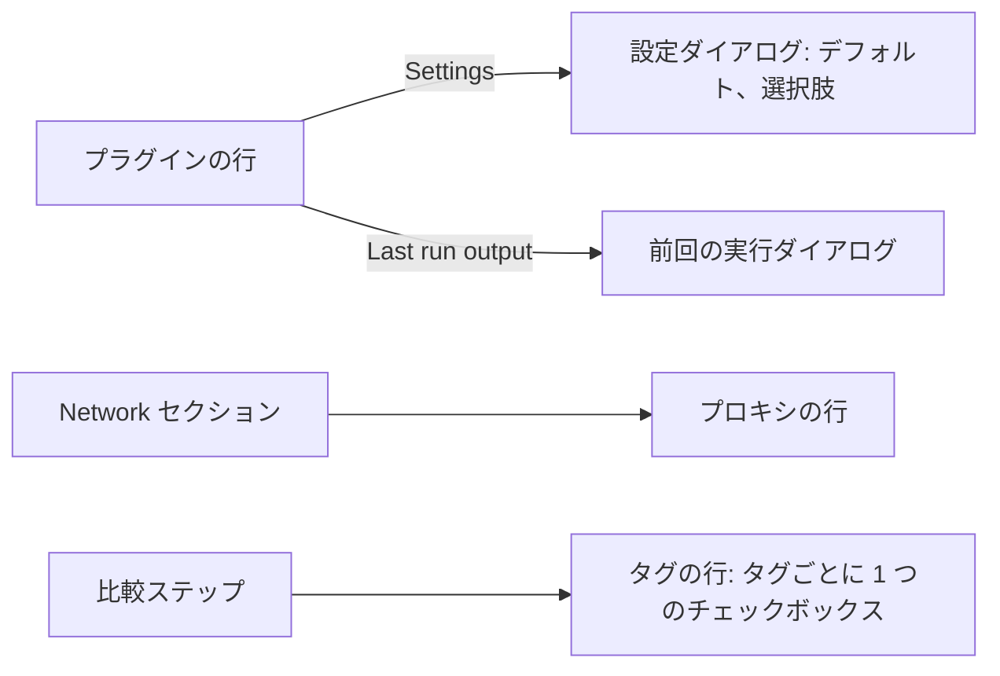
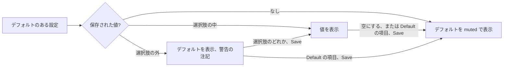
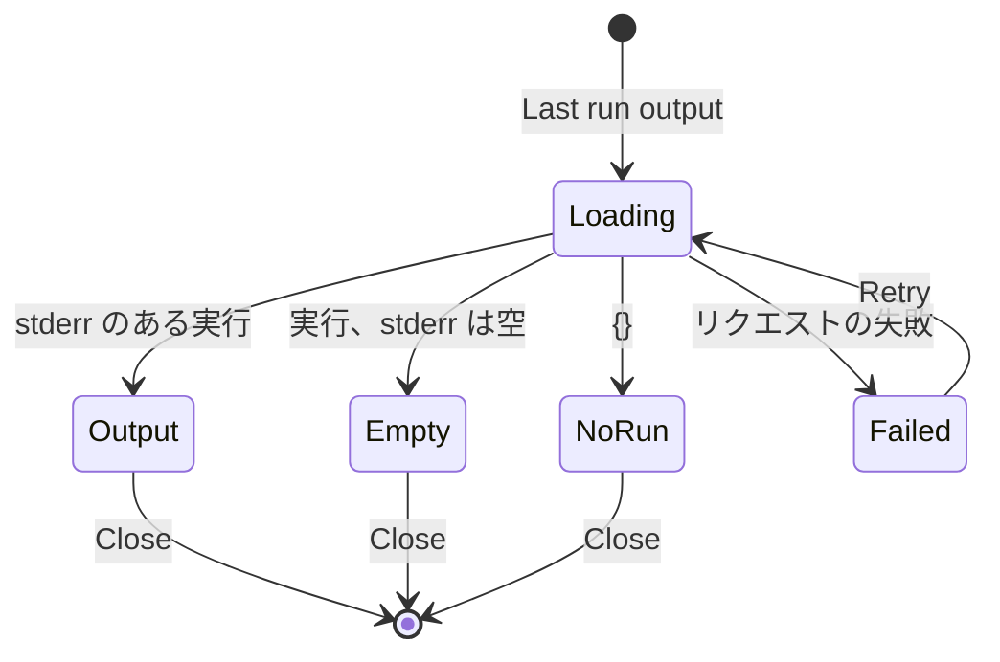
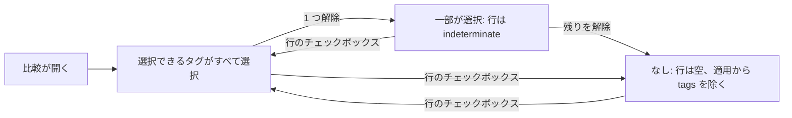

# UI 設計: 作者・運用者・利用者のための Work-info プラグイン用ツール {#ui-design-work-info-plugin-tooling-for-authors-operators-and-users}

**機能**: [親 Issue #1232](https://github.com/syudead/vv/issues/1232) · [plan.md](plan.md) · [contracts/screen-api.md](contracts/screen-api.md) · [research.md R-3](research.md#r-3-a-setting-declares-default-and-options-the-stored-value-or-the-default-is-what-the-run-receives) · [R-4](research.md#r-4-the-proxy-is-one-url-in-settings-read-on-each-run-and-passed-to-the-runtime-as-a-run-option) · [R-6](research.md#r-6-the-runtime-returns-each-runs-standard-error-and-the-app-keeps-the-last-one-per-plugin-with-the-secret-values-masked) · [R-7](research.md#r-7-the-apply-takes-the-selected-tag-names-and-a-tag-already-on-the-video-is-not-selectable) · [R-8](research.md#r-8-the-network-section-shows-on-every-build-and-the-lan-switch-stays-desktop-only)

すでに物事を決めている出典は、ここで繰り返さずリンクする。

| 話題 | 出典 |
| --- | --- |
| トークン、閉じたスケール、密度 | [design-system.md, Foundations](../../docs/design-docs/design-system.md#foundations)。[`web/src/ui/tokens.css`](../../web/src/ui/tokens.css) の `@theme` の値は、ここでは名前で呼び、コピーしない |
| `PageSection`, `FormRow`, `FactList`, `FormDialog`, `ErrorState`, 設定ページの規則 | [patterns.md](../../web/registry/rules/patterns.md) |
| `Input`, `Select`, `Checkbox`, `Field`, `Badge`, `Alert`, `DropdownMenu`, `Skeleton`, `Tooltip`, `TentativeMark` | [components.md](../../web/registry/rules/components.md) |
| Work-info プラグインのセクション、その行、承認プロンプト、設定ダイアログ | [049 UI design](../049-work-info-plugins/ui-design.md#settings-work-info-plugins-section)、[`WorkInfoPluginRow.tsx`](../../web/src/settings/WorkInfoPluginRow.tsx)、[`WorkInfoPluginSettingsDialog.tsx`](../../web/src/settings/WorkInfoPluginSettingsDialog.tsx) |
| Network セクション、そのスイッチ行、その保存状態 | [`NetworkSection.tsx`](../../web/src/settings/NetworkSection.tsx)、[`SaveStatus.tsx`](../../web/src/settings/SaveStatus.tsx) |
| 比較、そのグリッド、行、チップ | [049 UI design, Compare](../049-work-info-plugins/ui-design.md#compare)、[052 UI design, Compare](../052-plugin-work-info-fields/ui-design.md#compare)、[`CompareStep.tsx`](../../web/src/player/workInfoFetch/CompareStep.tsx)、[`TagChips.tsx`](../../web/src/player/workInfoFetch/TagChips.tsx) |
| 日付と相対時刻 | [`web/src/i18n/format.ts`](../../web/src/i18n/format.ts)（`formatDateTime`, `formatRelative`） |
| CSS の幅のブレークポイント、人が確かめるレイアウト | [library-ui.md, Width breakpoints](../../docs/design-docs/library-ui.md#width-breakpoints-in-css-and-the-sidebar-exception)、[Layout verified by people](../../docs/design-docs/library-ui.md#layout-verified-by-people-not-machines) |
| 画面の文言 | [`web/src/i18n/en.ts`](../../web/src/i18n/en.ts)。この機能は `settings.workInfoPlugins`、`settings.network`、`player.workInfoFetch` に追加する |

この機能が変えるのは 4 か所で、いずれも所有者向けである。

1. プラグインの**設定ダイアログ**は、宣言されたデフォルトを入力された値と区別して示し、宣言された選択肢を選択として提供する（要件 5 から 7、受け入れ条件 5）。
2. **Network セクション**に、プラグインのリクエスト用のプロキシが加わる。すべてのビルドで表示する（要件 8、受け入れ条件 7 と 8）。
3. **プラグインの行**から**前回の実行ダイアログ**を開く。プラグインの前回の標準エラー出力を、秘密の値を伏せて示す（要件 12 と 13、受け入れ条件 10 と 11）。
4. **比較**では、取得したタグを所有者が 1 つずつ選べる（要件 11、受け入れ条件 9）。

変えないもの: 設定ごとに muted の注記が 1 つ加わる以外の承認プロンプト、追加・承認取り消し・削除の流れ、取得ダイアログの検索と結果のステップ、ほかの比較の行、画面を持たない `mdm plugin run` と `pack`。

## この形にした理由 {#why-this-shape}

**デフォルトは値が入る場所に muted の色で示し、テキストとしてフィールドに入れない。** 空の `Input` はデフォルトを `placeholder` として持ち、フィールドの下のヒントがそれを名指しする。入力された値は `text-foreground`、デフォルトは `text-muted-foreground` で読ませ、ひと目で区別できるようにする（Issue の `UI品質`）。デフォルトをフィールドに書き込む案は採用しなかった。所有者が自分の入力と区別できず、デフォルトに戻すために消す操作が値の削除に見えるためである。これに合わせて、デフォルトを入力された値として保存することはない。空のフィールドも、`Select` の `Default` の項目も `null` を保存するので、新しいバージョンのデフォルトがプラグインに届く（[R-3](research.md#r-3-a-setting-declares-default-and-options-the-stored-value-or-the-default-is-what-the-run-receives)）。

`options` を持つ設定は、選択肢の数（2 から 50）にかかわらず **`Select`** にする。[components.md, Select and RadioGroup](../../web/registry/rules/components.md#select-and-radiogroup) は、現在の値が重要な設定行に `Select` を当て、その既定のトリガーは `h-9` で `Input` と同じ高さである（`sm` のトリガーは `h-8` なので使わない）。そのため選択がフィールドの並びに視覚的な切れ目なく収まる（Issue の `UI品質`）。選択肢が少ないときの `RadioGroup` は採用しなかった。2 から 6 個のラジオがテキストフィールドの横に並ぶと、値を比べるためでなく設定するために所有者が開くダイアログで、得るものがないまま 1 つの設定が隣の 3 倍の高さになる。

デフォルトに戻す操作は、デフォルトと等しい選択肢とは別の、リストの先頭にある **`Default ({default})` という専用の項目**にする。デフォルトの選択肢に印を付け、保存された値のない設定でそれを選ばせる案は採用しなかった。保存された値がその選択肢であるか古い値であるとき、所有者がデフォルトに戻すために押す項目がすでに選択されており、`Select` はその項目について変更を報告せず、`Save` は無効のままになるためである。別の項目にすれば `Input` の規則が保たれる。所有者はデフォルトに従うか値を入力するかのどちらかであり、デフォルトと等しい入力値もやはり所有者の入力である。

プロキシは Network セクションの **1 つの `FormRow`** で、`Input` を持ち、値が変わったときに保存する。LAN スイッチが変わったときに保存するのと同じである（Issue の `UI品質`、[patterns.md, Settings page](../../web/registry/rules/patterns.md#settings-page)）。Ollama と ComfyUI のセクションにあるような、行の下の `Save` ボタンは採用しなかった。それらのセクションは複数の値をまとめて保存するが、これは 1 つの値であり、加わるセクションにボタンはない。セクションの説明はスイッチの行に移る。スイッチのないビルドでは、説明がそこにない設定についてのものになるためである（[R-8](research.md#r-8-the-network-section-shows-on-every-build-and-the-lan-switch-stays-desktop-only)）。

前回の実行の出力は、行ではなく**行のメニューから開くダイアログ**に出す。64 KiB のログを設定の行に置くと、ほかのプラグインが画面の外へ押し出される。エラーを読むのは運用者がときどき行う作業なので、`Revoke approval` と `Delete` の隣の `More actions` の項目をもう 1 つ増やす。行のファクト行がプラグインを最後に実行した時刻を示すので、運用者は読むものがあるプラグインをひと目で見分けられる。行に 3 つ目のボタン（`Last run`）を置く案は採用しなかった。`Review and approve` と `Settings` だけで 360px の行はすでに埋まり、出力は設定の変更よりはるかに読まれる頻度が低い。

比較では、動画にまだないタグそれぞれを、**チップをラベルにした `Checkbox`** にし、行自身のチェックボックスは `indeterminate` 状態を持つ全選択になる。`Checkbox` は、あとで適用するフォーム内の選択に使うデザインシステムのコントロールである（[components.md, Checkbox and Switch](../../web/registry/rules/components.md#checkbox-and-switch)）。同じ規則により、チップのトグル（`Toggle`）は採用しなかった。タグごとにチェックボックスとテキストの行を置く案は、30 行がタイトルとほかのフィールドを隠すので採用しなかった。取得したタグの一覧は**折りたたまない**。`+{n} more` は所有者が選ぶはずのものを隠し、Issue は 25 個以上のタグを全部見られることを求めている。`Now` 列は、動画自身のタグをここでは選ばないので、折りたたみを残す。

## 文言 {#words}

英語はカタログが取り込む草稿であり、実装後は [`web/src/i18n/en.ts`](../../web/src/i18n/en.ts) が正になる。デフォルト値、選択肢の値、URL、プラグインの出力はユーザーのデータであり、翻訳せずそのまま埋め込む。

### 設定ダイアログの文言 {#settings-dialog-text}

| 場所 | 文言 | 備考 |
| --- | --- | --- |
| Default hint | Default: {default} | `FieldDescription`。空のフィールドは `{default}` を placeholder として示す |
| Select, stale value | Default ({default}), or Not set without a default | `Select` の placeholder、muted。選択された項目はない |
| Select, item to follow the default | Default ({default}) | 最初の項目、muted、デフォルトのある設定だけ。`null` を保存する |
| Select, item to clear | Not set | 最初の項目、muted、デフォルトのない設定だけ。`null` を保存する |
| Select, option item | {option} | すべての選択肢をマニフェストの順に並べる。デフォルトの選択肢も含み、印は付けない |
| Stale value, with a default | "{value}" isn't one of this version's choices. The default is used until you save. | フィールドの下に lucide `CircleAlert` を付けた `text-warning` |
| Stale value, no default | "{value}" isn't one of this version's choices. No value is sent until you save. | 同じ形 |
| Save | Save | 変更なし。デフォルトに戻したフィールドは `null` を送る |

### セクションと承認プロンプトの文言 {#section-and-approval-prompt-text}

| 場所 | 文言 | 備考 |
| --- | --- | --- |
| Settings summary, default in use | {label} default | `Settings: {list}` で `{label} set` と `{label} not set` に並ぶ |
| Stale values | Choose again: {labels} | lucide `CircleAlert` を付けた `text-warning`。両方に当てはまるときは `Needs a value` の下 |
| Last run (facts line) | Last run {when} | `{when}` は `formatRelative` から、完全な `formatDateTime` を `title` に入れる。`lastRunAt` があるときだけ |
| Row menu, last run | Last run output | [前回の実行ダイアログ](#last-run-dialog)を開く。`invalid` では出さない |
| Approval prompt, setting line | Default: {default} | `Secret` と `Required` のバッジの後ろに `text-muted-foreground` |

### 前回の実行ダイアログの文言 {#last-run-dialog-text}

| 場所 | 文言 | 備考 |
| --- | --- | --- |
| Title | Last run of {name} | |
| Description | What the plugin wrote to its error output during its last run. Values of secret settings are shown as [secret]. | |
| Facts | Ran · Did · Result | `FactList` の項目名 |
| Did | Search · Fetch by URL | `settings.workInfoPlugins.operations` から |
| Result, success | Finished | |
| Result, failure | Failed: {reason} | `{reason}` は実行の失敗コードに応じた [049 Error reasons](../049-work-info-plugins/ui-design.md#error-reasons) から。ただし下の 2 つは除く。この 2 つの `{host}` を実行の行は保持しない |
| Result, `blocked_address` | Failed: The plugin tried to reach VVMDM itself or a device on your network. | |
| Result, `network_error` | Failed: The plugin couldn't reach a site. | |
| Truncated | The output was cut at 64 KB. | 出力の上に lucide `CircleAlert` を付けた `text-warning` |
| Wrote nothing | The last run wrote nothing. | muted、出力の代わり |
| No run | No run yet. Run the plugin from a video page, then open this again. | muted、ファクトと出力の代わり |
| Load failed | Couldn't load the last run: {reason} | 本文の `ErrorState` と `Retry` |
| Close | Close | フッターの唯一のボタン |

### Network セクションの文言 {#network-section-text}

| 場所 | 文言 | 備考 |
| --- | --- | --- |
| Section description | Connections to VVMDM, and from its plugins to other sites. | 現在の説明を置き換える |
| LAN switch description | By default only this PC can open VVMDM. Allow connections from your local network to open it from a phone or another computer on the same network. | 現在のセクションの説明で、今はスイッチ行の `description` |
| Proxy label | Proxy for plugin requests | |
| Proxy description | Plugin requests to other sites go through this proxy. Leave it empty to connect directly. Devices on your network are refused either way. | |
| Proxy placeholder | http://proxy.example:3128 | `placeholder`。例であり、保存されない |
| Refused URL | Enter a URL starting with http://, https:// or socks5://, with a host and no path. | フィールドの下の `FieldError`。サーバーが適用するのと同じ規則（[contracts/screen-api.md](contracts/screen-api.md#get-and-put-apisettingsplugin-proxy)） |
| Saving | Saving… | `SaveStatus`。スイッチと同じ |
| Saved | Saved. | `role="status"`、muted、lucide `CircleCheck` を付ける。フィールドがもう一度編集されるまで |
| Save failed | Couldn't save the proxy: {reason} | `SaveStatus` の `destructive` の `Alert` |
| Load failed | Couldn't load the network settings: {reason} | 変更なし。今はプロキシのリクエストにも使う |

### 比較の文言 {#comparison-text}

| 場所 | 文言 | 備考 |
| --- | --- | --- |
| Tag checkbox name | {name} | チップが `Label` になる。仮のチップは今までどおり `{name}, Tentative` と読む |
| Row checkbox | Tags | 変更なし。一部のタグが選択されている間は `indeterminate` |
| Selected count | {n} of {m} selected | タグの行の `{n} new` を置き換える。`{m}` は動画にないタグの数 |
| Tag already on the video | On the video | 変更なし: lucide `Check` を付けた muted のチップで、チェックボックスはない |

## デザインシステムの変更 {#changes-to-the-design-system}

「Show the last run's error output on the settings screen」の作業単位が、ダイアログが使う前に、`web/src/ui/tokens.css` の `@theme` に名前付きのレイアウトステップを 1 つ加える。

| 変更 | 内容 |
| --- | --- |
| `run-output` | 前回の実行ダイアログの出力ブロックの最大の高さ（`max-h-run-output`）。スキャンの Issue 一覧に対する `issue-list` と同じく、ビューポートの高さに対する割合とし、64 KiB の出力がブロック内でスクロールする間も、ファクトとフッターが 1280×800 でも 360×640 でも見えたままになる |

これ以外は加えない。`Checkbox` にはすでに `indeterminate` 状態があり、`Select` には既定の `h-9` のトリガーと（`TagKindSelect` と同じ）`max-w-popover` のリスト、`FormDialog` には `wide` サイズと `Cancel` のないフッターがある。色のトークンは加えず、`web/src/theme/tokens.test.ts` の `pairs` にも何も加えない。警告の行、muted の注記、出力ブロックは既存のロール（`text-warning`, `text-muted-foreground`, `bg-muted`）を使う。アイコンは lucide の `CircleAlert`, `CircleCheck`, `Check`, `Ellipsis` で、いずれもすでに使われている。

## 設定ダイアログ {#settings-dialog}

[049, Settings dialog](../049-work-info-plugins/ui-design.md#settings-dialog) のダイアログは、順序、設定ごとの `Field`、秘密のフィールド、`Save` の規則を保つ。設定のフィールドは、マニフェストの宣言によって変わる。

| 設定 | フィールド |
| --- | --- |
| `default` も `options` もない | 049 のとおり |
| `default` あり、`options` なし | 保存された値を入れた `Input type="text"`、または空で `{default}` を `placeholder` にしたもの。その下に `Default: {default}`。フィールドを空にするか、空のままにすると `null` を保存する |
| `options` あり | 既定のトリガー（`h-9`）の `Select`、フィールドの全幅。最初の項目は `Default ({default})`、デフォルトのない設定では `Not set`。選択肢はマニフェストの順にその後に続く。選ばれた項目は、値が保存されているときはその値の選択肢、そうでなければ最初の項目 |
| `options` あり、保存された値がその中にない（`staleValue`） | 項目が選択されていない `Select` で、muted の placeholder は `Default ({default})` か `Not set` と読め、その下に `text-warning` の古い値の注記を置く。最初の項目を含むどの項目も変更である。最初の項目を選ぶと `null` を保存し、注記が消える |
| 秘密 | 049 のとおり。秘密はどちらも宣言しないので、何も変わらない |

`Save` は、キーが 1 つも変わらない間は無効のままである。最初の項目を選ぶこと、またはデフォルトを持つフィールドを空にすることは、値が保存されているときだけ変更である。`null` を送り、フィールドは今までどおりデフォルトを示す。値が保存されているとき、最初の項目は選択された項目ではない（選択されているのは保存された選択肢か、古い値なら何もない）ので、それを選ぶことは常に `Select` が報告する変更である。

デフォルトは 2000 文字、選択肢は 200 文字まで許され、その中に空白がなくてもよい（[contracts/plugin-contract.md](contracts/plugin-contract.md#manifest)）。そのため、それらを表示するどの部分も、ダイアログや画面を広げてはならない。

| 部分 | 形 |
| --- | --- |
| `Default: {default}` のヒント、古い値の注記、承認プロンプトの `Default:` | `wrap-anywhere`。空白のない値はフィールドの端で折り返す |
| `Select` のリスト | `TagKindSelect` と同じく `max-w-popover` の `SelectContent`。リストはトリガーより狭くならないので、1280px ではフィールドの全幅に広がり、360px では 16px の余白の内側に収まる。各項目のテキストは `wrap-anywhere` の `span` で、長い選択肢はリスト内で複数行に折り返す |
| `Select` のトリガー | 1 行。トリガー自身の `line-clamp-1` が長い値を切り、トリガーの `title` に選択されたテキスト全体を入れる |
| 長い placeholder の `Input` | placeholder はフィールドの端で切れる。その下のヒントがデフォルト全体を示す |

行の設定のまとめは、デフォルトを使っている設定を `{label} default` と呼ぶ。たとえば `Settings: Region default, Token set` は、ダイアログを開かなくても、プラグインが何を受け取るかを所有者に伝える。古い値は、まとめでは `{label} not set` となり、ファクト行の下の `Choose again` の行で、`Needs a value` と同じ形で名指しされる。デフォルトを持つ必須の設定が `Needs a value` に現れることはない（[R-3](research.md#r-3-a-setting-declares-default-and-options-the-stored-value-or-the-default-is-what-the-run-receives)）。

承認プロンプトでは、デフォルトを持つ各設定の行が、muted の色の `Default: {default}` で終わる。プラグインを承認する所有者は、何も入力しなかったときにプラグインが受け取るものを見られる。

### 状態 {#states}

| 状態 | フィールドの表示 |
| --- | --- |
| デフォルトを使用 | muted の色の placeholder か `Default ({default})` の項目。その下に `Default: {default}` |
| 値を入力済み | `text-foreground` の値。その下に `Default: {default}` は残る |
| 古い値 | デフォルトか `Not set`。その下に `text-warning` の古い値の注記 |
| 保存中 | 049 と同じく、すべてのフィールドが無効 |

## Network セクション {#network-section}

セクションは、`GET /api/settings/network` か `GET /api/settings/plugin-proxy` のどちらかが `200` で応答したときに表示する（[R-8](research.md#r-8-the-network-section-shows-on-every-build-and-the-lan-switch-stays-desktop-only)）。それまでは今までどおり何も表示しない。行は上から順に、LAN スイッチ（デスクトップのみ）とそのアドレスまたは注意のブロック、次にプロキシの行である。

| 部分 | 形 |
| --- | --- |
| プロキシの行 | [文言](#network-section-text) のラベルと説明を持つ `FormRow`。コントロールは `Input type="url"` の `sm:w-sm`、`autocomplete="off"`、保存された URL か placeholder を示す |
| 保存中 | フィールドがフォーカスを失うか Enter が押され、トリムした値が保存された値と異なるときに値を送る。スイッチと同じく行の下に `Saving…`。フィールドは編集できたままである。保存は同時に 1 つだけ実行する。保存の実行中にフォーカスを失うか Enter が押されても、そのときは何も送らず、その保存が応答したとき、直前に保存した URL と異なれば最新の値を送る |
| 保存済み | 応答の `url` は、フィールドが送った値のままであるときだけフィールドを置き換える。保存中に行った編集はフィールドに残り、失われない。次の編集まで行の下に `Saved.` |
| 拒否 | URL の規則に反する値は送らない。値が変わるまでフィールドに `aria-invalid` と、その下に `FieldError`。サーバーの `400` も同じエラーを示すので、2 つの経路は同じに読める |
| 失敗 | `SaveStatus` の `Alert` に `Couldn't save the proxy: {reason}`。入力した値は残る |
| 空にした | 空にしたフィールドは `""` を保存する。以後の実行はプロキシを使わない。どの値でも同じく `Saved.` を示す |

プロキシ URL のユーザー情報（`user:pass@`）は、保存されたとおりに示す。所有者がこの画面で入力したもので、API が返すためである。LAN スイッチの注意のブロックとアドレスの一覧は変えない。

### 状態 {#states-1}

| 状態 | セクションの表示 |
| --- | --- |
| 読み込み中 | どちらかのリクエストが応答するまで何も表示しない |
| デスクトップ | スイッチの行、そのブロック、プロキシの行 |
| コンテナ | プロキシの行だけ（`/api/settings/network` は `404`） |
| 読み込み失敗 | プロキシのリクエストが失敗し、network のリクエストが `404` で応答したか失敗したときは、`Retry` 付きの `ErrorState`。スイッチが読み込まれているときは、`ErrorState` がプロキシの行の場所に入る |
| 保存中、保存済み、拒否、失敗 | 上の表のとおり |

## 前回の実行ダイアログ {#last-run-dialog}

`cancelLabel` のない `FormDialog` `size="wide"` で、行のメニューの `Last run output` から開く。フッターには `Close` がある。開くたびに毎回 `GET /api/work-info-plugins/{id}/last-run` を読むので、設定画面を開いている間に終わった実行も表示される（要件 12）。

| 部分 | 形 |
| --- | --- |
| ファクト | `FactList`: `Ran`（`formatDateTime(ranAt)`）、`Did`（操作のテキスト）、`Result`（`Finished`、または `text-destructive` の `Failed: {reason}`） |
| 切り詰め | アイコン付きの `text-warning` の行を、ファクトと出力の間に置く。`truncated` のときだけ |
| 出力 | `bg-muted` に `rounded-md` と `p-3` を付けた `font-mono text-xs` のブロック。`whitespace-pre-wrap` と `break-all` で、長い行はダイアログを広げず折り返す。高さは最大 `max-h-run-output` で、独自の縦スクロールを持つ。テキストは応答の `stderr` そのままで、`[secret]` もその一部である |
| 出力なし | ブロックの代わりに、muted の色で `The last run wrote nothing.` |
| 実行なし | muted の色で `No run yet…`。ファクトもブロックもない |

出力は、ダイアログ内で唯一の `font-mono` のブロックであり、唯一スクロールするので、ファクトとフッターは見えたままになる。ダイアログ自体は、短い画面では本文だけがスクロールするという `FormDialog` の規則を保つ。

### 状態 {#states-2}

| 状態 | ダイアログの表示 |
| --- | --- |
| 読み込み中 | ファクト用に `h-5` の `Skeleton` の行 3 つ、ブロック用に `h-16` の 1 つ |
| 失敗 | 本文の `ErrorState` と `Retry` |
| 実行なし | `No run yet` の行 |
| 出力なし | ファクト、続いて `The last run wrote nothing.` |
| 出力あり | ファクト、該当するときは切り詰めの行、ブロック |

行のファクト行は、一覧の `lastRunAt` から `Last run {when}` を示す。一覧が読み直されたときに更新され、ダイアログを閉じたときには更新されない。

## 比較: タグの行 {#compare-tags-row}

タグの行は、その位置、グリッドのセル、`Now` 列を保つ（[049, Compare](../049-work-info-plugins/ui-design.md#compare)）。変わるのは、取得したセルと行のチェックボックスである。

| 部分 | 形 |
| --- | --- |
| 動画にない取得したタグ | `Checkbox` と、その `Label` としての `TentativeMark` 付きの `secondary` チップを、1 つの `inline-flex items-center gap-2` の項目に入れる。項目はセル内で `gap-x-3 gap-y-1` で折り返す。ステップを開いたときは、すべて選択されている |
| 動画にある取得したタグ | 今までどおり、lucide `Check` とツールチップを付けた muted のチップで、チェックボックスはない。選択できない（[R-7](research.md#r-7-the-apply-takes-the-selected-tag-names-and-a-tag-already-on-the-video-is-not-selectable)） |
| 件数 | 最後の項目の後に `{n} of {m} selected`、`text-xs text-muted-foreground`。`m` は選択できるタグの数 |
| 行のチェックボックス | 選択できるタグがすべて選択されていればチェック、一部が選択されていれば `indeterminate`、どれも選択されていなければ空。押すと、空のものがあるときはすべて選択し、そうでなければすべて解除する |
| 折りたたみ | 取得したセルにはなし。`Now` のセルは `+{n} more` を残す |
| `Same as now` | 変更なし: 取得したタグがすべて動画にあるときは、セルがそう示し、行は選択できない |

適用は、行に選択されたタグがあるとき、選択された名前を `tags` として送り、1 つも選択されていないときは `fields` から `tags` を除く（[contracts/screen-api.md](contracts/screen-api.md#post-apivideosidwork-info-fetchesfetchidapply)）。`Apply selected` は、何も選択されていない間だけ無効になる。したがって、タイトルが選択されたままタグをすべて解除すると、タイトルだけを適用する（Issue のエッジケース）。適用が実行中の間、または結果が古い間は、ほかの行と同じく、すべてのタグのチェックボックスが行のチェックボックスとともに無効になる。

## レスポンシブの挙動 {#responsive-behaviour}

Tailwind の既定のブレークポイントだけを使い、CSS で切り替える。判断する幅は、049 と同じ 360px、768px、1280px である。

| 幅 | 設定ダイアログ | Network セクション | 前回の実行ダイアログ | タグの行 |
| --- | --- | --- | --- | --- |
| 1280px | `max-w-lg`。`Select` は `Input` と同じくフィールドの全幅に広がる。古い値の注記はその下で折り返す | プロキシの行のラベルと説明は左、`sm:w-sm` の入力は右。スイッチの行と同じ。`Saving…` と `Saved.` は行の下 | `max-w-2xl`。ファクトは 2 列。64 KiB の出力はブロック内でスクロールし、ダイアログのフッターは見えたまま | 取得したセルは 1 行におよそ 3 項目を収める。30 個のタグはおよそ 10 行になり、行のチェックボックスは行の先頭。`Now` のセルは 10 個のチップと `+{n} more` を示す |
| 768px | 1280px と同じ | 1280px と同じ。ダイアログとセクションはビューポートの左右の余白の内側に収まる | 1280px と同じ | 1280px と同じで、1 行に 2 項目 |
| 360px | ダイアログは 16px の余白を残して画面全体に広がる。`Select` とその注記はフィールドの全幅に広がる | プロキシの行は積み重なる: ラベル、説明、次に全幅の入力。状態の行はその下 | ダイアログは画面全体に広がる。ファクトは積み重なる。出力の長い行はブロックの端で折り返す。横スクロールはない | 行は 049 と同じく積み重なる。タグの項目は `Fetched` の見出しの下で 1 行に 1、2 個で折り返す。最後に `{n} of {m} selected`。横スクロールはない |

## レビュー基準 {#review-criteria}

vv の唯一のダークスキームで、動いている画面を見て判断する（[Layout verified by people](../../docs/design-docs/library-ui.md#layout-verified-by-people-not-machines)）。「存在する」だけでは合格しない（Q-4）。

1. **Visual hierarchy**: 設定ダイアログでは、入力された値が本文の色、デフォルトが muted の色で読めるので、フィールドを上から見るだけで、所有者がどの設定を行ったかが分かる。古い値の注記は、ダイアログ内で唯一の `warning` の色である。Network セクションでは、プロキシの行がスイッチの行と同じ重みを持つ。ラベルの大きさ、説明の色が同じで、コントロールが同じ右端にある。前回の実行ダイアログでは、ファクトが出力ブロックより先に読まれ、失敗が唯一の `destructive` のテキストである。
2. **Information density**: `Select` は `Input` と同じ高さなので、3 つのテキスト設定と 2 つの選択を持つダイアログは、同じ高さの 5 つのフィールドの 1 つの一覧として読める。1280×800 の前回の実行ダイアログは、ダイアログの本文をスクロールせずに、ファクト、切り詰めの行、少なくとも 12 行の出力を示す。1280px の比較では、30 個のタグを取得した結果が、取得したセルにチェックボックス付きですべてのタグを示し、`more` ボタンはなく、タイトルの行はその上に見えたままである。
3. **Spacing rhythm**: デフォルトのヒントと古い値の注記は、秘密のヒントと同じく、フィールドの下の `FieldDescription` の距離に置く。プロキシの行は、スイッチの行とセクションの行のパディングと区切り線を共有する。タグの項目は縦横で同じ間隔を共有し、行のチェックボックスとラベルは、ほかの行のものとそろえて行の先頭に置く。
4. **Typography**: 出力ブロックは前回の実行ダイアログで唯一の `font-mono` のテキストで、`text-xs` であり、300 文字の行は横スクロールバーなしでブロック内で折り返す。`Default ({default})` の項目は muted なので、その下の選択肢と区別して読める。ファクト行の `Last run {when}` は、隣と同じ `text-xs` である。
5. **Action priority**: ダイアログでは、`Save` が塗りつぶしの唯一のボタンで、値が変わるまで無効である。フィールドをデフォルトに戻すのは 1 つの操作（フィールドを空にする、または `Default` の項目を選ぶ）で、保存された値が古いかどうかにかかわらずどの値からでもできる。プロキシはフィールドを離れたときに保存し、フィードバックは `Saving…` に続く `Saved.` だけで、スイッチの行の動作は変わらない。比較では、タグを 1 つ解除するのは 1 回の押下で、すべて解除するのは行のチェックボックスの 1 回の押下である。`Apply selected` は塗りつぶしの唯一のボタンのままである。
6. **Visible state**: 選んだ選択肢を保存して再読み込みすると、`Select` がそれを示し、まとめは `{label} set` となる。デフォルトに戻して再読み込みすると、`Select` は `Default ({default})` を示し、まとめは `{label} default` となり、実行はデフォルトを受け取る（受け入れ条件 5 と 6）。保存された選択肢のないバージョンに置き換えられたプラグインは、古い値の注記と `Choose again` を示す（Issue のエッジケース）。取得のあと、一覧が読み直されると行に `Last run {when}` が現れ、ダイアログはプラグインが秘密を出力した場所に `[secret]` を入れた出力を示す（受け入れ条件 10 と 11）。2 回目の取得はそれを置き換える。プロキシを保存すると、それを通した取得は成功し、LAN の宛先は引き続きホスト付きで失敗する（受け入れ条件 7 と 8）。タグを 1 つ解除して適用すると、そのタグは動画に付かず、ほかのタグは仮のタグになる（受け入れ条件 9）。
7. **Phone width**: 360px で、`Select`、そのリスト、その注記はフィールドの全幅に広がり、長いデフォルトや選択肢はそれらの中で折り返し、プロキシの行は入力がはみ出さずに積み重なり、出力ブロックはすべての行を折り返し、タグの項目は横スクロールなしで折り返す。
8. **Examples that do not meet the requirement**: デフォルトが、所有者が入力したかのようにフィールドに書き込まれている。2 つの選択肢を持つ設定が `RadioGroup` かテキストフィールドである。古い値が選ばれた項目として示されている。プロキシに `Save` ボタンがある、または Work-info プラグインのセクションにある。空白のない 200 文字の選択肢や 2000 文字のデフォルトが、ダイアログ、`Select` のリスト、画面を広げる。保存中にプロキシを編集すると、その編集が失われる。出力がダイアログやページを広げる。出力のない実行が、言葉のない空のブロックを示す。取得したタグが 10 個で折りたたまれる。動画にあるタグにチェックボックスがある。取得したタグのセルに `+{n} more` が現れる。

## アクセシビリティ {#accessibility}

親 Issue はスクリーンリーダーやコントラストの設計を求めていないので、名前だけを決める。

- 各タグのチェックボックスはそのチップがラベルになるので、`{name}, Tentative` と読まれる。行のチェックボックスは `Tags` というラベルを持ち、混在状態を告げる。
- プロキシの入力は行のラベルでラベル付けされ、説明で説明される。`aria-invalid` と `FieldError` は一緒に設定する。
- 前回の実行ダイアログの出力ブロックは `Output` という名前のラベル付きリージョンで、状態の行は `role="status"`、失敗は `role="alert"` を使う。
