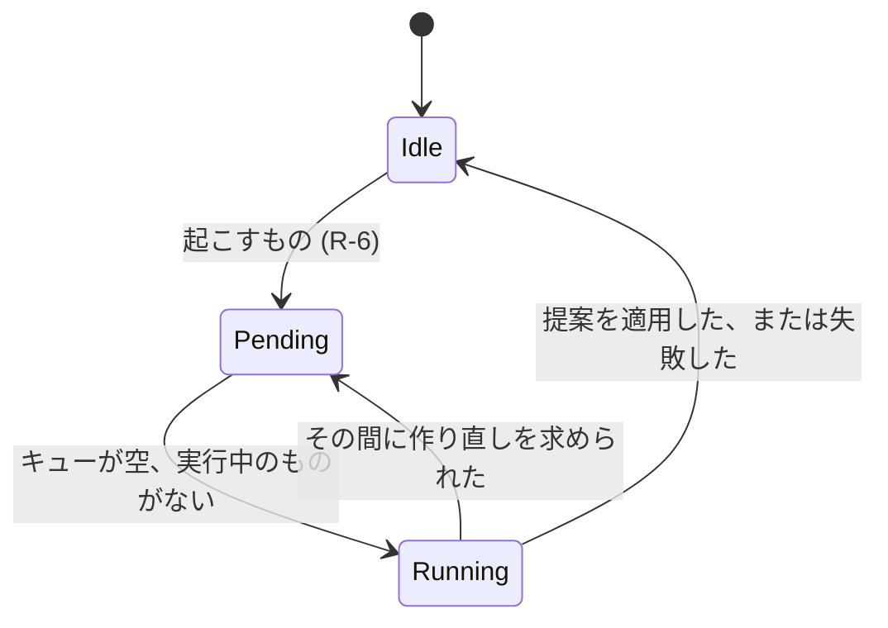

# データモデル: AI が整理する棚のホーム {#data-model-a-home-of-shelves-the-ai-organizes}

モデルの残りは変わらない。スマートフォルダについては [052 data-model](../052-smart-folders/data-model.md) と [マイグレーション](../../internal/store/migrations/) を参照する。

## マイグレーション {#migration}

`000NN_home_shelves.sql` は、マージされるときに番号を付け、`smart_folders` に `home_position` を加え、それが null でない行に索引 `smart_folders_home_idx(home_position)` を加える。どの行も位置を得ないので、ホームは最初の実行 (R-6) か所有者が加えるまで、フォルダの棚なしで始まる。

## `smart_folders.home_position` {#smart_foldershome_position}

| フィールド | 型 | Null | 意味 |
| --- | --- | --- | --- |
| `home_position` | integer | 可 | ホームでの棚の位置。小さいものが先。フォルダが棚でないときは null |

棚は `home_position`、次に `id` の順に並ぶ。位置は連続していなくてよい。棚を並べ替える書き込みは、すべての位置を 1、2、3 と順に書き直す。

## 設定 {#settings}

キーは既存の `settings` テーブルにある。

| キー | 値 | ないときの意味 |
| --- | --- | --- |
| `home.policy` | 所有者の方針の文章。前後の空白を除いて 0 から 2,000 文字 | 方針がない |
| `home.organize.pending` | `rebuild` か `extend` | 待っている実行がない |
| `home.organize.last` | 最後に終わった実行の JSON。下記 | 終わった実行がない |

`home.organize.last`:

| フィールド | 意味 |
| --- | --- |
| `organizer` | `ai` か `rules` (R-1) |
| `run` | `rebuild` か `extend` |
| `outcome` | `done`、`failed`、または提案が何も変えなかったときの `unchanged` |
| `finishedAt` | Unix ミリ秒 |
| `added`、`removed` | 挿入した棚と削除した棚 |
| `error` | `failed` のとき、所有者に示す短い理由: `unreachable`、`invalidAnswer`、`other` |

## 整理役の状態 {#organizer-state}

ホームと Settings が示す状態は、保留中の実行、今実行中かどうか (メモリーに保つ)、最後に終わった実行である。

## 提案する棚 {#proposed-shelf}

どちらの整理役も提案する棚のリストを返す。何もそれを保存しない。

| フィールド | 意味 |
| --- | --- |
| `name` | 1 から 100 文字。052 のフォルダ名の規則 |
| `rule` | `tags`、`tagKind`、`q`、`addedWithin`、`minDuration`、`maxDuration` だけを使う `SmartRule` (R-3) |

## 規則 {#rules}

| 規則 | 強制する場所 |
| --- | --- |
| 規則が `SmartRule.Validate` に通らない、または見える動画のどれにも合わない提案する棚は落とす | 適用のトランザクションの中の `domain` (検証)、`store` (一致の数) |
| 作り直しでは、AI のフォルダの規則を繰り返す提案する棚は、そのフォルダを提案の名前の下に残す。所有者が保った棚の規則を繰り返すもの、または追加でどれかの棚の規則を繰り返すものは落とす | `domain` (規則の等しさ)、`store` の適用のトランザクション (R-5) |
| 作り直しは `owner_kept` 0 のフォルダだけを削除する | `store`、適用のトランザクション (R-5) |
| 追加は挿入し、削除も名前の変更もしない | `store`、適用のトランザクション (R-5) |
| 所有者による `home_position` への書き込みは `owner_kept` を 1 にする | `store`、棚の順序の書き込み (R-4) |
| ホームの棚は最大 50。整理役はそれを超えて棚を挿入しない | `domain` の上限、`store` の適用のトランザクション |
| AI か規則のフォルダは、フォルダの並び順が `addedDesc` の最上位のフォルダである | `domain`、提案から `SmartFolderCreate` へ |

## 変わらないもの {#what-does-not-change}

`smart_folders.owner_kept` は 052 R-10 の意味を保つ。整理役は、R-10 がこの機能に残した書き込みの経路である。スマートフォルダの中身、カード、お気に入り、プレイリストの項目は変わらない。棚はそれ自身であるフォルダとして読む。どの動画がどの棚にあるかを記録するテーブルはない (R-8)。
