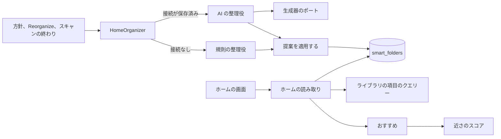
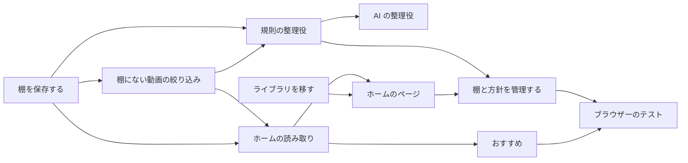

# 実装計画: AI が整理する棚のホーム {#implementation-plan-a-home-of-shelves-the-ai-organizes}

**ブランチ**: `feature/057-ai-home` | **親 Issue**: #1140

**入力**: 親 Issue。これがこの機能の仕様である。

## 概要 {#summary}

トップは棚のホームになる。各棚はホームでの位置を持つスマートフォルダで、その後に棚にない動画、最近追加した動画、おすすめの棚が続き、カードを押すと再生する。整理役がフォルダの棚を作る。Ollama が設定されているときは、AI の整理役が 053 の生成器のポートを通して所有者の方針を棚にし、設定されていないときは、規則の整理役が種類を持つよく使われたタグごとに 1 つの棚を作るので、ホームは AI なしで動く。ライブラリの画面は `/library` に移る。

図は、この機能が加える、または変える部分と、それぞれが読み書きするものを示す。



| 関心事 | 方針 |
| --- | --- |
| AI なし | 規則の整理役 ([R-1](research.md#r-1-two-organizers-behind-one-use-case-rules-work-with-no-ai)、[R-2](research.md#r-2-the-rule-organizer-makes-one-shelf-per-well-used-tag-with-a-kind)) |
| AI あり | 1 回の生成器へのリクエスト。名前を id に解決する ([R-3](research.md#r-3-the-ai-organizer-asks-the-generator-port-for-shelves-by-name)) |
| 棚 | `home_position` を持つスマートフォルダ ([R-4](research.md#r-4-a-shelf-is-a-smart-folder-with-a-home-position)、[data-model.md](data-model.md#smart_foldershome_position)) |
| 作り直しと追加 | 1 つのトランザクション。所有者が保ったフォルダには触れない ([R-5](research.md#r-5-a-rebuild-replaces-the-ais-folders-in-one-transaction-an-extend-only-adds)) |
| 動く時 | 設定にある保留中の実行。イベントが起こす ([R-6](research.md#r-6-one-run-at-a-time-queued-in-settings-triggered-by-events)、[R-7](research.md#r-7-an-extend-runs-when-20-or-more-shown-videos-are-unshelved)) |
| 棚にない動画 | 読み取りのときに評価するライブラリの絞り込み ([R-8](research.md#r-8-unshelved-means-matching-no-home-shelf-computed-on-read)) |
| 読み取り | 要約、次に画面上の棚の項目。予算は 1 秒 ([R-9](research.md#r-9-the-home-lists-shelf-summaries-shelf-items-are-read-on-screen)) |
| おすすめ | 所有者だけ。再生とお気に入りへの近さ ([R-10](research.md#r-10-recommended-is-the-owners-scored-against-favorites-and-plays)) |
| 再生 | 自動再生する動画のページ ([R-11](research.md#r-11-pressing-a-shelf-card-plays)) |
| ルート | ライブラリは `/library`。古い URL はリダイレクトする ([R-12](research.md#r-12-the-library-moves-to-library)) |
| 方針 | 1 つの設定。AI なしでも保存する ([R-13](research.md#r-13-the-policy-is-one-setting-without-ai-it-is-stored-but-unused)) |
| イベント | `HomeChanged` と画面のイベント `home` ([R-14](research.md#r-14-homechanged-tells-open-screens-to-read-the-home-again)) |

メンテナーは、ホームが AI なしでもある程度動くことを求めた (2026-10-16)。AI の接続がないときは方針を使わず、棚はタグの種類とタグから作る。要件 3 と受け入れ条件 3 には AI の整理役が要る。

Issue に `ui` ラベルがあるので、`design` 段階が画面の単位の前に `ui-design.md` を書く。対象は、棚の行を持つホーム、検索ボックスと `See all`、空のホーム、固定の棚と整理役の状態をフォルダの棚とどう見分けさせるか、棚の追加、削除、並べ替え、方針の Settings のセクションであり、親 Issue の `UI品質` に照らして判断する。

## 技術的な文脈 {#technical-context}

**正本の定義**:

| 項目 | 出典 |
| --- | --- |
| 境界、ストアの役割、コミットの後のイベント、すべての読み取りの閲覧者 | [ARCHITECTURE.md](../../ARCHITECTURE.md)、[.golangci.yml](../../.golangci.yml) (depguard) |
| スマートフォルダ、規則、`owner_kept`、中身、カード、読み取りの予算 | [052 plan](../052-smart-folders/plan.md)、[052 data-model](../052-smart-folders/data-model.md)、[052 research](../052-smart-folders/research.md) |
| タグの種類 | #1136、[`internal/domain/tag_kind.go`](../../internal/domain/tag_kind.go) |
| 分類器のポート、Ollama の接続、「接続が保存済み」 | [ai-layer.md](../../docs/design-docs/ai-layer.md)、[054 research、R-13](../054-auto-dup/research.md#r-13-the-model-is-asked-only-once-the-owner-has-saved-a-connection) |
| 生成器のポートとプロバイダー | 053 の plan と research の R-1 から R-3 (#1138、plan の PR #1164) |
| 近さのスコア | [related-videos.md](../../docs/design-docs/related-videos.md) |
| 視聴履歴、お気に入り | [043 data-model](../043-watch-history/data-model.md)、[035 data-model](../035-favorites/data-model.md) |
| ライブラリの画面、その URL とカード | [library-ui.md](../../docs/design-docs/library-ui.md)、[`web/src/videoList/listCriteria.ts`](../../web/src/videoList/listCriteria.ts) |
| 画面の API と生成コード | [api/openapi.yaml](../../api/openapi.yaml)、`task generate` |
| 画面と Web のテスト | [design-system.md](../../docs/design-docs/design-system.md)、[web-testing.md](../../docs/design-docs/web-testing.md)、[i18n.md](../../docs/design-docs/i18n.md) |
| 検査 | [Taskfile.yml](../../Taskfile.yml) (`task check`、`task check-docs`、`task test-e2e`) |

**この機能に固有の文脈**:

- マイグレーションは 1 つで、マージされるときに番号を付ける ([data-model.md、マイグレーション](data-model.md#migration))。
- 画面の API に 6 つのルート、1 つの一覧のパラメーター、1 つの画面のイベントの種類が加わる ([contracts/screen-api.md](contracts/screen-api.md))。外部 API と MCP は変わらない。
- AI の整理役には、`main` にある 053 の生成器のポートが要る。それを待つのはそう書いた単位だけで、ほかのどの単位も、AI なしのホームも待たない。
- `Scans.OnFinish` は今は 1 つのコールバックを持つ。それをリストにする ([R-6](research.md#r-6-one-run-at-a-time-queued-in-settings-triggered-by-events))。

## 憲章の確認 {#constitution-check}

| 規則 (出典) | 判定 |
| --- | --- |
| アダプターは互いも `internal/app` も import しない (ARCHITECTURE.md、depguard) | 合格: `internal/app` の `HomeOrganizer` は、自ら宣言するインターフェースを通してストアと生成器に届く。`internal/httpapi` は `Home` インターフェースを宣言する |
| ドメインが決め、ストアが強制する (ARCHITECTURE.md) | 合格: 提案の上限と規則の整理役の選び方は純粋なドメインの規則である。適用のトランザクションは `owner_kept` と一致の数を読み直す |
| ストアの役割 (ARCHITECTURE.md) | 合格: 新しい `HomeStore` の役割。そのトランザクションの中でのフォルダの挿入と削除は、`SmartFolderStore` と共有するパッケージ内のヘルパーを使う |
| コミットの後のイベント (ARCHITECTURE.md) | 合格: `HomeChanged` と `SmartFoldersChanged` は、適用のトランザクションがコミットした後に発行する |
| ユーザーデータは作り直しを越えて残る (ARCHITECTURE.md) | 合格: `home_position` は `smart_folders` にあり、その独自の id をキーとする。方針は設定である |
| すべての読み取りは閲覧者を知る (ARCHITECTURE.md) | 合格: 棚の項目、棚にない動画、最近追加した動画は閲覧者に合わせて絞る。おすすめと整理役の状態は所有者だけ |
| メディアフォルダのファイルを読むのはスキャンだけである (ARCHITECTURE.md) | 合格: 整理役が読むのは SQLite と生成器だけである |
| 生成ファイルを手で編集しない (AGENTS.md) | 合格: `api/openapi.yaml` を変え、`task generate` を実行する |
| 複雑度は 25 以下、コードをコピーしない (AGENTS.md) | 合格: 棚にない動画は既存の動画ごとの一致を否定する。棚の項目はライブラリの項目のクエリーを呼ぶ。おすすめは `ContentRelatedness` を呼ぶ |
| 画面の前に design-system.md を読む。最も低いレベルでテストする (AGENTS.md) | 合格: 画面は `ui-design.md` に従う。棚の行はレジストリの項目になる。整理役は偽物を使うアプリのテスト、ストアはそのテストとベンチマーク、画面はページのテスト、受け入れ条件は 1 つのブラウザーのテストを持つ |

違反はないので、Complexity Tracking はない。

## プロジェクトの構成 {#project-structure}

### 文書 (この機能) {#documentation-this-feature}

```text
specs/057-ai-home/
├── plan.md
├── research.md
├── data-model.md
└── contracts/
    └── screen-api.md
```

`ui-design.md` は `design` 段階が書く。`quickstart.md` はない。ブラウザーのテストは規則の整理役を動かし、AI の整理役の受け入れは偽の生成器を使うアプリのテストで動くので、手で動かすものは残らない。

### ソースコード {#source-code}

**影響する境界**:

| 境界 | この機能でそれが持つもの |
| --- | --- |
| `internal/domain` | 提案する棚とその上限、規則の整理役の選び方、`VideoQuery.Unshelved`、`HomeChanged`、整理役の状態 |
| `internal/store` | マイグレーション、`HomeStore` (要約、棚の項目、順序、適用)、棚にない動画の条件、おすすめの種のクエリー、設定のキー、ベンチマーク |
| `internal/app` | `HomeOrganizer` (起こす処理、保留中の実行、2 つの整理役)、おすすめのスコア付けとそのキャッシュ、`Scans.OnFinish` のリスト |
| `internal/httpapi`、`api/openapi.yaml`、`cmd/mdm` | ルート、`unshelved` パラメーター、`home` のイベント、配線 |
| `web/src/home` (新規)、`web/src/app`、`web/src/shell`、`web/src/settings`、`web/src/smartFolders`、`web/src/ui`、`web/src/i18n` | ホームのページと棚の行、ルートとリダイレクト、サイドバー、Settings のセクション、フォルダのページの操作 |
| `docs/design-docs` | 新しい `home.md`、`ai-layer.md` と `library-ui.md` の更新 |
| `web/e2e` | ライブラリのために `/` を開く既存のテストと、新しいブラウザーのテスト |

**新しいパス**: `internal/store/migrations/000NN_home_shelves.sql`、`internal/domain/home.go`、`internal/store/home.go`、`internal/app/home_organizer.go`、`internal/httpapi/home.go`、`web/src/api/home.ts`、`web/src/home/`、`docs/design-docs/home.md`、`web/e2e/home.e2e.ts`。

**構成の判断**: 既存の配置に従い、ホームはスマートフォルダの隣に、独自のストアの役割、ユースケース、画面のフォルダを持つ ([R-4](research.md#r-4-a-shelf-is-a-smart-folder-with-a-home-position))。

## 実装作業 {#implementation-work}

図は、どの単位が先にマージされなければならないかを示す。画面の単位は `design` 段階の `ui-design.md` も待ち、AI の整理役は `main` にある 053 の生成器のポートを待つ。



### ホームの棚をスマートフォルダに保存し、整理役の提案を適用する {#store-home-shelves-on-smart-folders-and-apply-an-organizers-proposal}

**範囲**: マイグレーション、ドメインの提案する棚とその上限、棚の要約を持つ `HomeStore`、棚の順序の書き込み (`owner_kept` を設定する)、作り直しと追加の適用のトランザクション、`HomeChanged` のイベント、設定のキー ([data-model.md](data-model.md)、[R-4](research.md#r-4-a-shelf-is-a-smart-folder-with-a-home-position)、[R-5](research.md#r-5-a-rebuild-replaces-the-ais-folders-in-one-transaction-an-extend-only-adds))。

**依存**: なし。

**受け入れ**: `task check` が通る。ストアのテストが次を示す: 作り直しは、規則を提案が繰り返さない AI のフォルダを削除し、規則を提案が繰り返すものは同じ id とお気に入りで提案の名前の下に残し、所有者が保った棚の規則を繰り返す提案を落とし、所有者が保ったフォルダはそのままにする。追加は最後の棚の後に棚を加え、既存の名前や規則を変えない。どの動画にも合わない提案の規則は落とす。棚の並べ替えは `owner_kept` を 1 にする。`HomeChanged` はコミットの後に発行され、ロールバックの後には発行されない。

### ライブラリを、どのホームの棚にもない動画に絞り込む {#filter-the-library-to-videos-in-no-home-shelf}

**範囲**: `VideoQuery.Unshelved`、すべてのホームの棚の実効の規則の動画ごとの一致を否定したその条件、ゲストも使える一覧のパラメーター `unshelved`、その API クライアントのパラメーター。画面の変更はない ([R-8](research.md#r-8-unshelved-means-matching-no-home-shelf-computed-on-read)、[contracts/screen-api.md、変わるスキーマとパラメーター](contracts/screen-api.md#schemas-and-parameters-changed))。

**依存**: ホームの棚をスマートフォルダに保存し、整理役の提案を適用する。

**受け入れ**: `task check` が通り、`task generate` で差分が出ない。ストアのテストが次を示す: `unshelved=1` はどの棚にも合わない動画を一覧し、子の棚のパスに合う動画は一覧せず、フォルダがホームから外された動画をまた一覧する。ゲストにはその中で隠れた動画が見えない。

### ホームの棚とその最初の項目を読む {#read-the-homes-shelves-and-their-first-items}

**範囲**: `GET /api/home`、フォルダ、棚にない動画、最近追加した動画の棚のための `GET /api/home/shelves`、`PUT /api/home/shelves`、スマートフォルダの `onHome`、画面のイベント `home`、空のホームの理由、R-9 のベンチマーク ([contracts/screen-api.md](contracts/screen-api.md)、[R-9](research.md#r-9-the-home-lists-shelf-summaries-shelf-items-are-read-on-screen)、[R-14](research.md#r-14-homechanged-tells-open-screens-to-read-the-home-again))。

**依存**: ライブラリを、どのホームの棚にもない動画に絞り込む。

**受け入れ**: `task check` が通る。ハンドラーのテストが次を示す: 棚はその順序で並び、その後に固定の棚が続く。ゲストは整理役の状態を受け取らず、フォルダに見えるものが何もない棚も受け取らない。フォルダの棚の項目は子フォルダを持たない。8 を超える `keys` は `400 invalid_request` で、未知の id を持つ `PUT` は `404` である。20,000 本の動画と 50 の棚でのベンチマークは、各読み取りを 1 秒以内に返す。

### 所有者のお気に入りと再生に近い動画をおすすめする {#recommend-videos-close-to-the-owners-favorites-and-plays}

**範囲**: 種のクエリー (90 日で最も再生した動画、最新のお気に入り)、どれかの種への最も高い近さによる順位付け、10 分のキャッシュ、所有者だけのためのホームの読み取りのおすすめの棚 ([R-10](research.md#r-10-recommended-is-the-owners-scored-against-favorites-and-plays))。

**依存**: ホームの棚とその最初の項目を読む。

**受け入れ**: `task check` が通る。偽のスコア付けを使うアプリのテストが、棚が種と見終わった動画を除き、最も高いスコアの順に並ぶことを示す。ストアのテストが種を示す。ハンドラーのテストが、ゲストと、再生もお気に入りもない所有者には棚がないことを示す。

### AI なしでタグの種類からホームを整理する {#organize-the-home-from-tag-kinds-without-ai}

**範囲**: 保留中の実行を持つ `HomeOrganizer`、その起こす処理 (方針の保存、`Reorganize`、キューが空になった後のスキャンの終わり、最初の実行)、`Scans.OnFinish` のリスト、規則の整理役、`POST /api/home/organize`、ホームの設定のルート、その翻訳を含む `docs/design-docs/home.md` ([R-1](research.md#r-1-two-organizers-behind-one-use-case-rules-work-with-no-ai)、[R-2](research.md#r-2-the-rule-organizer-makes-one-shelf-per-well-used-tag-with-a-kind)、[R-6](research.md#r-6-one-run-at-a-time-queued-in-settings-triggered-by-events)、[R-7](research.md#r-7-an-extend-runs-when-20-or-more-shown-videos-are-unshelved)、[R-13](research.md#r-13-the-policy-is-one-setting-without-ai-it-is-stored-but-unused))。

**依存**: ライブラリを、どのホームの棚にもない動画に絞り込む。

**受け入れ**: `task check` と `task check-docs` が通る。アプリのテストが次を示す: Ollama の接続がないとき、作り直しは 5 本以上の動画に付いた種類を持つタグごとに 1 つの棚を作る。棚にない動画が 20 本あるスキャンの終わりは、キューが空になった後にだけ追加を実行し、19 本では何も実行しない。保留中の実行は再起動を越えて残る。実行中に求められた作り直しは、その後に実行する。ハンドラーのテストが、2,000 文字を超える `PUT /api/settings/home` は `400` であることを示す。

### AI で所有者の方針に従ってホームを整理する {#organize-the-home-by-the-owners-policy-with-the-ai}

**範囲**: AI の整理役。方針、種類、タグ、保たれた棚、棚にない動画のタイトルを含む生成器へのリクエスト、応答のスキーマ、名前の解決、保存された接続による整理役の選択、棚を変えずに最後の実行として記録する失敗、その翻訳を含む `ai-layer.md` の機能の行 ([R-3](research.md#r-3-the-ai-organizer-asks-the-generator-port-for-shelves-by-name))。

**依存**: AI なしでタグの種類からホームを整理する。`main` にある 053 の生成器のポート。

**受け入れ**: `task check` と `task check-docs` が通る。偽の生成器を使うアプリのテストが次を示す: 料理の動画を求める方針と、タグ `料理` を名指す応答は、そのタグを持つ棚を作る (受け入れ条件 3)。未知のタグを名指す応答は棚を加えない。生成器のエラーは棚をそのままにし、`unreachable` 付きの `failed` を記録する。接続が保存されているとき、整理役の状態は `ai` を示す。

### ライブラリの画面を /library に移す {#move-the-library-screen-to-library}

**範囲**: `/library` のルート、ライブラリのパラメーターを持つ `/` のリダイレクト、アプリ内のすべての `/?tag=`、`/?person=`、`/?organization=` のリンク、サイドバーの `Home` と `Library` の項目、ホームのページがマージされるまで `/library` にリダイレクトする仮の `/`、ライブラリのために `/` を開く e2e のテスト、その翻訳を含む `library-ui.md` ([R-12](research.md#r-12-the-library-moves-to-library))。

**依存**: なし。

**受け入れ**: `task check` と `task check-docs` が通る。ページのテストが次を示す: `/?tag=3` はタグの絞り込みを適用した `/library?tag=3` を開き、動画のページのタグのチップは `/library?tag=<id>` を開く。ブラウザーのテストは `/library` に対して通る。画面が変わるので、サイドバーの見た目の確認が要る。

### ホームの棚を示し、そこから再生する {#show-the-homes-shelves-and-play-from-them}

**範囲**: `/` のホームのページ。画面上で読む棚の行、レジストリの項目としての棚の行、カードを押して再生すること (R-11)、フォルダを開く棚の見出し、`See all` (フォルダのページ、`/library?unshelved=1`、追加日で並べた `/library`)、`/library?q=` を開く検索ボックス、空のホーム、控えめに示す整理役の状態、`home` と `smartFolder` のイベントでの再読み込み。`ui-design.md` に従う ([R-9](research.md#r-9-the-home-lists-shelf-summaries-shelf-items-are-read-on-screen)、[R-11](research.md#r-11-pressing-a-shelf-card-plays))。

**依存**: ホームの棚とその最初の項目を読む。ライブラリの画面を /library に移す。

**受け入れ**: `task check` が通る。ページのテストが次を示す: 棚のカードを 1 回押すと、自動再生と `?smartFolder` 付きで動画のページに移り、検索ボックスに入力すると `/library?q=` を開く。画面が変わるので、デスクトップとモバイルの幅でのホームの見た目の確認が要る。

### ホームの棚と整理の方針を管理する {#manage-home-shelves-and-the-organizing-policy}

**範囲**: 方針、どの整理役が適用されるか、最後の実行、`Reorganize` を持つ Settings のセクション。ホームでの棚の追加、削除、並べ替え。スマートフォルダのページの `Add to home` と `Remove from home`。`ui-design.md` に従う ([R-4](research.md#r-4-a-shelf-is-a-smart-folder-with-a-home-position)、[R-13](research.md#r-13-the-policy-is-one-setting-without-ai-it-is-stored-but-unused))。

**依存**: ホームの棚を示し、そこから再生する。AI なしでタグの種類からホームを整理する。

**受け入れ**: `task check` が通る。ページのテストが次を示す: 方針の保存は `PUT /api/settings/home` を呼び、`Reorganize` は `POST /api/home/organize` を呼び、棚を動かすと新しい順序を送る。AI なしのとき、セクションは方針が AI の設定後に適用されると示す。画面が変わるので、見た目の確認が要る。

### ブラウザーのテストでホームを確かめる {#cover-the-home-in-a-browser-test}

**範囲**: 規則の整理役で受け入れ条件 1、2、4、5、6、7 を確かめる 1 つのブラウザーのテスト。`web/e2e/home.e2e.ts` を加える。受け入れ条件 3 は AI の整理役のアプリのテストに残る。

**依存**: ホームの棚と整理の方針を管理する。所有者のお気に入りと再生に近い動画をおすすめする。

**受け入れ**: `task test-e2e -- e2e/home.e2e.ts` が通り、CI の `Browser E2E` ジョブが通る。
