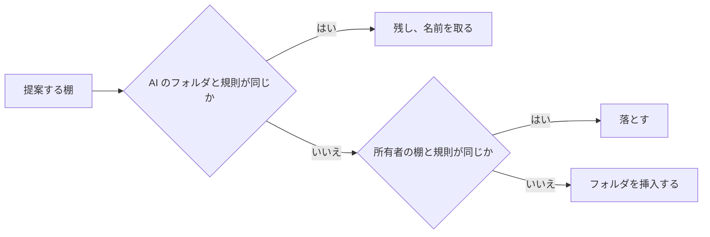

# 調査: AI が整理する棚のホーム {#research-a-home-of-shelves-the-ai-organizes}

引き継いだ決定: スマートフォルダ、その規則、`owner_kept`、読み取りのときに計算する中身、読み取りの予算 ([052 research](../052-smart-folders/research.md))。タグの種類 (#1136)。分類器のポートと Ollama のプロバイダー ([ai-layer.md](../../docs/design-docs/ai-layer.md))。生成器のポート、その Ollama の `/api/chat` のプロバイダー、`ollama.generation_model` の設定 (053 research の R-1 から R-3、#1138)。近さのスコア ([related-videos.md](../../docs/design-docs/related-videos.md))。このファイルは、この機能が加える決定だけを記録する。

## R-1: 1 つのユースケースの後ろに 2 つの整理役を置く。規則は AI なしで動く {#r-1-two-organizers-behind-one-use-case-rules-work-with-no-ai}

**決定**: `app.HomeOrganizer` は、Ollama の接続が保存されているときは AI の整理役で、そうでないときは規則の整理役で棚を作る。どちらも同じ提案する棚のリストを返し、1 つの適用の段階がそれを保存する。

| 案 | AI の接続がないとき | 判定 |
| --- | --- | --- |
| **規則の整理役、接続があるときは AI の整理役** | タグの種類とタグから作る棚 | 採用 |
| AI の整理役だけ | 所有者が Ollama を設定するまで棚がない | メンテナーが不採用とした (2026-10-16): ホームは AI なしでもある程度動かなければならない |
| 常に規則の整理役、AI は棚の名前を付けるだけ | 棚がある | 不採用: 方針がどの棚があるかを変えられない (要件 4) |

**理由**: 054 R-13 の接続の判定 (`OllamaConnectionSaved`) は、重複の判定のためにすでに「AI が設定されている」を決めているので、所有者が見るその意味は 1 つになる。設定されているが失敗する AI は、規則に切り替えない。切り替えると AI の棚が別の棚に置き換わるが、Issue の Edge Case は棚をそのまま保つ。

## R-2: 規則の整理役は、種類を持つよく使われたタグごとに 1 つの棚を作る {#r-2-the-rule-organizer-makes-one-shelf-per-well-used-tag-with-a-kind}

**決定**: 規則の整理役は、種類を持ち、見える動画の 5 本以上に付いたタグごとに 1 つの棚を提案する。棚はタグの名前を持ち、規則は `{"tags": [id]}` で、最大 24 の棚を、種類の順 (種類の id。つまりプリセットが先) に、次に動画の数の多い順に並べる。種類を持つタグがないときは、種類のないタグを同じように使う。

| 案 | 判定 |
| --- | --- |
| **種類を持つタグごとに 1 つの棚** | 採用 |
| 種類ごとに 1 つの棚 (`tagKind` の規則) | 不採用: `Genre` の棚は、どれかのジャンルのタグを持つすべての動画を持ち、何も分けない |
| フォルダ名から作る棚 | 不採用: Issue の背景は、フォルダ名とファイル名は動画が何であるかを示さないとしている |
| 固定の棚だけ (最近、未視聴) | 不採用: 内容で整理せず、ホームにはすでに最近追加した動画の棚がある |

**理由**: 種類を持つタグは、所有者か AI のタグの作成 (#1138) が分類したタグなので、モデルなしで得られる最もよい内容の手がかりである。最小の 5 本は、棚が 1 枚のカードの 1 行になるのを防ぐ。この整理役は方針を読まない。Settings がそう示す (R-13)。

## R-3: AI の整理役は、生成器のポートに名前で棚を求める {#r-3-the-ai-organizer-asks-the-generator-port-for-shelves-by-name}

**決定**: AI の整理役は、生成器のポート (053 R-1) にテキストだけのリクエストを 1 つ送る。その中身は、方針、それぞれ最大 30 のタグを持つ種類とその動画の数 (タグは全部で最大 500)、所有者が保つ棚、棚にない動画の数とそのうち最大 50 のタイトル、最大 20 の棚 (追加のときは 5) のための JSON Schema である。各棚は名前と規則で、規則のタグと種類は名前で与える。

| 案 | 判定 |
| --- | --- |
| **生成器のポート、応答には名前、整理役が解決する** | 採用 |
| この機能独自のポート | 不採用: 053 R-1 は、次の生成の機能が再利用するように、生成器のポートを作業に依存しないものにした |
| 応答に id | 不採用: モデルは id を名前ほど確実には写さず、誤った id は黙って別のタグを指す |
| 動画の画像 | 不採用: 棚は、モデルがすでにテキストとして持つタグと事実から作り、画像はリクエストの大きさを動画の数だけ倍にする |

**理由**: 名前は、053 R-5 と同じく、名前の完全一致と同義語の検索で解決する。タグか種類が解決しない棚、規則が `SmartRule.Validate` に通らない棚、見える動画のどれにも合わない棚は落とすので、誤った応答は空の棚ではなく何も加えない。示す規則のメンバーは `tags`、`tagKind`、`q`、`addedWithin`、`minDuration`、`maxDuration` である。視聴の状態とお気に入りは再生のたびに変わるので、長く続く棚にならない。

## R-4: 棚はホームでの位置を持つスマートフォルダである {#r-4-a-shelf-is-a-smart-folder-with-a-home-position}

**決定**: スマートフォルダは、その `home_position` が設定されているときホームにある。整理役は `owner_kept` 0 と位置を持つ最上位のフォルダを作り、所有者はどのフォルダも加え、外し、並べ替える。

| 案 | 判定 |
| --- | --- |
| **`smart_folders` の位置の列** | 採用 |
| フォルダを参照する別の棚のテーブル | 不採用: 棚は順序のほかに独自のフィールドを持たないので、2 つ目のテーブルは結合と削除の規則を加えるだけである |
| すべての最上位のフォルダが棚で、名前の順に並ぶ | 不採用: 所有者が棚を外したり並べ替えたりできない (要件 10) |

**理由**: 要件 2 は棚をスマートフォルダにし、フォルダのページは「フォルダ全体を開く」がすでに行き着く先である。所有者がフォルダのホームでの位置を変えると、052 R-10 がほかのすべての所有者の書き込みでするのと同じく `owner_kept` を 1 にするので、AI はそれを元に戻さない (要件 9)。

## R-5: 作り直しは 1 つのトランザクションで AI のフォルダを置き換える。追加は加えるだけである {#r-5-a-rebuild-replaces-the-ais-folders-in-one-transaction-an-extend-only-adds}

**決定**: 作り直しは、規則を提案が繰り返す `owner_kept` 0 のフォルダを、提案の名前を取って残し (そのため id、お気に入り、プレイリストの項目は残る)、所有者が保った棚がすでに持つ規則の提案する棚を落とし、残りを挿入し、提案が繰り返さなかった `owner_kept` 0 のフォルダを削除し、位置を設定する。これをすべて 1 つのトランザクションでする。追加は、今の棚の後に挿入するだけで、どれかの棚がすでに持つ規則の提案する棚を落とす。

図は、作り直しが提案する各棚をどう扱うかを示す。

| 案 | 判定 |
| --- | --- |
| **1 つのトランザクション、規則が繰り返すフォルダを残す** | 採用 |
| AI のフォルダをすべて削除し、すべて挿入する | 不採用: AI の棚のお気に入りやプレイリストの項目が、棚が変わらずに戻るときでも、作り直しのたびに消える |
| 名前と規則の両方が繰り返すフォルダだけを残す | 不採用: 同じ規則で名前を変えた提案は古いフォルダの重複として落とされ、その後古いフォルダが削除されるので、棚が消える |
| 古いフォルダと新しいフォルダを規則が似ているかで対応付ける | 不採用: 似ているかは推測であり、要件 8 は作り直しが削除と名前の変更をすることを認める |

**理由**: ホームはトランザクションがコミットするまで古い棚を読むので、作り直しの間に開いたホームは前の棚を示す (Edge Case)。

## R-6: 実行は一度に 1 つ。設定に積み、イベントが起こす {#r-6-one-run-at-a-time-queued-in-settings-triggered-by-events}

**決定**: 整理役は、保留中の実行を最大 1 つ、`rebuild` か `extend` (作り直しは追加を吸収する) として設定 `home.organize.pending` に保ち、それを独自のゴルーチンで実行し、起動時に再開する。

| 起こすもの | 実行 |
| --- | --- |
| 方針が変更とともに保存される | `rebuild` |
| 所有者が `Reorganize` を押す | `rebuild` |
| スキャンが完了として終わり、その後ジョブのキューと自動タグ付けのキューが 2 分間空である | R-7 が成り立つとき `extend` |
| 実行が一度も終わっておらず、キューが空で、少なくとも 1 つのタグが見える動画に付いている | `rebuild` |

| 案 | 判定 |
| --- | --- |
| **保留の設定と整理役のゴルーチン** | 採用 |
| `jobs` テーブルの種類 | 不採用: `jobs` の行は 1 つの動画とその場所に属し、新しい種類はその CHECK のためにテーブルの作り直しを要する |
| 数時間ごとに動くタイマー | 不採用: 要件 7 は棚の追加をスキャンの終わりに結び付ける |

**理由**: 新しい動画はスキャンが終わった後に自動タグ付けからタグを得るので、追加はキューが空になるのを待つ。そうしないと、新しい動画はどれもタグを持つ前に棚にない動画として数えられる。`Scans.OnFinish` は 1 つのコールバック (自動取り込みのもの) を持つので、コールバックのリストになる。

## R-7: 追加は、見える動画の 20 本以上が棚にないときに実行する {#r-7-an-extend-runs-when-20-or-more-shown-videos-are-unshelved}

**決定**: 追加は、所有者に見える動画の少なくとも 20 本がどの棚にもないときに実行し、その動画のためだけに棚を提案する。

| 案 | 判定 |
| --- | --- |
| **固定の 20 本** | 採用 |
| ライブラリの割合 (10%) | 不採用: 20,000 本の動画では 2,000 本の棚にない動画を待ち、50 本では 5 本で実行する |
| スキャンごと | 不採用: 動画を 2 本加えるスキャンが、そのたびにモデルに新しい棚を求める |

**理由**: 20 本は 1 つの棚の最初の 1 画面分のカードなので、新しい棚は少なくともその分を埋める。

## R-8: 棚にない動画とは、どのホームの棚にも合わないことであり、読み取りのときに計算する {#r-8-unshelved-means-matching-no-home-shelf-computed-on-read}

**決定**: 見える動画は、どのホームの棚の実効の規則にも合わないとき棚にない。ライブラリはそれを一覧する絞り込み `unshelved` を得て、棚にない動画の棚とその `See all` はそれを通して読む。

| 案 | 判定 |
| --- | --- |
| **読み取りのときに評価する絞り込み** | 採用 |
| 保存した所属のテーブル | 不採用: 052 R-2 は、古くならないようにフォルダの中身を読み取りのときに計算する。保存した集合は、タグのすべての書き込みがそれを更新する必要がある |
| どのスマートフォルダにも合わないことを棚にないとする | 不採用: 所有者がホームから外したフォルダが、その動画を棚にない動画の棚から隠したままになる |

**理由**: この絞り込みは、カードの読み取りがすでに作る動画ごとの一致 (`smartMatchFor`) の否定なので、規則の 2 つ目の翻訳を加えない。

## R-9: ホームは棚の要約を一覧し、棚の項目は画面上で読む {#r-9-the-home-lists-shelf-summaries-shelf-items-are-read-on-screen}

**決定**: `GET /api/home` は順序付きの棚の要約と整理役の状態を返し、`GET /api/home/shelves` は名指した最大 8 つの棚の最初の 24 項目を返す。20,000 本の動画と 50 の棚で、どちらも開発用のホストで 1 秒以内に返り、ストアのベンチマークで測る。

| 案 | 判定 |
| --- | --- |
| **要約、次に画面上の棚の項目** | 採用 |
| すべての棚の項目を 1 回で読む | 不採用: 052 R-13 がライブラリのカードで分かったように、50 の棚は 50 回のフォルダの読み取りである |
| スマートフォルダの項目のルートから、棚ごとに 1 つのリクエストで項目を読む | 不採用: 6 つの棚の画面は 6 回の往復を要し、棚にない動画、最近追加した動画、おすすめの棚はフォルダではない |

**理由**: フォルダのカードについての 052 R-14 の形なので、多くの棚を持つホームも待たずに開く (Edge Case)。

## R-10: おすすめは所有者のもので、お気に入りと再生に照らしてスコアを付ける {#r-10-recommended-is-the-owners-scored-against-favorites-and-plays}

**決定**: 所有者だけのために、おすすめの棚は、見終わっていない見える動画を、直近 90 日で最も再生した最大 10 本の動画と最新の最大 10 本のお気に入りのどれかへの最も高い近さで順位付けし、最初の 24 本を残し、結果をメモリーに 10 分間保つ。そうした種の動画がないときは示さない。

| 案 | 判定 |
| --- | --- |
| **どれかの種への最も高い近さ** | 採用 |
| すべての種への近さの合計 | 不採用: 種の 1 つの大きな集まりに近い動画が棚全体を埋める |
| 所有者の種からのゲスト向けのおすすめ | 不採用: 視聴履歴は所有者だけのもので (043 R-7)、棚は所有者が見るものをゲストに示すことになる |
| ホームを読むたびに計算する | 不採用: 近さの計算 1 回はすべての動画の手がかりを読み込み (related-videos.md)、20 回は R-9 の 1 秒に収まらない |

**理由**: `ContentRelatedness` を再利用すると、動画のページとホームで「内容が近い」の意味が 1 つに保たれる。

## R-11: 棚のカードを押すと再生する {#r-11-pressing-a-shelf-card-plays}

**決定**: 棚の動画のカードは、自動再生付きで動画のページを開き (フォルダの棚では次の動画が棚に従うように `?smartFolder=<id>` も付ける)、グループのカードは、グループが開く動画を自動再生と `?group` 付きで開く。フォルダの棚の項目は、再生する動画を持たない子フォルダを含めない。

| 案 | 判定 |
| --- | --- |
| **動画のページ、自動再生** | 採用 |
| ホームの中のプレイヤー | 不採用: 動画のページのプレイヤー、その画質と字幕の操作、そのキーボードの規則を重複させる |
| グループのカードはグループのページを開く | 不採用: 要件 2 と `UI品質` は、1 回押して再生することを求める |
| 棚の子フォルダのカード | 不採用: フォルダのカードは動画ではなくページを開き、棚の見出しがすでにフォルダをその子とともに開く |

**理由**: 動画のページは「次を再生」のためにすでに `state.autoplay` で自動再生するので、ホームはそれを設定するだけである。

## R-12: ライブラリは `/library` に移る {#r-12-the-library-moves-to-library}

**決定**: ホームが `/` を取り、ライブラリの画面は同じクエリーパラメーターで `/library` に移り、ライブラリのパラメーターを持つ `/` はそれを付けて `/library` にリダイレクトする。

| 案 | 判定 |
| --- | --- |
| **ライブラリは `/library`、古い URL をリダイレクトする** | 採用 |
| ホームは `/home` | 不採用: 要件 1 はトップをホームにする |
| リダイレクトなし | 不採用: `/?tag=` の形のブックマークとリンクがホームを開き、絞り込みを失う |

**理由**: `/?tag=`、`/?person=`、`/?organization=` の形のアプリ内のすべてのリンクは `/library` に移り、サイドバーは `Library` の上に `Home` を得る。

## R-13: 方針は 1 つの設定である。AI なしでは保存するが使わない {#r-13-the-policy-is-one-setting-without-ai-it-is-stored-but-unused}

**決定**: 方針は設定 `home.policy` で、最大 2,000 文字である。変更した方針の保存は作り直しを積み (R-6)、AI の接続がないとき、Settings は方針が AI の設定後に適用されると示す。

| 案 | 判定 |
| --- | --- |
| **1 つの設定、AI なしでも保存する** | 採用 |
| AI なしでは保存を拒む | 不採用: 所有者は Ollama を設定する前に方針を書け、それは最初の AI の作り直しで適用される |
| 棚ごとの方針 | 不採用: Issue の `対象外` は方針を 1 つの設定に保つ |

**理由**: 2,000 文字は Issue の例よりはるかに多く、500 のタグと並べてもプロンプトを 053 の `num_ctx` の 16,384 トークン以内に保つ。

## R-14: `HomeChanged` は、開いている画面にホームを読み直させる {#r-14-homechanged-tells-open-screens-to-read-the-home-again}

**決定**: ストアは棚の集合か順序を変えた後に、整理役はその状態が変わるたびに `HomeChanged` を発行する。HTTP 層はそれを画面のイベント `home` として所有者とゲストに送る。

| 案 | 判定 |
| --- | --- |
| **新しいイベント** | 採用 |
| `SmartFoldersChanged` だけ | 不採用: それは書き込みに規則が合ったフォルダを名指すが、失敗した実行はどのフォルダも変えないのに画面に届かなければならない |

**理由**: 棚の中身は引き続き `SmartFoldersChanged` に従い、ホームはそれをライブラリと同じように扱うので、`HomeChanged` は id を運ばない。
