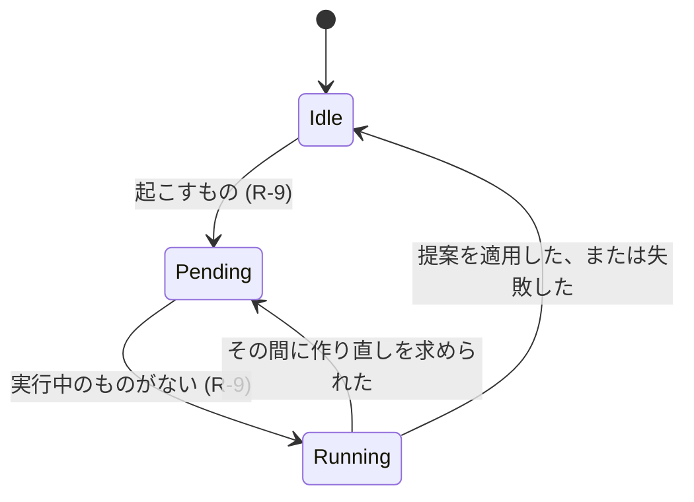

# データモデル: オンボーディングで始まる棚のホーム {#data-model-a-home-of-shelves-started-by-onboarding}

モデルの残りは変わらない。スマートフォルダについては [052 data-model](../052-smart-folders/data-model.md)、タグの種類については [051 data-model](../051-tag-kinds/data-model.md)、そして [マイグレーション](../../internal/store/migrations/) を参照する。

## マイグレーション {#migration}

`000NN_home_shelves.sql` は、マージされるときに番号を付け、`smart_folders` に `home_position` を加え、それが null でない行に索引 `smart_folders_home_idx(home_position)` を加える。どの行も位置を得ないので、ホームは、オンボーディング、最初の実行 (R-9)、または所有者が棚を加えるまで、フォルダの棚なしで始まる。

## `smart_folders.home_position` {#smart_foldershome_position}

| フィールド | 型 | Null | 意味 |
| --- | --- | --- | --- |
| `home_position` | integer | 可 | ホームでの棚の位置。小さいものが先。フォルダが棚でないときは null |

棚は `home_position`、次に `id` の順に並ぶ。位置は連続していなくてよい。棚を並べ替える書き込みは、すべての位置を 1、2、3 と順に書き直す。

## 設定 {#settings}

キーは既存の `settings` テーブルにある。

| キー | 値 | ないときの意味 |
| --- | --- | --- |
| `onboarding.step` | `folders`、`scan`、`interests`、`done` のどれか (R-3) | メディアフォルダがあるときは `done`、なければ `folders` |
| `home.organize.pending` | `rebuild` か `extend` | 待っている実行がない |
| `home.organize.last` | 最後に終わった実行の JSON。下記 | 終わった実行がない |

`home.organize.last`:

| フィールド | 意味 |
| --- | --- |
| `run` | `rebuild` か `extend` |
| `outcome` | `done`、`failed`、または提案が何も変えなかったときの `unchanged` |
| `finishedAt` | Unix ミリ秒 |
| `added`、`removed` | 挿入した棚と削除した棚 |

## 整理役の状態 {#organizer-state}

ホームと Settings が示す状態は、保留中の実行、今実行中かどうか (メモリーに保つ)、最後に終わった実行である。

## 興味の一覧 {#interest-catalog}

`domain.InterestCatalog` はテーブルではなくコードである (R-5)。各興味は安定した id、タグの名前、同義語を持つ。画面はこの順に一覧する。

| Id | タグの名前 | 同義語 |
| --- | --- | --- |
| `anime` | Anime | `アニメ` |
| `movies` | Movies | `映画` |
| `drama` | Drama | `ドラマ` |
| `documentary` | Documentary | `ドキュメンタリー` |
| `comedy` | Comedy | `お笑い` |
| `music` | Music | `音楽` |
| `live` | Live performances | `ライブ` |
| `games` | Games | `ゲーム` |
| `sports` | Sports | `スポーツ` |
| `fitness` | Fitness | `フィットネス` |
| `cooking` | Cooking | `料理` |
| `travel` | Travel | `旅行` |
| `animals` | Animals | `動物` |
| `nature` | Nature | `自然` |
| `family` | Family | `家族` |
| `kids` | Kids | `子供向け` |
| `education` | Education | `教育` |
| `science` | Science | `科学` |
| `technology` | Technology | `テクノロジー` |
| `cars` | Cars | `車` |
| `crafts` | Crafts | `工作` |
| `art` | Art | `アート` |
| `fashion` | Fashion | `ファッション` |
| `news` | News | `ニュース` |

## 提案する棚 {#proposed-shelf}

整理役は提案する棚のリストを返す。何もそれを保存しない。

| フィールド | 意味 |
| --- | --- |
| `name` | 1 から 100 文字。052 のフォルダ名の規則 |
| `rule` | `tags` (1 つの id)、`person`、`organization` のちょうど 1 つを持つ `SmartRule` (R-2) |

## 規則 {#rules}

| 規則 | 強制する場所 |
| --- | --- |
| 規則が `SmartRule.Validate` に通らない、または見える動画のどれにも合わない提案する棚は落とす | 適用のトランザクションの中の `domain` (検証)、`store` (一致の数) |
| 作り直しでは、整理役のフォルダの規則を繰り返す提案する棚は、そのフォルダを提案の名前の下に残す。所有者が保った棚の規則を繰り返すもの、または追加でどれかの棚の規則を繰り返すものは落とす | `domain` (規則の等しさ)、`store` の適用のトランザクション (R-8) |
| 作り直しは `owner_kept` 0 のフォルダだけを削除する | `store`、適用のトランザクション (R-8) |
| 追加は挿入し、削除も名前の変更も決してしない | `store`、適用のトランザクション (R-8) |
| 所有者による `home_position` への書き込みは `owner_kept` を 1 にする | `store`、棚の順序の書き込み (R-7) |
| 興味は、名前か同義語がその興味のタグの名前か同義語と等しいタグを使い、なければ同義語を持つ新しいタグを使う。種類のないタグは `Genre` を得て、それがないときは作り直す | `store`、興味のトランザクション (R-5、R-6) |
| 規則がすでにホームの棚の規則である興味は棚を加えない | `store`、興味のトランザクション (R-6) |
| ホームの棚は最大 50。整理役もオンボーディングもそれを超えて棚を挿入しない | `domain` の上限、`store` のトランザクション |
| 整理役か興味のフォルダは、フォルダの並び順が `addedDesc` の最上位のフォルダである | `domain`、提案から `SmartFolderCreate` へ |
| オンボーディングの段階は 4 つの値のどれかである。書き込みはそれが名指す段階を設定する | `domain` (値)、`store` (設定の書き込み) (R-3) |

## 変わらないもの {#what-does-not-change}

`smart_folders.owner_kept` は 052 R-10 の意味を保つ。整理役は、R-10 がこの機能に残した書き込みの経路である。スマートフォルダの中身、カード、お気に入り、プレイリストの項目は変わらない。棚はそれ自身であるフォルダとして読む。どの動画がどの棚にあるかを記録するテーブルはない (R-11)。メディアフォルダ、スキャン、タグ、自動タグ付けは自身のテーブルを保ち、オンボーディングはそれらを通して書く。
