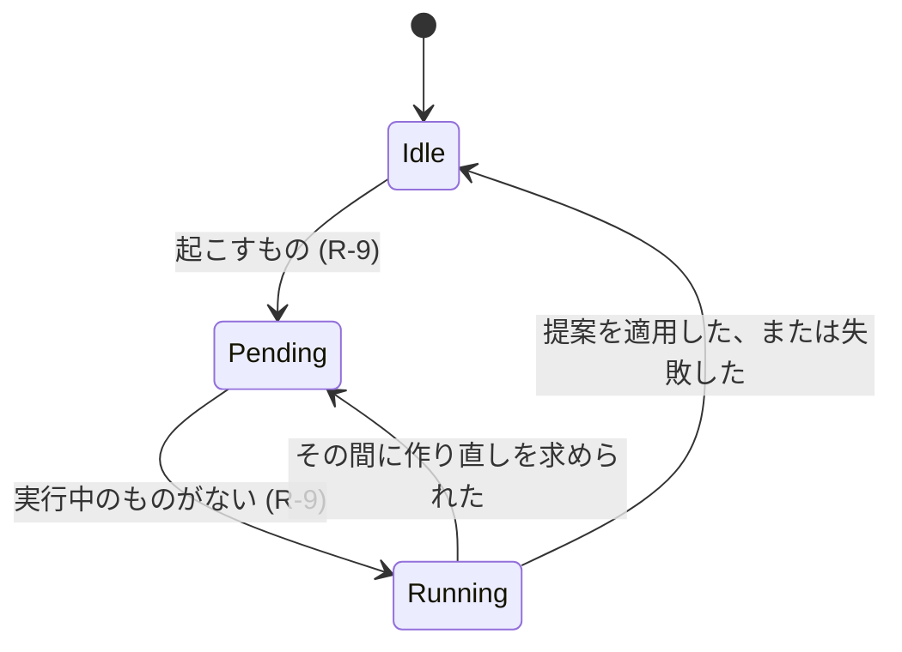

# データモデル: オンボーディングで始まる棚のホーム {#data-model-a-home-of-shelves-started-by-onboarding}

モデルの残りは変わらない。スマートフォルダについては [052 data-model](../052-smart-folders/data-model.md)、タグの種類については [051 data-model](../051-tag-kinds/data-model.md)、そして [マイグレーション](../../internal/store/migrations/) を参照する。

## マイグレーション {#migration}

`00056_home_shelves.sql` は、`smart_folders` に `home_position` を加え、それが null でない行に索引 `smart_folders_home_idx(home_position)` を加える。どの行も位置を得ないので、ホームは、オンボーディング、最初の実行 (R-9)、または所有者が棚を加えるまで、フォルダの棚なしで始まる。

`00057_group_closure.sql` は、[グループの閉包](#group-closure)のテーブルをその埋め戻しとトリガーとともに加え、棚の読み取りがたどる索引 (R-12) を加える。`video_locations_mtime_idx(mtime, video_id)`、`video_locations_created_idx(coalesce(file_created_at, mtime), video_id)`、`playback_progress_updated_idx(updated_at, content_key)` である。

`00058_home_watch.sql` は、`group_root_values` にカードの列と索引付きの視聴状態を加え、`search_dirty` フラグとそのトリガーとともに `video_watch_states` と `home_search_hits` のテーブルを加え、最初の保守が新しい列とともに埋め直すように保存した値を消す。

## `smart_folders.home_position` {#smart_foldershome_position}

| フィールド | 型 | Null | 意味 |
| --- | --- | --- | --- |
| `home_position` | integer | 可 | ホームでの棚の位置。小さいものが先。フォルダが棚でないときは null |

棚は `home_position`、次に `id` の順に並ぶ。位置は連続していなくてよい。棚を並べ替える書き込みは、すべての位置を 1、2、3 と順に書き直す。

## グループの閉包 {#group-closure}

棚の読み取りは、読み取りごとの再帰クエリーではなく、保存したグループの構造からグループのカードを決める ([R-12](research.md#r-12-the-home-lists-shelf-summaries-shelf-items-are-read-on-screen))。

`group_closure`、(グループ、子孫の動画の項目) ごとに 1 行:

| フィールド | 型 | 意味 |
| --- | --- | --- |
| `root_id` | integer | グループ。ここではどのグループもルートなので、お気に入りだけの棚も入れ子のグループを使える |
| `content_key` | text | 子孫の項目のキー。動画の内容の鍵、またはまとめた動画ではまとまりのユーザーキー |
| `sort_key` | text | 再生の順序のキー。各階層での位置を 10 桁にしたもの (048 の子孫の CTE) |

索引 `group_closure_key_idx(content_key, root_id)` は「どのグループがこの動画を持つか」に答える。

`group_root_values`、(グループ、`audience`: 1 は所有者、0 はゲスト) ごとに 1 行。その閲覧者に示される子孫に対するカードの値:

| フィールド | 意味 |
| --- | --- |
| `members` | 示される子孫。ないときは 0 |
| `added_at`、`mtime`、`created_at`、`played_at` | それらの中で最大の値 |
| `duration_ms`、`size_bytes` | それらの合計 |
| `watched`、`started` | 見終わった子孫と、見終わったか見始めた子孫。グループの視聴状態は 048 に従う |
| `playable` | どれかの子孫がブラウザーで再生できるか |
| `added_member`、`mtime_member`、`created_member`、`played_member` | 最大の値を持つ子孫 (同じ値なら id の大きいほう)。その並べ替えのキーでたどる棚は、この動画の位置にカードを置く |
| `open_member` | カードが開く動画。再生の順序で最初の視聴途中のもの、なければ最初の見終わっていないもの、なければ最初のもの (048 の開く索引)。ゲストの行は最初のものを持つ |
| `previews` | 最大 4 つの動画の id の JSON 配列。サムネイルの準備ができた子孫を再生の順序で先頭から取ったもので、カードのフォルダの絵である |
| `watch_state` | 生成列。`started`、`watched`、`members` から求めた `unwatched`、`inProgress`、`watched` (048)。`audience` とともに索引を持つので、視聴状態だけの棚はそのグループを索引で読む |

棚のグループのカードは、この行と、グループの名前と選んだ動画のサムネイルのバージョンのためのページごとに 1 つのクエリーから作る。どの棚の読み取りもカードのメンバーを読み込まない (R-12)。

`video_watch_states`、示される動画のキー (まとめた動画ではまとまりのユーザーキー) ごとに 1 行: `state` は動画の視聴状態 (進み具合の行がなければ未視聴) で、`state` で索引を持つので、視聴状態だけの棚はその状態のグループにない動画を索引で読む。

`home_search_hits`、(検索式、動画の id) ごとに 1 行: フォルダの棚の検索式に一致する、所有者のライブラリの動画 (`search` は検索式の条件と引数)。棚の読み取りと棚にある集合の保守は、全文検索のクエリーを実行する代わりに、検索の棚の一致をここで読む。`home_shelved_state.search_dirty` は、一致を計算し直す必要があることを示す。

`home_shelved_videos` は、所有者に示される動画のうち、動画としてどれかのフォルダの棚の実効の規則に一致するものすべてのユーザーキーを持つ ([R-11](research.md#r-11-unshelved-means-matching-no-home-shelf-computed-on-read))。`home_shelved_dirty` は計算し直すキーを並べ、`home_shelved_state` はすべてのキーを計算し直す必要があるというフラグを持つ。`group_closure_dirty` はフラグを持つ 1 行を持つ。

| 規則 | 強制する場所 |
| --- | --- |
| グループの構造を変えるすべての書き込みは、同じトランザクションの中で `group_closure` を作り直す | `store`: `writeGroups` (グループと整理の書き込み)、`rebuildFolderIndex` (フォルダのグループ、メディアフォルダ、まとまり、引き継ぎ、取り消し)、`rekeyGroupItems` |
| `groups` か `group_items` への書き込みは dirty フラグを立てる。次にコミットした書き込みの後の保守が閉包を作り直し、フラグを下ろす。棚の読み取りはフラグを読まず、閉包をそのまま読む | SQL のトリガー。`store` の `maintainHomeIndexes` |
| `videos`、`video_locations`、`playback_progress` への書き込みは、その動画を持つグループの値を両方の閲覧者について削除する。`public_videos` への書き込みはゲストの値を削除する。`media_folders`、`video_bundles`、`video_bundle_members` への書き込みはすべてを削除する | SQL のトリガー |
| `videos`、`video_locations`、`video_tags`、`playback_progress`、`video_favorites`、作品の情報のリンクへの書き込みは、動画のキーに印を付ける。`smart_folders`、`tags`、`tag_names`、`video_folder_names`、`media_folders`、`video_bundle_members` への書き込みは、すべてのキーにフラグを立てる | SQL のトリガー |
| 検索の結果を変えうる書き込み (`video_locations`、`video_tags`、`tag_names`、`video_work_info`、`people_names`、`video_work_people`、`organization_names`、`video_work_organizations`、`video_folder_names`、まとまりのテーブル、`media_folders`、`smart_folders`) は `search_dirty` を立てる。進み具合やプローブの書き込みは立てない | SQL のトリガー |
| コミットしたすべての書き込みの後 (`publishEvents`) と `Migrate` の後に、保守は、フラグが立っていれば閉包を作り直し、両方の閲覧者について欠けている値を埋め直し、`search_dirty` が立っていれば検索の一致を計算し直し、印の付いたキーを索引で引いて、その棚にあるかの印と視聴状態を計算し直す (フラグが立っていればすべて)。読み取りは決して書かない | `store` の `maintainHomeIndexes` |
| 規則が時計に依存する棚 (N 日以内に追加) は `home_shelved_videos` から除く。棚にない動画の棚は、たどった行ごとにそれらの棚の規則を確かめる | `store` の `refillShelvedVideos`、棚の読み取り |
| 値がまだ欠けている読み取りは、それらのグループの子孫を自ら集計する。棚にあるかの印か検索の一致が保留中だと分かった読み取りは、テーブルの代わりに、読み取りごとに棚の規則を評価するか、全文検索のクエリーを 1 回実行する | `store` の棚の読み取り |

## 設定 {#settings}

キーは既存の `settings` テーブルにある。

| キー | 値 | ないときの意味 |
| --- | --- | --- |
| `onboarding.step` | `folders`、`scan`、`interests`、`done` のどれか (R-3) | メディアフォルダがあるときは `done`、なければ `folders` |
| `home.organize.pending` | `rebuild` か `extend` | 待っている実行がない |
| `home.organize.last` | 最後に終わった実行の JSON。下記 | 終わった実行がない |

`home.organize.last`:

| フィールド | 意味 |
| --- | --- |
| `run` | `rebuild` か `extend` |
| `outcome` | `done`、`failed`、または提案が何も変えなかったときの `unchanged` |
| `finishedAt` | Unix ミリ秒 |
| `added`、`removed` | 挿入した棚と削除した棚 |

## 整理役の状態 {#organizer-state}

ホームと Settings が示す状態は、保留中の実行、今実行中かどうか (メモリーに保つ)、最後に終わった実行である。

## 興味の一覧 {#interest-catalog}

`domain.InterestCatalog` はテーブルではなくコードである (R-5)。各興味は安定した id、タグの名前、同義語を持つ。画面はこの順に一覧する。

| Id | タグの名前 | 同義語 |
| --- | --- | --- |
| `anime` | Anime | `アニメ` |
| `movies` | Movies | `映画` |
| `drama` | Drama | `ドラマ` |
| `documentary` | Documentary | `ドキュメンタリー` |
| `comedy` | Comedy | `お笑い` |
| `music` | Music | `音楽` |
| `live` | Live performances | `ライブ` |
| `games` | Games | `ゲーム` |
| `sports` | Sports | `スポーツ` |
| `fitness` | Fitness | `フィットネス` |
| `cooking` | Cooking | `料理` |
| `travel` | Travel | `旅行` |
| `animals` | Animals | `動物` |
| `nature` | Nature | `自然` |
| `family` | Family | `家族` |
| `kids` | Kids | `子供向け` |
| `education` | Education | `教育` |
| `science` | Science | `科学` |
| `technology` | Technology | `テクノロジー` |
| `cars` | Cars | `車` |
| `crafts` | Crafts | `工作` |
| `art` | Art | `アート` |
| `fashion` | Fashion | `ファッション` |
| `news` | News | `ニュース` |

## 提案する棚 {#proposed-shelf}

整理役は提案する棚のリストを返す。何もそれを保存しない。

| フィールド | 意味 |
| --- | --- |
| `name` | 1 から 100 文字。052 のフォルダ名の規則 |
| `rule` | `tags` (1 つの id)、`person`、`organization` のちょうど 1 つを持つ `SmartRule` (R-2) |

## 規則 {#rules}

| 規則 | 強制する場所 |
| --- | --- |
| 規則が `SmartRule.Validate` に通らない、または見える動画のどれにも合わない提案する棚は落とす | 適用のトランザクションの中の `domain` (検証)、`store` (一致の数) |
| 作り直しでは、整理役のフォルダの規則を繰り返す提案する棚は、そのフォルダを提案の名前の下に残す。所有者が保った棚の規則を繰り返すもの、または追加でどれかの棚の規則を繰り返すものは落とす | `domain` (規則の等しさ)、`store` の適用のトランザクション (R-8) |
| 作り直しは `owner_kept` 0 のフォルダだけを削除する | `store`、適用のトランザクション (R-8) |
| 追加は挿入し、削除も名前の変更も決してしない | `store`、適用のトランザクション (R-8) |
| 所有者による `home_position` への書き込みは `owner_kept` を 1 にする | `store`、棚の順序の書き込み (R-7) |
| 興味は、名前か同義語がその興味のタグの名前か同義語と等しいタグを使い、なければ同義語を持つ新しいタグを使う。種類のないタグは `Genre` を得て、それがないときは作り直す | `store`、興味のトランザクション (R-5、R-6) |
| 規則がすでにホームの棚の規則である興味は棚を加えない | `store`、興味のトランザクション (R-6) |
| ホームの棚は最大 50。整理役もオンボーディングもそれを超えて棚を挿入しない | `domain` の上限、`store` のトランザクション |
| 整理役か興味のフォルダは、フォルダの並び順が `addedDesc` の最上位のフォルダである | `domain`、提案から `SmartFolderCreate` へ |
| オンボーディングの段階は 4 つの値のどれかである。書き込みはそれが名指す段階を設定する | `domain` (値)、`store` (設定の書き込み) (R-3) |

## 変わらないもの {#what-does-not-change}

`smart_folders.owner_kept` は 052 R-10 の意味を保つ。整理役は、R-10 がこの機能に残した書き込みの経路である。スマートフォルダの中身、カード、お気に入り、プレイリストの項目は変わらない。棚はそれ自身であるフォルダとして読む。どの動画がどの棚にあるかを記録するテーブルはない (R-11)。`home_shelved_videos` は動画がどれかのフォルダの棚にあることだけを記録し、`home_search_hits` は棚ではなく検索式に一致する動画を記録する。それ以外の規則の棚は、保存したメンバーを持たない。グループの閉包が記録するのはグループの構造であり、棚への所属ではない。メディアフォルダ、スキャン、タグ、自動タグ付けは自身のテーブルを保ち、オンボーディングはそれらを通して書く。
