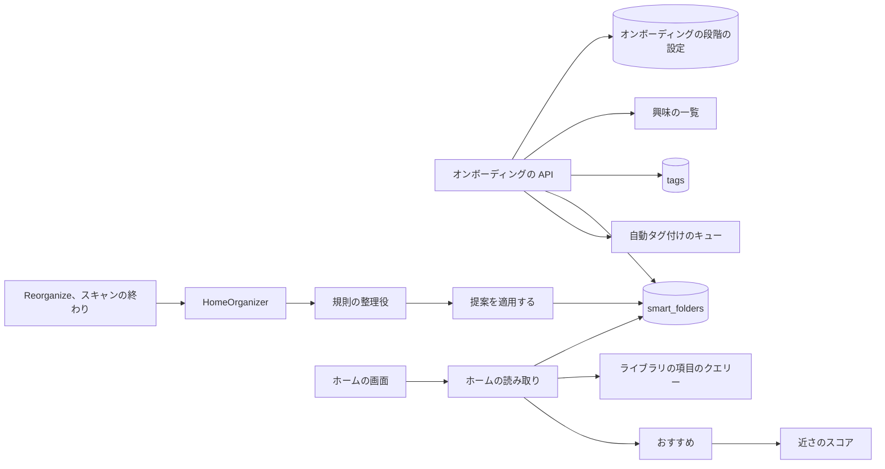
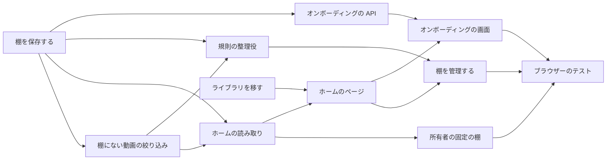

# 実装計画: オンボーディングで始まる棚のホーム {#implementation-plan-a-home-of-shelves-started-by-onboarding}

**ブランチ**: `feature/057-ai-home` | **親 Issue**: #1140

**入力**: 親 Issue。これがこの機能の仕様である。

## 概要 {#summary}

トップは棚のホームになる。各棚はホームでの位置を持つスマートフォルダで、その後に続きを見る棚、最近追加した動画の棚、棚にない動画の棚、おすすめの棚が続き、カードを押すと再生する。オンボーディングは、所有者をメディアフォルダの追加、スキャンの開始、組み込みのリストからの興味の選択へと順に導く。選んだ各興味は、種類を持つタグと所有者の棚になる。規則の整理役は、よく使われたタグ、人物、組織の棚を加える。AI を要するものは何もない。自動タグ付けが設定されているときは、それが興味の棚を埋める。ライブラリの画面は `/library` に移る。

図は、この機能が加える、または変える部分と、それぞれが読み書きするものを示す。



| 関心事 | 方針 |
| --- | --- |
| AI なし | 規則による 1 つの整理役。AI による整理は #1307 ([R-1](research.md#r-1-one-organizer-by-rules-ai-organizing-is-left-to-1307)) |
| 整理役の棚 | 見える動画の 5 本以上に付いたタグ、人物、組織 ([R-2](research.md#r-2-the-rule-organizer-makes-shelves-from-tags-people-and-organizations)) |
| オンボーディングの進み具合 | 設定にある 1 つの段階。どのクライアントも読む ([R-3](research.md#r-3-onboarding-progress-is-one-step-held-in-a-setting)) |
| オンボーディングと画面 | 段階と興味のための独自のルート。フォルダとスキャンは既存のルートのまま。Web アプリはすべてのルートで段階を確かめる ([R-4](research.md#r-4-onboarding-adds-routes-for-its-step-and-interests-only)) |
| 興味 | ドメインにある一覧。種類 `Genre` の下に置く ([R-5](research.md#r-5-the-interest-catalog-is-built-in-and-files-its-tags-under-genre)) |
| 興味の棚 | 興味ごとに所有者の棚。自動タグ付けにもう一度尋ねる ([R-6](research.md#r-6-a-picked-interest-becomes-an-owner-shelf-and-auto-tagging-is-asked-again)) |
| 棚 | `home_position` を持つスマートフォルダ ([R-7](research.md#r-7-a-shelf-is-a-smart-folder-with-a-home-position)、[data-model.md](data-model.md#smart_foldershome_position)) |
| 作り直しと追加 | 1 つのトランザクション。所有者が保ったフォルダには触れない ([R-8](research.md#r-8-a-rebuild-replaces-the-organizers-folders-in-one-transaction-an-extend-only-adds)) |
| 動く時 | 設定にある保留中の実行。イベントが起こす ([R-9](research.md#r-9-one-run-at-a-time-queued-in-settings-triggered-by-events)、[R-10](research.md#r-10-an-extend-runs-when-20-or-more-shown-videos-are-unshelved)) |
| 棚にない動画 | 読み取りのときに評価するライブラリの絞り込み ([R-11](research.md#r-11-unshelved-means-matching-no-home-shelf-computed-on-read)) |
| 読み取り | 要約、次に画面上の棚の項目。予算は 1 秒 ([R-12](research.md#r-12-the-home-lists-shelf-summaries-shelf-items-are-read-on-screen)) |
| 固定の棚 | 続きを見る棚とおすすめの棚は所有者に、最近追加した動画の棚と棚にない動画の棚は全員に ([R-13](research.md#r-13-four-fixed-shelves-two-of-them-the-owners-only)) |
| 再生 | 自動再生する動画のページ ([R-14](research.md#r-14-pressing-a-shelf-card-plays)) |
| ルート | ライブラリは `/library`。古い URL はリダイレクトする ([R-15](research.md#r-15-the-library-moves-to-library)) |
| イベント | `HomeChanged` と画面のイベント `home` ([R-16](research.md#r-16-homechanged-tells-open-screens-to-read-the-home-again)) |

Issue は 2026-10-16 に分割された。メンテナーは、ホームが AI なしで動き、実装されていない Issue に依存しないことを求めたので、所有者の方針と AI の整理役は #1307 に移り、最初のタグのプリセットは #1137 に残る。

Issue に `ui` ラベルがあるので、`design` 段階が画面の単位の前に `ui-design.md` を書く。対象は、3 つの段階とその飛ばし方を持つオンボーディング、棚の行を持つホーム、検索ボックスと `See all`、空のホーム、固定の棚をフォルダの棚とどう見分けさせるか、棚の追加、削除、並べ替え、オンボーディングをやり直し整理し直す Settings のセクションであり、親 Issue の `UI品質` に照らして判断する。

## 技術的な文脈 {#technical-context}

**正本の定義**:

| 項目 | 出典 |
| --- | --- |
| 境界、ストアの役割、コミットの後のイベント、すべての読み取りの閲覧者 | [ARCHITECTURE.md](../../ARCHITECTURE.md)、[.golangci.yml](../../.golangci.yml) (depguard) |
| スマートフォルダ、規則、`owner_kept`、中身、カード、読み取りの予算 | [052 plan](../052-smart-folders/plan.md)、[052 data-model](../052-smart-folders/data-model.md)、[052 research](../052-smart-folders/research.md) |
| タグの種類と初期データの `Genre` | [051 data-model](../051-tag-kinds/data-model.md)、[`internal/domain/tag_kind.go`](../../internal/domain/tag_kind.go) |
| タグ、同義語 | [`internal/store/tags.go`](../../internal/store/tags.go) |
| 自動タグ付け、その候補、"Tag all videos again" | [auto-tagging.md](../../docs/design-docs/auto-tagging.md) |
| メディアフォルダとスキャン | [api/openapi.yaml](../../api/openapi.yaml) の `/api/media-folders` と `/api/scans` |
| 人物、組織、その動画 | [047 data-model](../047-video-work-info/data-model.md) |
| アカウントの設定と認証のゲート | [016 data-model](../016-single-account-auth/data-model.md)、[`web/src/auth/AuthGate.tsx`](../../web/src/auth/AuthGate.tsx) |
| 近さのスコア | [related-videos.md](../../docs/design-docs/related-videos.md) |
| 視聴履歴、お気に入り | [043 data-model](../043-watch-history/data-model.md)、[035 data-model](../035-favorites/data-model.md) |
| ライブラリの画面、その URL とカード | [library-ui.md](../../docs/design-docs/library-ui.md)、[`web/src/videoList/listCriteria.ts`](../../web/src/videoList/listCriteria.ts) |
| 画面の API と生成コード | [api/openapi.yaml](../../api/openapi.yaml)、`task generate` |
| 画面と Web のテスト | [design-system.md](../../docs/design-docs/design-system.md)、[web-testing.md](../../docs/design-docs/web-testing.md)、[i18n.md](../../docs/design-docs/i18n.md) |
| 検査 | [Taskfile.yml](../../Taskfile.yml) (`task check`、`task check-docs`、`task test-e2e`) |

**この機能に固有の文脈**:

- マイグレーションは 1 つで、マージされるときに番号を付ける ([data-model.md、マイグレーション](data-model.md#migration))。
- 画面の API に 8 つのルート、1 つの一覧のパラメーター、1 つの画面のイベントの種類が加わる ([contracts/screen-api.md](contracts/screen-api.md))。外部 API と MCP は変わらない。
- どの単位もほかの Issue を待たない。ホームは、タグ、タグの種類、スマートフォルダ、自動タグ付け、作品の情報、視聴履歴、お気に入りを `main` にあるまま使う。
- `Scans.OnFinish` は今は 1 つのコールバックを持つ。それをリストにする ([R-9](research.md#r-9-one-run-at-a-time-queued-in-settings-triggered-by-events))。

## 憲章の確認 {#constitution-check}

| 規則 (出典) | 判定 |
| --- | --- |
| アダプターは互いも `internal/app` も import しない (ARCHITECTURE.md、depguard) | 合格: `internal/app` の `Onboarding` と `HomeOrganizer` は、自ら宣言するインターフェースを通してストアと自動タグ付けに届く。`internal/httpapi` は `Home` と `Onboarding` のインターフェースを宣言する |
| ドメインが決め、ストアが強制する (ARCHITECTURE.md) | 合格: 一覧、段階の順序、規則の整理役の選び方は純粋なドメインの規則である。適用のトランザクションは `owner_kept` と一致の数を読み直す |
| ストアの役割 (ARCHITECTURE.md) | 合格: 新しい `HomeStore` の役割。そのトランザクションの中でのフォルダの挿入と削除は、`SmartFolderStore` と `TagStore` と共有するパッケージ内のヘルパーを使う |
| コミットの後のイベント (ARCHITECTURE.md) | 合格: `HomeChanged`、`SmartFoldersChanged`、タグのイベントは、トランザクションがコミットした後に発行する |
| ユーザーデータは作り直しを越えて残る (ARCHITECTURE.md) | 合格: `home_position` は `smart_folders` にあり、その独自の id をキーとする。オンボーディングの段階は設定である |
| すべての読み取りは閲覧者を知る (ARCHITECTURE.md) | 合格: 棚の項目、棚にない動画、最近追加した動画は閲覧者に合わせて絞る。続きを見る棚、おすすめ、整理役の状態、オンボーディングは所有者だけ |
| メディアフォルダのファイルを読むのはスキャンだけである (ARCHITECTURE.md) | 合格: オンボーディングは既存のスキャンのルートを通してスキャンを始め、ファイルを読まない |
| 生成ファイルを手で編集しない (AGENTS.md) | 合格: `api/openapi.yaml` を変え、`task generate` を実行する |
| 複雑度は 25 以下、コードをコピーしない (AGENTS.md) | 合格: 棚にない動画は既存の動画ごとの一致を否定する。棚の項目はライブラリの項目のクエリーを呼ぶ。興味はタグの作成と同義語を再利用する。おすすめは `ContentRelatedness` を呼ぶ |
| 画面の前に design-system.md を読む。最も低いレベルでテストする (AGENTS.md) | 合格: 画面は `ui-design.md` に従う。棚の行はレジストリの項目になる。整理役とオンボーディングは偽物を使うアプリのテスト、ストアはそのテストとベンチマーク、画面はページのテスト、受け入れ条件はブラウザーのテストを持つ |

違反はないので、Complexity Tracking はない。

## プロジェクトの構成 {#project-structure}

### 文書 (この機能) {#documentation-this-feature}

```text
specs/057-home/
├── plan.md
├── research.md
├── data-model.md
└── contracts/
    └── screen-api.md
```

`ui-design.md` は `design` 段階が書く。`quickstart.md` はない。ブラウザーのテストはオンボーディングとホームを確かめ、自動タグ付けの結果はテストの API の呼び出しが置くので、手で動かすものは残らない。

### ソースコード {#source-code}

**影響する境界**:

| 境界 | この機能でそれが持つもの |
| --- | --- |
| `internal/domain` | 興味の一覧、オンボーディングの段階とその順序、提案する棚とその上限、規則の整理役の選び方、`VideoQuery.Unshelved`、`HomeChanged`、整理役の状態 |
| `internal/store` | マイグレーション、`HomeStore` (要約、棚の項目、順序、適用、興味の棚)、棚にない動画の条件、おすすめと続きを見る棚の種のクエリー、設定のキー、ベンチマーク |
| `internal/app` | `Onboarding` (段階、興味、自動タグ付けにもう一度尋ねること)、`HomeOrganizer` (起こす処理、保留中の実行、規則の整理役)、おすすめのスコア付けとそのキャッシュ、`Scans.OnFinish` のリスト |
| `internal/httpapi`、`api/openapi.yaml`、`cmd/mdm` | ルート、`unshelved` パラメーター、`home` のイベント、配線 |
| `web/src/onboarding` (新規)、`web/src/home` (新規)、`web/src/app`、`web/src/auth`、`web/src/shell`、`web/src/settings`、`web/src/library`、`web/src/smartFolders`、`web/src/ui`、`web/src/i18n` | オンボーディングのページとそのゲート、ホームのページと棚の行、ルートとリダイレクト、サイドバー、Settings のセクション、空のライブラリ、フォルダのページの操作 |
| `docs/design-docs` | 新しい `home.md`、`library-ui.md` と `auto-tagging.md` の更新 |
| `web/e2e` | ライブラリのために `/` を開く既存のテストと、新しいブラウザーのテスト |

**新しいパス**: `internal/store/migrations/000NN_home_shelves.sql`、`internal/domain/home.go`、`internal/domain/onboarding.go`、`internal/store/home.go`、`internal/app/home_organizer.go`、`internal/app/onboarding.go`、`internal/httpapi/home.go`、`internal/httpapi/onboarding.go`、`web/src/api/home.ts`、`web/src/api/onboarding.ts`、`web/src/onboarding/`、`web/src/home/`、`docs/design-docs/home.md`、`web/e2e/onboarding.e2e.ts`、`web/e2e/home.e2e.ts`。

**構成の判断**: 既存の配置に従い、ホームとオンボーディングは、スマートフォルダの隣に独自のユースケースと画面のフォルダを持つ ([R-7](research.md#r-7-a-shelf-is-a-smart-folder-with-a-home-position))。

## 実装作業 {#implementation-work}

図は、どの単位が先にマージされなければならないかを示す。画面の単位は `design` 段階の `ui-design.md` も待つ。



### ホームの棚をスマートフォルダに保存し、整理役の提案を適用する {#store-home-shelves-on-smart-folders-and-apply-an-organizers-proposal}

**範囲**: マイグレーション、ドメインの提案する棚とその上限、棚の要約を持つ `HomeStore`、棚の順序の書き込み (`owner_kept` を設定する)、作り直しと追加の適用のトランザクション、`HomeChanged` のイベント、整理役の設定のキー ([data-model.md](data-model.md)、[R-7](research.md#r-7-a-shelf-is-a-smart-folder-with-a-home-position)、[R-8](research.md#r-8-a-rebuild-replaces-the-organizers-folders-in-one-transaction-an-extend-only-adds))。

**依存**: なし。

**受け入れ**: `task check` が通る。ストアのテストが次を示す: 作り直しは、規則を提案が繰り返さない整理役のフォルダを削除し、規則を提案が繰り返すものは同じ id とお気に入りで提案の名前の下に残し、所有者が保った棚の規則を繰り返す提案を落とし、所有者が保ったフォルダはそのままにする。追加は最後の棚の後に棚を加え、既存の名前や規則を変えない。どの動画にも合わない提案の規則は落とす。棚の並べ替えは `owner_kept` を 1 にする。`HomeChanged` はコミットの後に発行され、ロールバックの後には発行されない。

### ライブラリを、どのホームの棚にもない動画に絞り込む {#filter-the-library-to-videos-in-no-home-shelf}

**範囲**: `VideoQuery.Unshelved`、すべてのホームの棚の実効の規則の動画ごとの一致を否定したその条件、ゲストも使える一覧のパラメーター `unshelved`、その API クライアントのパラメーター。画面の変更はない ([R-11](research.md#r-11-unshelved-means-matching-no-home-shelf-computed-on-read)、[contracts/screen-api.md、変わるスキーマとパラメーター](contracts/screen-api.md#schemas-and-parameters-changed))。

**依存**: ホームの棚をスマートフォルダに保存し、整理役の提案を適用する。

**受け入れ**: `task check` が通り、`task generate` で差分が出ない。ストアのテストが次を示す: `unshelved=1` はどの棚にも合わない動画を一覧し、子の棚のパスに合う動画は一覧せず、フォルダがホームから外された動画をまた一覧する。ゲストにはその中で隠れた動画が見えない。

### ホームの棚とその最初の項目を読む {#read-the-homes-shelves-and-their-first-items}

**範囲**: `GET /api/home`、フォルダ、棚にない動画、最近追加した動画の棚のための `GET /api/home/shelves`、`PUT /api/home/shelves`、スマートフォルダの `onHome`、画面のイベント `home`、空のホームの理由、R-12 のベンチマーク ([contracts/screen-api.md](contracts/screen-api.md)、[R-12](research.md#r-12-the-home-lists-shelf-summaries-shelf-items-are-read-on-screen)、[R-16](research.md#r-16-homechanged-tells-open-screens-to-read-the-home-again))。

**依存**: ライブラリを、どのホームの棚にもない動画に絞り込む。

**受け入れ**: `task check` が通る。ハンドラーのテストが次を示す: 棚はその順序で並び、その後に固定の棚が続く。ゲストは整理役の状態を受け取らず、フォルダに見えるものが何もない棚も受け取らない。フォルダの棚の項目は子フォルダを持たない。8 を超える `keys` は `400 invalid_request` で、未知の id を持つ `PUT` は `404` である。20,000 本の動画と 50 の棚でのベンチマークは、各読み取りを 1 秒以内に返す。

### 所有者の続きを見る棚とおすすめの棚を加える {#add-the-owners-continue-watching-and-recommended-shelves}

**範囲**: 続きを見る棚 (視聴途中の動画、最後に再生したものが先)、おすすめの種のクエリー (90 日で最も再生した動画、最新のお気に入り)、どれかの種への最も高い近さによる順位付け、10 分のキャッシュ、所有者だけのためのホームの読み取りの両方の棚 ([R-13](research.md#r-13-four-fixed-shelves-two-of-them-the-owners-only))。

**依存**: ホームの棚とその最初の項目を読む。

**受け入れ**: `task check` が通る。ストアのテストが、続きを見る棚は途中で止めた動画を一覧し、見終わった動画と再生していない動画は一覧せず、最後に再生したものが先であることを示す (受け入れ条件 6)。偽のスコア付けを使うアプリのテストが、おすすめは種と見終わった動画を除き、最も高いスコアの順に並ぶことを示す。ハンドラーのテストが、ゲストには両方の棚がなく、再生もお気に入りもない所有者にはおすすめの棚がないことを示す。

### 規則でホームを整理する {#organize-the-home-by-rules}

**範囲**: 保留中の実行を持つ `HomeOrganizer`、その起こす処理 (`Reorganize`、キューが空になった後のスキャンの終わり、最初の実行)、`Scans.OnFinish` のリスト、タグ、人物、組織を使う規則の整理役、`POST /api/home/organize`、その翻訳を含む `docs/design-docs/home.md` ([R-1](research.md#r-1-one-organizer-by-rules-ai-organizing-is-left-to-1307)、[R-2](research.md#r-2-the-rule-organizer-makes-shelves-from-tags-people-and-organizations)、[R-9](research.md#r-9-one-run-at-a-time-queued-in-settings-triggered-by-events)、[R-10](research.md#r-10-an-extend-runs-when-20-or-more-shown-videos-are-unshelved))。

**依存**: ライブラリを、どのホームの棚にもない動画に絞り込む。

**受け入れ**: `task check` と `task check-docs` が通る。アプリのテストが次を示す: 作り直しは、見える動画の 5 本以上に付いたタグ、人物、組織ごとに 1 つの棚を作り、仮のタグと 4 本に付いたものには作らない。棚にない動画が 20 本あるスキャンの終わりは、キューが空になった後にだけ追加を実行し、新しいタグの棚をほかの棚の名前を変えずに加え (受け入れ条件 5)、19 本では何も実行しない。保留中の実行は再起動を越えて残る。実行中に求められた作り直しは、その後に実行する。作り直しは、所有者が保った棚と興味の棚をそのままにする (受け入れ条件 7)。

### オンボーディングの段階を保ち、選んだ興味を棚にする {#keep-onboardings-step-and-turn-picked-interests-into-shelves}

**範囲**: 興味の一覧、オンボーディングの段階の設定と既存のライブラリでのその既定値、`GET` と `PUT /api/onboarding`、`GET /api/onboarding/interests`、`POST /api/onboarding/interests` (タグと種類を見つけるか作り、所有者の棚を作り、自動タグ付けにもう一度尋ねる)、興味を選ぶとすべての動画をキューに積むという `auto-tagging.md` の注記 ([R-3](research.md#r-3-onboarding-progress-is-one-step-held-in-a-setting)、[R-4](research.md#r-4-onboarding-adds-routes-for-its-step-and-interests-only)、[R-5](research.md#r-5-the-interest-catalog-is-built-in-and-files-its-tags-under-genre)、[R-6](research.md#r-6-a-picked-interest-becomes-an-owner-shelf-and-auto-tagging-is-asked-again))。

**依存**: ホームの棚をスマートフォルダに保存し、整理役の提案を適用する。

**受け入れ**: `task check` と `task check-docs` が通る。ストアとアプリのテストが次を示す: 2 つの興味を選ぶと、種類 `Genre` のタグ 2 つと所有者の棚 2 つができる (受け入れ条件 3)。名前か同義語がすでにタグである興味はそのタグを使い、2 つ目のタグを作らない。削除された種類 `Genre` は作り直す。興味を 2 回選んでも棚は 1 つである。自動タグ付けがオンのときはすべての動画をキューに積み、オフのときは何も積まず、それでも棚は作る。ハンドラーのテストが次を示す: 段階の既定値は、メディアフォルダがあるときは `done`、ないときは `folders` である。ゲストは `403` を受け取る。未知の段階か興味の id は `400` である。2 回の `PUT` は後の段階を残す (Edge Case)。

### ライブラリの画面を /library に移す {#move-the-library-screen-to-library}

**範囲**: `/library` のルート、ライブラリのパラメーターを持つ `/` のリダイレクト、アプリ内のすべての `/?tag=`、`/?person=`、`/?organization=` のリンク、サイドバーの `Home` と `Library` の項目、ホームのページがマージされるまで `/library` にリダイレクトする仮の `/`、ライブラリのために `/` を開く e2e のテスト、その翻訳を含む `library-ui.md` ([R-15](research.md#r-15-the-library-moves-to-library))。

**依存**: なし。

**受け入れ**: `task check` と `task check-docs` が通る。ページのテストが次を示す: `/?tag=3` はタグの絞り込みを適用した `/library?tag=3` を開き、動画のページのタグのチップは `/library?tag=<id>` を開く。ブラウザーのテストは `/library` に対して通る。画面が変わるので、サイドバーの見た目の確認が要る。

### ホームの棚を示し、そこから再生する {#show-the-homes-shelves-and-play-from-them}

**範囲**: `/` のホームのページ。画面上で読む棚の行、レジストリの項目としての棚の行、カードを押して再生すること (R-14)、フォルダを開く棚の見出し、`See all` (フォルダのページ、`/library?unshelved=1`、追加日で並べた `/library`、続きを見る棚では `/history`)、`/library?q=` を開く検索ボックス、空のホーム、`home` と `smartFolder` のイベントでの再読み込み。`ui-design.md` に従う ([R-12](research.md#r-12-the-home-lists-shelf-summaries-shelf-items-are-read-on-screen)、[R-14](research.md#r-14-pressing-a-shelf-card-plays))。

**依存**: ホームの棚とその最初の項目を読む。ライブラリの画面を /library に移す。

**受け入れ**: `task check` が通る。ページのテストが次を示す: 棚のカードを 1 回押すと、自動再生と `?smartFolder` 付きで動画のページに移り、検索ボックスに入力すると `/library?q=` を開く。画面が変わるので、デスクトップとモバイルの幅でのホームの見た目の確認が要る。

### ホームの棚を管理し、整理し直す {#manage-home-shelves-and-reorganize}

**範囲**: ホームでの棚の追加、削除、並べ替え。スマートフォルダのページの `Add to home` と `Remove from home`。`Reorganize`、最後の実行、`Start onboarding again` を持つ Settings のセクション。`ui-design.md` に従う ([R-7](research.md#r-7-a-shelf-is-a-smart-folder-with-a-home-position)、[R-9](research.md#r-9-one-run-at-a-time-queued-in-settings-triggered-by-events))。

**依存**: ホームの棚を示し、そこから再生する。規則でホームを整理する。

**受け入れ**: `task check` が通る。ページのテストが次を示す: `Reorganize` は `POST /api/home/organize` を呼び、棚を動かすと新しい順序を送り、`Start onboarding again` は段階を `folders` にする。画面が変わるので、見た目の確認が要る。

### どの画面からも所有者をオンボーディングに導く {#walk-the-owner-through-onboarding-from-any-screen}

**範囲**: 3 つの段階 (`/api/media-folders` を通してメディアフォルダを加える、`/api/scans` を通してスキャンを始めその進み具合を示す、興味を選ぶ) を持つオンボーディングのページ、各段階を飛ばすこと、段階が `done` でない間はどのルートからも所有者をオンボーディングに送るアプリのシェルのゲート、空のライブラリの操作、段階の変更での再読み込み。`ui-design.md` に従う ([R-3](research.md#r-3-onboarding-progress-is-one-step-held-in-a-setting)、[R-4](research.md#r-4-onboarding-adds-routes-for-its-step-and-interests-only))。

**依存**: オンボーディングの段階を保ち、選んだ興味を棚にする。ホームの棚を示し、そこから再生する。

**受け入れ**: `task check` が通る。ページのテストが次を示す: 段階が `scan` のときに `/library` か `/settings` を開いた所有者はスキャンの段階に着き、ゲストはそこに決して送られず、飛ばすと次の段階を書き、終えるとホームを開く。画面が変わるので、デスクトップとモバイルの幅での見た目の確認が要る。

### ブラウザーのテストでオンボーディングとホームを確かめる {#cover-onboarding-and-the-home-in-browser-tests}

**範囲**: 受け入れ条件 3 と 4 のための `web/e2e/onboarding.e2e.ts`。自動タグ付けの代わりに API を通して興味のタグを動画に付ける。受け入れ条件 1、2、5、6、7、8 のための `web/e2e/home.e2e.ts`。

**依存**: どの画面からも所有者をオンボーディングに導く。ホームの棚を管理し、整理し直す。所有者の続きを見る棚とおすすめの棚を加える。

**受け入れ**: `task test-e2e -- e2e/onboarding.e2e.ts e2e/home.e2e.ts` が通り、CI の `Browser E2E` ジョブが通る。
