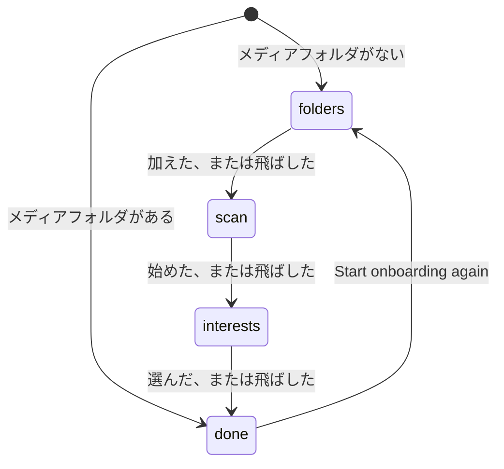
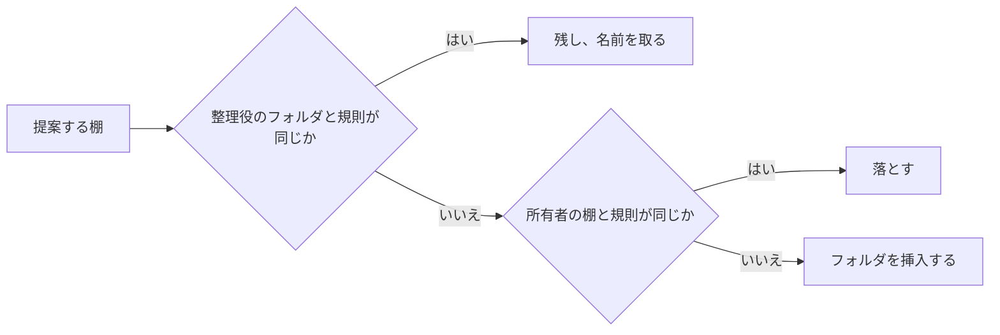

# 調査: オンボーディングで始まる棚のホーム {#research-a-home-of-shelves-started-by-onboarding}

引き継いだ決定: スマートフォルダ、その規則、`owner_kept`、読み取りのときに計算する中身、読み取りの予算 ([052 research](../052-smart-folders/research.md))。タグの種類と初期データの `Genre` ([051 research、R-2](../051-tag-kinds/research.md#r-2-preset-kinds-are-seeded-rows-with-no-special-status))。自動タグ付けとその候補 ([auto-tagging.md](../../docs/design-docs/auto-tagging.md))。近さのスコア ([related-videos.md](../../docs/design-docs/related-videos.md))。このファイルは、この機能が加える決定だけを記録する。

## R-1: 規則による 1 つの整理役。AI による整理は #1307 に残す {#r-1-one-organizer-by-rules-ai-organizing-is-left-to-1307}

**決定**: `app.HomeOrganizer` は規則の整理役だけで棚を作る。それは提案する棚のリストを返し、1 つの適用の段階がそれを保存するので、#1307 は同じリストを返す整理役を加えられる。

| 案 | 判定 |
| --- | --- |
| **規則だけ** | 採用 |
| #1138 の生成器のポートを通した AI の整理役 | メンテナーが不採用とした (2026-10-16): この機能は実装されていない Issue に依存してはならず、所有者の方針は #1307 に移った |
| 分類器が方針に照らして順位付けする規則の候補 | 不採用: `main` の分類器は yes か no で答えるので、規則の整理役の棚を並べ替えることしかできず、それを導く方針は #1307 のものである |

**理由**: 規則の整理役が読むすべての入力 (タグ、人物、組織、ライブラリ) は、Ollama の接続の有無にかかわらず `main` にあるので、ホームはどのインストールでも同じに振る舞う。

## R-2: 規則の整理役は、タグ、人物、組織から棚を作る {#r-2-the-rule-organizer-makes-shelves-from-tags-people-and-organizations}

**決定**: 規則の整理役は、見える動画の少なくとも 5 本に付いた普通のタグごとに 1 つの棚 (規則 `{"tags": [id]}`) を、見える動画の少なくとも 5 本に結び付いた人物ごとに 1 つの棚 (`{"person": id}`) と組織ごとに 1 つの棚 (`{"organization": id}`) を提案する。各棚はそのタグ、人物、組織の名前を持ち、全部で最大 24 である。種類を持つタグが種類の id の順に先に来て、次に種類のないタグ、次に人物、次に組織が来て、それぞれの中は動画の数の多い順である。

| 案 | 判定 |
| --- | --- |
| **タグ、人物、組織** | 採用 |
| 種類を持つタグだけ | メンテナーが不採用とした (2026-10-16): 種類を持つタグのないライブラリは内容の棚を得られず、人物と組織はすでに動画が何であるかを示す |
| 種類ごとに 1 つの棚 (`tagKind` の規則) | 不採用: `Genre` の棚は、どれかのジャンルのタグを持つすべての動画を持ち、何も分けない |
| フォルダ名や長さから作る棚 | 不採用: Issue の `対象外` |

**理由**: 最小の 5 本は、棚が 1 枚のカードの 1 行になるのを防ぐ。仮のタグは使わない。それは自動タグ付けの推測であり、所有者が受け入れたタグではない。人物と組織は作品の情報 (047) から来るので、それを取得するとすぐに、AI なしで現れる。

## R-3: オンボーディングの進み具合は、設定に保つ 1 つの段階である {#r-3-onboarding-progress-is-one-step-held-in-a-setting}

**決定**: 設定 `onboarding.step` は `folders`、`scan`、`interests`、`done` のどれかを保つ。所有者のどのクライアントもそれを読み書きし、書き込みはそれが名指す段階を設定するので、2 つのクライアントでは後の書き込みが勝つ。設定がないときは、メディアフォルダがあれば `done`、なければ `folders` と読む。

| 案 | 判定 |
| --- | --- |
| **設定にある 1 つの段階** | 採用 |
| ブラウザーのストレージ | 不採用: 要件 4 は別の端末でオンボーディングを再開する |
| 事実 (フォルダ、スキャン、興味の棚) から導く | 不採用: 飛ばした段階は事実を残さないので、飛ばした興味の段階が訪れるたびに戻ってくる |
| 終えた段階のリスト | 不採用: 段階は 1 つの順序で進むので、今の段階がすべてを言い、2 つのクライアントがリストを半端にまとめた状態で残すこともない |

**理由**: 既定値は、ライブラリを持つ既存のインストールを、更新の後にオンボーディングから外しておく。その所有者は Settings からもう一度始められる。「進める」ではなく名指した段階を書くので、繰り返した書き込みや遅れた書き込みは害がない (2 つの端末の Edge Case)。

## R-4: オンボーディングは、その段階と興味のためだけにルートを加える {#r-4-onboarding-adds-routes-for-its-step-and-interests-only}

**決定**: オンボーディングは、段階のための `GET` と `PUT /api/onboarding` と、`GET` と `POST /api/onboarding/interests` を加える。メディアフォルダの追加とスキャンの開始は `/api/media-folders` と `/api/scans` をそのまま使う。Web アプリはアプリのシェルで段階を確かめるので、段階が `done` でない間にどのルートを開いた所有者もオンボーディングに着く。

| 案 | 判定 |
| --- | --- |
| **段階と興味のルート。既存のフォルダとスキャンのルート** | 採用 |
| フォルダの追加とスキャンの開始を包むオンボーディングのルート | 不採用: 既存の 2 つの操作とそのエラーをコピーすることになる |
| 空のライブラリの画面から示すオンボーディング | メンテナーが不採用とした (2026-10-16): オンボーディングは画面に依存してはならない。要件 4 は空のライブラリの Settings へのリンクを置き換える |

**理由**: 状態はサーバーにあるので、外部 API やほかのクライアントが後で同じ段階を進められる。画面は段階を読み書きするだけである。ゲストはオンボーディングを決して見ない。段階のルートは所有者だけである。

## R-5: 興味の一覧は組み込みで、そのタグを `Genre` に分類する {#r-5-the-interest-catalog-is-built-in-and-files-its-tags-under-genre}

**決定**: `domain.InterestCatalog` は興味の固定のリストで、各興味は安定した id、英語の名前、日本語の同義語を持つ ([data-model.md、興味の一覧](data-model.md#interest-catalog))。選んだ興味のタグは `Genre` という名前の種類を得て、所有者がそれを削除していたときは作り直す。

| 案 | 判定 |
| --- | --- |
| **ドメインにあるリスト** | 採用 |
| #1137 のプリセット | メンテナーが不採用とした (2026-10-16): #1137 は実装されていない |
| 所有者が編集するファイル | 不採用: 興味を選ぶのは新しい所有者が最初にすることであり、編集するものがまだ何もない |
| 自由な文字の入力だけ | 不採用: 新しい所有者は自動タグ付けがどの名前によく答えるかを知らず、リストなら興味ごとに 1 回押すだけである |

**理由**: 画面は英語だけなので (i18n.md)、タグは英語の名前を取る。日本語の同義語により、同じ意味の既存の日本語のタグが 2 つ目のタグを作る代わりに一致し (Edge Case)、検索はどちらの名前でもタグを見つける。`Genre` は、この種のタグのための 051 の初期データの種類である。

## R-6: 選んだ興味は所有者の棚になり、自動タグ付けにもう一度尋ねる {#r-6-a-picked-interest-becomes-an-owner-shelf-and-auto-tagging-is-asked-again}

**決定**: `POST /api/onboarding/interests` はリクエストごとに 1 つのトランザクションを実行する。それは、各興味のタグを名前か同義語で見つけるか同義語とともに作り、種類がなければ種類を `Genre` にし、ホームの棚がすでにその規則を持つのでなければ、`owner_kept` 1 と次のホームでの位置を持つ最上位のスマートフォルダ `{"tags": [id]}` を作る。コミットの後、自動タグ付けがオンのときは、"Tag all videos again" と同じくすべての動画をキューに積む。

| 案 | 判定 |
| --- | --- |
| **所有者の棚、すべての動画をキューに積む** | 採用 |
| 整理役の棚 (`owner_kept` 0) | 不採用: 作り直しが、まだ動画のない興味の棚を削除してしまう (要件 9) |
| まだ判定していない動画だけをキューに積む | 不採用: 興味を選ぶ前に判定した動画は、新しいタグについて決して尋ねられない (auto-tagging.md、候補) |
| 自動タグ付けに尋ねずに棚を作る | 不採用: 興味の棚は手でしか埋まらない (受け入れ条件 3) |

**理由**: オンボーディングは最初のスキャンの間に進むので、判定済みの動画は少なく、すべてを積んでも費用は小さい。後で興味をもう一度選ぶ費用は "Tag all videos again" の費用と同じで、画面はそう示す。動画のない棚は示さないので (R-12)、興味の棚は、自動タグ付けか所有者がそのタグを動画に付けると現れる (Edge Case)。既存のタグは自身の種類を保つ。それを変えると所有者のタグを動かすことになる。

## R-7: 棚はホームでの位置を持つスマートフォルダである {#r-7-a-shelf-is-a-smart-folder-with-a-home-position}

**決定**: スマートフォルダは、その `home_position` が設定されているときホームにある。整理役は `owner_kept` 0 と位置を持つ最上位のフォルダを作り、オンボーディングは `owner_kept` 1 でそれを作り、所有者はどのフォルダも加え、外し、並べ替える。

| 案 | 判定 |
| --- | --- |
| **`smart_folders` の位置の列** | 採用 |
| フォルダを参照する別の棚のテーブル | 不採用: 棚は順序のほかに独自のフィールドを持たないので、2 つ目のテーブルは結合と削除の規則を加えるだけである |
| すべての最上位のフォルダが棚で、名前の順に並ぶ | 不採用: 所有者が棚を外したり並べ替えたりできない (要件 10) |

**理由**: 要件 2 は棚をスマートフォルダにし、フォルダのページは「フォルダ全体を開く」がすでに行き着く先である。所有者がフォルダのホームでの位置を変えると、052 R-10 がほかのすべての所有者の書き込みでするのと同じく `owner_kept` を 1 にするので、整理役はそれを元に戻さない (要件 9)。

## R-8: 作り直しは 1 つのトランザクションで整理役のフォルダを置き換える。追加は加えるだけである {#r-8-a-rebuild-replaces-the-organizers-folders-in-one-transaction-an-extend-only-adds}

**決定**: 作り直しは、規則を提案が繰り返す `owner_kept` 0 のフォルダを、提案の名前を取って残し (そのため id、お気に入り、プレイリストの項目は残る)、所有者が保った棚がすでに持つ規則の提案する棚を落とし、残りを挿入し、提案が繰り返さなかった `owner_kept` 0 のフォルダを削除し、位置を設定する。これをすべて 1 つのトランザクションでする。追加は、今の棚の後に挿入するだけで、どれかの棚がすでに持つ規則の提案する棚を落とす。

図は、作り直しが提案する各棚をどう扱うかを示す。

| 案 | 判定 |
| --- | --- |
| **1 つのトランザクション、規則が繰り返すフォルダを残す** | 採用 |
| 整理役のフォルダをすべて削除し、すべて挿入する | 不採用: 整理役の棚のお気に入りやプレイリストの項目が、棚が変わらずに戻るときでも、作り直しのたびに消える |
| 名前と規則の両方が繰り返すフォルダだけを残す | 不採用: 同じ規則で名前を変えた提案は古いフォルダの重複として落とされ、その後古いフォルダが削除されるので、棚が消える |

**理由**: ホームはトランザクションがコミットするまで古い棚を読むので、作り直しの間に開いたホームは前の棚を示す (Edge Case)。

## R-9: 実行は一度に 1 つ。設定に積み、イベントが起こす {#r-9-one-run-at-a-time-queued-in-settings-triggered-by-events}

**決定**: 整理役は、保留中の実行を最大 1 つ、`rebuild` か `extend` (作り直しは追加を吸収する) として設定 `home.organize.pending` に保ち、それを独自のゴルーチンで実行し、起動時に再開する。

| 起こすもの | 実行 |
| --- | --- |
| 所有者が `Reorganize` を押す | `rebuild` |
| スキャンが完了として終わり、その後ジョブのキューと自動タグ付けのキューが 2 分間空である | R-10 が成り立つとき `extend` |
| 実行が一度も終わっておらず、スキャンの後にキューが空である | `rebuild` |

| 案 | 判定 |
| --- | --- |
| **保留の設定と整理役のゴルーチン** | 採用 |
| `jobs` テーブルの種類 | 不採用: `jobs` の行は 1 つの動画とその場所に属し、新しい種類はその CHECK のためにテーブルの作り直しを要する |
| 数時間ごとに動くタイマー | 不採用: 要件 8 は棚の追加をスキャンの終わりに結び付ける |

**理由**: 新しい動画はスキャンが終わった後に自動タグ付けからタグを得るので、追加はキューが空になるのを待つ。そうしないと、新しい動画はどれもタグを持つ前に棚にない動画として数えられる。`Scans.OnFinish` は 1 つのコールバック (自動取り込みのもの) を持つので、コールバックのリストになる。

## R-10: 追加は、見える動画の 20 本以上が棚にないときに実行する {#r-10-an-extend-runs-when-20-or-more-shown-videos-are-unshelved}

**決定**: 追加は、所有者に見える動画の少なくとも 20 本がどの棚にもないときに実行し、その動画だけから棚を提案する。

| 案 | 判定 |
| --- | --- |
| **固定の 20 本** | 採用 |
| ライブラリの割合 (10%) | 不採用: 20,000 本の動画では 2,000 本の棚にない動画を待ち、50 本では 5 本で実行する |
| スキャンごと | 不採用: 動画を 2 本加えるスキャンが、そのたびに棚の順序を入れ替える |

**理由**: 20 本は 1 つの棚の最初の 1 画面分のカードなので、新しい棚は少なくともその分を埋める。

## R-11: 棚にない動画とは、どのホームの棚にも合わないことであり、読み取りのときに計算する {#r-11-unshelved-means-matching-no-home-shelf-computed-on-read}

**決定**: 見える動画は、どのホームのフォルダの棚の実効の規則にも合わないとき棚にない。ライブラリはそれを一覧する絞り込み `unshelved` を得て、棚にない動画の棚とその `See all` はそれを通して読む。

| 案 | 判定 |
| --- | --- |
| **読み取りのときに評価する絞り込み** | 採用 |
| 保存した所属のテーブル | 不採用: 052 R-2 は、古くならないようにフォルダの中身を読み取りのときに計算する。保存した集合は、タグのすべての書き込みがそれを更新する必要がある |
| どのスマートフォルダにも合わないことを棚にないとする | 不採用: 所有者がホームから外したフォルダが、その動画を棚にない動画の棚から隠したままになる |

**理由**: この絞り込みは、カードの読み取りがすでに作る動画ごとの一致 (`smartMatchFor`) の否定なので、規則の 2 つ目の翻訳を加えない。

## R-12: ホームは棚の要約を一覧し、棚の項目は画面上で読む {#r-12-the-home-lists-shelf-summaries-shelf-items-are-read-on-screen}

**決定**: `GET /api/home` は順序付きの棚の要約と、所有者には整理役の状態を返し、`GET /api/home/shelves` は名指した最大 8 つの棚の最初の 24 項目を返す。項目のない棚は画面に出さない。20,000 本の動画と 50 の棚で、どちらも開発用のホストで 1 秒以内に返り、ストアのベンチマークで測る。

| 案 | 判定 |
| --- | --- |
| **要約、次に画面上の棚の項目** | 採用 |
| すべての棚の項目を 1 回で読む | 不採用: 052 R-13 がライブラリのカードで分かったように、50 の棚は 50 回のフォルダの読み取りである |
| スマートフォルダの項目のルートから、棚ごとに 1 つのリクエストで項目を読む | 不採用: 6 つの棚の画面は 6 回の往復を要し、固定の棚はフォルダではない |

**理由**: フォルダのカードについての 052 R-14 の形なので、多くの棚を持つホームも待たずに開く (Edge Case)。

## R-13: 4 つの固定の棚。そのうち 2 つは所有者だけのもの {#r-13-four-fixed-shelves-two-of-them-the-owners-only}

**決定**: フォルダの棚の後に、続きを見る棚、最近追加した動画の棚、棚にない動画の棚、おすすめの棚が来る。続きを見る棚は、視聴途中の見える動画を、最後に再生したものから一覧する。おすすめの棚は、見終わっていない見える動画を、直近 90 日で最も再生した最大 10 本の動画と最新の最大 10 本のお気に入りのどれかへの最も高い近さで順位付けし、最初の 24 本を残し、結果をメモリーに 10 分間保ち、そうした種の動画がないときは示さない。どちらも所有者だけのものである。

| 案 | 判定 |
| --- | --- |
| **どれかの種への最も高い近さ** | 採用 |
| すべての種への近さの合計 | 不採用: 種の 1 つの大きな集まりに近い動画が棚全体を埋める |
| ゲストにも続きを見る棚とおすすめの棚 | 不採用: 視聴履歴は所有者だけのもので (043 R-7)、棚は所有者が見るものをゲストに示すことになる |
| ホームを読むたびにおすすめを計算する | 不採用: 近さの計算 1 回はすべての動画の手がかりを読み込み (related-videos.md)、20 回は R-12 の 1 秒に収まらない |

**理由**: `ContentRelatedness` を再利用すると、動画のページとホームで「内容が近い」の意味が 1 つに保たれる。続きを見る棚は、ライブラリの絞り込み `watch=inProgress` が読む視聴の状態を読むので、両者は一致する。

## R-14: 棚のカードを押すと再生する {#r-14-pressing-a-shelf-card-plays}

**決定**: 棚の動画のカードは、自動再生付きで動画のページを開き (フォルダの棚では次の動画が棚に従うように `?smartFolder=<id>` も付ける)、グループのカードは、グループが開く動画を自動再生と `?group` 付きで開く。フォルダの棚の項目は、再生する動画を持たない子フォルダを含めない。

| 案 | 判定 |
| --- | --- |
| **動画のページ、自動再生** | 採用 |
| ホームの中のプレイヤー | 不採用: 動画のページのプレイヤー、その画質と字幕の操作、そのキーボードの規則を重複させる |
| グループのカードはグループのページを開く | 不採用: 要件 2 と `UI品質` は、1 回押して再生することを求める |
| 棚の子フォルダのカード | 不採用: フォルダのカードは動画ではなくページを開き、棚の見出しがすでにフォルダをその子とともに開く |

**理由**: 動画のページは「次を再生」のためにすでに `state.autoplay` で自動再生するので、ホームはそれを設定するだけである。

## R-15: ライブラリは `/library` に移る {#r-15-the-library-moves-to-library}

**決定**: ホームが `/` を取り、ライブラリの画面は同じクエリーパラメーターで `/library` に移り、ライブラリのパラメーターを持つ `/` はそれを付けて `/library` にリダイレクトする。

| 案 | 判定 |
| --- | --- |
| **ライブラリは `/library`、古い URL をリダイレクトする** | 採用 |
| ホームは `/home` | 不採用: 要件 1 はトップをホームにする |
| リダイレクトなし | 不採用: `/?tag=` の形のブックマークとリンクがホームを開き、絞り込みを失う |

**理由**: `/?tag=`、`/?person=`、`/?organization=` の形のアプリ内のすべてのリンクは `/library` に移り、サイドバーは `Library` の上に `Home` を得る。

## R-16: `HomeChanged` は、開いている画面にホームを読み直させる {#r-16-homechanged-tells-open-screens-to-read-the-home-again}

**決定**: ストアは棚の集合か順序を変えた後に、整理役とオンボーディングはその状態が変わるたびに `HomeChanged` を発行する。HTTP 層はそれを画面のイベント `home` として所有者とゲストに送る。

| 案 | 判定 |
| --- | --- |
| **新しいイベント** | 採用 |
| `SmartFoldersChanged` だけ | 不採用: それは書き込みに規則が合ったフォルダを名指すが、実行や段階の変更はどのフォルダにも触れないのに、開いているすべての画面に届かなければならない |

**理由**: 棚の中身は引き続き `SmartFoldersChanged` に従い、ホームはそれをライブラリと同じように扱うので、`HomeChanged` は id を運ばない。別の端末のクライアントは、同じイベントを通してオンボーディングの段階の変更を見る。
