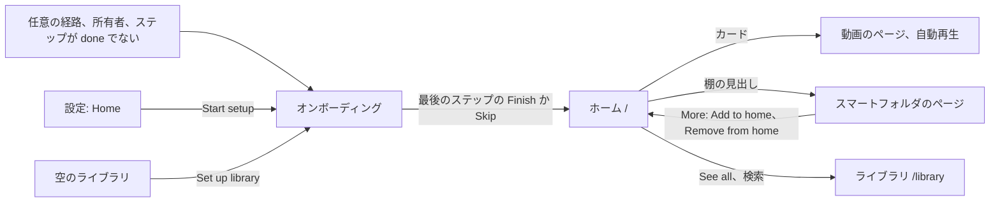
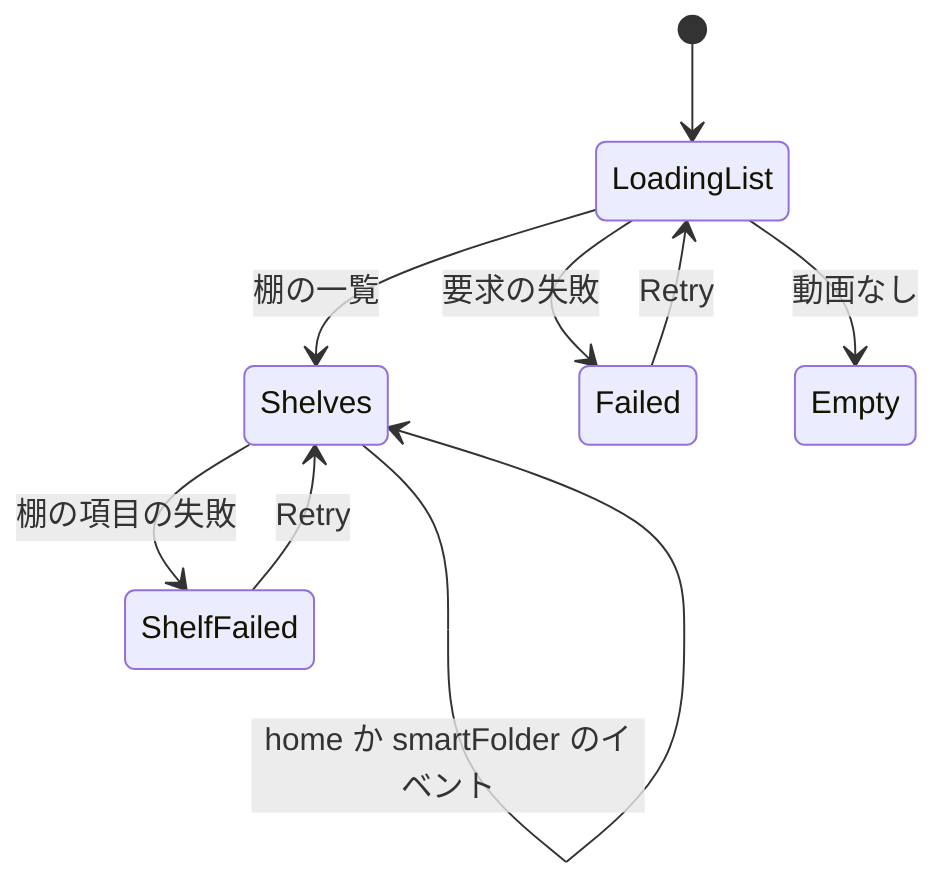
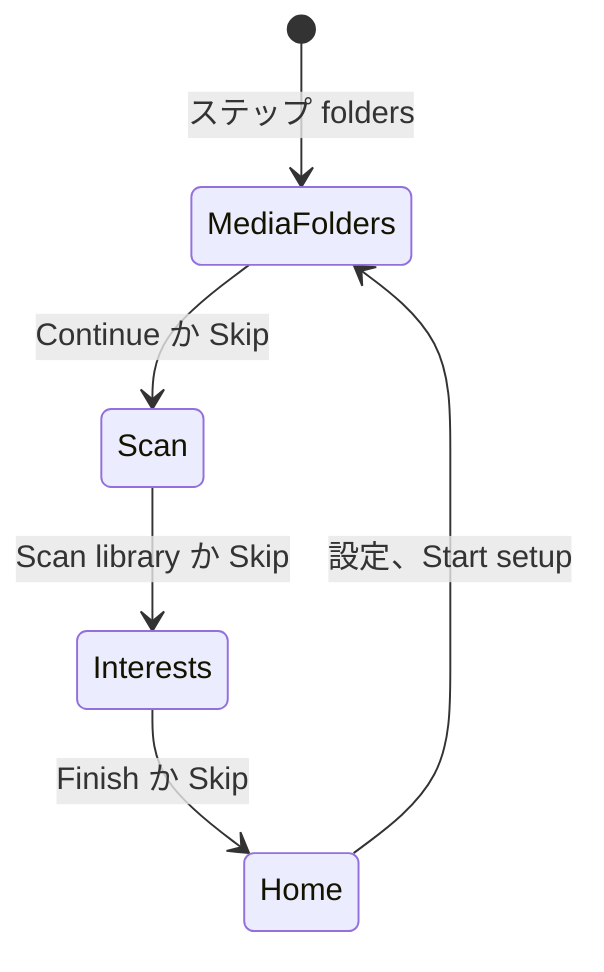

# UI 設計: オンボーディングで始まる、棚の並んだホーム {#ui-design-a-home-of-shelves-started-by-onboarding}

**機能**: [親 Issue #1140](https://github.com/syudead/vv/issues/1140) · [plan.md](plan.md) · [research.md R-3](research.md#r-3-onboarding-progress-is-one-step-held-in-a-setting) · [R-4](research.md#r-4-onboarding-adds-routes-for-its-step-and-interests-only) · [R-6](research.md#r-6-a-picked-interest-becomes-an-owner-shelf-and-auto-tagging-is-asked-again) · [R-12](research.md#r-12-the-home-lists-shelf-summaries-shelf-items-are-read-on-screen) · [R-13](research.md#r-13-four-fixed-shelves-two-of-them-the-owners-only) · [R-14](research.md#r-14-pressing-a-shelf-card-plays) · [R-15](research.md#r-15-the-library-moves-to-library) · [contracts/screen-api.md](contracts/screen-api.md)

すでに決めている出典。ここでは繰り返さず、リンクする。

| 話題 | 出典 |
| --- | --- |
| トークン、閉じた段階、ライブラリの密度 | [design-system.md、Foundations](../../docs/design-docs/design-system.md#foundations)。値は [`web/src/ui/tokens.css`](../../web/src/ui/tokens.css) の `@theme` にあり、ここでは名前で参照し、写さない |
| `ListPage`、`PageHeader`、`Toolbar`、`PageSection`、`FormRow`、状態のブロック | [patterns.md](../../web/registry/rules/patterns.md) |
| `Button`、`Toggle`、`ToggleGroup`、`DropdownMenu`、`Combobox`、`Progress`、`Alert`、`Skeleton`、`Sonner`: それぞれの用途 | [components.md](../../web/registry/rules/components.md) |
| 動画のカード、グループのカード、そのサムネイル、進み具合の縁、お気に入りのハート | [library-ui.md、Cards](../../docs/design-docs/library-ui.md#cards)、[Favorite mark](../../docs/design-docs/library-ui.md#favorite-mark) |
| トップバー、そのツールバーのポータル、サイドバーのレールとドロワー | [library-ui.md、Shell and toolbar](../../docs/design-docs/library-ui.md#shell-and-toolbar) |
| メディアフォルダの選択ダイアログ | [`web/src/settings/FolderPicker.tsx`](../../web/src/settings/FolderPicker.tsx) と、設定の `Media folders` のセクション |
| スキャンの開始、その状態と文言、右下の表示 | [library-ui.md、Scan entry and progress](../../docs/design-docs/library-ui.md#scan-entry-and-progress)、[024 の UI 設計](../024-import-progress/ui-design.md) |
| スマートフォルダのページとその `More` メニュー | [052 の UI 設計、Smart folder page](../052-smart-folders/ui-design.md#smart-folder-page) |
| 動画のページの自動再生とフォルダの文脈 | [052 の UI 設計、Video page](../052-smart-folders/ui-design.md#video-page)、[library-ui.md、Group members](../../docs/design-docs/library-ui.md#group-members) |
| ゲストでの縮退 | [016 の UI 設計、Guest degradation](../016-single-account-auth/ui-design.md#guest-degradation) |
| CSS の幅のブレークポイント。人が確かめるレイアウト | [library-ui.md、Width breakpoints](../../docs/design-docs/library-ui.md#width-breakpoints-in-css-and-the-sidebar-exception)、[Layout verified by people](../../docs/design-docs/library-ui.md#layout-verified-by-people-not-machines) |
| 画面の文言 | [`web/src/i18n/en.ts`](../../web/src/i18n/en.ts)。この機能は `home`、`onboarding` と下の文言を加える |

図は、この機能が加えるか変える画面と、それぞれの操作の行き先を示す。

変わらないもの: ライブラリの画面の中身 (アドレスだけが `/library` に移る)、動画のカードとグループのカードそのもの、動画のページ、2 つのメニュー項目を除くスマートフォルダのページ、メディアフォルダの選択器、スキャンの表示。

## この形にした理由 {#why-this-shape}

ホームはカードの行の並びで、棚ごとに 1 行あり、各行は横にスクロールする。これは現在の動画製品が閲覧のために行き着いた形である (`UI品質`、1 つ目の点)。棚のグリッドやフォルダのカードの一覧は採用しなかった: フォルダのカードは動画をもう 1 回押した先に隠し、Issue はまずサムネイルを見せ、1 回押して再生することを求めているからである。棚のカードは、ライブラリの動画のカードとグループのカードを、最小のカードの段階 `card-0` で、タグの行と選択のチェックなしで使う: ホームは見るものを選ぶためのもので、管理するためのものではないので、行はライブラリより多くのサムネイルと少ない文字を出す。カードを押すと再生し (R-14)、フォルダの棚の見出しはフォルダを開くので、棚の 2 つの操作が同じ対象を共有することはない。

検索欄はトップバーにあるライブラリの検索なので、以前のトップに慣れた人は、それを元の場所で見つける (`UI品質`、3 つ目の点)。送信するとホームを絞り込むのではなく `/library?q=` を開く。ホームの行は絞り込む 1 つの一覧ではないからである。各棚の `See all` は行き先を棚自身の名前で示すので、ライブラリの移動について覚えることは何もない。

オンボーディングは、最初のセットアップと同じくシェルの外にある独自のページで、3 つのステップをヘッダーの帯に置き、一度に 1 つのステップの中身を出す。ゲートは、ステップが `done` になるまで、どの経路からも所有者をそこへ戻す (R-4) ので、サイドバーはそこへ戻るだけになる。そのまわりにシェルを描くことは採用しなかった。ホームの上のダイアログは採用しなかった。ホームには最初のスキャンの前に出すものがなく、また Esc で閉じたダイアログは、ステップが済んでいないのに「済んだ」と読めるからである。どのステップも主な操作の隣に `Skip` を持つので、飛ばすことが隠れることはない (`UI品質`、4 つ目の点)。また興味のステップはスキャンの進み具合を興味の上に出すので、所有者はスキャンを待つのではなく、スキャンが走る間に選ぶ。

興味はチェックボックスの一覧ではなく、折り返すトグルのチップである: 24 の短い名前はオンボーディングの列の数行に収まり、押したチップは一目で選んだと読める。すでにホームにある興味は押された無効の状態で描くので、設定からもう一度選んでも 2 つ目の棚はできない (R-6)。

ホームの配置はホームそのものの上で変える: 各フォルダの棚の所有者の `More` は棚を上か下に動かすか取り除き、ヘッダーの `Add shelf` は任意のスマートフォルダを加える。ドラッグのハンドルを持つ別の配置のダイアログは採用しなかった: 棚は少なく、2 つのメニュー項目が順序付けをし、所有者は結果をその場で見る。

## デザインシステムの変更 {#changes-to-the-design-system}

ホームとオンボーディングには、デザインシステムにない 1 つのセクション、1 つの雛形、1 つの読み込みのレイアウトが要る。これらの画面を作る単位が、まずそれらをレジストリ、その例のブロック、[patterns.md](../../web/registry/rules/patterns.md) に加え、それから使う。

| 追加するもの | 種類 | 内容 |
| --- | --- | --- |
| `ShelfRow` | セクション (`shelf-row`) | 見出しの行 (タイトル、任意の `leading` アイコン、タイトルをリンクにする任意の `href`、右端の `actions`) と、その下の横にスクロールするカードの 1 行。カードは幅 `card-0`、間隔 `gap-3` で、カードの始まりにスナップする。`md` 以上でホバーできるポインタがあるときは、行がホバーかフォーカスされている間、行の両端の上に `ghost` `icon-sm` の前と次のボタンを出し、それぞれ自分の側の端ではない。`LoadingState`、`Alert`、カードのいずれかを持つ |
| `StepsPage` | 雛形 (`steps-page`) | シェルの外のページ: 高さ `navbar` のヘッダーの帯で、左に `BrandHomeLink`、中央にステップの帯を置き、その下に最大 `max-w-2xl` で中央に置いた `p-4` (`sm` から `p-6`) の 1 列を置く。列はステップの `title` (`h1`、`text-xl`)、`description`、`content`、`footer` の行を持ち、その行は左に `Skip` (`ghost` `sm`)、右に 1 つの `default` `sm` の操作を持つ。帯は番号付きのステップの名前で、現在のものは `primary`、済んだものはチェック付きである。`sm` 未満では `Step 2 of 3` と現在の名前だけを出す |
| `LoadingState` `layout="shelves"` | 状態 | `Skeleton` の見出しの棒と、その下の `card-0` のカードのスケルトンの行を 3 行 |

トークンにも、`web/src/theme/tokens.test.ts` のコントラストの組にも、何も加えない。

## 文言 {#words}

| 場所 | 文言 | 備考 |
| --- | --- | --- |
| サイドバーの項目、`/` | `Home` | `Library` の上。所有者とゲストに出す。アイコンは `House` |
| ホーム、ページのタイトル (スクリーンリーダー向けのみ) | `Home` | `PageHeader` `titleHidden` |
| ホーム、検索欄のプレースホルダー | `Search the library` | 送信すると `/library?q=` を開く |
| ホーム、ヘッダーの操作 (所有者) | `Add shelf` | `outline` `sm`。スマートフォルダの `Combobox` を開く |
| `Add shelf` のコンボボックス、空 | `Every smart folder is already on your home.` | |
| `Add shelf` のコンボボックス、1 つもない | `No smart folders yet. Save a library filter as a smart folder first.` | |
| 固定の棚、視聴途中 | `Continue watching` | 所有者のみ |
| 固定の棚、最近 | `Recently added` | |
| 固定の棚、どの棚にもない | `Not on any shelf` | |
| 固定の棚、おすすめ | `Recommended` | 所有者のみ |
| 棚の見出し、末尾 | `See all` | `link` `sm` |
| フォルダの棚の `More` (所有者) | `Move up`、`Move down`、`Remove from home` | `Move up` は最初のフォルダの棚になく、`Move down` は最後のものにない |
| `Remove from home` の後のトースト | `Removed "{name}" from your home.` | `Undo` 付きで、それは棚を元の場所に加え直す |
| `Add shelf` の後のトースト | `Added "{name}" to your home.` | |
| 棚、項目の失敗 | `Couldn't load this shelf: {reason}` | `Retry` |
| ホーム、失敗 | `Couldn't load your home: {reason}` | `Retry` 付きの `ErrorState` |
| ホーム、動画なし、タイトル | `No videos yet` | `EmptyState` |
| ホーム、動画なし、所有者向けの説明 | `Add a media folder and scan it, and your shelves appear here.` | 操作は `Set up library` |
| ホーム、動画なし、ゲスト向けの説明 | `There's nothing to watch here yet.` | 操作なし |
| ホーム、整理の処理が実行中 (所有者) | `Organizing your shelves…` | 最後のフォルダの棚の下の、`Spinner` 付きの薄い色の `text-xs` の行 |
| スマートフォルダのページの `More` (所有者) | `Add to home`、`Remove from home` | `onHome` に応じてどちらか一方 |
| 設定のセクション | `Home` | `Media folders` の後の `PageSection` |
| 設定の行 | `Shelves` · `Rebuild the shelves VVMDM made from your tags, people and organizations. Shelves you made, changed or picked as interests stay.` · ボタン `Reorganize` | |
| 設定の行、最後の実行 | `Last organized {time}: {added} added, {removed} removed.` / `Last organized {time}: nothing changed.` / `Last organizing failed {time}.` / `Not organized yet.` | 説明の下。薄い色の `text-xs` |
| 設定の行 | `Setup` · `Add media folders, scan and pick interests again.` · ボタン `Start setup` | ステップを `folders` にする |
| オンボーディング、ステップの名前 | `Media folders`、`Scan`、`Interests` | 帯 |
| オンボーディング、ステップ 1 のタイトル | `Where are your videos?` | |
| オンボーディング、ステップ 1 の説明 | `Add the folders on the server that hold your videos. You can change them later in Settings.` | |
| オンボーディング、ステップ 1 の操作 | `Add folder` (`outline` `sm`)、`Continue` (`default`) | `Continue` はフォルダがないと無効 |
| オンボーディング、ステップ 2 のタイトル | `Scan your library` | |
| オンボーディング、ステップ 2 の説明 | `VVMDM reads the folders and makes thumbnails. It keeps going in the background, so you can continue while it runs.` | |
| オンボーディング、ステップ 2 の操作 | `Scan library` (`default`) | フォルダがないときは `Add a media folder first.` を添えて無効 |
| オンボーディング、ステップ 3 のタイトル | `What do you watch?` | |
| オンボーディング、ステップ 3 の説明 | `Pick what your videos are about. Each becomes a shelf on your home that fills in as videos get these tags.` | |
| オンボーディング、ステップ 3 の注記、自動タグ付けが無効 | `Auto-tagging is off, so these shelves fill in only as you tag videos. You can turn it on in Settings.` | `Alert`、既定のバリアント |
| オンボーディング、ステップ 3、すでにホームにある興味 | `On your home` | 無効のチップの `Tooltip` |
| オンボーディング、ステップ 3 の操作 | `Finish` (`default`) | 選んだものがあれば、それを加えてから終える |
| オンボーディング、すべてのステップ | `Skip` | `ghost` `sm`、フッターの左 |
| オンボーディング、ステップ 3 のスキャンの行 | `Scanning: {done} of {total}` / `Scan finished` / `Scan failed. See Settings.` | 興味の上。スキャン中は `Progress` 付き |
| オンボーディング、ステップの書き込みの失敗 | `Couldn't save your progress: {reason}` | フッターの上の `Alert`。ステップはそのまま |
| オンボーディング、選んだものの追加の失敗 | `Couldn't add the shelves: {reason}` | フッターの上の `Alert`。選んだものは保たれる |
| 選んだものがある `Finish` の後のトースト | `Added {n} shelves to your home.` | |
| 空のライブラリ、所有者の操作 | `Set up library` | `Scan status` へのリンクを置き換える。ステップを `folders` にする |

## ホーム {#home}

`/` の `ListPage` で、ライブラリの密度である。`header` は、タイトルをスクリーンリーダー向けにだけ持ち、所有者には `actions` に `Add shelf` を持つ `PageHeader` である。`toolbar` は `placement="topBar"` の `Toolbar` で、検索欄だけを持ち、絞り込みや表示の操作は持たない。本体は棚で、上から下へ `gap-6` の間隔で並び、それぞれが `ShelfRow` である:

| 棚 | 見出し | `See all` の行き先 | カード |
| --- | --- | --- | --- |
| フォルダの棚 | `/smart-folders/{id}` へのリンクとしてのフォルダの名前で、その前に `FolderSearch` アイコン。末尾に所有者の `More` | `/smart-folders/{id}` | フォルダの並び順の動画とグループ |
| `Continue watching` | 文字 | `/history` | 視聴途中の動画。最後に再生したものが先 |
| `Recently added` | 文字 | `/library` (既定の並び順が新しい順) | 新しい順 |
| `Not on any shelf` | 文字 | `/library?unshelved=1` | 新しい順 |
| `Recommended` | 文字 | なし | 近さの順 |

棚のカードは、ライブラリの動画のカードとグループのカードを `card-0` で使い、タグの行、場所の行、選択のチェックを除き、サムネイル、長さ、進み具合の縁、タイトル、所有者のハート、グループの数の面を残す。動画のカードを押すと動画のページを自動再生で開き、フォルダの棚では `?smartFolder=<id>` を加える。グループのカードを押すと、グループの開く動画を自動再生と `?group` 付きで開く (R-14)。ホバーのプレビューはライブラリと同じく働く。

棚は視界に入るときに読む: まず棚の一覧を、次にビューポートにある棚とその次の 2 つの棚の項目を、1 回の要求につき最大 8 棚ずつ読む (R-12)。合計が 0 の棚は描かず、その下の行は跳ねずに隙間を詰める: 棚の行は、その項目が何かあると示して初めて描く。

所有者のフォルダの棚の `More` (`ghost` `icon-sm`、`aria-label` は `More actions for {name}`) は `Move up`、`Move down`、`Remove from home` を持つ。それぞれすぐに作用し、行はその場で並び替わる。`Add shelf` は、ホームにないスマートフォルダを名前で選ぶ `Combobox` を開く。1 つを選ぶと、最後のフォルダの棚の後に加える。固定の棚はメニューを持たない。

整理の処理が走る間、所有者には最後のフォルダの棚の下に `Organizing your shelves…` が見える。`home` イベントが届くと行が変わり、この 1 行は消える。

### 状態 {#states}

| 状態 | 画面が出すもの |
| --- | --- |
| 棚の一覧を読み込み中 | 本体に `LoadingState layout="shelves"`。検索は使えるまま |
| 棚の一覧は読み込み済みで、棚の項目を読み込み中 | 棚の見出し、次にその行に `card-0` の `Skeleton` |
| 棚の項目が失敗 | 棚の見出し、次にその行に `Retry` 付きの `Alert`。他の棚は影響を受けない |
| 棚の一覧が失敗 | `Retry` 付きの `ErrorState` |
| 閲覧者に見える動画がない | 所有者かゲストの説明を持つ `EmptyState` (`Film` アイコン)。所有者には `Set up library` |
| 動画はあるが、どの棚も空 | 項目を持つ固定の棚だけ。`Recently added` には必ず項目がある |
| ゲスト | `Add shelf`、`More`、`Continue watching` と `Recommended`、ハートがない |

## オンボーディング {#onboarding}

`/welcome` の `StepsPage` で、所有者だけのものである。ステップが `done` でない間に所有者が開くどの経路も、自身を `/welcome` に置き換える。ステップの帯は保存されたステップを示す。ゲストがそこへ送られることはなく、ステップが `done` のときの所有者の `/welcome` は `/` に行く。

| ステップ | 中身 | 主な操作 | Skip |
| --- | --- | --- | --- |
| `Media folders` | 追加したフォルダの行 (パス。先頭から切り詰め、`title` に全体) と、メディアフォルダの選択ダイアログを開く `Add folder` | `Continue`。フォルダがないと無効 | `scan` を書き込む |
| `Scan` | 説明のほかは何もない。すでに走っているスキャンは開始済みとみなす | `Scan library` は `/api/scans` でスキャンを始め、`interests` を書き込む | `interests` を書き込む |
| `Interests` | `Progress` 付きのスキャンの行、自動タグ付けが無効なときはその注記、次に 24 の興味を、折り返す `outline` `sm` のトグルの `ToggleGroup type="multiple"` として `gap-2` で出す | `Finish` は押された興味を加え、次に `done` を書き込み `/` を開く | `done` を書き込み、`/` を開く |

各ステップの書き込みは `/api/onboarding` に行き、それが保留中の間はフッターのボタンを無効にする。別の端末でステップが変わると、`home` イベントがこのページをそのステップへ動かす。失敗した書き込みはフッターの上にその `Alert` を出し、ステップを保つ。選んだものの追加の失敗は、押されたチップを保つ。

## スマートフォルダのページと設定 {#smart-folder-page-and-settings}

スマートフォルダのページの所有者の `More` は、フォルダの `onHome` に応じて、`Edit…` の後に `Add to home` か `Remove from home` を得る。それぞれホームと同じトーストを伴う。

設定は `Media folders` の後に `Home` の `PageSection` を得て、2 つの `FormRow` を持つ: `Reorganize` (`outline` `sm`。実行が保留中か実行中の間は `Spinner` 付きで無効) と、説明の下の最後の実行を持つ `Shelves`。`folders` を書き込み `/welcome` を開く `Start setup` (`outline` `sm`) を持つ `Setup`。

## サイドバーとライブラリ {#sidebar-and-library}

サイドバーは、所有者とゲストのために `Library` の上に `Home` を得る。`Library` は今後 `/library` を開く。空のライブラリの所有者の操作は `Set up library` になり、`folders` を書き込み `/welcome` を開く。

## レスポンシブな振る舞い {#responsive-behaviour}

| 幅 | ホーム | オンボーディング |
| --- | --- | --- |
| 360px | 棚はドロワーの ☰ の下で全幅。1 行にカードが約 1.5 枚見え、横にスワイプする。前と次のボタンはない。見出しは `See all` の手前で切り詰める。`Add shelf` はヘッダーにある | 帯は `Step 2 of 3` と名前。`p-4` の 1 列。興味は 1 行に約 2 つで折り返す。フッターの `Skip` と操作は 1 行にある |
| 768px | レールのサイドバー。1 行にカードが約 3 枚と次の一部。ホバーできるポインタがあるとき、行に前と次のボタン | 帯全体。列は `max-w-2xl`。興味は 1 行に約 4 つ |
| 1280px | レールのサイドバー。1 行にカードが約 4.5 枚。ホバーで前と次のボタン | 768px と同じで、中央に置き、両側に余白がある |

## レビューの基準 {#review-criteria}

1. 1280px で、3 つのフォルダの棚を持つホームの最初の表示は、ほとんどがサムネイルである: 各行のカードは面積でその見出しの行より大きく、棚の間の間隔はカードの間の間隔より大きい。
2. 棚の行の最後に見えるカードは、どの幅でも右端で切れているので、行は矢印なしで横にスクロールすると読める。
3. どの棚のカードを押しても、1 回押すだけで動画のページで再生が始まる。フォルダの棚のカードではなく見出しがフォルダを開く。
4. 検索欄は、トップバーでライブラリのものがある場所にあり、送信すると結果とともにライブラリを出す。
5. 固定の棚はフォルダの棚と区別して読める: フォルダの棚の見出しは `FolderSearch` アイコンと所有者の `More` を持つリンクで、固定の棚の見出しはそのどちらもないただの文字である。
6. 棚の読み込み中、本体はその場に棚のスケルトンを出し、空とわかった棚は隙間を残さない。
7. オンボーディングのどのステップでも、`Skip` と主な操作は 1 つのフッターの行にあり、`Skip` は操作より控えめで、帯はどのステップが現在かを示す。
8. スキャン中の興味のステップでは、スキャンの行は興味の上にあり、押されたチップはラベルを読まなくても選ばれたと読める。
9. すでにホームにある興味は押された状態で、押していない状態に戻せず、そのツールチップが理由を述べる。
10. 360px では、オンボーディングのどのステップも、ホームのどの行も、ページを横にスクロールさせない。
