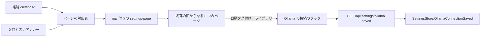
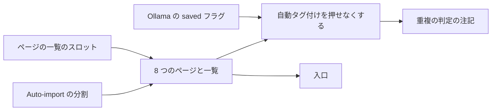

# 実装計画: 設定を開く頻度で 8 つのページに分ける {#implementation-plan-settings-split-into-eight-pages-by-how-often-they-are-opened}

**ブランチ**: `feature/058-settings-pages` | **親 Issue**: #973

**入力**: 親 Issue。これがこの機能の仕様である。

## 概要 {#summary}

11 の節を持つ 1 つの `/settings` の画面が、`/settings/<page>` の下の 8 つのページになる。それぞれが自分のアドレスを持ち、横に 8 つのページの一覧を置く。`/settings` はスキャンのページを出し、`sm` より下では一覧だけを出す。節はコンポーネントを保ったまま、親 Issue の表が名指すページへ移る。Auto-import の節は、監視状態 (スキャン) とスイッチ (ライブラリ) に分かれる。Ollama の設定の資源は `saved` を持ち、自動タグ付けのページは接続先が保存されていない間は操作を押せなくし、接続のページへのリンクを出す。

図は、この機能が加えるか変える部分と、何が何を読むかを示す。



| 関心事 | 方針 |
| --- | --- |
| アドレス | 経路 `/settings/<page>`。知らないスラッグは `/settings/scan` に置き換える ([R-1](research.md#r-1-each-settings-page-is-a-route-under-settings)) |
| 入口 | リンクはページへ移す。`/settings#<anchor>` は転送する ([R-2](research.md#r-2-the-old-anchor-addresses-are-forwarded-and-the-entry-points-move-to-the-pages)) |
| 狭い画面 | 1 つのマークアップ。CSS が一覧かページかを見せる ([R-3](research.md#r-3-the-page-list-is-a-column-beside-the-page-from-sm-and-the-whole-of-settings-below-it)) |
| 接続の状態 | `OllamaSettings` の `saved`。SPA では 1 つのフック ([R-4](research.md#r-4-ollamasettings-reports-whether-the-connection-was-saved)、[contracts/screen-api.md](contracts/screen-api.md)) |
| 押せない自動タグ付け | 読み取りから決め、失敗したら開き、値は見える ([R-5](research.md#r-5-the-auto-tagging-page-is-gated-by-the-connection-with-three-other-states)) |

Issue は `ui` ラベルを持つので、画面の単位の前に `design` の段階が `ui-design.md` を書く。ページの一覧と今の項目、ページの題と `sm` より下の戻るリンク、分けた Auto-import の行、リンク付きの押せない自動タグ付けのページ、重複の判定のスイッチの下の注記、デスクトップアプリの外でのネットワークのページの行、8 つの項目の言葉を、親 Issue の `UI品質` に照らして決める。

`data-model.md` はない。この機能はエンティティを足さず、テーブルを変えない。`quickstart.md` もない。受け入れ条件はページのテスト、e2e のテスト、`ui-design.md` が求める目視の確認である。

## 技術的な文脈 {#technical-context}

**正本となる定義**:

| 話題 | 出典 |
| --- | --- |
| Web 層、経路、認証のゲート、生成コード | [ARCHITECTURE.md](../../ARCHITECTURE.md) |
| 幅の境目、サイドバー、スキャンの入口と表示 | [library-ui.md](../../docs/design-docs/library-ui.md) |
| 設定ページのパターン、ページの節 | [patterns.md](../../web/registry/rules/patterns.md)、[design-system.md](../../docs/design-docs/design-system.md) |
| Ollama の接続、「接続を保存した」 | [ai-layer.md](../../docs/design-docs/ai-layer.md)、[054 の調査 R-13](../054-auto-dup/research.md#r-13-the-model-is-asked-only-once-the-owner-has-saved-a-connection) |
| 各節の設計 | [024 UI 設計](../024-import-progress/ui-design.md)、[042 UI 設計](../042-folder-watch-import/ui-design.md)、[045 UI 設計](../045-comfyui-thumbnails/ui-design.md)、[049 UI 設計](../049-work-info-plugins/ui-design.md)、[054 UI 設計](../054-auto-dup/ui-design.md) |
| 画面の API と生成コード | [api/openapi.yaml](../../api/openapi.yaml)、`task generate` |
| Web のテストとその段階 | [web-testing.md](../../docs/design-docs/web-testing.md)、[i18n.md](../../docs/design-docs/i18n.md) |
| 検査 | [Taskfile.yml](../../Taskfile.yml) (`task check`、`task check-docs`、`task test-e2e`) |

**機能に固有の文脈**: 要件 9 はすべての節の振る舞いを保つので、節のコンポーネント、API の呼び出し、テストは節と共に移る。分けるのは Auto-import の節だけで、状態を足すのは自動タグ付けと重複の判定の節だけである。`/settings` や `/settings#<anchor>` を開く e2e の仕様 (`settings`、`scan-progress`、`scan-issues`、`auto-import`、`folders`、`work-info-plugins`、`unconfigured.setup`) は、その行き先を移す単位と共に変わる。

## 憲章の確認 {#constitution-check}

ARCHITECTURE.md と AGENTS.md に照らして確認した。この設計が頼る規則:

| 規則 | 設計がどう満たすか |
| --- | --- |
| ページは `fetch` を呼ばない。`api/` がサーバーと話す唯一の場所 | `saved` は `web/src/api/client.ts` の既存の `getOllamaSettings` を通して届く |
| ゲートはゲストを所有者だけの画面から送り返す | `ownerOnlyPath` はすでに `/settings/` 以下に一致する。ゲストのエッジケースは今の振る舞いである |
| 幅は CSS で、サイドバーは例外 | R-3 は JavaScript で幅を読まない |
| 規則はページの外へ | ページの対応表とアンカーの転送は、ロジックのテストを持つ純粋なモジュールである |
| コードを写さない、複雑度 25 | 節はコンポーネントとして移り、押せなくなる 2 つの節は 1 つのフックを共有する |

## プロジェクトの構成 {#project-structure}

### 文書 (この機能) {#documentation-this-feature}

```text
specs/058-settings-pages/
├── plan.md
├── research.md            # R-1..R-5
└── contracts/
    └── screen-api.md      # OllamaSettings.saved
```

`design` の段階が `ui-design.md` を足す。

### ソースコード {#source-code}

**影響する境界**:

| パッケージ | 変更 |
| --- | --- |
| `internal/httpapi`、`internal/app` (`OllamaConnection`)、`api/openapi.yaml` | Ollama の設定の応答の `saved`。ストアの `OllamaConnectionSaved` を通して読む。`PUT` の本文のための `UpdateOllamaSettingsRequest` |
| `web/src/app` | 1 つの遅延読み込みの経路としての `/settings/*` |
| `web/src/settings` | ページの対応表、8 つのページ、Auto-import の分割、接続のフック、押せなくなる節 |
| `web/src/ui/patterns`、`web/registry` | `settings-page` パターンの `nav` スロットとその規則 |
| `web/src/shell` | サイドバーの `Settings` の項目が `/settings` 以下のページに一致すること。スキャンの表示のリンク |
| `web/src/library`、`web/src/folders`、`web/src/player` | ページへの入口のリンク |
| `web/e2e` | 設定を開く仕様 |
| `docs/design-docs/library-ui.md` | スキャンの入口のアドレス |

**新しいパス**: `web/src/settings/settingsPages.ts` (ページの対応表)、`web/src/settings/pages/` の下にページごとに 1 ファイル、`web/src/settings/useOllamaConnection.ts`。

**構成の決定**: 節は今の場所に留まり、ページがそれらを組み合わせるので、節のテストと `ui-design.md` はパスを保つ。どのページがどの節を載せるかを言う場所は、ページの対応表だけである。

## 実装の作業 {#implementation-work}

図は、どの単位を先に入れなければならないかを示す。画面の単位は `design` の段階の `ui-design.md` も待つ。



### 設定 API で Ollama の接続先を保存したかを返す {#report-whether-the-ollama-connection-was-saved-in-the-settings-api}

**範囲**: `api/openapi.yaml` の `OllamaSettings` の `saved` と、`PUT` の本文のための `UpdateOllamaSettingsRequest` スキーマ、生成コード、ストアの `OllamaConnectionSaved` から `saved` に答える `OllamaConnection` のポートとハンドラ、SPA のクライアントの `getOllamaSettings`、`endpoint` と `model` だけを送る `updateOllamaSettings` ([contracts/screen-api.md](contracts/screen-api.md)、[R-4](research.md#r-4-ollamasettings-reports-whether-the-connection-was-saved))。

**依存**: なし。

**受け入れ**: `task check` が `task generate` との差分なしに通る。ハンドラのテストは、`GET /api/settings/ollama` が保存の前は `saved: false` を、`PUT` の後は `saved: true` を返し、`PUT` の応答が `saved: true` を持ち、`saved` を持つ `PUT` の本文には `400` を返すことを示す。ページのテストは、Ollama の節が `saved` 付きで読んだ接続先を保存でき、リクエストの本文が `endpoint` と `model` だけを持つことを示す。設定の画面は変わらない。

### 設定のページのパターンにページの一覧のスロットを与える {#give-the-settings-page-pattern-a-slot-for-a-page-list}

**範囲**: `settings-page` パターンの `nav` スロット、そのレジストリの項目、見本のブロック、[patterns.md](../../web/registry/rules/patterns.md) の規則。`sm` からは本文の横に一覧を置き、`sm` より下では一覧だけか、戻るリンクの下の本文を置く。`ui-design.md` から ([R-3](research.md#r-3-the-page-list-is-a-column-beside-the-page-from-sm-and-the-whole-of-settings-below-it))。

**依存**: なし。

**受け入れ**: `task check` と `task check-docs` が通る。見本のブロックは `ui-design.md` の幅での目視の確認に通り、`sm` からは本文の横に一覧が、それより下では一覧だけと戻るリンクが出る。`nav` を渡さない設定の画面は変わらない。

### Auto-import の節を監視状態とスイッチに分ける {#split-the-auto-import-section-into-its-watch-state-and-its-switch}

**範囲**: `AutoImportSection` を 2 つのコンポーネントに分ける。監視状態とその問題、そしてスイッチである。それぞれが要する読み直しを保つ。どちらも 1 つの設定の画面にまだ出す ([R-1](research.md#r-1-each-settings-page-is-a-route-under-settings))。

**依存**: なし。

**受け入れ**: `task check` が通る。2 つのコンポーネントへ移した Auto-import の節のページのテストが通る。`auto-import` の e2e の仕様は変更なしに通る。

### 設定を自分のアドレスを持つ 8 つのページとページの一覧に分ける {#split-settings-into-eight-pages-with-their-own-addresses-and-a-page-list}

**範囲**: `/settings/*` の経路とページの対応表 (スラッグ、節、各ページが持つアンカー、知らないスラッグの規則)。`ui-design.md` からの 8 つのページ。それぞれ `nav` スロットの中で R-1 の表が名指す節を組み合わせ、スキャンに Auto-import の監視状態を、ライブラリにそのスイッチを置く。ネットワークの読み取りが `404` を返すときのネットワークのページの行。`sm` からはスキャンのページ、それより下では一覧としての `/settings`、`/settings#<anchor>` の転送。サイドバーの `Settings` の項目が `/settings` 以下のページに一致すること。ライブラリのページからスキャンの状態へ知らせるメディアフォルダの数。フォルダを足すために `/settings` を開く e2e の仕様 ([R-1](research.md#r-1-each-settings-page-is-a-route-under-settings) から [R-3](research.md#r-3-the-page-list-is-a-column-beside-the-page-from-sm-and-the-whole-of-settings-below-it))。

**依存**: 設定のページのパターンにページの一覧のスロットを与える。Auto-import の節を監視状態とスイッチに分ける。

**受け入れ**: `task check` と `task check-docs` が通る。ロジックのテストは、知らないスラッグが `scan` に、`#comfyui` が接続のページに対応することを示す。ページのテストは、8 つのアドレスのそれぞれがそのページの節だけを描くこと、一覧が今のページを示すこと、`/settings/nowhere` が `/settings/scan` に置き換わること、`/settings#comfyui` が ComfyUI の見出しにフォーカスした `/settings/connections#comfyui` に着くこと、一覧から別のページへ移って戻ると前のページに戻ることを示す。ページのテストは、サイドバーが `/settings` でも `/settings/library` でも `Settings` を現在の項目として示すこと、ネットワークの読み取りが `404` を返すと `/settings/network` がデスクトップアプリの行を出すことを示す。ページのテストは、ライブラリのページでメディアフォルダを足してスキャンのページを開くと `Scan library` が押せることを示す。既存の設定の e2e の仕様がライブラリのページに対して通る。ページは `ui-design.md` の幅での目視の確認に通る。`sm` より下の一覧だけの状態と戻るリンクを含む。

### 設定の入口をそのページへ送る {#send-the-settings-entry-points-to-their-pages}

**範囲**: `ScanProgressIndicator`、`EmptyLibrary`、`FolderView`、`RootView`、`EditEntry`、`FindStep` のリンクを [R-2](research.md#r-2-the-old-anchor-addresses-are-forwarded-and-the-entry-points-move-to-the-pages) のページのアドレスへ。[library-ui.md](../../docs/design-docs/library-ui.md) のスキャンの入口のアドレス。古いアドレスを確かめるか開く e2e の仕様。

**依存**: 設定を自分のアドレスを持つ 8 つのページとページの一覧に分ける。

**受け入れ**: `task check` と `task check-docs` が通る。ページのテストは、表示が取り込みの状況の見える `/settings/scan#scan-status` を開くこと、動画のページの編集の入口が `/settings/connections#comfyui` へリンクすること、作品情報の取得ダイアログの `Open Settings` が `/settings/plugins#work-info-plugins` へリンクすること、空のルートフォルダの `Open Settings` が `/settings/library` へリンクすることを示す。`scan-progress`、`scan-issues`、`auto-import`、`folders`、`work-info-plugins` の e2e の仕様が新しいアドレスに対して通る。

### Ollama の接続先が保存されるまで自動タグ付けのページを押せなくする {#lock-the-auto-tagging-page-until-the-ollama-connection-is-saved}

**範囲**: `saved` を読む `useOllamaConnection`。[R-5](research.md#r-5-the-auto-tagging-page-is-gated-by-the-connection-with-three-other-states) の表から状態を取る自動タグ付けのページの操作と実行ボタン、`/settings/connections` へのリンクを持つ行、`Retry` を持つ読み取り失敗の行。`ui-design.md` から。

**依存**: 設定 API で Ollama の接続先を保存したかを返す。設定を自分のアドレスを持つ 8 つのページとページの一覧に分ける。

**受け入れ**: `task check` が通る。ページのテストは、`saved: false` のときスイッチ、入力、`Save`、`Test judging`、実行ボタンが保存した値を見せたまま `aria-disabled` で、リンクが `/settings/connections` へ導くこと、各スイッチとボタンを押しても各入力に打っても表示された値が変わらずリクエストも送られないこと、そこで接続先を保存して戻ると押せること、`saved: true` で自動タグ付けをオフにして保存すると実行ボタンが今までどおり隠れること、読み取りの失敗では操作が押せたままで読み取り失敗の行が出ることを示す。ページは `ui-design.md` の幅での目視の確認に通る。

### 重複の判定のスイッチの下で、異なる組には Ollama の接続が要ると言う {#say-under-the-duplicate-judging-switch-that-differing-pairs-need-the-ollama-connection}

**範囲**: ライブラリのページの Duplicate judging の節が `useOllamaConnection` を読み、`saved` が false の間、`/settings/connections` へのリンクを持つ注記を出す。`ui-design.md` から ([R-5](research.md#r-5-the-auto-tagging-page-is-gated-by-the-connection-with-three-other-states))。

**依存**: Ollama の接続先が保存されるまで自動タグ付けのページを押せなくする。

**受け入れ**: `task check` が通る。ページのテストは、`saved: false` でスイッチが切り替わって保存され、注記が `/settings/connections` へリンクすること、`saved: true` か読み取りの失敗では注記がないことを示す。節は `ui-design.md` の幅での目視の確認に通る。
