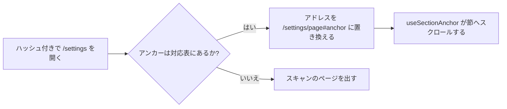

# 調査: 設定を 8 つのページに分ける {#research-settings-split-into-eight-pages}

引き継ぐ決定: [ARCHITECTURE.md](../../ARCHITECTURE.md)、[library-ui.md](../../docs/design-docs/library-ui.md)、[design-system.md](../../docs/design-docs/design-system.md)、[ai-layer.md](../../docs/design-docs/ai-layer.md)、[054 の調査 R-13](../054-auto-dup/research.md#r-13-the-model-is-asked-only-once-the-owner-has-saved-a-connection)。このファイルは、この機能が加える決定だけを記録する。

## R-1: 設定の各ページは `/settings` の下の経路である {#r-1-each-settings-page-is-a-route-under-settings}

**決定**: 8 つのページは表のスラッグを持つ経路 `/settings/<page>` で、`/settings` はスキャンのページを出し、表にないスラッグは `/settings/scan` に置き換える。

| ページ (親 Issue) | 経路 | 載せる節 |
| --- | --- | --- |
| スキャン | `/settings/scan` | `Scan library` と問題のある動画を含むスキャンの状況。自動の取り込みの監視状態とその問題 |
| ライブラリ | `/settings/library` | メディアフォルダ。自動の取り込みのスイッチ。重複の判定のスイッチ |
| 自動タグ付け | `/settings/auto-tagging` | キューと実行ボタン。スイッチ、取り込み後のタグ付け、しきい値 |
| 接続 | `/settings/connections` | Ollama。ComfyUI |
| プラグイン | `/settings/plugins` | 作品情報プラグイン |
| 動画の変換 | `/settings/conversion` | 動画の変換 |
| ネットワーク | `/settings/network` | ネットワーク |
| API | `/settings/api` | API トークン |

| 案 | ページごとの自分のアドレス | ブラウザの「戻る」 | 遅延読み込みのチャンク | 判定 |
| --- | --- | --- | --- | --- |
| **経路 `/settings/<page>`** | ある | 使える | ほかの画面と同じく、`/settings` 以下で 1 チャンク | 採用 |
| タグ管理の `tab` と同じ `/settings?page=<page>` | ある | 使える | 同じ | 不採用: クエリは 1 つの画面の状態を表すものだが、ページはそれぞれ入口を持つ画面であり、`AuthGate` とサイドバーはすでにパスで照合している |
| URL を変えないタブ | ない | 使えない | 同じ | 不採用: 要件 1 はページごとのアドレスを、受け入れ条件 2 は「戻る」を求めている |

**理由**: 親 Issue の入口 (`#scan-status`、`#comfyui`、`#work-info-plugins`) はページを指しており、パスはシェルの現在の項目、ゲートの所有者だけの一覧、`deferredRoute` がすでに読んでいるものである。スラッグは英語の名詞にし、アドレス、一覧の項目、ページの題が 1 つの言葉を使うようにする (W-8)。画面の文言そのものは `ui-design.md` で決める。

ページの対応表 (スラッグ、題のキー、節、ページが持つ節のアンカー) はページの隣の 1 つの純粋なモジュールにし、知らないスラッグの規則と R-2 のアンカーの対応がロジックのテストを持つようにする ([web-testing.md「Rules out of pages」](../../docs/design-docs/web-testing.md#rules-out-of-pages))。

今のページの節だけをマウントする。ページを変えると前のページはアンマウントされるので、親 Issue のエッジケースが言うとおり未保存の入力は失われ、ページは自分の資源だけを読む。

親 Issue の表は、作品情報プラグインのプロキシもネットワークのページに置いている。Issue は設定の追加を範囲外としているが、このフィーチャーの作業中に 056 が `main` のネットワークの節にそのプロキシの行を追加した。そのためネットワークのページはネットワークの節だけを載せ、節が持つプロキシの行もそのまま載る。

ネットワークの節の LAN スイッチはデスクトップ専用である。`GET /api/settings/network` は、vv が Windows のデスクトップアプリではないところでは `404` を返す。そこではネットワークのページは一覧の項目を保ち、LAN からのアクセスは Windows のデスクトップアプリで設定すると言う行を、プロキシの行の上、スイッチの場所に出す。

| 案 | 判定 |
| --- | --- |
| **項目を残し、ページに行を出す** | 採用 |
| ページを空にする | 不採用: 所有者は題だけでその下に何もないページに着き、理由が分からない |
| デスクトップアプリの外では項目を外す | 不採用: 要件 2 は 8 つのページをすべてのページに並べると言っており、一覧はネットワークの読み取りを待たないと描けなくなる |

シェルのサイドバーの `Settings` の項目は、`/settings` とその下のすべてのページで現在の項目を示す (`matchDescendants`)。今は `/settings` だけに完全一致するからである。

## R-2: 古いアンカーのアドレスは転送し、入口はページへ移す {#r-2-the-old-anchor-addresses-are-forwarded-and-the-entry-points-move-to-the-pages}

**決定**: 入口はその節を載せるページへリンクし (`/settings/scan#scan-status`、`/settings/connections#comfyui`、`/settings/plugins#work-info-plugins`、空のルートフォルダの `Open Settings` は `/settings/library`)、ページの対応表が知るアンカーを持つ `/settings#<anchor>` は、アンカーを保ったままそのページのアドレスに置き換える。

| 案 | 判定 |
| --- | --- |
| **リンクを変え、古い形は転送する** | 採用 |
| すべてのリンクを `/settings#<anchor>` のままにして転送する | 不採用: 狭い画面では `/settings` は一覧なので (R-3)、転送が節に着く唯一の手段になり、ブックマークは一瞬一覧を見せる |
| リンクを変えるだけ | 不採用: 古いアドレスのブックマークや開いたままのタブは、その節ではなくスキャンのページに着く |

**理由**: 節のページが開けば `useSectionAnchor` はそのまま動くので、転送はページの対応表の参照と `replace` の遷移だけであり、リンクは行き先を名乗る。

## R-3: ページの一覧は `sm` からはページの横の列で、それより下では `/settings` 全体である {#r-3-the-page-list-is-a-column-beside-the-page-from-sm-and-the-whole-of-settings-below-it}

**決定**: どのページも 8 つのページの一覧と自分の本文を描く。CSS は `sm` (640px) から両方を見せ、`sm` より下では `/settings` で一覧だけを、`/settings/<page>` で本文と `/settings` へ戻るリンクを見せる。

| 幅 | `/settings` | `/settings/<page>` |
| --- | --- | --- |
| `sm` 以上 | スキャンのページの横に一覧 | そのページの横に一覧。項目は今のページを示す |
| `sm` より下 | 一覧だけ | 一覧へ戻るリンクの下にページの本文 |

| 案 | 判定 |
| --- | --- |
| **1 つのマークアップ、何を見せるかは CSS が決める** | 採用 |
| `useIsMobile` が一覧かページかを選ぶ | 不採用: [library-ui.md](../../docs/design-docs/library-ui.md#width-breakpoints-in-css-and-the-sidebar-exception) は幅をサイドバーを除いて CSS に置いており、ページに CSS で表せない状態はない |
| 一覧をシェルの 2 つ目のサイドバーにする | 不採用: シェルのレールは全画面のための 68px のアイコンであり、設定の一覧は 1 つの画面のものである |

**理由**: `/settings` は `sm` からスキャンのページで (要件 4)、それより下では一覧であり (要件 3)、幅を読む JavaScript はない。スキャンのページはどちらでも描かれ、見えるかどうかだけが変わるからである。一覧は `settings-page` パターンの `nav` スロットなので、レジストリの項目と [patterns.md](../../web/registry/rules/patterns.md) が規則を持ち、一覧、今の項目、戻るリンクの見た目は `ui-design.md` で決める。

## R-4: `OllamaSettings` は接続先を保存したかを返す {#r-4-ollamasettings-reports-whether-the-connection-was-saved}

**決定**: `GET /api/settings/ollama` に `saved` を足し、所有者が接続先を保存していれば true にする ([contracts/screen-api.md](contracts/screen-api.md))。接続に依存するページはこの資源を読む。`PUT` のリクエストの本文は `endpoint` と `model` だけを持つ独自のスキーマにする。今は応答のスキーマを参照しており、ハンドラはほかのフィールドを拒むからである。

| 案 | 自動タグ付けのページのリクエスト数 | 判定 |
| --- | --- | --- |
| **`OllamaSettings` の `saved`** | 2 (auto-tagging、ollama) | 採用 |
| `/api/thumbnail-edits/readiness` のような準備の資源 | 3 | 不採用: サムネイルのものは、動画のページが設定を読む理由を持たないからある。設定のページはどのみち設定を読む |
| `AutoTaggingSettings` と `VersionJudgingSettings` の `saved` | 2 | 不採用: 同じ事実を 2 つの資源で言うことになり、その事実は接続のものである ([054 R-13](../054-auto-dup/research.md#r-13-the-model-is-asked-only-once-the-owner-has-saved-a-connection)) |

**理由**: ストアはすでに重複の判定のためにこの問いに答えており (`OllamaConnectionSaved`)、読み取りは何も保存されていなければ既定値を返すので SPA は `endpoint` から判別できず、1 つのフィールドなら SPA の読み取りを 1 か所に保てる。両方のページが使う `web/src/settings` のフックである。

## R-5: 自動タグ付けのページは接続で押せなくなり、ほかに 3 つの状態がある {#r-5-the-auto-tagging-page-is-gated-by-the-connection-with-three-other-states}

**決定**: 自動タグ付けのページの設定、`Save`、`Test judging`、実行ボタンは、表のとおり接続の読み取りから押せるかどうかを決める。値はどの状態でも見える。

| 接続の読み取り | 操作 | ページが足すもの |
| --- | --- | --- |
| 読み込み中 | まだ描かない (今のスケルトン) | なし |
| `saved: true` | 今のまま | なし |
| `saved: false` | 押せない (`aria-disabled`、値は見える) | Ollama の接続が要ると言う行と、`/settings/connections` へのリンク |
| 失敗 | 今のまま | 接続を読めなかったと言う行と、`Retry` |

| 案 | 判定 |
| --- | --- |
| **接続の読み取りから決め、失敗したら開く** | 採用 |
| `Test judging` の結果から決める | 不採用: それには動いているモデルが要り、親 Issue は保存したアドレスだけで決めている |
| 読み取りが失敗したら閉じる | 不採用: 親 Issue のエッジケースはどちらとも決めつけないと言っている |
| 未保存の間は操作を隠す | 不採用: 親 Issue は今の値を読めるままにしている |

**理由**: `aria-disabled` は、ページのボタンが保存中にすでにそうしているとおり、値を読めるようにしフォーカスの順を保つ。この属性だけでは何も止まらない (`Button`、`Switch`、`Input` はなおイベントを発火する) ので、ページの各ハンドラは、`saved` が false の間、入力を変えずリクエストも送らずに戻る。保存のハンドラが保存中にすでに戻るのと同じである。実行ボタンは自動タグ付けがオンの間だけ出る今の規則を保つので、オフにすれば受け入れ条件 6 を満たす。

ライブラリのページの重複の判定のスイッチは押せなくならない。`saved: false` のときは、フレームの異なる組には接続が要るという行を同じリンクと共に出し、読み取りの失敗では何も足さない。スイッチはどちらでも動くからである。
