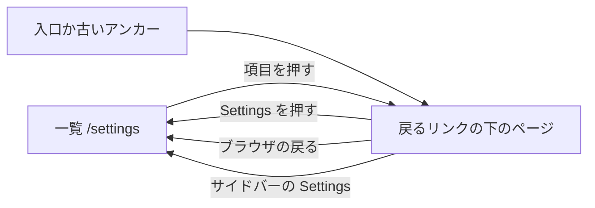
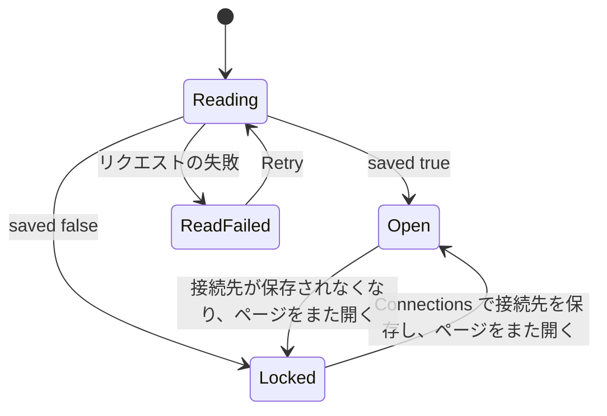

# UI 設計: 設定を 8 つのページに分ける {#ui-design-settings-split-into-eight-pages}

**機能**: [親 Issue #973](https://github.com/syudead/vv/issues/973) · [plan.md](plan.md) · [research.md R-1](research.md#r-1-each-settings-page-is-a-route-under-settings) · [R-3](research.md#r-3-the-page-list-is-a-column-beside-the-page-from-sm-and-the-whole-of-settings-below-it) · [R-5](research.md#r-5-the-auto-tagging-page-is-gated-by-the-connection-with-three-other-states) · [contracts/screen-api.md](contracts/screen-api.md)

すでに決まっていることの出典。ここでは繰り返さずリンクする。

| 話題 | 出典 |
| --- | --- |
| トークン、閉じた段階、ライブラリの密度 | [design-system.md, Foundations](../../docs/design-docs/design-system.md#foundations)。値は [`web/src/ui/tokens.css`](../../web/src/ui/tokens.css) の `@theme` にあり、ここでは名前だけを挙げて写さない |
| `SettingsPage`、`PageHeader`、`PageSection`、`FormRow`、`FactList`。状態のブロック | [patterns.md, Settings page](../../web/registry/rules/patterns.md#settings-page)、[Sections](../../web/registry/rules/patterns.md#sections)、[States](../../web/registry/rules/patterns.md#states) |
| `Button`、`Switch`、`Input`、`Alert`、`Skeleton`、`Sidebar` のそれぞれの用途と、押せない状態はどこでも `opacity-50` であること | [components.md](../../web/registry/rules/components.md) |
| サイドバーの今の項目 (`isActive` 付きの `SidebarMenuButton`)、`sm` からのレール、それより下のドロワー | [components.md, Sidebar](../../web/registry/rules/components.md#sidebar)、[library-ui.md, Width breakpoints](../../docs/design-docs/library-ui.md#width-breakpoints-in-css-and-the-sidebar-exception) |
| スキャンの入口、`Scan library`、右下の表示 | [library-ui.md, Scan entry and progress](../../docs/design-docs/library-ui.md#scan-entry-and-progress)、[024 UI design, Settings Scan Status](../024-import-progress/ui-design.md#settings-scan-status) |
| 変えずに移る節: その行、状態、言葉 | [042 UI design, Settings: Auto-import section](../042-folder-watch-import/ui-design.md#settings-auto-import-section)、[045 UI design, Settings: ComfyUI section](../045-comfyui-thumbnails/ui-design.md#settings-comfyui-section)、[049 UI design, Settings: Work-info plugins section](../049-work-info-plugins/ui-design.md#settings-work-info-plugins-section)、[054 UI design, Settings: Duplicate judging section](../054-auto-dup/ui-design.md#settings-duplicate-judging-section)、[`web/src/settings`](../../web/src/settings) のコンポーネント |
| 設定の節を開く入口 | `ScanProgressIndicator`、`EmptyLibrary`、`FolderView`、`RootView` ([library-ui.md](../../docs/design-docs/library-ui.md#scan-entry-and-progress))、動画ページの `EditEntry` ([045 UI design, Video page: edit entry](../045-comfyui-thumbnails/ui-design.md#video-page-edit-entry))、取得ダイアログの `FindStep` ([049 UI design, Find](../049-work-info-plugins/ui-design.md#find)) |
| 設定の節の中の文中リンク | 動画の変換、ComfyUI、作品情報プラグイン、API トークンの節の手引きへのリンク (`text-primary underline underline-offset-4`) |
| 画面の文言 | [`web/src/i18n/en.ts`](../../web/src/i18n/en.ts) (`settings`)。この機能は下の言葉を足し、変える |

この機能が画面で変えるのは 4 つである。1 つの設定の画面が、横にページの一覧を持つ **8 つのページ** になる (要件 1 から 4)。Auto-import の節は、スキャンの監視状態とライブラリのスイッチに **分かれる** (要件 5)。Ollama の接続先が保存されていない間、**自動タグ付けのページは押せなくなり**、接続のページへの道を出す (要件 7)。**重複の判定のスイッチ** は同じリンク付きの注記を得る (要件 8)。どの節も、[言葉](#words) の表が別に言う箇所を除き、行、操作、状態、言葉を保つ (要件 9)。

## この形にした理由 {#why-this-shape}

ページの一覧は、ページの左の控えめな列であり、タブの行でも 2 つ目のサイドバーでもない。8 つの行き先を持つ設定の領域は、デスクトップ製品や Web のコンソールが収斂した形 (平文の名前の左の列で、今の項目を塗る) であり、列は領域全体の地図として読める一方で、ページの本文が主役のままになる (`UI品質`、見た目の階層)。タブは不採用である。8 つのラベルは 768px で 1 行に収まらず、[components.md, Tabs](../../web/registry/rules/components.md#tabs) はタブを 1 つの内容の見方の切り替えに限り、別の画面への移動には使わない。2 つ目のシェルのサイドバーは [R-3](research.md#r-3-the-page-list-is-a-column-beside-the-page-from-sm-and-the-whole-of-settings-below-it) で不採用にした。項目にアイコンは付けない。8 つのアイコンは節が持つアイコンやバッジと競い、名前は一覧として読める短さである。今の項目はサイドバー自身の印 (`bg-secondary`、`text-foreground`、`font-medium`) を使い、2 つの段の案内が同じやり方で「ここにいる」と言う。

`sm` より下では、一覧が `/settings` の全体であり、各ページは戻るリンクの下に開く。これは携帯電話の設定アプリの形である。360px のページの横に列を置くと、節が狭くなりすぎて `FormRow` のラベルと操作が 1 行に並ばないからである。一覧はどの幅でも同じ行を保ち (カードもシェブロンもない)、シェルのドロワーがレールの項目を保つのと同じである。`sm` より下では今の項目に印を付けない。そこでは一覧は行き先のメニューであり、見る人がどこにいるかの地図ではない。

ページの題は `UI品質` が求めるとおり一覧の項目の言葉であり、それ以外は何もない。題の下に説明を置かないので、最初の節の見出しが目に入る 2 つ目のものになる。唯一の節がページ自身の名前を持つページは、同じ言葉を 1 行離して 2 度見せることになるので、その 2 つの節は行の主題である名詞に改める。`Network` は `Local network` に、`Video conversion` は `Encoder` になる。代わりにページの題を隠す案は不採用である。`sm` より下では戻るリンクとページの名前は一緒にあるべきで、題の位置がページごとに違ってしまうからである。

自動タグ付けのページは 1 つの節を `Progress` と `Classifier` にこの順で分け、実行ボタンがページの最初の行になり、スイッチとしきい値がその後に来る (`UI品質`、操作の優先)。`Scan status` に `Scan library` が置かれているように `Progress` の見出しの `actions` に実行ボタンを置く案は不採用である。4 語の名前を持つ 2 つのボタンは 360px で見出しの横に収まらない。

押せない状態は、操作ごとの行ではなく、ページの題の下の 1 つの通知である。理由はページのすべての操作で同じであり、直し方を添えた 1 つの `Alert` は 1 度で読める (`UI品質`、最後の点)。操作は値を保ち、コンポーネントの押せない見た目をとるので、ページは節が欠けたページではなく、「設定した内容はこれで、今変えられない理由はこれ」と読める。

1 つの画面の中の場所を指していた言葉 (「below」「under Scan status」) は、ページを名指してリンクするので、何が足りないかを言う行が、どこへ行けばよいかも言う。

## 言葉 {#words}

| 場所 | 文言 | 注記 |
| --- | --- | --- |
| ページの一覧の項目とページの題 | Scan · Library · Auto-tagging · Connections · Plugins · Video conversion · Network · API | [R-1](research.md#r-1-each-settings-page-is-a-route-under-settings) のスラッグによる `settings.pages.<slug>`。項目、`h1`、ブラウザの題で 1 つの言葉 |
| ページの一覧の見出し | Settings | `settings.title`。今のページの題と同じで、`nav` のアクセシブルな名前でもある |
| `sm` より下の戻るリンク | Settings | `settings.title`。`ArrowLeft` の後ろ |
| ネットワークのページの節の見出し | Local network | `Network` (`settings.network.heading`) を置き換える |
| 動画の変換のページの節の見出し | Encoder | `Video conversion` (`settings.transcoding.heading`) を置き換える |
| 自動タグ付けのページの最初の節の見出し | Progress | 新しい節。[自動タグ付けのページ](#auto-tagging-page) を見る |
| 自動タグ付けのページの 2 つ目の節の見出し | Classifier | 節の見出しとしての `Auto-tagging` を置き換える。説明は変えない |
| 自動タグ付けがオンのときの `Progress` の説明 | Waiting 3 · Tagging 1 · Done 340 · Failed 2 | 既存の待ち行列の行 (`settings.autoTagging.queue`)。本文から見出しへ移す |
| 自動タグ付けがオフのときの `Progress` の説明 | Auto-tagging is off. | 1 文 |
| 自動タグ付けがオフのときの `Progress` の本文 | Turn on "Use auto-tagging" under Classifier to tag videos. | 1 つの `
` の行 |
| 押せない通知の題 | Ollama connection needed | 既定の `Alert` の `AlertTitle` |
| 押せない通知の本文 | Save the Ollama URL and model in Connections to use auto-tagging. | `AlertDescription` |
| 押せない通知の操作 | Open Connections | `AlertAction`。`/settings/connections` へのリンクとしての `outline` の `sm` の `Button` |
| 接続の読み取りの失敗 | Couldn't read the Ollama connection: {reason} | `AlertAction` に `Retry` (`common.retry`) を持つ `destructive` の `Alert` |
| 重複の判定の注記 | No Ollama connection is saved. Pairs with a differing part wait until you save one in Connections. | `Connections` は `/settings/connections` への文中リンク |
| スキャンの状況、`Scan library` が押せないとき | Add a media folder in Library to scan. | 「Add a media folder below to scan.」を置き換える。`Library` は `/settings/library` への文中リンク |
| Auto-import の状態、メディアフォルダなし | Add a media folder in Library to watch it. | 「Add a media folder below to watch it.」を置き換える。`Library` は文中リンク |
| Auto-import の状態、オフ | Off. Changes are picked up by the next scan. Turn it on in Library. | 最後の文を足す。`Library` は文中リンク |
| Auto-import のスイッチの説明 | The watch state is on the Scan page. | `FormRow` の説明としての状態の行を置き換える。`Scan` は `/settings/scan` への文中リンク |
| Auto-import の節の説明 | … picked up by "Scan library" on the Scan page. | `settings.autoImport.description` の「under Scan status」を置き換える。両方のページの Auto-import の節が共有する |
| メディアフォルダの説明 | … start a scan with "Scan library" on the Scan page. … | `settings.mediaFolders.description` の「under Scan status」を置き換える |
| デスクトップアプリの外でのネットワークのページ | This setting is in the Windows desktop app. This VVMDM isn't running as the desktop app, so there's nothing to set here. | `Local network` の見出しの下の 1 つの `
` の行 |

入口は言葉を保つ。空のルートフォルダ、サムネイルの編集の入口、取得ダイアログの `Open Settings` は、リンクの行き先を今も言っており、アドレスだけが変わる ([R-2](research.md#r-2-the-old-anchor-addresses-are-forwarded-and-the-entry-points-move-to-the-pages))。

## デザインシステムへの変更 {#changes-to-the-design-system}

`settings-page` パターンは 2 つのスロットを得る。レジストリの項目、見本のブロック、[patterns.md, Settings page](../../web/registry/rules/patterns.md#settings-page)、[design-system.md](../../docs/design-docs/design-system.md#page-patterns) に、ページがそれを使う前に「設定ページのパターンにページの一覧のスロットを与える」単位が加える。

| 変更 | 内容 |
| --- | --- |
| `nav` スロット | ページの一覧。見出しを持つリンクの `nav`。`sm` からは本文の左の `settings-nav` の幅の列で、トップバーの下に留まる。`sm` より下では一覧だけか本文だけで、[ページの一覧と骨格](#page-list-and-skeleton) のとおり。渡さなければ骨格は変わらない |
| `notice` スロット | 見出しと節の間の 1 行。ページ全体に当てはまる状態のための `Alert`。渡さなければ何も描かない |
| `settings-nav` | `tokens.css` の名前付きのレイアウトの段。一覧の列の幅で、`text-sm` の `Video conversion` が行の `px-2` と合わせて 1 行に収まる幅 |
| `grid-cols-settings-page` | `grid-cols-list-aside` と同じ名前付きのユーティリティ。`settings-nav` の幅の一覧の列、その後ろに本文 |
| `nav` 付きの `max-w-4xl` | `nav` を渡すと骨格の幅は `max-w-4xl` になり、本文は列の横で今とほぼ同じ幅を保つ |
| `aria-disabled` の見た目 | `Button`、`Switch`、`Input` は `aria-disabled="true"` を `disabled` と同じに描き (`opacity-50`、`not-allowed` のカーソル)、`pointer-events-none` は付けないので、押せない操作はフォーカスと値を保つ |

色のトークンは足さず、`web/src/theme/tokens.test.ts` の `pairs` にも何も足さない。一覧はサイドバーがすでに組にしている役割 `muted-foreground`、`foreground`、`accent`、`secondary` を使う。アイコンは lucide の `ArrowLeft`、`Unplug`、`CircleAlert` である。

## ページの一覧と骨格 {#page-list-and-skeleton}

どのページも 1 つの `SettingsPage` で、一覧を `nav` に、ページの題を `header` に、節を子に置く。一覧は `Settings` という名前の `nav` で、見出しと、[R-1](research.md#r-1-each-settings-page-is-a-route-under-settings) の順に並ぶ 8 つのルーターのリンクの `ul` を持ち、今の項目は `aria-current="page"` を持つ。

| 部分 | `sm` から | `sm` より下 |
| --- | --- | --- |
| 一覧の見出し | `Settings`。`text-sm font-semibold text-muted-foreground` で、列の最初の行 | `Settings`。`text-xl font-semibold`。そこではページの題である |
| 項目の行 | `h-8`、`px-2`、`rounded-md`、`text-sm`、`text-muted-foreground`。列の幅いっぱいで左寄せ。ホバーは `bg-accent text-foreground`。行の間は `gap-1` | 同じ行をページの幅いっぱいに |
| 今の項目 | サイドバーの今の項目と同じ `bg-secondary text-foreground font-medium` | 印なし |
| 列 | `settings-nav` の幅。本文との間は `gap-6`。トップバーの下に `sticky` (`top-navbar`) で、長いスキャンのページでも見えたままになる | 列ではない。`/settings` では一覧がページを満たし本文は描かない。`/settings/<page>` では一覧を描かない |
| 戻るリンク | 描かない | `PageHeader` の `leading` に置く `/settings` へのリンクとしての `ghost` の `sm` の `Button`。`ArrowLeft`、その後ろに `Settings` |
| ページの題 | ページの名前。`h1` の `text-xl`。説明なし | 同じ。戻るリンクの下 |

図は、`sm` より下で見る人が一覧とページの間をどう移るかを示す。`sm` からはどの矢印も列を押すことであり、一覧は画面から消えない。

項目を押すのは push の移動なので、ブラウザの戻るは見る人が来たページに戻る (受け入れ条件 2)。サイドバーの `Settings` の項目は `/settings` へ行き、その下のどのページでも今の項目として印が付くので、`sm` より下では一覧へ戻る 2 つ目の道になる。

### 状態 {#states}

| 状態 | 画面が見せるもの |
| --- | --- |
| `/settings`、`sm` から | `Scan` を今の項目とする列と、スキャンのページ |
| `/settings`、`sm` より下 | 見出しの下の一覧だけ |
| `/settings/<page>` | その項目を今の項目とする列と、そのページ。`sm` より下では戻るリンクの下のページ |
| `/settings/<unknown>` | `/settings/scan` に置き換える。画面はスキャンのページ |
| 知っているアンカー付きの `/settings#<anchor>` | アンカー付きのそのページのアドレスに置き換える。節の見出しへ今と同じくスクロールしフォーカスする |
| ページの節の読み込みが失敗する | その節が自分の `ErrorState` を出す。列、題、ほかの節は変わらない |
| ゲスト | 今の `/settings` と同じく追い返す。ページは描かれない |

## ページとその節 {#pages-and-their-sections}

表はページの対応表の内容であり、スラッグは [R-1](research.md#r-1-each-settings-page-is-a-route-under-settings) のものである。節は挙げた順の既存のコンポーネントで、[言葉](#words) が改めない限り `PageSection` の見出しは今のままである。

| ページ | 節、上から下へ | アンカー |
| --- | --- | --- |
| スキャン | `Scan status` (`Scan library`、バー、問題のある動画を含む)。監視状態としての `Auto-import` ([スキャンのページ](#scan-page-auto-import-state)) | `#scan-status` |
| ライブラリ | `Media folders`。スイッチとしての `Auto-import`。`Duplicate judging` ([ライブラリのページ](#library-page)) | — |
| 自動タグ付け | `Progress`。`Classifier` ([自動タグ付けのページ](#auto-tagging-page)) | — |
| 接続 | `Ollama`。`ComfyUI` | `#comfyui` |
| プラグイン | `Work-info plugins` | `#work-info-plugins` |
| 動画の変換 | `Encoder` | — |
| ネットワーク | `Local network` ([ネットワークのページ](#network-page-outside-the-desktop-app)) | — |
| API | `API tokens` | — |

節の間は `gap-8` を保ち、行、余白、状態はそれぞれの設計のままである。メディアフォルダのダイアログ (選択、削除の確認) はライブラリのページから今と全く同じに開く。

## スキャンのページ: Auto-import の状態 {#scan-page-auto-import-state}

`Scan status` の後ろの `Auto-import` という見出しの `PageSection` で、[言葉](#words) の節の説明を持ち、操作は持たない。本文は監視状態と、あるときはその問題である。

| 行 | 内容 |
| --- | --- |
| 状態の行 | [042 UI design, States](../042-folder-watch-import/ui-design.md#states) の状態の行を持つ 1 つの `
`。[言葉](#words) の 2 つの行が古い形を置き換える。`text-sm`。オフは `text-muted-foreground`、ほかは `foreground` |
| 問題の行 | `watch.state` が `limited` の間だけ: 今と同じ `warning` の `Alert` |

| 状態 | 節が見せるもの |
| --- | --- |
| 読み込み中 | 状態の行に 1 行の高さの `Skeleton` |
| 読み込みの失敗 | 今と同じく「Couldn't load the auto-import settings: {reason}」と `Retry` を持つ `ErrorState` |
| オフ | 「Off. Changes are picked up by the next scan. Turn it on in Library.」 |
| オン、メディアフォルダなし | 「Add a media folder in Library to watch it.」 |
| 開始中、監視中、制限あり | 今と同じ状態の行。制限ありは問題の行を足す |

節は 042 が挙げる出来事 (マウント、ウィンドウのフォーカス、直近のスキャンの終了) で状態を読み直す。メディアフォルダの変更の引き金はここでは当てはまらない。フォルダは別のページで変え、変更の後にスキャンのページを開くと節がまたマウントされるからである。

## ライブラリのページ {#library-page}

最初に `Media folders`。見出しの操作に `Add folder` を持ち、行、ダイアログ、スキャン中の制限の行は今のままである。次に 1 つの `FormRow` としての `Auto-import`。ラベル `Pick up changes as they happen`、スキャンのページへのリンクを持つ [言葉](#words) の説明、`Switch`。保存中の行と保存の失敗の `Alert` は 042 のとおりである。行の説明はどちらの状態でも同じ文なので、押しても行の高さは変わらない。

`Duplicate judging` は 054 の節に 1 行を足したものである。

| 行 | 内容 |
| --- | --- |
| スイッチの行 | 054 のとおり: `Judge possible duplicates automatically`、その説明、`Switch` |
| 接続の注記 | 接続の読み取りが `saved: false` を返した間だけ: `text-sm text-muted-foreground` の 1 つの `
` の行で、[言葉](#words) の注記と `/settings/connections` への文中リンクを持つ |

スイッチは [R-5](research.md#r-5-the-auto-tagging-page-is-gated-by-the-connection-with-three-other-states) のとおりどの状態でも押せる。読み込み中や失敗した接続の読み取りは行を足さないので、読み取りが `false` を返すまで節は 1 行の高さである。

## 自動タグ付けのページ {#auto-tagging-page}

2 つの `PageSection`。`Progress` が先で、見出しの説明は待ち行列の行、本文は実行ボタンと直近の失敗を持つ。`Classifier` は今の節の行を今の順で持つ。2 つのスイッチ、2 つのしきい値、次に `Save` と `Test judging` の行とその状態の行である。

| `Progress` の行 | 内容 |
| --- | --- |
| 実行の行 | `Tag videos not yet tagged` (`outline` の `sm`)、次に `Tag all videos again` (`ghost` の `sm`)。`sm` より下では折り返す |
| 直近の失敗 | 待ち行列が報告する間だけ: 今と同じ `warning` の `Alert` |

自動タグ付けがオフの間 (保存された `enabled` が `false`)、節はオフの説明と [言葉](#words) の 1 つの `
` の行を持ってその場に残り、実行の行は持たない。スイッチをオフで保存しても `Classifier` の節が上に跳ねない (受け入れ条件 6)。

押せない状態は [R-5](research.md#r-5-the-auto-tagging-page-is-gated-by-the-connection-with-three-other-states) に従う。ページは Ollama の接続を読み、`saved` が `false` の間は両方の節のすべての操作が `aria-disabled` で、値を見せたまま `opacity-50` で描く。スイッチは位置を、入力は数を保ち、自動タグ付けがオンなら実行の行は描かれたままである。`notice` スロットは押せない通知を持つ。`Unplug`、題、本文、`AlertAction` の `Open Connections` を持つ既定の `Alert` である。節自身の読み込みの Skeleton と `ErrorState` は変えない。

### 状態 {#states-1}

図は、接続の読み取りによるページの状態と、その間を動かすものを示す。節自身の読み込みと保存の状態は変えない。

| 状態 | ページが見せるもの |
| --- | --- |
| Reading | 節の読み込みの Skeleton。通知なし |
| Open | 通知なし。操作は今のまま |
| Locked | 題と `Progress` の間の押せない通知。両方の節のすべてのスイッチ、入力、ボタンが `aria-disabled` で `opacity-50`、値は見える。押しても打っても何も変わらず、何も送らない |
| ReadFailed | `notice` スロットに、読み取りの失敗の行と `Retry` を持つ `destructive` の `Alert`。操作は Open と同じ |

## デスクトップアプリの外でのネットワークのページ {#network-page-outside-the-desktop-app}

ネットワークの読み取りが `404` を返すところでは、ページは `Local network` という見出しの `PageSection` を見せ、節の説明は今のままで、[言葉](#words) の行を `text-sm text-muted-foreground` の 1 つの `
` の行として持つ。スイッチも `Alert` も状態のブロックもない。何も失敗しておらず、何も空ではないからである。デスクトップアプリでは節は今のもので、新しい見出しの下にある。

## 入口 {#entry-points}

| 入口 | 行き先 | 着いたときに見る人が見るもの |
| --- | --- | --- |
| 右下の表示。空のライブラリと空のフォルダの `Scan library` | `/settings/scan#scan-status` | `Scan status` を一番上に置くスキャンのページ。`sm` より下では戻るリンクの下 |
| 空のルートフォルダの `Open Settings` | `/settings/library` | `Media folders` が最初のライブラリのページ |
| サムネイルの編集の入口の `Open Settings` | `/settings/connections#comfyui` | `ComfyUI` までスクロールし、その見出しにフォーカスした接続のページ |
| 取得ダイアログの `Open Settings` | `/settings/plugins#work-info-plugins` | `Work-info plugins` を一番上に置くプラグインのページ |
| 押せない通知、重複の判定の注記 | `/settings/connections` | `Ollama` が最初の接続のページ |
| サイドバーの `Settings` | `/settings` | `sm` からはスキャンのページ。それより下では一覧 |

## 幅による振る舞い {#responsive-behaviour}

ブレークポイントは Tailwind の既定だけで、CSS で当てる ([library-ui.md, Width breakpoints](../../docs/design-docs/library-ui.md#width-breakpoints-in-css-and-the-sidebar-exception))。`sm` は 640px である。判断する幅は 360px、768px、1280px である。

| 幅 | レイアウト |
| --- | --- |
| 1280px | レール、次に中央に `max-w-4xl` のページ。左に `settings-nav` の幅の列、横に本文。どの `FormRow` もラベルが左、操作が右 |
| 768px | 同じ 2 列で本文が狭くなる。どのページの `FormRow` もラベルが左、操作が右のまま。実行の行と `Save` の行はボタンを 1 行に保つ |
| 360px | トップバーにドロワーの ☰。`/settings` は一覧だけ、`/settings/<page>` は戻るリンクの下のページ。`FormRow` は縦に積む。実行の行は 2 行に折り返す。押せない通知の操作は文の下に置かれる |

## 確認の基準 {#review-criteria}

上の幅で、8 つのページのすべてで、Ollama の接続先を保存する前と後、メディアフォルダがあるときとないとき、デスクトップアプリの外で、実際の画面を見て判断する ([library-ui.md, Layout verified by people, not machines](../../docs/design-docs/library-ui.md#layout-verified-by-people-not-machines))。「存在する」だけでは基準を満たさない (Q-4)。

1. **見た目の階層**: `sm` からのどのページでも、目はページの題 → 最初の節の見出し → その行の順に進み、列はその後に見つかる。列の見出しはページの題より小さく控えめで、今の項目以外に塗りはない。今の項目は名前を読まなくても列を一目見れば分かる (`UI品質`、見た目の階層)。
2. **情報の密度**: 1280px で、ライブラリ、接続、プラグイン、動画の変換、ネットワーク、API はスクロールせずにすべての行を見せる。スキャンと自動タグ付けは最初の節の全体と 2 つ目の節の見出しを見せる。どのページも [ページとその節](#pages-and-their-sections) の表が与えない節を見せない (`UI品質`、密度。受け入れ条件 1)。
3. **余白のリズム**: どのページでも節は `gap-8` で並び、今の画面と同じカード、行の余白、区切り線を持つ。列の行は `h-8` で `gap-1`、列と本文の間はどのページでも同じである。ページを移っても、ページの題と最初の節の見出しは同じ縦の位置に留まる。
4. **文字**: ページの題はその項目と同じ言葉で `text-xl`。どのページも自分の名前を続けて 2 度見せない。列の項目と戻るリンクは `text-sm` で、列の中で今の項目の `font-medium` より太いものはない。
5. **操作の優先**: スキャンでは `Scan library` がページの最初のボタンである。自動タグ付けでは 2 つの実行ボタンがすべてのスイッチと入力より上にある。ライブラリでは `Add folder` がスイッチより上にある。列の項目はボタンに見えない (枠なし、今の項目以外に塗りなし)。
6. **狭い幅**: 360px で、`/settings` は今の印のない、親指で読める一覧であり、項目を押すと `Settings` と書かれた戻るリンクの下にページが開き、戻るリンクは一覧に戻り、ブラウザの戻るも同じである (要件 3、受け入れ条件 2 と 9)。
7. **押せないページ**: Ollama の接続先が保存されていないとき、自動タグ付けのページは題の下に 1 つの通知を見せ、すべての操作は値を読めたまま半分の不透明度である。スイッチを押しても、しきい値に打っても、`Save`、`Test judging`、実行ボタンを押しても画面は何も変わらない。`Open Connections` は `Ollama` に着く。そこで接続先を保存して戻ると、通知は消え、操作は元の不透明度になる (受け入れ条件 7、`UI品質` の最後の点)。
8. **接続の読み取りの失敗**: ページは `Retry` を持つ読み取りの失敗の `Alert` を見せ、操作は元の不透明度である。ページの何も押せなくなっていない。
9. **重複の判定**: 接続先が保存されていないとき、スイッチは切り替わり保存され、その下の注記は接続へリンクする。接続先が保存されていれば節は 1 行の高さである (受け入れ条件 8)。
10. **スキャンとライブラリ**: メディアフォルダがないとき、`Scan library` は押せず、その行はライブラリへリンクする。そこでフォルダを足してスキャンを開くと、再読み込みなしにボタンが押せる (受け入れ条件 5)。スキャンの Auto-import の状態とライブラリのスイッチは、ライブラリで押してスキャンに戻った後、同じオン・オフを見せる。
11. **入口**: 右下の表示、2 つの `Open Settings` のリンク、空のライブラリの `Scan library` は、[入口](#entry-points) のページに着き、名指した節が一番上にあり、アンカーがあるところではその見出しにフォーカスする (受け入れ条件 3 と 4)。
12. **要件を満たさない例** (`UI品質`): 列がアイコンを見せる、あるいはツールバーに見える。`sm` より下で今の項目に印が付く。ページが題の下に説明を持つ。`Network` や `Video conversion` が題と見出しの両方に現れる。実行ボタンがしきい値の下にある。押せない操作が隠れる、あるいは押せるように見える。押せない理由が行ごとに繰り返される。デスクトップアプリの外でネットワークのページが空である。

## アクセシビリティ {#accessibility}

親 Issue は読み上げやコントラストの設計を求めていないので、054 と同じく名前だけを決める。

- 一覧はアクセシブルな名前が `Settings` の `nav` である。今の項目は `aria-current="page"` を持つ。`h1` はページの名前で、`sm` より下の `/settings` では一覧の見出しが見える題である。
- 戻るリンクはボタンではなくリンクで、名前は `Settings` である。
- 押せない操作は `aria-disabled="true"` で、フォーカスの順を保ち、押せない通知は題の後の最初の要素なので、操作より先に読まれる。読み取りの失敗の `Alert` はコンポーネント自身のロールである。
- 状態の行と注記の中の文中リンクは、ページの名前を文言とするルーターのリンクである。
