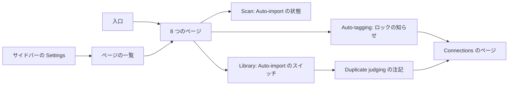
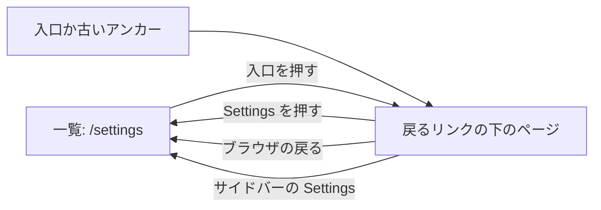
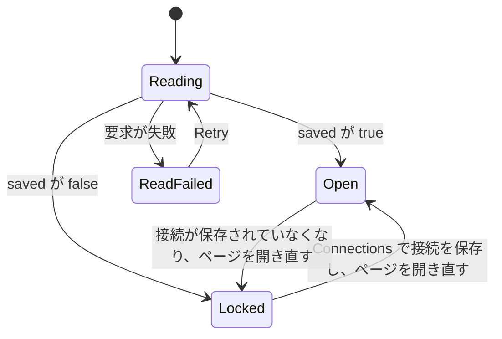

# UI 設計: 設定を 8 つのページに分ける {#ui-design-settings-split-into-eight-pages}

**機能**: [親 Issue #973](https://github.com/syudead/vv/issues/973) · [plan.md](plan.md) · [research.md R-1](research.md#r-1-each-settings-page-is-a-route-under-settings) · [R-3](research.md#r-3-the-page-list-is-a-column-beside-the-page-from-sm-and-the-whole-of-settings-below-it) · [R-5](research.md#r-5-the-auto-tagging-page-is-gated-by-the-connection-with-three-other-states) · [contracts/screen-api.md](contracts/screen-api.md)

すでに決めている出典。ここでは繰り返さずにリンクする。

| 項目 | 出典 |
| --- | --- |
| トークン、閉じたスケール、ライブラリの密度 | [design-system.md、基礎](../../docs/design-docs/design-system.md#foundations)。[`web/src/ui/tokens.css`](../../web/src/ui/tokens.css) の `@theme` の値。ここでは名前で示し、決してコピーしない |
| `SettingsPage`、`PageHeader`、`PageSection`、`FormRow`、`FactList`。状態のブロック | [patterns.md、設定ページ](../../web/registry/rules/patterns.md#settings-page)、[節](../../web/registry/rules/patterns.md#sections)、[状態](../../web/registry/rules/patterns.md#states) |
| `Button`、`Switch`、`Input`、`Alert`、`Skeleton`、`Sidebar`: それぞれ何に使うか、無効がどこでも `opacity-50` であること | [components.md](../../web/registry/rules/components.md) |
| サイドバーの現在の入口 (`isActive` 付きの `SidebarMenuButton`)、`sm` からのレール、それより下のドロワー | [components.md、Sidebar](../../web/registry/rules/components.md#sidebar)、[library-ui.md、幅のブレークポイント](../../docs/design-docs/library-ui.md#width-breakpoints-in-css-and-the-sidebar-exception) |
| スキャンの入口、`Scan library`、右下の表示 | [library-ui.md、スキャンの入口と進捗](../../docs/design-docs/library-ui.md#scan-entry-and-progress)、[024 UI 設計、Settings Scan Status](../024-import-progress/ui-design.md#settings-scan-status) |
| 変わらずに移る節: その行、状態、言葉 | [042 UI 設計、Settings: Auto-import の節](../042-folder-watch-import/ui-design.md#settings-auto-import-section)、[045 UI 設計、Settings: ComfyUI の節](../045-comfyui-thumbnails/ui-design.md#settings-comfyui-section)、[049 UI 設計、Settings: Work-info plugins の節](../049-work-info-plugins/ui-design.md#settings-work-info-plugins-section)、[054 UI 設計、Settings: Duplicate judging の節](../054-auto-dup/ui-design.md#settings-duplicate-judging-section)、[`web/src/settings`](../../web/src/settings) のコンポーネント |
| 設定の節を開く入口 | `ScanProgressIndicator`、`EmptyLibrary`、`FolderView`、`RootView` ([library-ui.md](../../docs/design-docs/library-ui.md#scan-entry-and-progress))、動画ページの `EditEntry` ([045 UI 設計、動画のページ: 編集の入口](../045-comfyui-thumbnails/ui-design.md#video-page-edit-entry))、取得ダイアログの `FindStep` ([049 UI 設計、Find](../049-work-info-plugins/ui-design.md#find)) |
| 設定の節の中のテキストリンク | Video conversion、ComfyUI、Work-info plugins、API tokens の節のガイドへのリンク (`text-primary underline underline-offset-4`) |
| 画面の文言 | [`web/src/i18n/en.ts`](../../web/src/i18n/en.ts) (`settings`)。この機能は下の言葉を加え、変える |

この機能は画面の 4 つのものを変える。1 つの Settings の画面が、横に**ページの一覧**を持つ **8 つのページ**になる (要件 1 から 4)。Auto-import の節が、Scan の監視状態と Library のスイッチに**分かれる** (要件 5)。Ollama の接続が保存されていない間は **Auto-tagging のページがロックされ**、Connections のページへの道を示す (要件 7)。**Duplicate judging のスイッチ**に、同じリンクを持つ注記が付く (要件 8)。すべての節は、[文言](#words) の表が別に言うところを除いて、行、操作、状態、言葉を保つ (要件 9)。

図は、この文書が扱う部分と、それぞれがどこへつながるかを示す。

各ページは、一覧を `nav` スロットに持つ 1 つの `SettingsPage` である。Connections へリンクするのは、ロックの知らせと注記だけである。

## この形にする理由 {#why-this-shape}

ページの一覧はページの左にある静かな列であり、タブの行でも 2 つ目のサイドバーでもない。8 つの行き先を持つ設定の領域では、デスクトップの製品と Web のコンソールがこの形に行き着いている (素の名前を並べた左の列で、現在のものが塗られる)。列は領域全体の地図として読め、ページの本体は主題のままである (`UI品質`、視覚的な階層)。タブは採用しなかった。8 つのラベルは 768px で 1 行に収まらず、[components.md、Tabs](../../web/registry/rules/components.md#tabs) はタブを 1 つの内容の表示の切り替えに使い、別の画面への移動には使わないからである。シェルの 2 つ目のサイドバーは [R-3](research.md#r-3-the-page-list-is-a-column-beside-the-page-from-sm-and-the-whole-of-settings-below-it) で採用しなかった。入口にはアイコンを付けない。8 つのアイコンは節自身のアイコンやバッジと競合し、名前は一覧として読めるほど短い。現在の入口はサイドバー自身の印 (`bg-secondary`、`text-foreground`、`font-medium`) を使うので、2 つの段のナビゲーションは「ここにいる」を同じ方法で示す。

`sm` より下では一覧が `/settings` の全体であり、各ページは戻るリンクの下に開く。スマートフォンの設定アプリが使う形である。360px のページの横に列を置くと、節が狭すぎて `FormRow` のラベルと操作が 1 行に収まらないからである。シェルのドロワーがレールの入口を保つように、一覧はどの幅でも同じ行を保つ (カードなし、山形の矢印なし)。`sm` より下では、どの入口にも現在の印を付けない。そこでは一覧は行き先のメニューであり、見る人がどこにいるかの地図ではない。

ページのタイトルは `UI品質` が求めるとおり一覧の入口の語であり、それ以外は何もない。下に説明はないので、最初の節の見出しが目が出会う 2 つ目のものになる。唯一の節がページ自身の名前を持つページは、1 行離れて同じ語を 2 回見せるので、その 2 つの節は行が扱う名詞に名前を変える。`Network` は `Local network` に、`Video conversion` は `Encoder` になる。代わりにページのタイトルを隠す案は採用しなかった。`sm` より下では戻るリンクとページの名前がひとまとまりであり、そうするとページによってタイトルの位置が違ってしまうからである。

Auto-tagging のページは 1 つの節を `Progress` と `Classifier` にこの順で分ける。そのため実行ボタンがページの最初の行になり、スイッチとしきい値はその後に来る (`UI品質`、操作の優先順位)。`Scan library` が `Scan status` にあるように、実行ボタンを `Progress` の見出しの `actions` に置く案は採用しなかった。4 語の名前を持つ 2 つのボタンは、360px では見出しの横に収まらない。

ロックはページのタイトルの下の 1 つの知らせであり、操作ごとの 1 行ではない。理由はページのすべての操作で同じであり、直し方を持つ 1 つの `Alert` は 1 回で読める (`UI品質`、最後の点)。操作は値を保ち、コンポーネントの無効の見た目をとる。そのためページは、節が欠けたページとしてではなく、「ここに設定したものがあり、ここに今それを変えられない理由がある」と読める。

1 つの画面の上の場所を指していた言葉 ("below"、"under Scan status") は、ページを名指してそこへリンクするようになる。そのため、何が欠けているかを言う行は、どこへ行けばよいかも言う。

## 文言 {#words}

| 場所 | 文言 | 注記 |
| --- | --- | --- |
| ページの一覧の入口とページのタイトル | Scan · Library · Auto-tagging · Connections · Plugins · Video conversion · Network · API | [R-1](research.md#r-1-each-settings-page-is-a-route-under-settings) のスラッグを使う `settings.pages.<slug>`。入口、`h1`、ブラウザのタイトルに 1 つの語 |
| ページの一覧の見出し | Settings | 今のページのタイトルと同じ `settings.title`。`nav` のアクセシブルな名前でもある |
| `sm` より下の戻るリンク | Settings | `ArrowLeft` の後の `settings.title` |
| 節の見出し、Network のページ | Local network | `Network` (`settings.network.heading`) を置き換える |
| 節の見出し、Video conversion のページ | Encoder | `Video conversion` (`settings.transcoding.heading`) を置き換える |
| Auto-tagging のページ、1 つ目の節の見出し | Progress | 新しい節。[Auto-tagging のページ](#auto-tagging-page) を参照 |
| Auto-tagging のページ、2 つ目の節の見出し | Classifier | 節の見出しとして `Auto-tagging` を置き換える |
| `Classifier` の説明 | Asks the classifier set in Connections which existing tags fit each video, … | `settings.autoTagging.description` の "under Ollama" を置き換える。`Connections` は `/settings/connections` へのテキストリンク |
| Duplicate judging の説明 | … the classifier set in Connections is asked only about the frames that differ. … | `settings.versionJudging.description` の "under Ollama" を置き換える。`Connections` はテキストリンク |
| 自動タグ付けがオンの間の `Progress` の説明 | Waiting 3 · Tagging 1 · Done 340 · Failed 2 | 既存の待ち行列の行 (`settings.autoTagging.queue`)。本体から見出しへ移す |
| 自動タグ付けがオフの間の `Progress` の説明 | Auto-tagging is off. | 1 文 |
| 自動タグ付けがオフの間の `Progress` の本体 | Turn on "Use auto-tagging" under Classifier to tag videos. | 1 つの `
` の行 |
| ロックの知らせのタイトル | Ollama connection needed | 既定の `Alert` の `AlertTitle` |
| ロックの知らせの本体 | Save the Ollama URL and model in Connections to use auto-tagging. | `AlertDescription`。`Connections` は `/settings/connections` へのテキストリンクなので、知らせは `AlertAction` を持たない |
| 接続の読み取りの失敗 | Couldn't read the Ollama connection: {reason} | `AlertAction` に `Retry` (`common.retry`) を持つ `destructive` の `Alert` |
| Duplicate judging の注記 | No Ollama connection is saved. Pairs with a differing part wait until you save one in Connections. | `Connections` は `/settings/connections` へのテキストリンク |
| Scan status、`Scan library` が使えないとき | Add a media folder in Library to scan. | "Add a media folder below to scan." を置き換える。`Library` は `/settings/library` へのテキストリンク |
| Auto-import の状態、メディアフォルダなし | Add a media folder in Library to watch it. | "Add a media folder below to watch it." を置き換える。`Library` はテキストリンク |
| Auto-import の状態、オフ | Off. Changes are picked up by the next scan. Turn it on in Library. | 最後の文を加える。`Library` はテキストリンク |
| Auto-import のスイッチの説明 | The watch state is on the Scan page. | `FormRow` の説明として状態の行を置き換える。`Scan` は `/settings/scan` へのテキストリンク |
| Auto-import の節の説明 | … picked up by "Scan library" on the Scan page. | `settings.autoImport.description` の "under Scan status" を置き換える。両方のページの Auto-import の節が共有する |
| Media folders の説明 | … start a scan with "Scan library" on the Scan page. … | `settings.mediaFolders.description` の "under Scan status" を置き換える |
| デスクトップアプリの外での Network のページ | This setting is in the Windows desktop app. This VVMDM isn't running as the desktop app, so there's nothing to set here. | `Local network` の見出しの下の 1 つの `
` の行 |

入口は言葉を保つ。空のルートフォルダ、サムネイルの編集の入口、取得ダイアログの `Open Settings` は引き続きリンクの行き先を言い、アドレスだけが変わる ([R-2](research.md#r-2-the-old-anchor-addresses-are-forwarded-and-the-entry-points-move-to-the-pages))。

## デザインシステムへの変更 {#changes-to-the-design-system}

`settings-page` のパターンは、その registry の項目、例のブロック、[patterns.md、設定ページ](../../web/registry/rules/patterns.md#settings-page)、[design-system.md](../../docs/design-docs/design-system.md#page-patterns) で 2 つのスロットを得る。各変更は、それを最初に使う計画の単位が、そのページより前に行う。"Give the settings page pattern a slot for a page list" の単位が、`nav` スロット、`settings-nav`、`grid-cols-settings-page`、`max-w-4xl` の幅を作る。"Lock the Auto-tagging page until the Ollama connection is saved" の単位が、`notice` スロット、下の `Alert` の規則、`aria-disabled` の見た目を作る。

| 変更 | 内容 |
| --- | --- |
| `nav` スロット | ページの一覧: 見出しを持つリンクの `nav`。`sm` からは本体の左にある `settings-nav` の幅の列で、上のバーの下に貼り付く。`sm` より下では、[ページの一覧と雛形](#page-list-and-skeleton) が言うとおり一覧だけか本体だけ。これがなければ雛形は変わらない |
| `notice` スロット | ヘッダーと節の間の 1 行で、ページ全体に当てはまる状態のためのもの: `Alert`。これがなければ何も描かない |
| `Alert` の規則 | [components.md、Alert](../../web/registry/rules/components.md#alert) は、節の中に加えて、ページのパターンの `notice` スロットでもページ全体の状態のための `Alert` を許す |
| `settings-nav` | `tokens.css` の名前付きのレイアウトの段階: 一覧の列の幅。行の `px-2` を含めて、`text-sm` の `Video conversion` が 1 行に収まる幅 |
| `grid-cols-settings-page` | `grid-cols-list-aside` と同じく名前付きのユーティリティ: `settings-nav` の幅の一覧の列、その次に本体 |
| `nav` があるときの `max-w-4xl` | `nav` を渡すと雛形の幅が `max-w-4xl` になり、本体は列の横で今とほぼ同じ幅を保つ |
| `aria-disabled` の見た目 | `Button`、`Switch`、`Input` は `aria-disabled="true"` を `disabled` と同じに描く (`opacity-50`、`not-allowed` のカーソル)。`pointer-events-none` は付けないので、ロックされた操作はフォーカスと値を保つ |

色のトークンは加えず、`web/src/theme/tokens.test.ts` の `pairs` にも何も加えない。一覧は `muted-foreground`、`foreground`、`accent`、`secondary` を使う。サイドバーがすでに組にしている役割である。アイコンは lucide の `ArrowLeft`、`Unplug`、`CircleAlert` である。

## ページの一覧と雛形 {#page-list-and-skeleton}

すべてのページは、`nav` に一覧、`header` にページのタイトル、子に節を持つ 1 つの `SettingsPage` である。一覧は `Settings` という名前の `nav` で、見出しと、[R-1](research.md#r-1-each-settings-page-is-a-route-under-settings) の順の 8 つのルーターリンクの `ul` を持ち、現在のものは `aria-current="page"` を持つ。

| 部分 | `sm` から | `sm` より下 |
| --- | --- | --- |
| 一覧の見出し | `Settings`、`text-sm font-semibold text-muted-foreground`、列の最初の行 | `Settings`、`text-xl font-semibold`: そこではこれがページのタイトルである |
| 入口の行 | `h-8`、`px-2`、`rounded-md`、`text-sm`、`text-muted-foreground`、列の全幅、左揃え。ホバーで `bg-accent text-foreground`。行の間は `gap-1` | 同じ行をページの全幅で |
| 現在の入口 | サイドバーの現在の入口と同じく `bg-secondary text-foreground font-medium` | 印なし |
| 列 | `settings-nav` の幅、本体から `gap-6`、上のバーの下に `sticky` (`top-navbar`)。そのため長い Scan のページでも見えたままである | 列ではない: `/settings` では一覧がページを埋め、本体は描かない。`/settings/<page>` では一覧を描かない |
| 戻るリンク | 描かない | `PageHeader` の `leading` に置く、`/settings` へのリンクとしての `ghost` `sm` の `Button`: `ArrowLeft`、その次に `Settings` |
| ページのタイトル | ページの名前、`h1` `text-xl`、説明なし | 同じ。戻るリンクの下 |

図は、`sm` より下で見る人が一覧とページの間をどう移るかを示す。`sm` からはすべての矢印が列を押すことであり、一覧は画面から消えない。

入口を押すとプッシュのナビゲーションになるので、ブラウザの戻るは見る人が来たページへ戻る (受け入れ条件 2)。サイドバーの `Settings` の入口は `/settings` へ行き、その下のすべてのページで現在の印が付くので、`sm` より下では一覧へ戻る 2 つ目の方法になる。

### 状態 {#states}

| 状態 | 画面が見せるもの |
| --- | --- |
| `/settings`、`sm` から | `Scan` が現在である列と、Scan のページ |
| `/settings`、`sm` より下 | 見出しの下の一覧だけ |
| `/settings/<page>` | その入口が現在である列と、そのページ。`sm` より下では、戻るリンクの下のページ |
| `/settings/<unknown>` | `/settings/scan` に置き換える。画面は Scan のページ |
| 既知のアンカーを持つ `/settings#<anchor>` | アンカー付きのページのアドレスに置き換える。今と同じく、節の見出しまでスクロールしてフォーカスする |
| ページの節の読み込みが失敗する | その節が自分の `ErrorState` を見せる。列、タイトル、ほかの節は変わらない |
| ゲスト | 今の `/settings` と同じく別の場所へ送る。どのページも描画しない |

## ページとその節 {#pages-and-their-sections}

表はページの対応表の内容であり、スラッグは [R-1](research.md#r-1-each-settings-page-is-a-route-under-settings) のものである。節は既存のコンポーネントを示した順に並べたもので、[文言](#words) が名前を変えない限り、それぞれ今と同じ `PageSection` の見出しを持つ。

| ページ | 節 (上から下へ) | アンカー |
| --- | --- | --- |
| Scan | `Scan status` (`Scan library`、バー、問題のある動画を持つ)。監視状態としての `Auto-import` ([Scan のページ](#scan-page-auto-import-state)) | `#scan-status` |
| Library | `Media folders`。スイッチとしての `Auto-import`。`Duplicate judging` ([Library のページ](#library-page)) | — |
| Auto-tagging | `Progress`。`Classifier` ([Auto-tagging のページ](#auto-tagging-page)) | — |
| Connections | `Ollama`。`ComfyUI` | `#comfyui` |
| Plugins | `Work-info plugins` | `#work-info-plugins` |
| Video conversion | `Encoder` | — |
| Network | `Local network` ([Network のページ](#network-page-outside-the-desktop-app)) | — |
| API | `API tokens` | — |

節は互いの間に `gap-8` を保ち、それぞれの設計の行、余白、状態を保つ。メディアフォルダのダイアログ (ピッカー、削除の確認) は、今とまったく同じように Library のページから開く。

## Scan のページ: Auto-import の状態 {#scan-page-auto-import-state}

`Scan status` の後に置く、`Auto-import` という見出しの `PageSection`。[文言](#words) の節の説明を持ち、操作は持たない。本体は監視状態と、あるときはその問題である。

| 行 | 内容 |
| --- | --- |
| 状態の行 | [042 UI 設計、状態](../042-folder-watch-import/ui-design.md#states) の状態の行を持つ 1 つの `
`。[文言](#words) の 2 つの行が古い形を置き換える。`text-sm`。Off には `text-muted-foreground`、残りは `foreground` |
| 問題の行 | `watch.state` が `limited` の間だけ: 今と同じ `warning` の `Alert` |

| 状態 | 節が見せるもの |
| --- | --- |
| 読み込み中 | 状態の行に 1 行の高さの `Skeleton` |
| 読み込みの失敗 | 今と同じく "Couldn't load the auto-import settings: {reason}" と `Retry` を持つ `ErrorState` |
| Off | "Off. Changes are picked up by the next scan. Turn it on in Library." |
| On、メディアフォルダなし | "Add a media folder in Library to watch it." |
| Starting、Active、Limited | 今と同じ状態の行。Limited は問題の行を加える |

節は、042 が挙げるイベント (マウント、ウィンドウのフォーカス、最新のスキャンの終了) で状態を読み直す。メディアフォルダの変更による契機は、フォルダが別のページで変わるので、ここではもう当てはまらない。変更の後に Scan のページを開くと、節はもう一度マウントされる。

## Library のページ {#library-page}

まず `Media folders` で、見出しの actions に `Add folder` を持ち、行、ダイアログ、スキャンのロックの行は今と同じである。次に 1 つの `FormRow` としての `Auto-import`: ラベル `Pick up changes as they happen`、Scan のページへのリンクを持つ [文言](#words) の説明、`Switch`。保存中の行と保存の失敗の `Alert` は 042 と同じである。行の説明は両方の状態で同じ文なので、押しても行の高さは変わらない。

`Duplicate judging` は、1 つの行を加えた 054 の節である。

| 行 | 内容 |
| --- | --- |
| スイッチの行 | 054 と同じ: `Judge possible duplicates automatically`、その説明、`Switch` |
| 接続の注記 | 接続の読み取りが `saved: false` と答えた間だけ: 1 つの `
` の行、`text-sm text-muted-foreground`。[文言](#words) の注記と、`/settings/connections` へのテキストリンクを持つ |

[R-5](research.md#r-5-the-auto-tagging-page-is-gated-by-the-connection-with-three-other-states) が言うとおり、スイッチはどの状態でも押せる。読み込み中か失敗した接続の読み取りは行を加えないので、読み取りが `false` と答えるまで節は 1 行の高さである。

## Auto-tagging のページ {#auto-tagging-page}

2 つの `PageSection`。`Progress` が先に来る。その見出しの説明は待ち行列の行であり、本体は実行ボタンと最後の失敗を持つ。`Classifier` は今の節の行を今の順で持つ: 2 つのスイッチ、2 つのしきい値、そして `Save` と `Test judging` とその状態の行を持つ行。

| `Progress` の行 | 内容 |
| --- | --- |
| 実行の行 | `Tag videos not yet tagged` (`outline` `sm`)、次に `Tag all videos again` (`ghost` `sm`)。`sm` より下では折り返す |
| 最後の失敗 | 待ち行列が失敗を報告している間だけ: 今と同じ `warning` の `Alert` |

自動タグ付けがオフの間 (保存された `enabled` が `false`)、節はオフの説明と [文言](#words) の 1 つの `
` の行を持って同じ場所に残り、実行の行は持たない。そのため、スイッチをオフで保存しても `Classifier` の節が跳ね上がらない (受け入れ条件 6)。

ロックは [R-5](research.md#r-5-the-auto-tagging-page-is-gated-by-the-connection-with-three-other-states) に従う。ページは Ollama の接続を読み、`saved` が `false` の間、両方の節のすべての操作は `aria-disabled` であり、値を見せたまま `opacity-50` で描かれる。スイッチは位置を、入力は数値を保ち、自動タグ付けがオンのときは実行の行も描かれたままである。`notice` スロットはロックの知らせを持つ。`Unplug`、タイトル、`Connections` のリンクを持つ本体からなる既定の `Alert` である。節自身の読み込み中のスケルトンと `ErrorState` は変わらない。

### 状態 {#states-1}

図は、接続の読み取りから決まるページの状態と、その間を移すものを示す。節自身の読み込み中と保存中の状態は変わらない。

| 状態 | ページが見せるもの |
| --- | --- |
| Reading | 節の読み込み中のスケルトン。知らせなし |
| Open | 知らせなし。操作は今と同じ |
| Locked | タイトルと `Progress` の間のロックの知らせ。両方の節のすべてのスイッチ、入力、ボタンが `aria-disabled` で `opacity-50`、値は見える。押しても打鍵しても何も変わらず、何も送らない |
| Read failed | 読み取りの失敗の行と `Retry` を持つ `destructive` の `Alert` を `notice` スロットに置く。操作は Open と同じ |

## デスクトップアプリの外での Network のページ {#network-page-outside-the-desktop-app}

ネットワークの読み取りが `404` を答えるところでは、ページは `Local network` という見出しの `PageSection` を、今と同じ節の説明と 1 つの `
` の行 ([文言](#words) の行、`text-sm text-muted-foreground`) とともに見せる。スイッチも、`Alert` も、状態のブロックもない。何も失敗しておらず、何も空ではない。デスクトップアプリでは、節は新しい見出しの下の今の節である。

## 入口 {#entry-points}

| 入口 | 行き先 | 着いたときに見る人が見るもの |
| --- | --- | --- |
| 右下の表示。空のライブラリと空のフォルダの `Scan library` | `/settings/scan#scan-status` | `Scan status` が一番上にある Scan のページ。`sm` より下では戻るリンクの下 |
| 空のルートフォルダの `Open Settings` | `/settings/library` | `Media folders` が先頭の Library のページ |
| サムネイルの編集の入口の `Open Settings` | `/settings/connections#comfyui` | `ComfyUI` までスクロールし、その見出しにフォーカスした Connections のページ |
| 取得ダイアログの `Open Settings` | `/settings/plugins#work-info-plugins` | `Work-info plugins` が一番上にある Plugins のページ |
| ロックの知らせ、Duplicate judging の注記 | `/settings/connections` | `Ollama` が先頭の Connections のページ |
| サイドバーの `Settings` | `/settings` | `sm` からは Scan のページ。それより下では一覧 |

## レスポンシブの振る舞い {#responsive-behaviour}

ブレークポイントは Tailwind の既定のものだけで、CSS で適用する ([library-ui.md、幅のブレークポイント](../../docs/design-docs/library-ui.md#width-breakpoints-in-css-and-the-sidebar-exception))。`sm` は 640px である。判定する幅は 360px、768px、1280px である。

| 幅 | レイアウト |
| --- | --- |
| 1280px | レール、次に中央に置いた `max-w-4xl` のページ: 左に `settings-nav` の幅の列、その横に本体。すべての `FormRow` はラベルが左、操作が右 |
| 768px | 同じ 2 つの列で、本体は狭くなる。すべてのページの `FormRow` は引き続きラベルが左、操作が右に並ぶ。実行の行と `Save` の行はボタンを 1 行に保つ |
| 360px | 上のバーにドロワーの ☰。`/settings` は一覧だけ、`/settings/<page>` は戻るリンクの下のページ。`FormRow` は縦に積む。実行の行は 2 行に折り返す。ロックの知らせの本体はタイトルの下で折り返す |

## レビューの基準 {#review-criteria}

実際の画面を見て判定する ([library-ui.md、レイアウトは機械ではなく人が確かめる](../../docs/design-docs/library-ui.md#layout-verified-by-people-not-machines))。上の幅で、8 つのページのすべてで、Ollama の接続を保存する前と後の Settings で、メディアフォルダがあるときとないときで、デスクトップアプリの外で判定する。「存在する」だけでは基準を満たさない (Q-4)。

1. **視覚的な階層**: `sm` からのすべてのページで、目はページのタイトル → 最初の節の見出し → その行と進み、列はそれらの後に見つかる。列の見出しはページのタイトルより小さく静かであり、現在のもの以外のどの入口にも塗りがない。現在の入口は、名前を読まずに列を一目見るだけで見つかる (`UI品質`、視覚的な階層)。
2. **情報の密度**: 1280px で、Library、Connections、Plugins、Video conversion、Network、API はスクロールせずにすべての行を見せる。Scan と Auto-tagging は最初の節の全体と 2 つ目の節の見出しを見せる。[ページとその節](#pages-and-their-sections) の表が与えていない節を見せるページはない (`UI品質`、密度。受け入れ条件 1)。
3. **余白のリズム**: すべてのページの節は `gap-8` 離れて並び、今の画面と同じカード、行の余白、区切り線を持つ。列の行は `h-8` で `gap-1` であり、列と本体の間隔はすべてのページで同じである。ページを移っても、ページのタイトルと最初の節の見出しは同じ縦の位置にとどまる。
4. **文字組み**: ページのタイトルは入口と同じ語で、`text-xl` である。自分の名前を 2 回続けて見せるページはない。列の入口と戻るリンクは `text-sm` であり、列の中に現在の入口の `font-medium` より太いものはない。
5. **操作の優先順位**: Scan では `Scan library` がページの最初のボタンである。Auto-tagging では 2 つの実行ボタンがすべてのスイッチと入力より上にある。Library では `Add folder` がスイッチより上にある。列の入口は決してボタンに見えない (枠線がなく、現在のもの以外に塗りがない)。
6. **狭い幅**: 360px で、`/settings` は現在の印なしで親指で読める一覧であり、入口を押すと `Settings` と書かれた戻るリンクの下にページが開き、戻るリンクは一覧へ戻り、ブラウザの戻るも同じことをする (要件 3、受け入れ条件 2 と 9)。
7. **ロックされたページ**: Ollama の接続が保存されていないとき、Auto-tagging のページはタイトルの下に 1 つの知らせを見せ、すべての操作を値が読めるまま半分の不透明度で見せる。スイッチを押しても、しきい値に入力しても、`Save`、`Test judging`、実行ボタンを押しても、画面の何も変わらない。知らせの `Connections` のリンクは `Ollama` に着く。そこで接続を保存して戻ると、知らせは消え、操作は完全な不透明度になる (受け入れ条件 7、`UI品質`、最後の点)。
8. **接続の読み取りの失敗**: ページは `Retry` を持つ読み取りの失敗の `Alert` を見せ、操作は完全な不透明度である。ページの何もロックされていない。
9. **Duplicate judging**: 接続が保存されていないとき、スイッチは切り替わって保存され、その下の注記は Connections へリンクする。接続が保存されているとき、節は 1 行の高さである (受け入れ条件 8)。
10. **Scan と Library**: メディアフォルダがないとき、`Scan library` は無効で、その行は Library へリンクする。そこでフォルダを加えて Scan を開くと、再読み込みなしでボタンが有効になる (受け入れ条件 5)。Library で押して Scan に戻った後、Scan の Auto-import の状態と Library のスイッチは同じオン/オフを見せる。
11. **入口**: 右下の表示、2 つの `Open Settings` のリンク、空のライブラリの `Scan library` は [入口](#entry-points) のページに着き、名指した節が一番上にあり、アンカーが与えられているところではその見出しにフォーカスがある (受け入れ条件 3 と 4)。
12. **要件を満たさない例** (`UI品質`): 列がアイコンを見せるか、ツールバーのように見える。`sm` より下で現在の入口に印が付く。ページがタイトルの下に説明を持つ。`Network` か `Video conversion` がタイトルと見出しの両方に現れる。実行ボタンがしきい値の下にある。ロックされた操作が隠れているか、押せるように見える。ロックの理由が行ごとに繰り返される。デスクトップアプリの外で Network のページが空である。

## アクセシビリティ {#accessibility}

親 Issue はスクリーンリーダーやコントラストの設計を求めていないので、054 と同じく名前だけを決める。

- 一覧はアクセシブルな名前が `Settings` の `nav` である。現在の入口は `aria-current="page"` を持つ。`h1` はページの名前であり、`sm` より下の `/settings` では一覧の見出しが目に見えるタイトルである。
- 戻るリンクはボタンではなくリンクであり、名前は `Settings` である。
- ロックされた操作は `aria-disabled="true"` であり、フォーカスの順序を保つ。ロックの知らせはタイトルの後の最初の要素なので、操作より先に読まれる。読み取りの失敗の `Alert` はコンポーネント自身のロールを持つ。
- 状態の行と注記の中のテキストリンクは、ページの名前を文字とするルーターリンクである。
